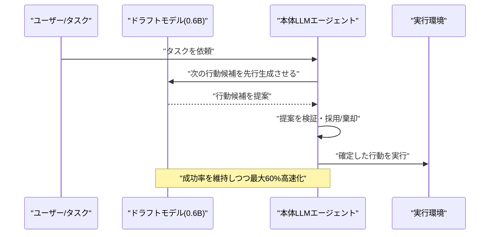
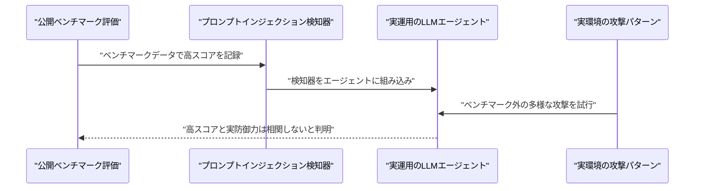
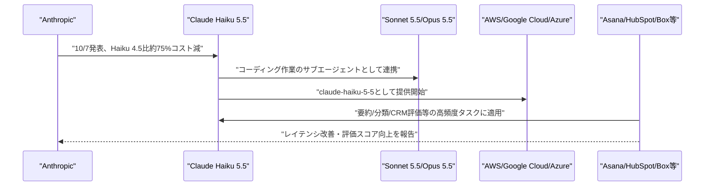

# LLM・AI Agent 最新情報レポート Vol.160
<!-- x-summary: Anthropicが低コスト小型モデル「Claude Haiku 5.5」を発表、旧Haiku比約4分の1のコストで性能大幅向上 -->

**作成日**: 2026年10月7日(JST)
**対象期間**: 2026年10月6日〜10月7日(Vol.159との差分)

---

## 目次

1. [Google Cloudアップデート](#1-google-cloudアップデート)
2. [Microsoft Azure AIアップデート](#2-microsoft-azure-aiアップデート)
3. [LLM Model / AI Agentアーキテクチャ・研究](#3-llm-model--ai-agentアーキテクチャ研究)
   - [3.1 論文、投機的デコーディングでAIエージェントの実行を高速化する「LEAP」](#31-論文投機的デコーディングでaiエージェントの実行を高速化するleap)
   - [3.2 論文、ベンチマーク高得点が実運用の防御力を保証しないプロンプトインジェクション検知器の問題](#32-論文ベンチマーク高得点が実運用の防御力を保証しないプロンプトインジェクション検知器の問題)
4. [公式ブログ・論文のリサーチ・要約](#4-公式ブログ論文のリサーチ要約)
   - [4.1 Anthropic、低コスト小型モデル「Claude Haiku 5.5」を発表](#41-anthropic低コスト小型モデルclaude-haiku-55を発表)
5. [AI Agent搭載SaaS製品情報](#5-ai-agent搭載saas製品情報)
6. [LLM/AI Agentセキュリティインシデント](#6-llmai-agentセキュリティインシデント)
7. [参考リンク](#7-参考リンク)

---

## 1. Google Cloudアップデート

新情報なし。対象期間(10月6日〜10月7日)中、Vertex AI、BigQuery AI関数、Gemini Enterprise、Agent Development Kit (ADK) について、既報(Vol.159以前)と重複しない新機能・GA化・新サービスの発表は確認されなかった。

---

## 2. Microsoft Azure AIアップデート

新情報なし。対象期間(10月6日〜10月7日)中、Azure AI Foundry(Microsoft Foundry)、Copilot Studio、Azure OpenAI Service、Foundry Agent Serviceについて、既報と重複しない新機能・新サービスの発表は確認されなかった。

---

## 3. LLM Model / AI Agentアーキテクチャ・研究

### 3.1 論文、投機的デコーディングでAIエージェントの実行を高速化する「LEAP」

論文「LEAP: Learning Efficient Action Proposals For LLM Agents」(arXiv:2610.02670、10月2日提出)は、LLMエージェントの行動選択(ロールアウト)を投機的デコーディング(speculative decoding)によって高速化する手法を提案している。0.6Bパラメータという小規模な「ドラフトモデル」に次の行動候補を先行提案させ、本体モデルがそれを検証・採用することで、タスク成功率を大きく落とさずに実行時間を最大60%短縮できるという。エージェントの応答速度はユーザー体験や実行コストに直結するため、推論品質を維持したまま高速化する手法は実運用上の意義が大きい。[[1]](#ref-1)

### 3.2 論文、ベンチマーク高得点が実運用の防御力を保証しないプロンプトインジェクション検知器の問題

論文「Passing the Test You Trained On: Re-evaluating Prompt-Injection Detectors for LLM Agents」(arXiv:2610.03448)は、公開ベンチマークで高スコアを記録しているプロンプトインジェクション検知器の多くが、実際にLLMエージェントへ組み込んで動作させた際の防御力とは相関しないことを指摘している。検知器がベンチマークのデータ分布に過度に最適化され、実環境での攻撃パターンの多様性に対応できていない可能性を示し、検知器単体のスコアではなく、エージェントに組み込んだ状態での評価が必要だと論じている。[[2]](#ref-2)

---

## 4. 公式ブログ・論文のリサーチ・要約

Anthropicから1件の公式発表が確認された。Google・OpenAIについては、対象期間(10月6日〜10月7日)中、既報と重複しない新規の公式ブログ記事・論文・プレスリリースは確認されなかった(新情報なし)。

### 4.1 Anthropic、低コスト小型モデル「Claude Haiku 5.5」を発表

Anthropicは10月7日、小型モデルの最新版「Claude Haiku 5.5」を発表した。同社は「これまでで最も安価・高速かつ高性能な小型モデル」と位置付けており、要約、会話の圧縮、データベース照会、分類といった高頻度・低コストのタスクに加え、Opus 5.5・Sonnet 5.5と組み合わせたコーディング用サブエージェントとしての利用を想定している。Haikuクラスとして初めて、コストと性能をトレードオフできる「Effort」設定(Low/Med/High/Xhigh/Max)にも対応した。

ベンチマークでは前モデルのHaiku 4.5から全項目で大幅に向上しており、例えばOSWorld 2.1(オフラインサブセット)は15.7%→72.4%、Terminal-Bench 4.0は0.0%→39.2%、Humanity's Last Exam(ツール使用)は18.7%→57.4%に上昇した。一方でAnthropicは、複雑なエージェント型コーディングではSonnet 5.5・Opus 5.5が依然として優れた選択だとしている。価格は入力$0.10/output $0.50(10万トークンまで、100万トークンあたり)で、Haiku 4.5比で平均約75%、10万トークン以下の処理では約90%の値下げとなる。Asana、HubSpot、AlphaSense、Box、Cognitionなど複数の顧客からの導入事例も公表されており、レイテンシ改善や評価スコア向上が報告されている。Claude Platform上でモデルID「claude-haiku-5-5」として、またAWS・Google Cloud・Microsoft Azure経由でも利用可能になっている。同時にSonnet 5.5のキャッシュ読み取り価格も50%引き下げられた。[[3]](#ref-3)

---

## 5. AI Agent搭載SaaS製品情報

新情報なし。対象期間(10月6日〜10月7日)中、既報と重複しない新規のAI Agent搭載SaaS製品・機能の発表は確認されなかった。

---

## 6. LLM/AI Agentセキュリティインシデント

新情報なし。対象期間(10月6日〜10月7日)中、既報と重複しない新規のLLM/AI Agent関連セキュリティインシデントの報告は確認されなかった。

---

## 7. 参考リンク

**[1]** [LEAP: Learning Efficient Action Proposals For LLM Agents | arXiv](https://arxiv.org/abs/2610.02670)

**[2]** [Passing the Test You Trained On: Re-evaluating Prompt-Injection Detectors for LLM Agents | arXiv](https://arxiv.org/abs/2610.03448)

**[3]** [Introducing Claude Haiku 5.5 | Anthropic](https://www.anthropic.com/claude-haiku-5-5)
