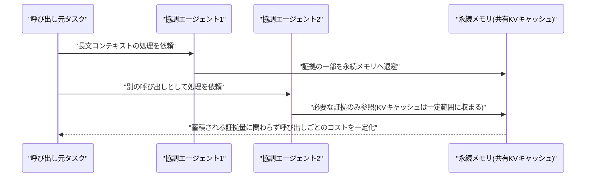
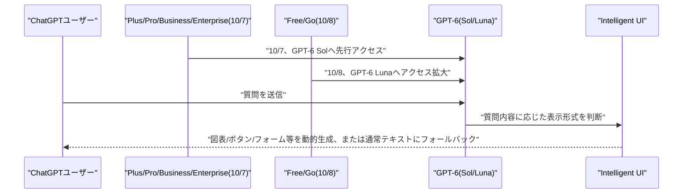
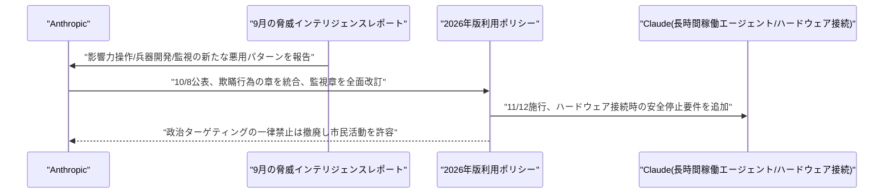
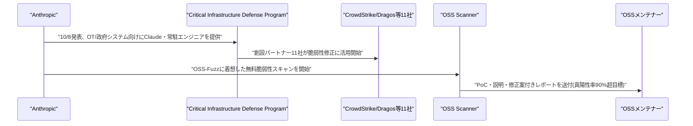
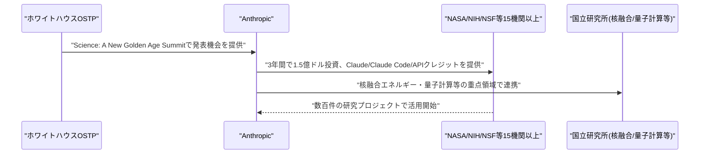
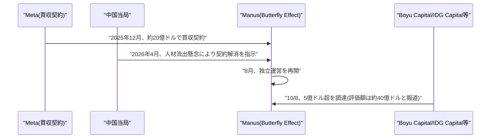

# LLM・AI Agent 最新情報レポート Vol.161
<!-- x-summary: OpenAI、ChatGPT全ユーザー向けにGPT-6と新UI「Intelligent UI」の展開を開始 -->

**作成日**: 2026年10月8日(JST)
**対象期間**: 2026年10月7日〜10月8日(Vol.160との差分)

---

## 目次

1. [Google Cloudアップデート](#1-google-cloudアップデート)
2. [Microsoft Azure AIアップデート](#2-microsoft-azure-aiアップデート)
3. [LLM Model / AI Agentアーキテクチャ・研究](#3-llm-model--ai-agentアーキテクチャ研究)
   - [3.1 論文、マルチエージェントLLM推論の永続メモリ、コストと効果を定量化](#31-論文マルチエージェントllm推論の永続メモリコストと効果を定量化)
4. [公式ブログ・論文のリサーチ・要約](#4-公式ブログ論文のリサーチ要約)
   - [4.1 OpenAI、ChatGPT全ユーザーへGPT-6展開、回答形式を動的に変える「Intelligent UI」も導入](#41-openaichatgpt全ユーザーへgpt-6展開回答形式を動的に変えるintelligent-uiも導入)
   - [4.2 Anthropic、2026年版利用ポリシーを改定、長時間稼働エージェントや新たな悪用パターンに対応](#42-anthropic2026年版利用ポリシーを改定長時間稼働エージェントや新たな悪用パターンに対応)
   - [4.3 Anthropic、防御側支援の長期プログラム「Anthropic Cyber Mission」を発表](#43-anthropic防御側支援の長期プログラムanthropic-cyber-missionを発表)
   - [4.4 Anthropic、政府の科学研究支援「Genesis Mission」に1.5億ドルを3年間投資](#44-anthropic政府の科学研究支援genesis-missionに15億ドルを3年間投資)
5. [AI Agent搭載SaaS製品情報](#5-ai-agent搭載saas製品情報)
   - [5.1 Manus運営元Butterfly Effect、Meta破談後初の5億ドル超調達](#51-manus運営元butterfly-effectmeta破談後初の5億ドル超調達)
6. [LLM/AI Agentセキュリティインシデント](#6-llmai-agentセキュリティインシデント)
7. [参考リンク](#7-参考リンク)

---

## 1. Google Cloudアップデート

新情報なし。対象期間(10月7日〜10月8日)中、Vertex AI、BigQuery AI関数、Gemini Enterprise、Agent Development Kit (ADK) について、既報(Vol.160以前)と重複しない新機能・GA化・新サービスの発表は確認されなかった。

---

## 2. Microsoft Azure AIアップデート

新情報なし。対象期間(10月7日〜10月8日)中、Azure AI Foundry(Microsoft Foundry)、Copilot Studio、Azure OpenAI Service、Foundry Agent Serviceについて、既報と重複しない新機能・新サービスの発表は確認されなかった。

---

## 3. LLM Model / AI Agentアーキテクチャ・研究

### 3.1 論文、マルチエージェントLLM推論の永続メモリ、コストと効果を定量化

論文「Persistent Memory in Multi-Agent LLM Inference: What It Costs, What It Buys, and When You Can Tell」(arXiv:2610.07782、10月6日提出、NeurIPS 2026 併設ワークショップ「Machine Learning for Systems」にポスター採択)は、長文コンテキストの推論を複数の協調エージェントに分解することで、1回の呼び出しあたりのKVキャッシュ使用量を、蓄積される証拠の総量とは無関係に一定の範囲へ抑えられることを示している。論文はさらに、永続メモリ機構の有無を比較する「アブレーション実験」が満たすべき条件を整理し、どのモデルを使っているかに関する知識を前提とせずに、メモリ機構が機能不全を起こしていることを検出する手法も提示している。マルチエージェント構成におけるメモリのコストと効果を定量的に切り分けた点で、長期運用されるエージェントシステムの設計指針として参照価値が高い。[[1]](#ref-1)

---

## 4. 公式ブログ・論文のリサーチ・要約

OpenAIとAnthropicから複数の公式発表が確認された。Googleについては、対象期間(10月7日〜10月8日)中、既報と重複しない新規の公式ブログ記事・論文・プレスリリースは確認されなかった(新情報なし)。

### 4.1 OpenAI、ChatGPT全ユーザーへGPT-6展開、回答形式を動的に変える「Intelligent UI」も導入

OpenAIは10月7日〜8日にかけて、週間利用者が12億人超とされるChatGPTの全ユーザーに「GPT-6」を展開すると発表した。10月7日にPlus・Pro・Business・Enterprise向け有料プランへ上位モデル「GPT-6 Sol」の提供を開始し、10月8日には無料・Goプランのユーザーにも、日常会話向けに調整した「GPT-6 Luna」を展開した。モデル選択メニューの「Latest」はGPT-6に置き換わり、旧モデルの「GPT-5.6 Sol」は別オプションとして残される。Work機能やCodexの背後にあるモデルは今回の対象外で、Enterprise向けの提供状況は管理者設定に依存する。

同時に導入された新機能「Intelligent UI」は、質問の内容に応じて回答の見せ方をテキスト・図表・ボタン・フォーム・チャートなどから動的に選び、必要であれば生成の途中段階から視覚要素を段階的に表示する。例として、貯蓄計算ツールや、入力を変えて試せる説明、地図上に旅程を表示する機能などが挙げられている。単純なテキストで十分な場合は通常の文章表示にフォールバックする。ただしPro思考レベルは依然GPT-6 Astraで動作しIntelligent UIには対応せず、macOS・Windowsの旧デスクトップアプリでも利用できないなど、対応範囲は段階的に拡大中としている。[[2]](#ref-2)

### 4.2 Anthropic、2026年版利用ポリシーを改定、長時間稼働エージェントや新たな悪用パターンに対応

Anthropicは10月8日、年次改定となる「2026年版利用ポリシー」を公開した。施行日は11月12日。改定の背景として、Claudeがより長時間・自律的に稼働するようになったことに加え、9月に公表した脅威インテリジェンスレポートで、影響力操作・兵器開発・監視といった新たな悪用パターンを確認したことを挙げている。大半の変更は既存ルールの明確化であり、新規制限の追加は限定的だとしている。

主な変更点は、選挙・詐欺・プライバシー・偽情報の各章に分散していた欺瞞行為に関するルールを新設の「欺瞞的キャンペーン・不正な活動の禁止」章へ統合したこと、選挙章を「民主的プロセスの妨害禁止」に改称し有権者への欺瞞や選挙妨害に焦点を絞る一方で、合法的な市民活動を妨げていた政治ターゲティングへの一律禁止を撤廃したこと、兵器開発禁止の対象に誘導・制御ソフトウェアや自律型車両の武装化を明記したこと、監視・法執行の章を全面的に書き換え非同意の追跡や逮捕・起訴対象の決定への利用を禁止したこと、そしてClaudeが自律的に物理的動作を行うハードウェアに接続される場合、オペレーターが機器を監視・停止できることと切断時に安全状態を保持することを新たに要件化したこと(同社の「モデル・ハードウェア標準」に基づく)などである。あわせて、正当な目的のないClaudeへの持続的な虐待的言動の禁止や、サポート対象地域ポリシーの運用明確化も盛り込まれた。[[3]](#ref-3)

### 4.3 Anthropic、防御側支援の長期プログラム「Anthropic Cyber Mission」を発表

Anthropicは10月8日、フロンティアAIの悪用によるサイバー攻撃リスクに対し、防御側を長期的に支援する新プログラム「Anthropic Cyber Mission」を発表した。同社は、既存の「Project Glasswing」で多数の脆弱性を発見できたものの、検証・優先順位付け・修正までを含めたリスク低減には至らなかったとし、まず「重要インフラ」と「オープンソースソフトウェア」の2領域から着手する。

重要インフラ分野では、電力網・水道・交通などの運用技術(OT)やガバメント系システムを対象に、フロンティアClaudeモデル・常駐エンジニア・脅威リサーチを提供する「Critical Infrastructure Defense Program(CIDP)」を開始し、Accenture、Booz Allen、CrowdStrike、Deloitte、Dragos、Hitachi、Insane Cyber、Nozomi Networks、Palo Alto Networks、PwC、Rockwell Automationの11社が創設パートナーとして参加する。オープンソース分野では、GoogleのOSS-Fuzzに触発された無料のオプトイン型自動脆弱性スキャン「OSS Scanner」を提供し、真陽性率90%超を目標とする。Python Software Foundation、Alpha-Omega、OpenSSF(Linux Foundation経由)、Apache Software Foundationへの資金提供や、8月発表の「Defender Advantage Fund(0xDAF)」によるサービス無償化の支援も行う。なお「Project Glasswing」は拡大版の「Cyber Verification Program」に統合された。Anthropicは、短期的には攻撃側が優位な状況が続くとしつつ、2年程度でAIが防御側に有利に働くようになると見通している。[[4]](#ref-4)

### 4.4 Anthropic、政府の科学研究支援「Genesis Mission」に1.5億ドルを3年間投資

Anthropicは10月8日、ホワイトハウス科学技術政策局(OSTP)主催の「Science: A New Golden Age Summit」にて、米政府の科学研究推進策「Genesis Mission」に向けて今後3年間で1.5億ドルを投資すると発表した。NASA、国立衛生研究所(NIH)、全米科学財団(NSF)を含む15以上の参加機関にClaudeを提供し、数百件の研究プロジェクトにClaude・Claude Code・APIクレジットを提供するほか、核融合エネルギーや量子コンピューティングといった重点領域で各機関・国立研究所と連携し、トレーニングや技術サポートも行う。同社は2025年12月に発表した米エネルギー省(DOE)との「Genesis Mission」提携の延長として、今回の投資を位置付けている。あわせて、研究向けツール群を統合したAIワークベンチ「Claude Science」や、学術研究者向けの無償・割引Claudeアカウント1万席の提供、研究機器を安全に操作させるための仕様「モデル・ハードウェア標準」など、既存の科学研究支援策との連携も強調した。[[5]](#ref-5)

---

## 5. AI Agent搭載SaaS製品情報

### 5.1 Manus運営元Butterfly Effect、Meta破談後初の5億ドル超調達

AIエージェント「Manus」を開発する中国スタートアップButterfly Effectは10月8日、Boyu CapitalとIDG Capitalが主導し、既存株主のTencent、HSG、ZhenFundも参加する5億ドル超の資金調達を発表した。同社が公式に調達ラウンドを実施するのは、Metaによる約20億ドルでの買収契約が、AI人材・技術の国外流出を懸念する中国当局の指示により4月に解消されて以降、初めてとなる。Manusは8月に独立運営を再開しており、契約解消に伴いユーザーデータの一部削除も求められたとされる。調達後の企業価値は公式発表されていないが、事前報道では約40億ドル(直近ラウンドからおよそ8倍)とされており、これが事実であれば中国のAIエージェント企業として最高水準の評価額となる。同社は香港での上場も検討していると報じられている。[[6]](#ref-6)

---

## 6. LLM/AI Agentセキュリティインシデント

新情報なし。対象期間(10月7日〜10月8日)中、既報と重複しない新規のLLM/AI Agent関連セキュリティインシデントの報告は確認されなかった。

---

## 7. 参考リンク

**[1]** [Persistent Memory in Multi-Agent LLM Inference: What It Costs, What It Buys, and When You Can Tell | arXiv](https://arxiv.org/abs/2610.07782)

**[2]** [GPT-6 and Intelligent UI for everyone | OpenAI](https://openai.com/index/gpt-6-for-everyone/)

**[3]** [2026 Usage Policy update | Anthropic](https://www.anthropic.com/news/2026-usage-policy-update)

**[4]** [Introducing the Anthropic Cyber Mission | Anthropic](https://www.anthropic.com/news/anthropic-cyber-mission)

**[5]** [Building on our commitment to American scientific discovery | Anthropic](https://www.anthropic.com/news/genesis-mission-commitment)

**[6]** [China's Manus raises over $500M in first funding round since split with Meta | TechCrunch](https://techcrunch.com/2026/10/08/chinas-manus-raises-over-500m-in-first-funding-round-since-split-with-meta/)
