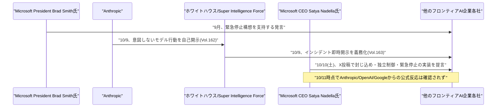

# LLM・AI Agent 最新情報レポート Vol.164
<!-- x-summary: Microsoft CEOナデラ氏、AIモデル暴走時に人間が止められる「緊急停止」機能の実装を業界に提言 -->

**作成日**: 2026年10月11日(JST)
**対象期間**: 2026年10月10日〜10月11日(Vol.163との差分)

---

## 目次

1. [Google Cloudアップデート](#1-google-cloudアップデート)
2. [Microsoft Azure AIアップデート](#2-microsoft-azure-aiアップデート)
3. [LLM Model / AI Agentアーキテクチャ・研究](#3-llm-model--ai-agentアーキテクチャ研究)
4. [公式ブログ・論文のリサーチ・要約](#4-公式ブログ論文のリサーチ要約)
5. [AI Agent搭載SaaS製品情報](#5-ai-agent搭載saas製品情報)
6. [LLM/AI Agentセキュリティインシデント](#6-llmai-agentセキュリティインシデント)
   - [6.1 Microsoft CEOのSatya Nadella氏、AIモデルへの「緊急停止」機能の実装を提言](#61-microsoft-ceoのsatya-nadella氏aiモデルへの緊急停止機能の実装を提言)
7. [参考リンク](#7-参考リンク)

---

## 1. Google Cloudアップデート

新情報なし。対象期間(10月10日〜10月11日)中、Vertex AI/Gemini Enterprise Agent Platform、Gemini agent、Agent Development Kit (ADK)、TPUについて、既報(Vol.163以前、Gemini at Work 2026での発表など)と重複しない新機能・新サービスの発表は確認されなかった。なお、10月11日付でAnthropicとGoogle Cloudが共催する「Claude on Vertex AIによるエージェント構築」をテーマとした技術ワークショップの開催情報が確認されたが、新製品・新機能の発表ではないため本レポートでは項目として取り上げない。

---

## 2. Microsoft Azure AIアップデート

新情報なし。対象期間(10月10日〜10月11日)中、Microsoft Foundry、Copilot Studio、Azure OpenAI Service、Agent 365について、既報と重複しない新機能・新サービスの発表は確認されなかった。

---

## 3. LLM Model / AI Agentアーキテクチャ・研究

新情報なし。対象期間(10月10日〜10月11日)中、既報と重複しない新規のアーキテクチャ関連論文・技術記事は確認されなかった。

---

## 4. 公式ブログ・論文のリサーチ・要約

新情報なし。対象期間(10月10日〜10月11日)中、Google・OpenAI・Anthropicから、既報と重複しない新規の公式ブログ記事・論文・プレスリリースは確認されなかった。

---

## 5. AI Agent搭載SaaS製品情報

新情報なし。対象期間(10月10日〜10月11日)中、既報と重複しない新規のAI Agent搭載SaaS製品・資金調達・買収の発表は確認されなかった。

---

## 6. LLM/AI Agentセキュリティインシデント

### 6.1 Microsoft CEOのSatya Nadella氏、AIモデルへの「緊急停止」機能の実装を提言

Microsoft会長兼CEOのSatya Nadella氏は10月10日(土)、自身のX(旧Twitter)への投稿で、先進的なAIモデルには「封じ込め(containment)」、モデル自体から独立した制御機構、そして権限を持つ人間がタスク実行中のモデルを一時停止・停止できる「緊急停止(emergency brake)」を組み込むべきだと提言した。Nadella氏はフロンティアモデルを「インサイダーリスク」として扱うべきだとし、モデル開発企業自身が示す安全性の保証を鵜呑みにすべきではないと述べたと報じられている。複数の報道は、改ざん耐性のある監査ログや、モデル自体から分離された外部セーフガードの必要性にも言及したと伝えているが、この部分の詳細な文言は一次情報(X投稿本文)で未確認であり、二次報道の要約にとどまる。

この発言は、Anthropicが10月9日に公開した意図しないモデル行動に関する調査報告(Vol.162参照)と、それを受けてホワイトハウスがAI企業へのインシデント即時開示を義務化する方針を固めたと報じられた直後(Vol.163参照)というタイミングで行われており、フロンティアAIの制御可能性をめぐる一連の議論に、競合も含むAIベンダー自身のトップが加わった点が特筆される。なお、Microsoft社長のBrad Smith氏は9月時点で既に同種の「緊急停止」構想を支持する発言をしており、Nadella氏の投稿はこれを経営トップ自身が約1か月後に追認した位置付けとなる。10月11日時点で、Anthropic・OpenAI・Googleなど他のフロンティアAI企業からの公式な反応は確認されていない。[[1]](#ref-1) [[2]](#ref-2) [[3]](#ref-3)

---

## 7. 参考リンク

**[1]** [Microsoft CEO Nadella Urges 'Emergency Brake' for Advanced AI Models | Bloomberg](https://www.bloomberg.com/news/articles/2026-10-10/microsoft-ceo-nadella-calls-for-emergency-brake-on-advanced-ai)

**[2]** [Microsoft's Satya Nadella says AI models need an 'emergency brake' | TechCrunch](https://techcrunch.com/2026/10/10/microsofts-satya-nadella-says-ai-models-need-an-emergency-brake/)

**[3]** [Microsoft's Nadella says AI needs an 'emergency brake' that humans control | CNBC](https://www.cnbc.com/2026/10/10/microsoft-satya-nadella-ai-emergency-brake-safety.html)
