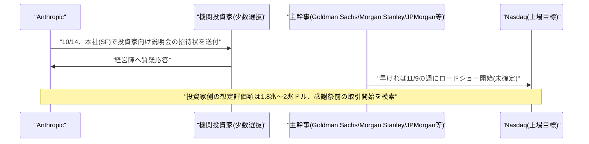

# LLM・AI Agent 最新情報レポート Vol.165
<!-- x-summary: Anthropic、10月14日に投資家向け説明会を開催、評価額最大2兆ドルで感謝祭前の上場目指すと報道 -->

**作成日**: 2026年10月12日(JST)
**対象期間**: 2026年10月11日〜10月12日(Vol.164との差分)

---

## 目次

1. [Google Cloudアップデート](#1-google-cloudアップデート)
2. [Microsoft Azure AIアップデート](#2-microsoft-azure-aiアップデート)
3. [LLM Model / AI Agentアーキテクチャ・研究](#3-llm-model--ai-agentアーキテクチャ研究)
4. [公式ブログ・論文のリサーチ・要約](#4-公式ブログ論文のリサーチ要約)
5. [AI Agent搭載SaaS製品情報](#5-ai-agent搭載saas製品情報)
6. [LLM/AI Agentセキュリティインシデント](#6-llmai-agentセキュリティインシデント)
7. [その他特筆すべき情報](#7-その他特筆すべき情報)
   - [7.1 Anthropic、10月14日に投資家向け説明会を開催と報道、感謝祭前のIPOを模索](#71-anthropic10月14日に投資家向け説明会を開催と報道感謝祭前のipoを模索)
8. [参考リンク](#8-参考リンク)

---

## 1. Google Cloudアップデート

新情報なし。対象期間(10月11日〜10月12日)中、Vertex AI/Gemini Enterprise Agent Platform、Gemini agent、Agent Development Kit (ADK)、TPU、Antigravityについて、既報と重複しない新機能・新サービスの発表は確認されなかった。

---

## 2. Microsoft Azure AIアップデート

新情報なし。対象期間(10月11日〜10月12日)中、Microsoft Foundry、Copilot Studio、Azure OpenAI Service、Agent 365、Work IQについて、既報と重複しない新機能・新サービスの発表は確認されなかった。

---

## 3. LLM Model / AI Agentアーキテクチャ・研究

新情報なし。対象期間(10月11日〜10月12日)中、既報と重複しない新規のアーキテクチャ関連論文・技術記事は確認されなかった。

---

## 4. 公式ブログ・論文のリサーチ・要約

新情報なし。対象期間(10月11日〜10月12日)中、Google・OpenAI・Anthropicの公式ニュースページを確認したが、既報と重複しない新規の公式ブログ記事・論文・プレスリリースは確認されなかった。

---

## 5. AI Agent搭載SaaS製品情報

新情報なし。対象期間(10月11日〜10月12日)中、既報(Manus運営元Butterfly Effectの資金調達、Nous Researchの調達など)と重複しない新規のAI Agent搭載SaaS製品・資金調達・買収の発表は確認されなかった。

---

## 6. LLM/AI Agentセキュリティインシデント

新情報なし。対象期間(10月11日〜10月12日)中、新規のセキュリティインシデントの報告は確認されなかった。なお、Anthropicの自己調査報告(意図しないモデル行動、Vol.162参照)やホワイトハウスによる開示義務化(Vol.163参照)、Microsoft CEOの「緊急停止」提言(Vol.164参照)について、複数メディアが続報・解説記事を出しているが、いずれも既報の事実関係の再構成にとどまり、事実関係上の新規性は確認されなかった。

---

## 7. その他特筆すべき情報

### 7.1 Anthropic、10月14日に投資家向け説明会を開催と報道、感謝祭前のIPOを模索

Bloombergは10月、複数の関係者の話として、AnthropicがIPO(新規株式公開)に向けて、10月14日にサンフランシスコの本社で投資家向け説明会を開催する予定だと報じた。少数の機関投資家を対象に、経営陣への質疑応答の機会を設けるという。報道によれば、招待状は直近になって送付されたばかりとしている。

同報道では、正式なIPOロードショー(投資家向け説明行脚)は早ければ11月9日の週に開始され、感謝祭(11月26日)前の取引開始を目指す可能性があるとされている。投資家側が見込む企業価値は1.8兆〜2兆ドルとされ、これが実現すればSpaceXの調達規模を上回る、史上最大規模のIPOになるとの指摘もある。Anthropicは5月時点のシリーズHで約9650億ドルの評価額を得ており、今回報じられた水準はそこからおよそ倍増する計算となる。10月5日時点の既報(Vol.158参照)では上場時期を「早ければ11月」とする程度の情報であったのに対し、今回は投資家向け説明会の具体日程・開催場所まで報じられた点が新しい。なお、関係者はIPOの詳細が変更される可能性があるとしており、Anthropicの広報担当者はコメントを拒否したと報じられている。[[1]](#ref-1) [[2]](#ref-2)

---

## 8. 参考リンク

**[1]** [Anthropic Said to Set October 14 Pre-IPO Investor Day, Targeting November Listing | iTiger News (Bloomberg)](https://www.itiger.com/news/1134201499)

**[2]** [Anthropic plans pre-IPO investor day on October 14 | CryptoBriefing](https://cryptobriefing.com/anthropic-pre-ipo-investor-day-october-14/)
