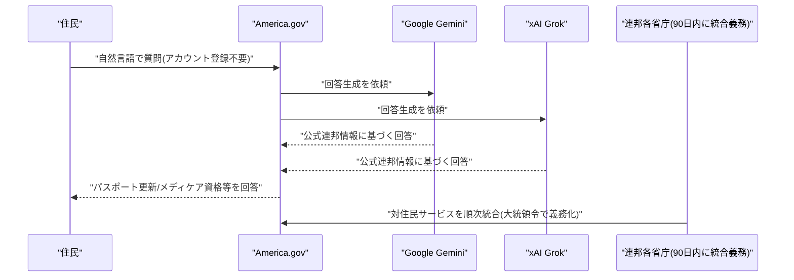

# LLM・AI Agent 最新情報レポート Vol.166
<!-- x-summary: 米政府、Gemini・Grok搭載のAIポータル「America.gov」を稼働、パスポート申請等の窓口を一本化 -->

**作成日**: 2026年10月13日(JST)
**対象期間**: 2026年10月12日〜10月13日(Vol.165との差分)。あわせて、調査の過程で既報に含まれていなかったことが判明した9月29日〜10月8日発表分の未報告事項を補足掲載。

---

## 目次

1. [Google Cloudアップデート](#1-google-cloudアップデート)
2. [Microsoft Azure AIアップデート](#2-microsoft-azure-aiアップデート)
3. [LLM Model / AI Agentアーキテクチャ・研究](#3-llm-model--ai-agentアーキテクチャ研究)
4. [公式ブログ・論文のリサーチ・要約](#4-公式ブログ論文のリサーチ要約)
5. [AI Agent搭載SaaS製品情報](#5-ai-agent搭載saas製品情報)
   - [5.1 SAP、人材スキル分析のTechWolfを買収、SuccessFactorsにエージェント向け「グラウンディング層」を統合](#51-sap人材スキル分析のtechwolfを買収successfactorsにエージェント向けグラウンディング層を統合)
   - [5.2 Atlassian、人間とAIエージェントの協働基盤「Agentic Multiplayer Protocol(AMP)」を発表](#52-atlassian人間とaiエージェントの協働基盤agentic-multiplayer-protocolampを発表)
   - [5.3 Cisco、WebexにClaudeを統合する計画と新エージェント基盤「Dialog」を発表](#53-ciscowebexにclaudeを統合する計画と新エージェント基盤dialogを発表)
6. [LLM/AI Agentセキュリティインシデント](#6-llmai-agentセキュリティインシデント)
7. [その他特筆すべき情報](#7-その他特筆すべき情報)
   - [7.1 米政府、Gemini・Grok搭載のAIポータル「America.gov」を稼働、行政サービスの窓口を一本化](#71-米政府geminigrok搭載のaiポータルamericagovを稼働行政サービスの窓口を一本化)
8. [参考リンク](#8-参考リンク)

---

## 1. Google Cloudアップデート

新情報なし。対象期間(10月12日〜10月13日)中、Vertex AI/Gemini Enterprise Agent Platform、Gemini agent、Agent Development Kit (ADK)、TPU、Antigravityについて、既報と重複しない新機能・新サービスの発表は確認されなかった。

---

## 2. Microsoft Azure AIアップデート

新情報なし。対象期間(10月12日〜10月13日)中、Microsoft Foundry、Copilot Studio、Azure OpenAI Service、Agent 365、Work IQについて、既報と重複しない新機能・新サービスの発表は確認されなかった。

---

## 3. LLM Model / AI Agentアーキテクチャ・研究

新情報なし。対象期間(10月12日〜10月13日)中、既報と重複しない新規のアーキテクチャ関連論文・技術記事は確認されなかった。

---

## 4. 公式ブログ・論文のリサーチ・要約

新情報なし。対象期間(10月12日〜10月13日)中、Google・OpenAI・Anthropicの公式ニュースページを確認したが、既報(Claude Haiku 5.5、2026年版利用ポリシー改定、Anthropic Cyber Mission等)と重複しない新規の公式ブログ記事・論文・プレスリリースは確認されなかった。Anthropicの公式ニュースページの最新投稿は10月8日時点のものにとどまっている。

---

## 5. AI Agent搭載SaaS製品情報

### 5.1 SAP、人材スキル分析のTechWolfを買収、SuccessFactorsにエージェント向け「グラウンディング層」を統合

SAPは10月6日、ベルギー・ゲント発のAI人材分析スタートアップTechWolfを買収することで合意したと発表した。買収額は非公開だが、TechWolfのCEOによれば同国のベンチャー出資企業としては史上最大規模の売却になるという。クロージングは2026年第4四半期を予定し、通常の規制審査などを条件とする。

TechWolfは、社内の業務データからリアルタイムにスキル情報を推定する「コンテキストグラフ」技術とAIモデル、応用AI研究チームをSAPに提供する。SAP幹部は、TechWolfを「業務・スキル計画・タレントマネジメントに関するエージェントへの問い合わせを裏付けるグラウンディング層」と位置づけており、買収後はSuccessFactorsやJoule(SAPのAIアシスタント)のスキル追跡・人材配置機能の中核として統合される計画である。TechWolfはSAP傘下入り後も独立会社として運営を続け、HSBCやAMD、PayPalなど既存の非SAP顧客への提供は継続するとしている。本件は10月12日時点でVol.165までの既報に含まれておらず、今回新たに確認された。[[1]](#ref-1)

### 5.2 Atlassian、人間とAIエージェントの協働基盤「Agentic Multiplayer Protocol(AMP)」を発表

Atlassianは10月6日〜8日にアムステルダムで開催した「Team '26 Europe」で、人間とAIエージェントが同じワークスペース上で協働するための新しい仕組み「Agentic Multiplayer Protocol(AMP)」を発表した。AMPは、エージェントごとに人間とは異なる属性を持つ「非人間アイデンティティ」を割り当て、アクセス範囲をスコープ化し、顧客ごとの「Teamwork Graph」に行動の根拠を紐づけ、実行履歴を人間がレビューできる形で記録する枠組みである。Atlassianの担当者はAMPについて「厳密な意味での技術標準ではなく、技術とインターフェースパターンの集合体」と説明しており、外部ベンダーが独立して実装できる公開仕様ではない点には留意が必要である。

同時に、更新版のAtlassian MCP Server、エージェントの行動記録・識別機能「Agent Sessions」、画面・音声の録画からJira課題やConfluence仕様書を自動生成する「Record for Agent」、AIコード変更の帰属を可視化する機能なども発表された。非人間アイデンティティ関連の一部機能は「近日提供」とされ、全容はこれから順次展開される。本件もVol.165までの既報に含まれておらず、今回新たに確認された。[[2]](#ref-2) [[3]](#ref-3)

### 5.3 Cisco、WebexにClaudeを統合する計画と新エージェント基盤「Dialog」を発表

Ciscoは10月7日、テキサス州オースティンで開催した「WebexOne 2026」で、コラボレーションツールWebexにAnthropicのClaudeを統合する計画を発表した。Claude Managed Agentsを基盤に、Webexを離れずに社内データを分析したりコンテンツを生成したりできるようにするとしており、提供開始時期は「近日(Soon)」とされている。

併せて、カスタマーエクスペリエンス向けのエージェント実行基盤「Dialog」をプレビュー公開し、2027年第1四半期にベータ提供を予定していることも明らかにした。その他、会議室デバイス向けOS「RoomOS 27」、Webexの情報をOpenAIの常時稼働エージェント「Dots」に連携するMCP統合、Splunkと連携するエージェント監視機能(AI Agent 360、12月提供予定)なども発表されている。Ciscoは発表内容の多くが開発中であり、提供時期は変更の可能性があるとしている。本件もVol.165までの既報に含まれておらず、今回新たに確認された。[[4]](#ref-4)

---

## 6. LLM/AI Agentセキュリティインシデント

新情報なし。対象期間(10月12日〜10月13日)中、新規のセキュリティインシデントの報告は確認されなかった。

---

## 7. その他特筆すべき情報

### 7.1 米政府、Gemini・Grok搭載のAIポータル「America.gov」を稼働、行政サービスの窓口を一本化

トランプ米大統領は9月29日、連邦政府の行政サービスを一本化するAIポータル「America.gov」の設立を定める大統領令に署名し、同サイトの稼働を発表した。運営は総務庁(GSA)傘下の「National Design Studio」が担い、米国初のチーフ・デザイン・オフィサーに就任したAirbnb共同創業者のジョー・ゲビア氏が主導している。大統領令は、全省庁に対し90日以内に自らの対住民向けサービスをAmerica.govへ統合するよう指示しており、政権側は既存の連邦政府系ウェブサイト約2万9000件分の情報を集約したとしている。

利用者はアカウント登録なしにチャット形式で「メディケアの資格確認」「パスポートの更新」「就職支援」などを自然言語で質問でき、回答は公式の連邦政府情報のみに基づいて生成される。ホワイトハウス関係者によれば、基盤となる生成AIモデルはGoogleのGeminiとxAIのGrokの2つで、Googleは技術パートナーとして関与を認めている。両モデルの役割分担の詳細は公開されていない。なお同日、政権はもう一件、行政内で「人工知能(Artificial Intelligence)」という用語を「スーパーインテリジェンス(Super Intelligence)」に置き換える大統領令にも署名している。本件はVol.165までの既報に含まれておらず、今回新たに確認された。[[5]](#ref-5) [[6]](#ref-6) [[7]](#ref-7)

---

## 8. 参考リンク

**[1]** [SAP to Acquire TechWolf, Giving Enterprises Evidence-Based View of Work in the Age of AI | SAP News](https://news.sap.com/?p=247980)

**[2]** [Atlassian launches AMP to tackle AI code visibility, attribution | InfoWorld](https://www.infoworld.com/article/4231567/atlassian-launches-amp-to-tackle-ai-code-visibility-attribution.html)

**[3]** [Atlassian AMP: How can enterprises run and govern agentic AI teams? | Techzine](https://www.techzine.eu/blogs/devops/144826/atlassian-amp-how-can-enterprises-run-and-govern-agentic-ai-teams/)

**[4]** [Cisco Unveils New Agentic Collaboration Experiences | Cisco Newsroom](https://newsroom.cisco.com/c/r/newsroom/en/us/a/y2026/m10/cisco-unveils-new-agentic-collaboration-experiences.html)

**[5]** [Trump launches America.gov with AI chatbots at its core | The Register](https://www.theregister.com/public-sector/2026/09/29/trump-launches-americagov-with-ai-chatbots-at-its-core/5299907)

**[6]** [White House launches AI-powered 'America.gov' digital front door | Government Executive](https://www.govexec.com/technology/2026/09/white-house-launches-ai-powered-americagov-digital-front-door/416323/)

**[7]** [Fact Sheet: President Donald J. Trump Inaugurates The Era of Super Intelligence | The White House](https://www.whitehouse.gov/fact-sheets/2026/09/fact-sheet-president-donald-j-trump-inaugurates-the-era-of-super-intelligence/)
