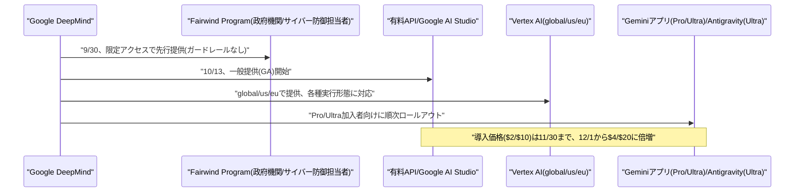
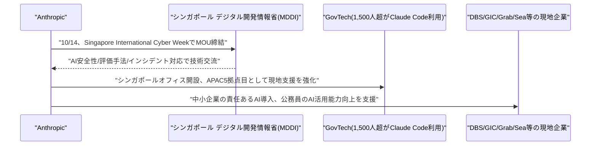
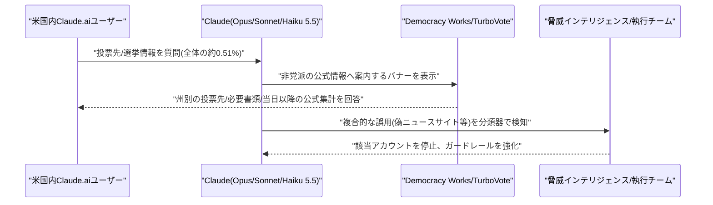
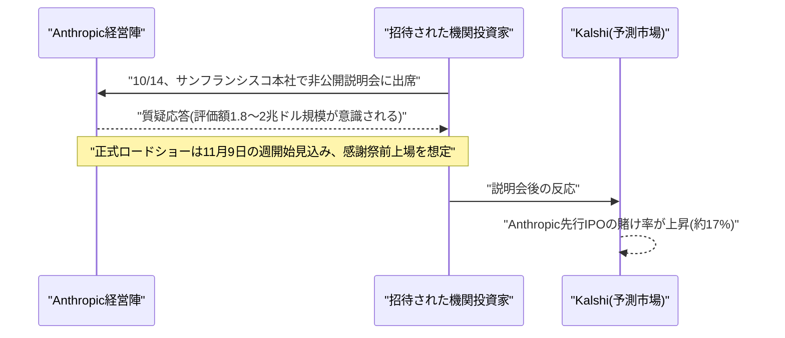

# LLM・AI Agent 最新情報レポート Vol.167
<!-- x-summary: Google、次世代モデル「Gemini 4 Argon」を一般提供開始、API・Vertex AIで利用可能に -->

**作成日**: 2026年10月14日(JST)
**対象期間**: 2026年10月13日〜10月14日(Vol.166との差分)

---

## 目次

1. [Google Cloudアップデート](#1-google-cloudアップデート)
   - [1.1 Google、「Gemini 4 Argon」を一般提供開始、API・Vertex AI・Geminiアプリ等で利用可能に](#11-google-gemini-4-argonを一般提供開始apivertex-aigeminiアプリ等で利用可能に)
2. [Microsoft Azure AIアップデート](#2-microsoft-azure-aiアップデート)
3. [LLM Model / AI Agentアーキテクチャ・研究](#3-llm-model--ai-agentアーキテクチャ研究)
4. [公式ブログ・論文のリサーチ・要約](#4-公式ブログ論文のリサーチ要約)
   - [4.1 Anthropic、シンガポールに新オフィス開設、同国政府(MDDI)とAI安全性に関するMOUを締結](#41-anthropicシンガポールに新オフィス開設同国政府mddiとai安全性に関するmouを締結)
   - [4.2 Anthropic、2026年米中間選挙に向けた取り組みを公表、Claudeの政治的公平性評価や選挙誤用対策を詳述](#42-anthropic2026年米中間選挙に向けた取り組みを公表claudeの政治的公平性評価や選挙誤用対策を詳述)
5. [AI Agent搭載SaaS製品情報](#5-ai-agent搭載saas製品情報)
6. [LLM/AI Agentセキュリティインシデント](#6-llmai-agentセキュリティインシデント)
7. [その他特筆すべき情報](#7-その他特筆すべき情報)
   - [7.1 Anthropic、IPO前の投資家向け説明会を10月14日に開催、評価額は最大2兆ドル規模との報道](#71-anthropicipo前の投資家向け説明会を10月14日に開催評価額は最大2兆ドル規模との報道)
8. [参考リンク](#8-参考リンク)

---

## 1. Google Cloudアップデート

### 1.1 Google、「Gemini 4 Argon」を一般提供開始、API・Vertex AI・Geminiアプリ等で利用可能に

Googleは10月13日、9月30日に発表した次世代フロンティアモデル「Gemini 4 Argon」(Vol.155既報)を一般提供(GA)した。9月末時点では政府機関・Google Cloud顧客・サイバーセキュリティパートナー650以上が参加する限定プログラム「Fairwind Program」経由でのみ提供されていたが、約2週間を経て、有料API、Google AI Studio、Vertex AI(global/us/euの各エンドポイントで提供、バッチ・フレックス・優先度別・プロビジョンドスループットの各形態に対応)、Gemini アプリ(Google AI Pro/Ultra加入者向け)、Antigravity(Ultra加入者向け)という形で広く開放された。

価格は導入記念として入力100万トークンあたり2ドル・出力同10ドル(Vertex AIのリージョンエンドポイントでは一律10%増の2.20ドル/11.00ドル)とし、キャッシュ入力には95%の割引を適用する。この導入価格は2026年11月30日までの期間限定であり、12月1日からは正規料金として入力4ドル・出力20ドルへ倍増することが明示されている。Fairwind Program参加時点で示されていたハルシネーション率の低さ(AA-Omniscience評価で15%、同格モデル中最低水準)などの性能面の訴求は維持されたまま、今回のGAで対象が開発者・企業・一般ユーザーへと大きく広がった形である。[[1]](#ref-1) [[2]](#ref-2)

---

## 2. Microsoft Azure AIアップデート

新情報なし。対象期間(10月13日〜10月14日)中、Microsoft Foundry、Copilot Studio、Azure OpenAI Service、Agent 365について、既報と重複しない新機能・新サービスの発表は確認されなかった。

---

## 3. LLM Model / AI Agentアーキテクチャ・研究

新情報なし。対象期間(10月13日〜10月14日)中、既報と重複しない新規のアーキテクチャ関連論文・技術記事は確認されなかった。

---

## 4. 公式ブログ・論文のリサーチ・要約

### 4.1 Anthropicシンガポールに新オフィス開設、同国政府(MDDI)とAI安全性に関するMOUを締結

Anthropicは10月14日、東京・ベンガルール・ソウル・シドニーに続くアジア太平洋地域5拠点目となるシンガポールオフィスの開設を発表するとともに、シンガポール・サイバーウィークの場でシンガポールのデジタル開発情報省(MDDI)とのMOU(覚書)を締結したと公表した。署名はMDDIのKai Fong Chng事務次官とAnthropic共同創業者のBen Mann氏が行い、Josephine Teo大臣とAnthropicのAPAC政策責任者Michael Sellitto氏が立会人を務めた。MOUの対象領域は、AIの安全性・セキュリティ・モデル評価、AI活用とその影響に関する研究、官民双方での責任あるAI導入の3分野である。

具体的な活動として、シンガポールのAI安全・保証関連機関との評価手法やインシデント対応に関する技術交流、中小企業への責任あるAI導入支援、公務員のAI活用能力の向上支援、Anthropic Economic Indexなどの研究・データ共有、シンガポールのAIルール策定への政策・技術面での協力が挙げられている。背景として、シンガポールはAnthropicにとって人口比で見たClaude.ai利用率が121か国中2位(人口規模から予測される水準の約6倍)という主要市場であり、政府系技術機関GovTechでは1,500人超のエンジニア・技術職員がClaude Codeを政府システムの近代化に活用しているほか、サイバーセキュリティ庁(CSA)が国家サイバー防衛強化への活用を検討中、DBSが開発・生産性向上に、政府系ファンドGICが投資・コーポレート部門全体に展開中、配車大手Grabの営業支援AI「BriX」(Claude基盤)が四半期あたり約4万時間の削減効果を上げているなど、既に幅広い導入事例があるとしている。なお、金融機関などの規制業種向けには、Amazon Bedrock経由でのリージョン内推論(データのシンガポール国内処理)も提供されている。[[3]](#ref-3)

### 4.2 Anthropic、2026年米中間選挙に向けた取り組みを公表、Claudeの政治的公平性評価や選挙誤用対策を詳述

Anthropicは10月14日、2026年米中間選挙に向けた準備状況をまとめたブログ記事を公開した。2026年9月21日〜27日の米国内Claude.ai会話から25万件を無作為抽出して分析した結果、政治・公共政策・社会問題に関する会話は全体の約5.75%、選挙・投票に特化した会話は約0.51%、「誰に投票すべきか」を尋ねる会話はわずか約0.01%、選挙健全性ポリシーに違反する会話は約0.002%にとどまったとしている。同社は投票日が近づくにつれてこうした会話が増加すると予測している。

ユーザー支援策としては、有権者登録・投票所・選挙日程に関する質問に対し非営利団体Democracy Works運営の「TurboVote」への案内バナーを表示する既存機能に加え、今月後半からDemocracy Worksの公式データを用いて州別の投票先・必要な身分証明などをClaude.ai上で直接回答できるようにし、投票日当日以降は公式集計結果も表示するとしている。政治的公平性については、Claude Opus 5.5・Sonnet 5.5・Haiku 5.5が同社の政治的公平性評価で99%のスコアを記録し「これまでで最も公平」とする一方、外部団体(Vanderbilt大学のFuture of Free Speech、Foundation for American Innovation、Collective Intelligence Project)による検証では、拒否率は低いものの要求されていない注釈や反対意見を一部回答に挿入してしまう偏りが指摘されており、Yes/No形式の質問への対応や注釈付与基準の改善を今後の課題としている。

誤用対策では、Institute for Strategic DialogueおよびMcCain Instituteと連携し米国・イスラエル・ブラジルで安全対策の実地テストを実施した結果、単発の悪質な依頼は確実に拒否できる一方、個々には無害に見えるタスクに分割された複合的な攻撃を見逃す場合があったことが判明したため、偽アカウント・偽ニュースサイトの作成や金銭目的の選挙詐欺、国家主体による選挙干渉を検知する新たな分類器を導入し、選挙インフラ・選挙運動向けのサイバー防御も強化した。実際の悪用事例として、ロシア・イラン・北朝鮮寄りの論調で米中間選挙報道を行う偽ニュースサイトにClaudeが使われていたケースや、広告収益目当てに米国の読者向け捏造ニュースを作成していたケースが見つかり、該当アカウントを停止したとしている。[[4]](#ref-4)

---

## 5. AI Agent搭載SaaS製品情報

新情報なし。対象期間(10月13日〜10月14日)中、信頼できる複数情報源で裏付けられる新規のAI Agent搭載SaaS製品の発表は確認されなかった。

---

## 6. LLM/AI Agentセキュリティインシデント

新情報なし。対象期間(10月13日〜10月14日)中、新規のセキュリティインシデントの報告は確認されなかった。

---

## 7. その他特筆すべき情報

### 7.1 Anthropic、IPO前の投資家向け説明会を10月14日に開催、評価額は最大2兆ドル規模との報道

複数の報道によると、Anthropicは10月14日、米サンフランシスコの本社で新規株式公開(IPO)に向けた非公開の投資家向け説明会(インベスターデー)を開催した。Bloombergは10月1日時点で、同社が機関投資家向けにIPO準備としての面談を計画していると報じており、招待は直近になって送付されたとしている。説明会では経営幹部が機関投資家からの質疑に応じる形式がとられ、投資家の間では1.8兆〜2兆ドル規模の評価額が意識されているとされる。これは2026年5月のシリーズHで付けた965億ドルの評価額のおよそ2倍にあたる。

報道によれば、正式なIPOロードショー(投資家向け説明行脚)は11月9日の週に始まる可能性があり、感謝祭(11月第4木曜)前の上場を視野に入れているという。この投資家説明会を受けて、予測市場Kalshiでは「OpenAIとAnthropicのどちらが先にIPOするか」の賭け率が約12ポイント変動し、Anthropic先行の確率が約17%まで上昇したとの報道もある(OpenAIは上場時期を2027年としているとされる)。なお、これらの内容はいずれも関係者情報に基づく報道であり、Anthropicからの公式発表ではない点に留意が必要である。[[5]](#ref-5) [[6]](#ref-6) [[7]](#ref-7)

---

## 8. 参考リンク

**[1]** [Google makes Gemini 4 Argon broadly available with limited-time low API pricing of $2/$10 per 1M token | VentureBeat](https://venturebeat.com/technology/google-makes-gemini-4-argon-broadly-available-with-limited-time-low-api-pricing-of-2-10-per-1m-token)

**[2]** [Google Opens Gemini 4 Argon at $2/$10 Pricing | Technology.org](https://www.technology.org/2026/10/14/gemini-4-argon-generally-available-pricing-december/)

**[3]** [Anthropic opens Singapore office and signs MOU with the Government of Singapore | Anthropic](https://www.anthropic.com/news/singapore-office-opening)

**[4]** [Preparing for the 2026 US midterms | Anthropic](https://www.anthropic.com/news/2026-us-midterms)

**[5]** [Anthropic Is Said to Plan Pre-IPO Investor Day as Listing Nears | Bloomberg](https://www.bloomberg.com/news/articles/2026-10-01/anthropic-is-said-to-plan-pre-ipo-investor-day-as-listing-nears)

**[6]** [Anthropic Holds Investor Day Oct 14 Ahead of IPO | Briefs](https://www.briefs.co/news/anthropic-sets-investor-meetings-on-oct-14-ahead-of-possible/)

**[7]** [OpenAI or Anthropic IPO First? Kalshi Odds Jump 12 Points as Anthropic Courts Investors | Tech Insider](https://tech-insider.org/openai-anthropic-ipo-first-kalshi-odds-swing/)
