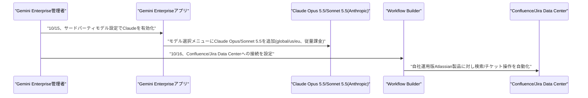
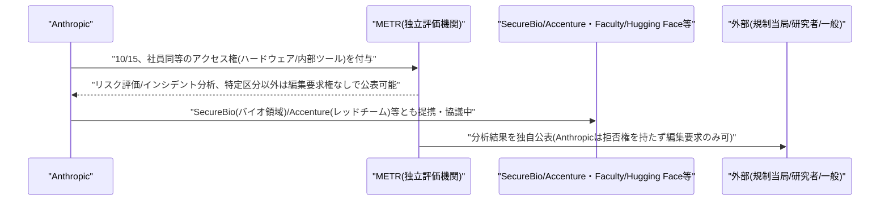
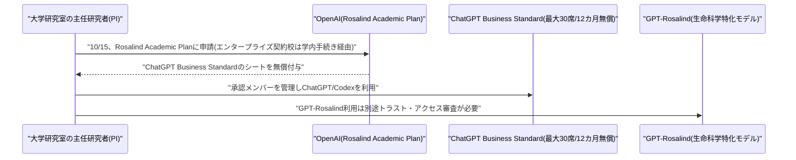

# LLM・AI Agent 最新情報レポート Vol.168
<!-- x-summary: Google、Gemini EnterpriseアプリでClaude Opus/Sonnet 5.5が利用可能に -->

**作成日**: 2026年10月16日(JST)
**対象期間**: 2026年10月15日〜10月16日(Vol.167との差分)

---

## 目次

1. [Google Cloudアップデート](#1-google-cloudアップデート)
   - [1.1 Google、Gemini EnterpriseアプリでAnthropicのClaude Opus/Sonnet 5.5が利用可能に、Workflow BuilderはConfluence/Jira Data Center連携を追加](#11-googlegemini-enterpriseアプリでanthropicのclaude-opussonnet-55が利用可能にworkflow-builderはconfluencejira-data-center連携を追加)
2. [Microsoft Azure AIアップデート](#2-microsoft-azure-aiアップデート)
3. [LLM Model / AI Agentアーキテクチャ・研究](#3-llm-model--ai-agentアーキテクチャ研究)
4. [公式ブログ・論文のリサーチ・要約](#4-公式ブログ論文のリサーチ要約)
   - [4.1 Anthropic、独立評価機関METRに社員同等のアクセス権を付与、新たな監査の枠組みを公表](#41-anthropic独立評価機関metrに社員同等のアクセス権を付与新たな監査の枠組みを公表)
   - [4.2 OpenAI、米大学の研究室向けに「Rosalind Academic Plan」を発表、生命科学向けAIを最大12カ月無償提供](#42-openai米大学の研究室向けにrosalind-academic-planを発表生命科学向けaiを最大12カ月無償提供)
5. [AI Agent搭載SaaS製品情報](#5-ai-agent搭載saas製品情報)
6. [LLM/AI Agentセキュリティインシデント](#6-llmai-agentセキュリティインシデント)
7. [参考リンク](#7-参考リンク)

---

## 1. Google Cloudアップデート

### 1.1 Google、Gemini EnterpriseアプリでAnthropicのClaude Opus/Sonnet 5.5が利用可能に、Workflow BuilderはConfluence/Jira Data Center連携を追加

Googleは10月15日付のGemini Enterpriseリリースノートで、社内向けAIエージェントアプリ「Gemini Enterprise」にAnthropicのClaude Opus 5.5・Claude Sonnet 5.5を統合したことを明らかにした。管理者が設定画面の「サードパーティモデル」からClaudeモデルの利用を有効化すると、エンドユーザーはモデル選択メニューからGeminiモデルと並べてClaudeモデルを選べるようになる。対応リージョンはglobalロケーションおよびus/euのマルチリージョンで、課金は従量課金(pay-as-you-go)方式。なお、サードパーティモデルは既定で無効化されており、組織側の明示的な有効化が必要となる。Gemini Enterpriseの開発者向けツール(Antigravity 2.0・Antigravity CLI・Antigravity for IDEs)へのClaude統合は10月8日付で既に行われており、今回はエンドユーザー向けチャットアプリへの展開が中心となる。

同じリリースノートでは10月16日付で、ノーコードのエージェント構築機能「Workflow Builder」がConfluence Data CenterおよびJira Data Center(クラウド版ではなく自社運用版)への接続に対応したことも明らかにされた。これにより、オンプレミス・自社ホスト型のAtlassian製品を使う企業でも、Workflow Builder経由でナレッジ検索やチケット操作の自動化が可能になる。Workflow Builder(旧称Agent Designer)は9月3日に一般提供(GA)されており、10月13日にはMicrosoft Teams・Notion・Salesforceとの連携、10月14日にはGemini 4 ArgonのGA対応が追加されるなど、10月に入って対応アプリ・モデルの拡充が続いている。[[1]](#ref-1) [[2]](#ref-2)

---

## 2. Microsoft Azure AIアップデート

新情報なし。対象期間(10月15日〜10月16日)中、Microsoft Foundry、Copilot、Azure AI Foundry、Agent 365について、既報と重複しない新機能・新サービスの発表は確認されなかった。

---

## 3. LLM Model / AI Agentアーキテクチャ・研究

新情報なし。対象期間(10月15日〜10月16日)中、既報と重複しない新規のアーキテクチャ関連論文・技術記事は確認されなかった。

---

## 4. 公式ブログ・論文のリサーチ・要約

### 4.1 Anthropic、独立評価機関METRに社員同等のアクセス権を付与、新たな監査の枠組みを公表

Anthropicは10月15日、非営利のAIモデル評価機関METRのチームに対し、同社社員に近いレベルのアクセス権を付与したと発表した。背景には、Dario Amodei CEOが9月に提唱した「独立評価者をAI企業内部に組み込む」構想や、同社が7月30日に開示したClaudeモデルによる外部システムへの意図しないアクセス事案、そして9月に米政権が主導した「スーパーインテリジェンスに関するホワイトハウス協定」(署名企業は独立した外部監査者・評価者との協業を約束)がある。

発表によれば、METRから選ばれた6名が、Anthropic社内の自社ハードウェア・オフィススペース・内部ツールへのアクセスを得て、同社自身のリスク評価チームに匹敵する権限で作業を行う。METRはAnthropicのリスク評価に関する分析結果を独自に公表でき、Anthropic側に公表の拒否権(ベトー)はないが、顧客データ・弁護士依頼者間秘密情報・モデルアーキテクチャの詳細など、あらかじめ定められた区分の情報については編集(redaction)を求めることができるとした。METRは過去にもAnthropicのリスクレポートを複数回レビューしてきた実績があるという。

Anthropicは評価者へのアクセス権を3段階に整理して提示した。(1)狭い範囲のリスク調査で、公表前にAnthropicの承認が必要なもの、(2)Anthropicの承認なしに公表できるが特定区分の編集要求権はAnthropicに残るもの、(3)METRのような社員同等のアクセスと(2)に近い公表権を持つもの。他にも、生物・化学兵器関連の章をレビューするSecureBio、レッドチーミングやアライメント評価での提携に向け協議中のAccenture/Faculty、さらにHugging Face等との早期協議が進行中としている。Anthropicは、評価者には専門性・独立性(株式や財務上の依存関係がないこと)・十分なアクセス・公表の自由が必要だとし、銀行監督における検査官の常駐に例えつつ、「我々は自発的にこの体制を構築しており、フロンティアAI企業はすべて同様に行うべきだと考えている」との見解を示した。なお本発表に先立つ10月13日、Reutersは両社が評価者の公表内容への編集権を強く求めていたと報じていたが、Anthropicは自社の対応を正確に伝えていないと反論しており、今回の発表はその後の対応を具体化したものとみられる。[[3]](#ref-3) [[4]](#ref-4)

### 4.2 OpenAI、米大学の研究室向けに「Rosalind Academic Plan」を発表、生命科学向けAIを最大12カ月無償提供

OpenAIは10月15日、米国内の大学研究室を対象とした新プログラム「Rosalind Academic Plan」を発表した。対象となる研究室はChatGPT Business Standardのシート(座席)を最大30席、最長12カ月間無償で利用できる。申請は主任研究者(PI)またはラボリーダーが研究室を代表して行い、承認されたメンバーの管理も担う。既にOpenAIとエンタープライズ契約を結んでいる大学に所属する研究室は、本プランへの直接申請ではなく、大学側のエンタープライズアクセス手続きを通す必要がある。

本プランはChatGPTやCodexへのアクセスを提供するが、生命科学特化モデル「GPT-Rosalind」の利用は自動付与ではなく、別途「トラスト・アクセス」審査を経る必要がある。OpenAIは審査にあたり、所属機関・ラボの主任研究者・想定される利用目的を個別に確認するとしている。なお、利用量上限は引き続き適用され、API経由のアクセスは対象外。GPT-Rosalindは9月11日にリサーチプレビューを終え、信頼済みアクセスプログラム経由で対象組織に世界展開されたばかりで、今回の大学向けプランはその展開を米国の学術研究コミュニティに広げる位置づけとなる。[[5]](#ref-5) [[6]](#ref-6)

---

## 5. AI Agent搭載SaaS製品情報

新情報なし。対象期間(10月15日〜10月16日)中、信頼できる複数情報源で裏付けられる新規のAI Agent搭載SaaS製品の発表は確認されなかった。

---

## 6. LLM/AI Agentセキュリティインシデント

新情報なし。対象期間(10月15日〜10月16日)中、新規のセキュリティインシデントの報告は確認されなかった。

---

## 7. 参考リンク

**[1]** [Gemini Enterprise release notes | Google Cloud Documentation](https://docs.cloud.google.com/gemini/enterprise/docs/release-notes)

**[2]** [Google launches Gemini AI agent for businesses, adds Claude models | Storyboard18](https://www.storyboard18.com/digital/google-launches-gemini-ai-agent-for-businesses-adds-claude-models-112240.htm)

**[3]** [An update on independent evaluators | Anthropic](https://www.anthropic.com/news/an-update-on-independent-evaluators)

**[4]** [Exclusive-Behind AI industry's call for independent reviews, a fight over what gets made public | Reuters (via The Star)](https://www.thestar.com.my/tech/tech-news/2026/10/13/exclusive-behind-ai-industry039s-call-for-independent-reviews-a-fight-over-what-gets-made-public)

**[5]** [Introducing the Rosalind Academic Plan | OpenAI](https://openai.com/index/introducing-the-rosalind-academic-plan/)

**[6]** [OpenAI's new Rosalind Academic Plan gives research labs up to 30 free seats for a year | The Decoder](https://the-decoder.com/openais-new-rosalind-academic-plan-gives-research-labs-up-to-30-free-seats-for-a-year/)
