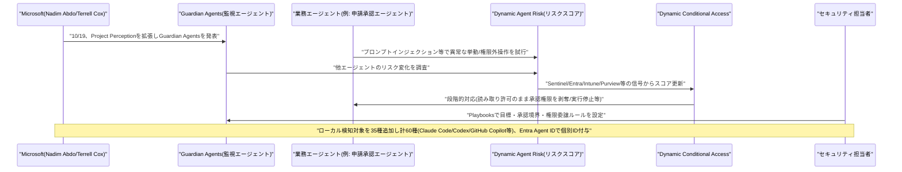
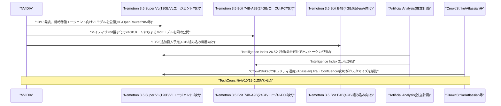
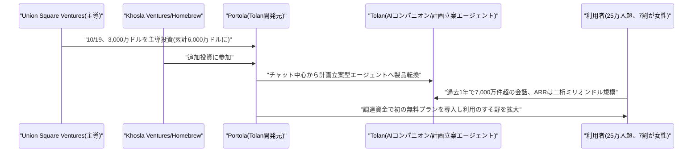

# LLM・AI Agent 最新情報レポート Vol.171
<!-- x-summary: MicrosoftがAIエージェントを侵入者として扱い権限を動的制御するGuardian Agentsを発表 -->

**作成日**: 2026年10月19日(JST)
**対象期間**: 2026年10月18日〜10月19日(Vol.170との差分)

---

## 目次

1. [Google Cloudアップデート](#1-google-cloudアップデート)
2. [Microsoft Azure AIアップデート](#2-microsoft-azure-aiアップデート)
   - [2.1 Microsoft、AIエージェントを「インサイダーリスク」として扱う新機能群を発表、Guardian AgentsとDynamic Permissions/Risk/Conditional Accessを拡充](#21-microsoftaiエージェントをインサイダーリスクとして扱う新機能群を発表guardian-agentsとdynamic-permissionsriskconditional-accessを拡充)
3. [LLM Model / AI Agentアーキテクチャ・研究](#3-llm-model--ai-agentアーキテクチャ研究)
   - [3.1 NVIDIA、オープンウェイトの新モデル群「Nemotron 3.5 Super VL」「Bolt」を発表、常時稼働エージェントとローカルPC向けエージェントを両睨み](#31-nvidiaオープンウェイトの新モデル群nemotron-35-super-vlboltを発表常時稼働エージェントとローカルpc向けエージェントを両睨み)
4. [公式ブログ・論文のリサーチ・要約](#4-公式ブログ論文のリサーチ要約)
5. [AI Agent搭載SaaS製品情報](#5-ai-agent搭載saas製品情報)
   - [5.1 AIコンパニオン「Tolan」開発のPortola、Union Square Ventures主導で3,000万ドルを調達、計画立案型エージェントへの転換を強調](#51-aiコンパニオンtolan開発のportolaunion-square-ventures主導で3000万ドルを調達計画立案型エージェントへの転換を強調)
6. [LLM/AI Agentセキュリティインシデント](#6-llmai-agentセキュリティインシデント)
7. [その他特筆すべき情報](#7-その他特筆すべき情報)
8. [参考リンク](#8-参考リンク)

---

## 1. Google Cloudアップデート

新情報なし。対象期間(10月18日〜10月19日)中、Vertex AI・Gemini Enterprise Agent Platform等について、既報と重複しない新機能・新サービスの発表は確認されなかった。

---

## 2. Microsoft Azure AIアップデート

### 2.1 Microsoft、AIエージェントを「インサイダーリスク」として扱う新機能群を発表、Guardian AgentsとDynamic Permissions/Risk/Conditional Accessを拡充

Microsoftは10月19日、同社の公式セキュリティブログで、社内で稼働するAIエージェントを従業員と同様の「インサイダーリスク」として扱う新たなセキュリティ機能群を発表した。投稿を執筆したのは同社ID・ネットワークアクセス部門担当コーポレートバイスプレジデントのNadim Abdo氏で、Satya Nadella氏が提唱する「モデルを最も信頼しない形で設計する」という原則を引用しつつ、AIエージェントは悪意を持つわけではないが、誤作動・操作・侵害によって人間のインサイダー以上の速度と規模で被害を広げうると位置づけている。

今回の発表は、7月27日に公開した「Project Perception」の拡張にあたる。中核となる新機能「Guardian Agents」は、他のエージェントのリスクが変化した理由を調査し、封じ込め策を提案・実行する監視エージェントで、セキュリティ担当者が設定する「Playbooks」(目標・承認境界・権限委譲ルール)に基づき稼働する。合わせて、タスク単位・時間制限付きで権限を動的に調整する「Dynamic Permissions」、Sentinel・Entra・Intune・Purview・Global Secure Access・Defenderなど全社の信号を統合してリスクスコアを継続算出する「Dynamic Agent Risk」、スコアに応じて権限縮小・書き込み禁止・アクセス短縮・人間承認要求・実行停止までを段階的に発動する「Dynamic Conditional Access」の3機能が導入される。ローカル環境で稼働するエージェントの検知対象も新たに35種類追加され、Anthropicの「Claude Code」やOpenAIの「Codex」、GitHub Copilotを含む計60種類に拡大、Microsoft Entra Agent IDによって検知した各エージェントに個別のID(アイデンティティ)を付与できるようになった。ブログでは、申請承認エージェントがプロンプトインジェクションを受けて本来の業務外の操作を試みた際に、読み取り権限は維持しつつ承認権限のみを剥奪する、といった具体例が示されている。同社のDeputy CISOであるTerrell Cox氏は、Microsoft自身が「カスタマーゼロ」として数十万規模のエージェントを社内運用しており、継続的な可視化と適応的な防御が必要だと述べている。[[1]](#ref-1) [[2]](#ref-2) [[3]](#ref-3)

---

## 3. LLM Model / AI Agentアーキテクチャ・研究

### 3.1 NVIDIA、オープンウェイトの新モデル群「Nemotron 3.5 Super VL」「Bolt」を発表、常時稼働エージェントとローカルPC向けエージェントを両睨み

NVIDIAは10月15日、オープンウェイトモデル群「Nemotron 3.5」ファミリーに新モデルを追加したと公式ブログで発表し、10月19日にはTechCrunchなど複数メディアが改めて取り上げた。中核となる「Nemotron 3.5 Super VL」は1,200億パラメータの視覚言語(VL)モデルで、テキスト・画像・チャート・ウェブページ・文書を扱い、PDFからの情報抽出やチャート・表の解釈、複数ステップのワークフローをこなすツール利用に対応する。NVIDIAは常時稼働するエージェント向けに設計したとし、同社の最大級の推論モデルと同等の精度をおよそ5分の1のパラメータ数で達成し、処理速度は次点モデルの5倍に達するとしている(いずれも自社計測値)。独立計測を行うArtificial Analysisは、Super VLのIntelligence Indexスコアを26.5(前世代のNemotron 3 Superは13)と評価し、米国発のオープンウェイトモデルとしては最高水準、出力トークン数も前世代比で約6割削減されたと報告している。NVIDIAによれば、Super VLはCrowdStrikeがサイバーセキュリティ運用向けに、AtlassianがJira・Confluence横断検索向けにそれぞれカスタマイズを検討しているという。

ローカルPC向けには、74Bパラメータ(アクティブ9B)のMoEモデル「Nemotron 3.5 Bolt 74B-A9B」も同時発表された。ネイティブ2bit量子化により24GBメモリに収まる設計で、RTX搭載PCやDGX Sparkでのローカル実行を想定し、llama.cpp・Ollama・LM Studio・Unsloth・vLLMに対応する。Artificial AnalysisはBoltのIntelligence Indexを21.4と評価している。さらに小型の「Nemotron 3.5 Bolt E4B」(4GBメモリ想定、組み込み機器向け)も10月23日に追加投入予定であることが明らかにされた。Super VLとBolt 74B-A9Bは、Hugging Face・OpenRouter・ModelScope・NVIDIA NIM経由で既に利用可能となっている。[[4]](#ref-4) [[5]](#ref-5) [[6]](#ref-6)

---

## 4. 公式ブログ・論文のリサーチ・要約

新情報なし。対象期間(10月18日〜10月19日)中、Google・OpenAI・Anthropic公式ブログにおいて、既報(Anthropic Public Benefit Fund等)と重複しない新規の発表・論文は確認されなかった。

---

## 5. AI Agent搭載SaaS製品情報

### 5.1 AIコンパニオン「Tolan」開発のPortola、Union Square Ventures主導で3,000万ドルを調達、計画立案型エージェントへの転換を強調

AIコンパニオンアプリ「Tolan」を開発するPortolaは10月19日、Union Square Ventures主導(Khosla Ventures・Homebrewも参加)で3,000万ドルの資金調達を実施したと発表した。これにより累計調達額は6,000万ドルに達する。Tolanはチャットで会話するだけの従来型コンパニオンとは異なり、ユーザーの目標や生活上の課題を把握した上で、日々のタスクや計画立案をエージェントとして代行・支援する方向に製品の重心を移しているという。同社は、過去1年間で25万人超のアクティブユーザーが7,000万件超の会話を行ったとし、年間計上収益(ARR)は「二桁ミリオンドル」規模に達していると説明している。PitchBookは今回の調達による推定バリュエーションを2億6,800万ドル超(確度は「中程度」)としており、報道によれば前回調達時点のバリュエーションは1億2,000万ドルだったとされる。調達資金は、これまで有料モデルのみだったTolanに初の無料プランを導入し、利用のすそ野を広げる用途に充てられる。同社によれば、ユーザーの約70%は女性であり、テック業界で典型的とされる若い男性中心のAIコンパニオン利用層とは異なる構成になっているという。[[7]](#ref-7) [[8]](#ref-8) [[9]](#ref-9)

---

## 6. LLM/AI Agentセキュリティインシデント

新情報なし。対象期間(10月18日〜10月19日)中、既報(LiteLLMの脆弱性等)と重複しない新規のセキュリティインシデント・脆弱性報告は確認されなかった。

---

## 7. その他特筆すべき情報

新情報なし。対象期間(10月18日〜10月19日)中、上記カテゴリに該当しない特筆すべき新規情報は確認されなかった。

---

## 8. 参考リンク

**[1]** [Agents are your newest insiders. Security must move at their speed. | Microsoft Security Blog](https://www.microsoft.com/en-us/security/blog/2026/10/19/agents-are-your-newest-insiders-security-must-move-at-their-speed/)

**[2]** [Microsoft unveils tools to monitor and corral rogue AI agents | GeekWire](https://www.geekwire.com/2026/microsoft-unveils-tools-to-monitor-and-corral-rogue-ai-agents/)

**[3]** [Microsoft Adds Guardian Agents to Project Perception for AI Insider Risk | Unite.AI](https://www.unite.ai/microsoft-adds-guardian-agents-to-project-perception-for-ai-insider-risk/)

**[4]** [Open From Data Center to Desktop: NVIDIA Expands Nemotron Family With Highest Efficiency Super VL and Bolt Models | NVIDIA Blog](https://blogs.nvidia.com/?p=98620)

**[5]** [Nemotron 3.5 Super and Bolt | Artificial Analysis](https://artificialanalysis.ai/articles/nemotron-3-5-super-and-bolt)

**[6]** [NVIDIA Launches Three Nemotron AI Models, Including Two for Local AI Agents | TechRepublic](https://www.techrepublic.com/article/news-nvidia-nemotron-3-5-super-vl-bolt-ai-models/)

**[7]** [Tolan snags $30M for its AI companion that helps users navigate life | TechCrunch](https://techcrunch.com/2026/10/19/tolan-snags-30m-for-its-ai-companion-that-helps-users-navigate-life/)

**[8]** [Tolan Raises $30M From USV, Khosla Ventures For AI Companion App | Upstarts Media](https://www.upstartsmedia.com/p/tolan-raises-30m-for-ai-companion-you-trust)

**[9]** [Tolan | Union Square Ventures](https://www.usv.com/writing/tolan)
