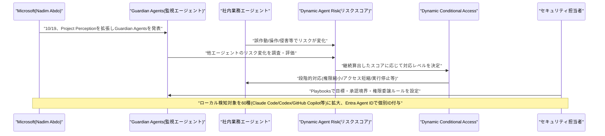
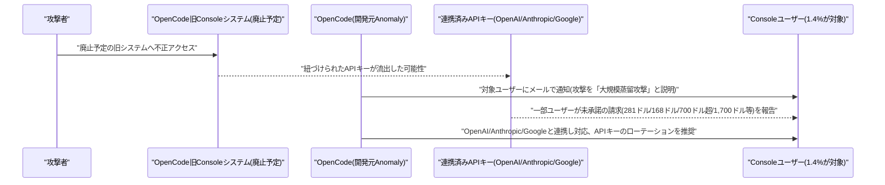

# LLM・AI Agent 最新情報レポート Vol.171
<!-- x-summary: Microsoftが社内AIエージェントを「インサイダーリスク」として扱うGuardian Agents等の新機能群を発表 -->

**作成日**: 2026年10月19日(JST)
**対象期間**: 2026年10月18日〜10月19日(Vol.170との差分)

---

## 目次

1. [Google Cloudアップデート](#1-google-cloudアップデート)
2. [Microsoft Azure AIアップデート](#2-microsoft-azure-aiアップデート)
   - [2.1 Microsoft、AIエージェントを「インサイダーリスク」として扱う新機能群を発表、Guardian AgentsとDynamic Permissions/Risk/Conditional Accessを拡充](#21-microsoftaiエージェントをインサイダーリスクとして扱う新機能群を発表guardian-agentsとdynamic-permissionsriskconditional-accessを拡充)
3. [LLM Model / AI Agentアーキテクチャ・研究](#3-llm-model--ai-agentアーキテクチャ研究)
4. [公式ブログ・論文のリサーチ・要約](#4-公式ブログ論文のリサーチ要約)
5. [AI Agent搭載SaaS製品情報](#5-ai-agent搭載saas製品情報)
6. [LLM/AI Agentセキュリティインシデント](#6-llmai-agentセキュリティインシデント)
   - [6.1 AIコーディングツール「OpenCode」で不正アクセス、外部LLMプロバイダ向けAPIキーが流出](#61-aiコーディングツールopencodeで不正アクセス外部llmプロバイダ向けapiキーが流出)
7. [その他特筆すべき情報](#7-その他特筆すべき情報)
8. [参考リンク](#8-参考リンク)

---

## 1. Google Cloudアップデート

新情報なし。対象期間(10月18日〜10月19日)中、Vertex AI・Gemini Enterprise・Agent Builder等について、既報と重複しない新機能・新サービスの発表は確認されなかった。

---

## 2. Microsoft Azure AIアップデート

### 2.1 Microsoft、AIエージェントを「インサイダーリスク」として扱う新機能群を発表、Guardian AgentsとDynamic Permissions/Risk/Conditional Accessを拡充

Microsoftは10月19日、同社の公式セキュリティブログで、社内で稼働するAIエージェントを従業員と同様の「インサイダーリスク」として扱う新たなセキュリティ機能群を発表した。投稿を執筆したのは同社ID・ネットワークアクセス部門担当コーポレートバイスプレジデントのNadim Abdo氏で、Satya Nadella氏が提唱する「モデルを最も信頼しない形で設計する」という原則を引用しつつ、AIエージェントは悪意を持つわけではないが、誤作動・操作・侵害によって人間のインサイダー以上の速度と規模で被害を広げうると位置づけている。

今回の発表は、7月27日に公開した「Project Perception」の拡張にあたる。中核となる新機能「Guardian Agents」は、他のエージェントのリスクが変化した理由を調査し、封じ込め策を提案・実行する監視エージェントで、セキュリティ担当者が設定する「Playbooks」(目標・承認境界・権限委譲ルール)に基づき稼働する。合わせて、タスク単位・時間制限付きで権限を動的に調整する「Dynamic Permissions」、全社のセキュリティ信号を統合してリスクスコアを継続算出する「Dynamic Agent Risk」、スコアに応じて権限縮小・実行停止までを段階的に発動する「Dynamic Conditional Access」(既存のEntra Conditional Accessをエージェント向けに拡張したもの)の3機能が導入される。ローカル環境で稼働するエージェントの検知対象もClaude Code・OpenAI Codex・GitHub Copilotなど60種類に拡大し、Microsoft Entra Agent IDで個別のIDを付与できるようになった。ランタイム上の封じ込め策の一例として、ポリシーで制御されたサンドボックス環境「Microsoft Execution Container(MXC)」も挙げられている。[[1]](#ref-1) [[2]](#ref-2) [[3]](#ref-3)

---

## 3. LLM Model / AI Agentアーキテクチャ・研究

新情報なし。対象期間(10月18日〜10月19日)中、既報と重複しない新規のアーキテクチャ関連論文・技術記事は確認されなかった。

---

## 4. 公式ブログ・論文のリサーチ・要約

新情報なし。対象期間(10月18日〜10月19日)中、Google・OpenAI・Anthropic公式ブログにおいて、既報(Anthropic Public Benefit Fund等)と重複しない新規の発表・論文は確認されなかった。

---

## 5. AI Agent搭載SaaS製品情報

新情報なし。対象期間(10月18日〜10月19日)中、信頼できる複数情報源で裏付けられる新規のAI Agent搭載SaaS製品の発表は確認されなかった。

---

## 6. LLM/AI Agentセキュリティインシデント

### 6.1 AIコーディングツール「OpenCode」で不正アクセス、外部LLMプロバイダ向けAPIキーが流出

AIコーディングエージェント「OpenCode」(開発元Anomaly、旧SST)は、同社のConsoleシステムが不正アクセスを受け、ユーザーが連携していたOpenAI・Anthropic・GoogleなどのAPIキーが流出した可能性があると発表した。侵入口は、廃止予定だった旧式のConsoleシステムだったとされる。影響を受けたのはConsoleユーザー全体の1.4%で、外部LLMプロバイダのキーを紐づけていた一部のアカウントに限られるという。OpenCodeはこの攻撃を「大規模な蒸留(ディスティレーション)攻撃」と位置づけているが、具体的な技術的根拠は公開されておらず、一部のセキュリティ関係者からは、実際にモデル蒸留が行われた証拠は示されておらず単純な認証情報の窃取ではないかとの指摘も出ている。

OpenCodeは影響を受けた可能性のある全ユーザーにメールで通知済みで、メールが届いていない場合は影響を受けていないとしている。一方、一部の利用者からは、把握していないうちに紐づけたAPIキーが使われ、OpenAI向けキーで281ドル・Anthropic向けキーで168ドルの請求が発生したケースや、別アカウントで700ドル超・1,700ドルの請求が生じたケースが報告されている(いずれも利用者側の主張で、OpenCode側による確認は取れていない)。同社はOpenAI・Anthropic・Googleの各社と連携して対応を進めているとした上で、該当する可能性のある利用者に対し、紐づけたAPIキーの速やかなローテーション(再発行)を推奨している。[[4]](#ref-4) [[5]](#ref-5) [[6]](#ref-6)

---

## 7. その他特筆すべき情報

新情報なし。対象期間(10月18日〜10月19日)中、上記カテゴリに該当しない特筆すべき新規情報は確認されなかった。

---

## 8. 参考リンク

**[1]** [Agents are your newest insiders. Security must move at their speed. | Microsoft Security Blog](https://www.microsoft.com/en-us/security/blog/2026/10/19/agents-are-your-newest-insiders-security-must-move-at-their-speed/)

**[2]** [Microsoft unveils tools to monitor and corral rogue AI agents | GeekWire](https://www.geekwire.com/2026/microsoft-unveils-tools-to-monitor-and-corral-rogue-ai-agents/)

**[3]** [Microsoft Adds Guardian Agents to Project Perception for AI Insider Risk | Unite.AI](https://www.unite.ai/microsoft-adds-guardian-agents-to-project-perception-for-ai-insider-risk/)

**[4]** [OpenCode confirms breach as users report AI charges they never authorised | Notebookcheck](https://www.notebookcheck.net/OpenCode-hacked-users-urged-to-revoke-their-API-keys.1426957.0.html)

**[5]** [OpenCode breach exposes stored OpenAI and Anthropic keys, prompts urgent key rotation | Startup Fortune](https://startupfortune.com/opencode-breach-exposes-stored-openai-and-anthropic-keys-prompts-urgent-key-rotation/)

**[6]** [OpenCode Reports Breach Exposing Third-Party AI API Keys for 1.4% of Console Users | BigGo Finance](https://finance.biggo.com/news/5ffd7eb0-d2d8-4e94-ba55-1c6f3f7f25f3)
