# LLM・AI Agent 最新情報レポート Vol.172
<!-- x-summary: Anthropicが常時稼働の個人向けAIエージェント「Claude Duet」研究プレビューを開始 -->

**作成日**: 2026年10月23日(JST)
**対象期間**: 2026年10月22日〜10月23日(Vol.171との差分)

---

## 目次

1. [Google Cloudアップデート](#1-google-cloudアップデート)
   - [1.1 Google Cloud、AIエージェント専用コンピュート基盤「Agent Compute Engine」とガバナンス機能拡張を発表](#11-google-cloudaiエージェント専用コンピュート基盤agent-compute-engineとガバナンス機能拡張を発表)
   - [1.2 Google Cloud、Claude利用に「Anthropic管理」デプロイ方式を追加し一般提供開始](#12-google-cloudclaude利用にanthropic管理デプロイ方式を追加し一般提供開始)
2. [Microsoft Azure AIアップデート](#2-microsoft-azure-aiアップデート)
   - [2.1 Microsoft、「Frontier Tour」ケルン公演でAIエージェントの安全な主権確保に向けた新機能群を発表](#21-microsoftfrontier-tourケルン公演でaiエージェントの安全な主権確保に向けた新機能群を発表)
3. [LLM Model / AI Agentアーキテクチャ・研究](#3-llm-model--ai-agentアーキテクチャ研究)
4. [公式ブログ・論文のリサーチ・要約](#4-公式ブログ論文のリサーチ要約)
   - [4.1 Anthropic、オープン標準「Agent Skills」をAgentic AI Foundationへ寄贈](#41-anthropicオープン標準agent-skillsをagentic-ai-foundationへ寄贈)
   - [4.2 Anthropic、常時稼働型の個人向けAIエージェント「Claude Duet」の研究プレビューを開始](#42-anthropic常時稼働型の個人向けaiエージェントclaude-duetの研究プレビューを開始)
5. [AI Agent搭載SaaS製品情報](#5-ai-agent搭載saas製品情報)
   - [5.1 Walmart、AIエージェントによる購買を許可する「Agent Gateway」を発表](#51-walmartaiエージェントによる購買を許可するagent-gatewayを発表)
6. [LLM/AI Agentセキュリティインシデント](#6-llmai-agentセキュリティインシデント)
   - [6.1 OSS版LLMゲートウェイ「LiteLLM」が2度目の大規模サプライチェーン攻撃、GitHubトークン窃取が原因](#61-oss版llmゲートウェイlitellmが2度目の大規模サプライチェーン攻撃githubトークン窃取が原因)
   - [6.2 Microsoft、ConnectWise侵害を中国系ハッカー集団Storm-0940によるAI駆動型攻撃と断定](#62-microsoftconnectwise侵害を中国系ハッカー集団storm-0940によるai駆動型攻撃と断定)
7. [その他特筆すべき情報](#7-その他特筆すべき情報)
   - [7.1 OpenAI、評価額1.25兆ドルで最大300億ドルの新規資金調達が最終段階と報道](#71-openai評価額125兆ドルで最大300億ドルの新規資金調達が最終段階と報道)
   - [7.2 Nvidia CEOジェンセン・フアン氏、カザフスタン訪問とGTC Berlin閉幕、ネオクラウド排除疑惑も浮上](#72-nvidia-ceoジェンセンフアン氏カザフスタン訪問とgtc-berlin閉幕ネオクラウド排除疑惑も浮上)
   - [7.3 AI関連株急落、市場に「AI支出懸念」広がる](#73-ai関連株急落市場にai支出懸念広がる)
8. [参考リンク](#8-参考リンク)

---

## 1. Google Cloudアップデート

### 1.1 Google Cloud、AIエージェント専用コンピュート基盤「Agent Compute Engine」とガバナンス機能拡張を発表

Google Cloudは10月22日、AIエージェント・MCP関連のカンファレンス「AGNTCon + MCPCon」にて、エージェント実行に特化した新しいコンピュートサービス「Agent Compute Engine(ACE)」を発表した。ACEは、高速起動するmicroVM、OSテンプレートを複数エージェント間で共有するcopy-on-writeメモリ、高速なチェックポイント/復元機能を備え、人間の応答待ちなどでアイドル状態になったエージェントを一時停止・スナップショットから再開できる。セキュリティ面では、Googleのハードウェアオフロード機構「Titanium IPU」とCloud Hypervisorによるハードウェア分離境界を採用し、各microVMには短命な認証情報と暗号的に検証可能なIDが個別に付与される。このアーキテクチャは既にGemini for work内のエージェント機能を支えているものだという。ACEは数カ月以内にプレビュー提供を開始する予定。

同時に、Kubernetes(GKE)上でエージェントファーストの実行基盤を実現するオープンソースランタイム「Agent Substrate」も発表された。従来型コンピュートに対し最大10倍のコンピュート密度を実現するとされ、20万エージェント規模の検証では秒間500件のアクティベーション、500ミリ秒未満のサスペンド/レジューム遅延を達成したという。Claude Code・OpenClaw・Hermesなど任意のエージェントフレームワークで利用できる。加えて、Gemini for businessのエージェントガバナンス機能(Agent Gateway・Registry・Identity・Observability)も、Cloud Run・GKE・ACE・ローカル端末上のコーディングエージェント(Claude Code・Antigravity CLI等)まで対象ランタイムを拡大し、トークン単位のコスト管理やモデルルーティングポリシーなどを今四半期中にプレビュー追加するとした。[[1]](#ref-1)

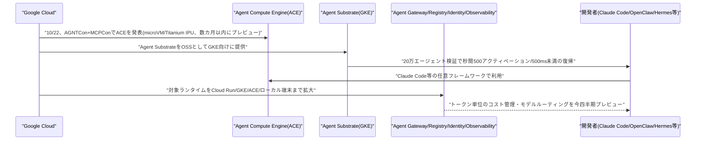

---

### 1.2 Google Cloud、Claude利用に「Anthropic管理」デプロイ方式を追加し一般提供開始

Google Cloudは10月23日、Google Cloud上でのClaude利用に、既存の「Google管理」方式に加えて新たな「Anthropic管理」デプロイ方式を一般提供(GA)したと発表した。執筆者はGoogle CloudでGemini担当VP Product ManagementのMichael Gerstenhaber氏。両方式とも対象モデルはClaude Fable 5.1・Sonnet 5.5・Haiku 5.5・Opus 5.5で同一、料金もGoogle Cloudの既存契約・コミットメントの範囲内で変わらないが、データ処理者(プロセッサ)が異なる。新設の「Anthropic管理」はAnthropicがデータ処理者となり、Managed Agents(ベータ)・Skills・コード実行といったClaude Platformの新機能に即日アクセスできる。一方、既存の「Google管理」はGoogle Cloudがデータ処理者となり、VPC Service Controls・顧客管理暗号鍵(CMEK)・米国/EU/APACでのデータレジデンシーなど、厳格なガバナンス・コンプライアンス・主権要件を持つ顧客向けに、BigQueryやModel Armorとのネイティブ統合を提供する。[[2]](#ref-2)

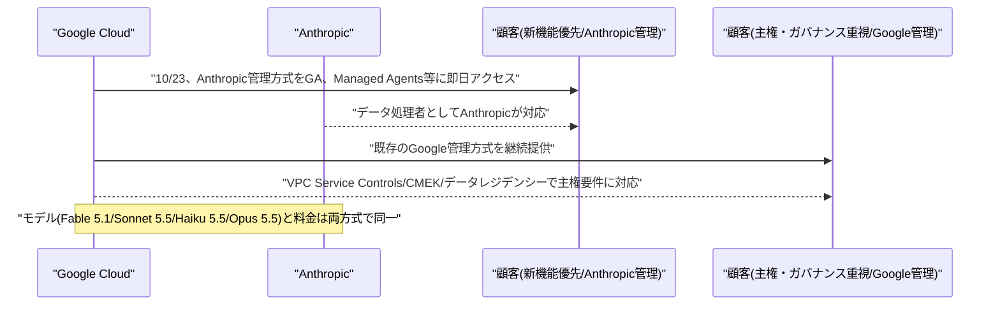

---

## 2. Microsoft Azure AIアップデート

### 2.1 Microsoft、「Frontier Tour」ケルン公演でAIエージェントの安全な主権確保に向けた新機能群を発表

Microsoftは10月22日、ドイツ・ケルンで開催した「Frontier Tour」(同社AI Tourのドイツ公演)にて、CEOのSatya Nadella氏とドイツ・オーストリア担当CVPのAgnes Heftberger氏が基調講演を行い、AIエージェントに関する新たなセキュリティ・主権確保機能群を発表した。Nadella氏は、企業がAIシステムへの統制を保持すべきであり、エージェント型AIの監査ログは「改ざん不可能である必要がある」と強調した。発表の中核は、AIエージェント群のID管理・保護を目的とする「Microsoft Entra Agent ID」の拡張で、ローカル環境で稼働するエージェントを含む追加のエージェントパターンに対応する新たなID種別を導入する。

合わせて、機密性の高いデータを第三者と共有せずに共同分析できる「Azure Confidential Clean Rooms」、自社開発のAIチップ「Maia」への継続投資も発表された。パートナーシップとしては、ミュンヘン工科大学系アクセラレータ「UnternehmerTUM」との「Physical AI Growth Lab」や、製薬大手Boehringer Ingelheimとの協業も明らかにされた。Microsoftによれば、ケルン公演には5,000人超が参加し、80以上のセッションが行われたという。欧州におけるAI主権・データガバナンスへの規制圧力を背景に、Microsoftは同社のAIエージェント統制機能を欧州市場向けに強化する姿勢を鮮明にしている。[[3]](#ref-3) [[4]](#ref-4)

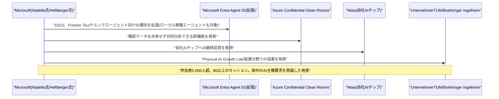

---

## 3. LLM Model / AI Agentアーキテクチャ・研究

新情報なし。対象期間(10月22日〜10月23日)中、既報と重複しない新規のアーキテクチャ関連論文・技術記事は確認されなかった。なお、Google Cloudが発表した「Agent Compute Engine」「Agent Substrate」のmicroVM・エージェントID設計などの技術的詳細は、上記1.1で取り上げている。

---

## 4. 公式ブログ・論文のリサーチ・要約

### 4.1 Anthropic、オープン標準「Agent Skills」をAgentic AI Foundationへ寄贈

Anthropicは10月22日、AIエージェントに手順的な知識・ワークフローを与えるためのオープン標準「Agent Skills」を、Linux Foundation傘下のプロジェクト「Agentic AI Foundation(AAIF)」に寄贈すると発表した。AAIFはAnthropicがBlock・OpenAIと共同で設立した団体で、既にAnthropicが寄贈したModel Context Protocol(MCP)を管理している。Agent Skillsは「SKILL.md」ファイルとスクリプト・参考資料を含むフォルダでタスクや領域知識をエージェントに教える仕組みで、Claude Codeの開発過程で生まれ2025年12月にオープン標準として公開された。現在までにChatGPT・Cursor・GitHub Copilot・VS Codeなど70以上のプラットフォームが統合し、公開スキルは約100万件、インストール数は2.8億件近くに達しているという。今回の寄贈対象には標準そのものに加え、Agent Skillsの名称・ロゴ、GitHub組織、agentskills.ioドメインが含まれる。今後はAnthropic・Google・OpenAIなど複数社のエンジニアが個人の立場でメンテナンスを担うベンダー中立な体制に移行し、リード・メンテナーにはDavid Soria Parra氏とMahesh Murag氏が就く。ロードマップには、バージョン管理されたリリース、正式な提案プロセス、スキル作成者・導入者向けのセキュリティ指針整備が含まれる。[[5]](#ref-5)

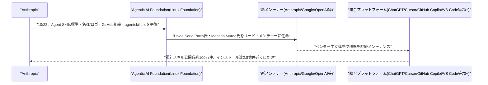

---

### 4.2 Anthropic、常時稼働型の個人向けAIエージェント「Claude Duet」の研究プレビューを開始

Anthropicは10月21日(米国時間、日本時間22日)、個人向けの常時稼働型プロアクティブエージェント「Claude Duet」の研究プレビューを開始したと発表した。既存のClaudeアプリとは別の専用アプリで、米国のPro・Maxプラン利用者を対象にウェイトリスト方式で提供され、iOS・Android・Web版が用意されている。複数の報道によれば基盤モデルはClaude Opus 5.5。Duetは毎朝、連携先アプリの中から対応が必要な重要事項をまとめたブリーフィングを送付し、その後も数時間おきに連携アプリを確認、注意が必要な場合のみ通知する。スケジューリングや簡易ダッシュボード・Webアプリの構築といった、まとまったタスクを依頼することもできる。メッセージ送信・支払い・文書への署名・ファイル削除など、結果を左右する操作を実行する前には必ず利用者の承認を求める設計で、Anthropicは連携先アカウントのパスワード・ログイン認証情報を保持しないとしている。使用量は既存のClaudeプランの利用上限に含まれる。Meta「Muse」やOpenAIの「Dots」といった、同種のプロアクティブ型エージェント製品への対抗という位置づけで報じられている。なおTeam・Enterpriseプランは今回の対象に含まれていない。[[6]](#ref-6) [[7]](#ref-7) [[8]](#ref-8)

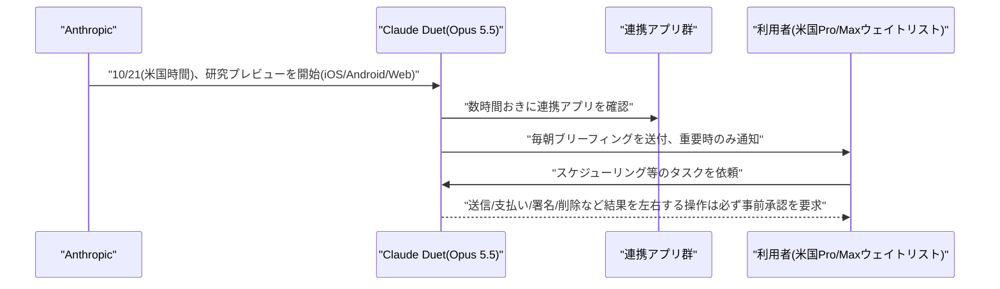

---

## 5. AI Agent搭載SaaS製品情報

### 5.1 Walmart、AIエージェントによる購買を許可する「Agent Gateway」を発表

Walmartは10月21日(米国時間、日本時間22日)、サンフランシスコで開催された「Masters of Scale Summit」にて、社長兼CEOのJohn Furner氏が、承認済みのAIエージェントがWalmart・Sam's Clubの在庫を検索し、利用者に代わって購買を完了できるMCPサーバー「Agent Gateway」を発表した。利用にWalmart+会員登録は不要で、Walmartアカウントがあれば利用できる。合わせて、顧客アカウント内にエージェント専用の「Agent Profile」を設け、エージェントによる購買を本人の注文履歴と分離する仕組みも発表された。利用者は購買ごとに承認を求める設定や、50・100・200ドルといった支出上限を設定でき、Walmartはこれを「エージェントをクレジットカードの追加カード名義人として登録する」ことに近いと説明している。Agent Profile自体の提供開始は11月を予定しており、現時点では未提供。この発表は、Amazonが自社サイトでのAIエージェントによる購買を制限する方針を示した直後のタイミングで行われ、対照的な姿勢として報じられた。接続標準にはAnthropicが開発したMCP(Model Context Protocol)が採用されている。[[9]](#ref-9) [[10]](#ref-10)

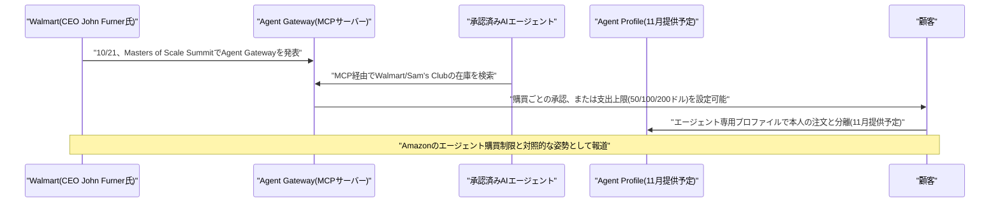

---

## 6. LLM/AI Agentセキュリティインシデント

### 6.1 OSS版LLMゲートウェイ「LiteLLM」が2度目の大規模サプライチェーン攻撃、GitHubトークン窃取が原因

多数の企業がLLMプロバイダへのアクセスを一元管理するために利用するOSS版AIゲートウェイ「LiteLLM」(開発元Berri AI)で、10月21日(米国時間、日本時間22日)、悪意のあるバージョン「v1.107.0」がDocker HubとPyPIの両方に公開される事態が発生した。PyPI上の不正なパッケージは、発見・削除されるまで約2時間公開された状態にあった。組み込まれたマルウェアは、クラウド認証情報・秘密鍵・ブラウザデータに加え、AI開発ツール向けのAPIキーなど認証ファイルを窃取し、リモートコード実行ツールを読み込む機能も持つとされる。LiteLLMのCEOによれば、攻撃者は3名のエンジニアのGitHub CLI OAuthトークンを窃取し、1つのトークンでリリースワークフローを起動、別のトークンで承認するという形で、本来2名承認制であるはずのリリース承認プロセスの不備を突いた。LiteLLMは侵害されたトークンを無効化し、GitHub組織のメンバーを被害を受けていない1名を除いて全員外し、信頼済みパブリッシャーのリンクも解除して不正公開を防止したが、トークンがどのように盗まれたかは未解明で、追加の侵害の可能性は排除できないとしている。同社では2026年3月24日にも、CI/CDのTrivyスキャナー侵害を起点とする別の攻撃グループによるサプライチェーン攻撃(v1.82.7/v1.82.8)を受けており、今回は同年2度目の大規模インシデントとなる。該当バージョンを利用していた組織には、認証情報の速やかなローテーションが推奨されている。[[11]](#ref-11) [[12]](#ref-12)

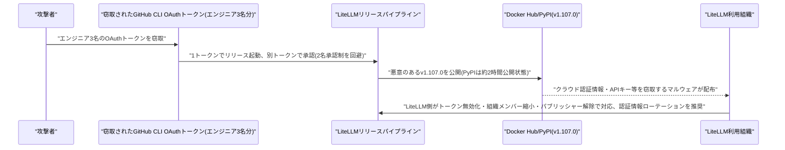

---

### 6.2 Microsoft、ConnectWise侵害を中国系ハッカー集団Storm-0940によるAI駆動型攻撃と断定

Microsoftは10月21日(米国時間、日本時間22日)、ITサービス企業ConnectWiseのクラウドバックアップ関連システムへの不正アクセス事案について、中国と関係があるとされるハッカー集団「Storm-0940」による犯行と断定したと発表した。ConnectWiseは10月16〜17日、Cloud Backup(旧SkyKick)のアプリケーションIDへの不正アクセスを公表し、Cloud Backup・SaaS Security・Cloud Managementの各サービスを一時停止していた。Microsoftの分析によれば、2021年から活動するStorm-0940は、オープンソースのAI駆動型侵入テストフレームワーク「ARTEX」を用いて偵察からデータ持ち出しまでを自律的に実行させ、9月頃から活動を開始、327件のアカウントに対するパスワードスプレー攻撃が失敗した後、窃取したConnectWiseのアプリケーションIDに切り替えて侵入したという。攻撃規模は、累計15万件超のログイン失敗、ピーク時で毎分2,900件の試行に達し、2,250超のテナントに到達、一部では初期標的化からわずか3時間未満で特権的なクラウド管理者権限を奪取したケースもあったとされる。ただしMicrosoftは、サインイン成功が必ずしも顧客データへのアクセス・持ち出しを意味するものではないとも説明している。ConnectWiseは同社への取材時点でMicrosoftの分析結果についてコメントしていない。なお、ARTEXは10月上旬に報じられた韓国の銀行7社を狙った別系統の攻撃(既報、金銭目的の中国語話者グループによるものとされる)にも使われたツールであり、今回のStorm-0940による国家関与型キャンペーンとは別系統の悪用事例として位置づけられる。[[13]](#ref-13) [[14]](#ref-14)

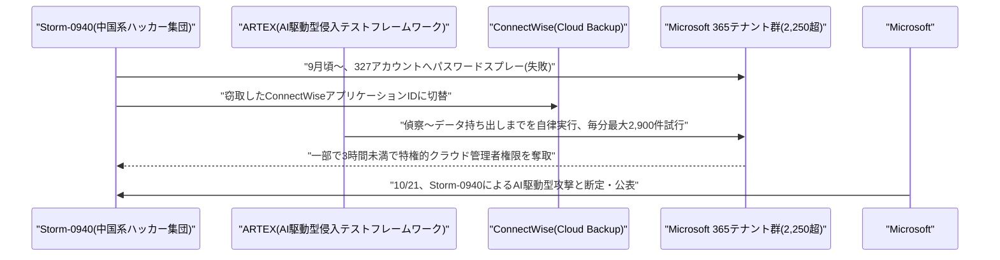

---

## 7. その他特筆すべき情報

### 7.1 OpenAI、評価額1.25兆ドルで最大300億ドルの新規資金調達が最終段階と報道

CNBCは10月23日、OpenAIが評価額1.25兆ドル(プレマネー)で最大300億ドル規模の資金調達の最終段階にあると報じた。調達はUAE系投資家(アブダビのMGXが関与しているとされる)と投資会社Coatueが主導するとされる。これは10月上旬に報じられていた、評価額1.4兆ドルでBlackRockも交渉に加わっているとされた内容から、評価額が下方に修正された形となる。OpenAIの直近の確定済み調達は2026年3月の、評価額852億ドルでの122億ドル調達だった。[[15]](#ref-15)

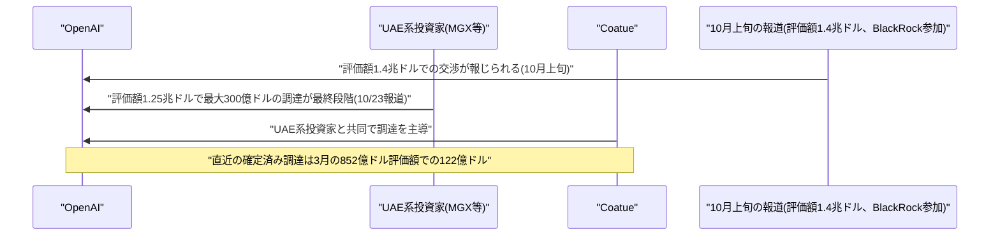

---

### 7.2 Nvidia CEOジェンセン・フアン氏、カザフスタン訪問とGTC Berlin閉幕、ネオクラウド排除疑惑も浮上

Nvidia CEOのジェンセン・フアン氏は、ロンドン・パリ・ストックホルム・ダブリン・ベルリンを巡る欧州ツアーの一環として、10月23日にカザフスタンを初訪問し、首都アスタナのAI国際センター「alem.ai」で同国副首相Zhaslan Madiyev氏とのフリートークに参加、カザフスタンを次世代のAIインフラ拠点として売り込んだ。同国は6月、米企業Firebirdが主導する最大100億ドル規模の「データセンター・バレー」計画などを既に発表しており、Firebirdは今後12カ月でアルメニア・カザフスタン両国に250MW規模のNvidia基盤インフラを展開する計画という。

欧州ツアーの最終地となったGTC Berlinでは、フランスのスタートアップPollen RoboticsとHugging Faceが開発したアヒル型ロボットが登場する基調講演が行われたが、ロシアの巡航ミサイルにNvidia製チップが使われていたとされる問題に抗議するGreenpeaceの活動家により開始20分ほどで中断される一幕もあった。また調査会社SemiAnalysisは、NvidiaがAMDやGoogle TPUなど他社製チップを併用し始めた複数の「ネオクラウド」事業者をGTC Berlinへの参加から排除したと報じ、Nvidia製品への専属化を迫る圧力行使ではないかとの懸念が指摘されている。Nvidiaは会期中、欧州のテック業界に対して約100億ドルの投資コミットメントも発表した。[[16]](#ref-16) [[17]](#ref-17)

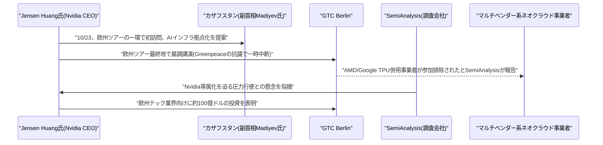

---

### 7.3 AI関連株急落、市場に「AI支出懸念」広がる

CNBCは10月22〜23日にかけて、AI・グロース株が下落し防御的セクターへの資金シフトが進んでいると報じた。22日の報道では、AI関連株が売られる一方で防御株が上昇したことが「不安定な市場」の表れと位置づけられ、23日の報道では金(ゴールド)などのセーフヘイブン資産への回転が続いているとされた。同日のCNBC「デイリーオープン」は「AI支出への懸念がハロウィーン前の市場を悩ませている」と題し、イーロン・マスク氏、ビル・アックマン氏、ジェンセン・フアン氏の名前を挙げてAI投資を巡る論争に言及した。[[18]](#ref-18) [[19]](#ref-19)

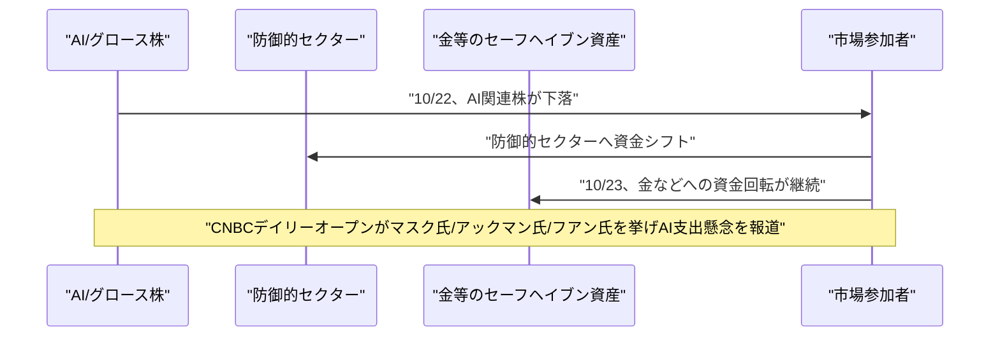

---

## 8. 参考リンク

**[1]** [Introducing Agent Compute Engine and expanded agent governance | Google Cloud Blog](https://cloud.google.com/blog/topics/ai-infrastructure/introducing-agent-compute-engine-and-expanded-agent-governance)

**[2]** [Expanding Claude availability on Google Cloud | Google Cloud Blog](https://cloud.google.com/blog/products/ai-machine-learning/expanding-claude-availability-on-google-cloud)

**[3]** [Microsoft Frontier Tour in Köln: Satya Nadella kündigt neue Lösungen für sichere und souveräne KI an | Microsoft Source EMEA](https://news.microsoft.com/source/emea/2026/10/microsoft-frontier-tour-in-koeln-satya-nadella-kuendigt-neue-loesungen-fuer-sichere-und-souveraene-ki-an/?lang=de)

**[4]** [Microsoft Frontier Tour: AI is like Cologne Cathedral, a vision | heise online](https://www.heise.de/en/news/Microsoft-Frontier-Tour-AI-is-like-Cologne-Cathedral-a-vision-11497182.html)

**[5]** [Donating Agent Skills to the Agentic AI Foundation | Anthropic](https://www.anthropic.com/news/donating-agent-skills-to-the-agentic-ai-foundation)

**[6]** [Anthropic Launches Claude Duet, a Proactive AI Agent | MacRumors](https://macrumors.com/2026/10/21/anthropic-claude-duet/)

**[7]** [Anthropic Announces Claude Duet, a Personal AI Agent | Thurrott](https://thurrott.com/a-i/anthropic/343121/anthropic-announces-claude-duet-a-personal-ai-agent)

**[8]** [Anthropic launches Claude Duet AI agent to rival Meta's Muse, OpenAI's Dots | Anadolu Agency](https://www.aa.com.tr/en/americas/anthropic-launches-claude-duet-ai-agent-to-rival-metas-muse-openais-dots/4096538)

**[9]** [While Amazon blocks AI agents, Walmart rolls out the welcome mat | TechCrunch](https://techcrunch.com/2026/10/21/while-amazon-blocks-ai-agents-walmart-rolls-out-the-welcome-mat/)

**[10]** [Walmart launches tools for AI agents to shop for customers | KSL](https://www.ksl.com/article/51639372/walmart-launches-tools-for-ai-agents-to-shop-for-customers)

**[11]** [LiteLLM Compromised in Supply Chain Attack | The Hacker News](https://thehackernews.com/2026/10/litellm-compromised-in-supply-chain.html)

**[12]** [LiteLLM Hit in Cascading Supply Chain Attack | BankInfoSecurity](https://www.bankinfosecurity.com/litellm-hit-in-cascading-supply-chain-attack-a-31210)

**[13]** [Chinese-linked hackers compromise ConnectWise, target hundreds in global attack, Microsoft says | Reuters (via KFGO)](https://kfgo.com/2026/10/21/chinese-linked-hackers-compromise-connectwise-target-hundreds-in-global-attack-microsoft-says/)

**[14]** [Microsoft pins ConnectWise supply-chain attack to China-state aligned threat group | CyberScoop](https://cyberscoop.com/microsoft-attributes-connectwise-supply-chain-attack-china-storm-0940/)

**[15]** [OpenAI nears up to $30 billion funding round at $1.25 trillion valuation | CNBC](https://www.cnbc.com/video/2026/10/23/openai-nears-30-billion-funding-round-at-1point25-trillion-valuation.html)

**[16]** [Nvidia's Huang makes first-ever visit to Kazakhstan, pitches it as next AI hub | CNBC](https://www.cnbc.com/2026/10/23/nvidia-huang-investment-kazakhstan-.html)

**[17]** [Jensen Huang wraps up GTC with robot ducks amid neocloud distress | CNBC](https://www.cnbc.com/2026/10/23/jensen-huang-gtc-robot-ducks-neocloud-distress.html)

**[18]** [AI stocks tumble as the defensives rise: what it says about this uneasy market | CNBC](https://www.cnbc.com/investingclub/2026/10/22/ai-stocks-tumble-as-the-defensives-rise-what-it-says-about-this-uneasy-market.html)

**[19]** [CNBC Daily Open: AI spending fears haunt markets before Halloween | CNBC](https://www.cnbc.com/2026/10/23/cnbc-daily-open-ai-spending-elon-musk-bill-ackman-jensen-huang.html)
