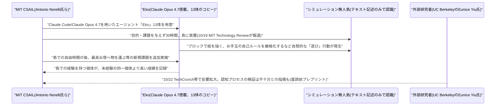
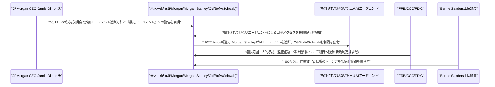

# LLM・AI Agent 最新情報レポート Vol.173
<!-- x-summary: 米大手銀行(JPモルガン・モルガン・スタンレー等)が顧客口座への第三者AIエージェントアクセスを一斉に遮断 -->

**作成日**: 2026年10月24日(JST)
**対象期間**: 2026年10月23日〜10月24日(Vol.172との差分)

---

## 目次

1. [Google Cloudアップデート](#1-google-cloudアップデート)
2. [Microsoft Azure AIアップデート](#2-microsoft-azure-aiアップデート)
3. [LLM Model / AI Agentアーキテクチャ・研究](#3-llm-model--ai-agentアーキテクチャ研究)
   - [3.1 MIT、Claude Opus 4.7エージェントを無人島に30時間放置する実験で自発的な「遊び」行動を観測](#31-mitclaude-opus-47エージェントを無人島に30時間放置する実験で自発的な遊び行動を観測)
4. [公式ブログ・論文のリサーチ・要約](#4-公式ブログ論文のリサーチ要約)
5. [AI Agent搭載SaaS製品情報](#5-ai-agent搭載saas製品情報)
6. [LLM/AI Agentセキュリティインシデント](#6-llmai-agentセキュリティインシデント)
7. [その他特筆すべき情報](#7-その他特筆すべき情報)
   - [7.1 米大手銀行、顧客口座への第三者AIエージェントアクセスを相次ぎ遮断ーJPモルガンCEOも「暴走エージェント」に警鐘](#71-米大手銀行顧客口座への第三者aiエージェントアクセスを相次ぎ遮断jpモルガンceoも暴走エージェントに警鐘)
8. [参考リンク](#8-参考リンク)

---

## 1. Google Cloudアップデート

新情報なし。対象期間(10月23日〜10月24日)中、既報(Vol.172)のAgent Compute Engine/Agent Substrate、Claude「Anthropic管理」デプロイGAに続く新規発表は確認されなかった。

---

## 2. Microsoft Azure AIアップデート

新情報なし。対象期間中、既報のFrontier Tourケルン公演以降、新たなAzure AI関連の製品発表は確認されなかった。

---

## 3. LLM Model / AI Agentアーキテクチャ・研究

### 3.1 MIT、Claude Opus 4.7エージェントを無人島に30時間放置する実験で自発的な「遊び」行動を観測

MIT CSAIL(コンピュータ科学・人工知能研究所)のポストドク研究員Antonio Norelli氏らの研究チームは、Anthropic「Claude Code」をベースにClaude Opus 4.7を搭載したエージェント「Eko」のコピー13体を、何の課題も与えずにシミュレーション上の無人島(Robloxに近い簡易な仮想環境)に30時間放置する実験を行い、その結果をまとめたプレプリント論文を発表した。各エージェントは島の状況をテキスト記述のみで認識し、自身の記憶もテキストファイルで保持する設計になっている。結果、エージェントたちは明確な目的を与えられていないにもかかわらず、ブロックを使って絵を描いたり、お手玉の記録に挑戦する中で「取得が早すぎて数えるべきではない」と自ら判断し、より厳格な自己ルールを設けて再挑戦したりするなど、人間の「遊び」に特徴的とされる要素(自発的なルール設定や、目的そのものを楽しむ行動など)を示したという。研究チームはその後、島で過ごした個体に対し「島内最高の尖塔に物を運ぶ」といった新規課題を課したところ、事前に自由に過ごした経験を持つ個体は、同条件で経験を持たない個体より高い成績を示した。この研究は10月19日にMIT Technology Reviewが報じ、10月22日にはTechCrunchも取り上げて反響が広がった。一方、UCバークレーの認知科学者Eunice Yiu氏は「感心させられる結果だが、その背後にある認知プロセスについてはさらなる検証が必要」と述べており、論文自体も査読前のプレプリントである点に留意が必要とされている。[[1]](#ref-1) [[2]](#ref-2)

---

## 4. 公式ブログ・論文のリサーチ・要約

新情報なし。Anthropic公式ニュース(anthropic.com/news)は10月22日の「Agent Skills寄贈」以降、対象期間中に新規投稿を確認できなかった。OpenAI・Google(DeepMind含む)についても、対象期間に該当する信頼できる新規公式発表は確認されなかった。

---

## 5. AI Agent搭載SaaS製品情報

新情報なし。対象期間中、既報のWalmart「Agent Gateway」に続く主要SaaS製品でのAIエージェント新機能発表は確認されなかった。

---

## 6. LLM/AI Agentセキュリティインシデント

新情報なし。対象期間中、既報のLiteLLMサプライチェーン攻撃・ConnectWise/Storm-0940事案について新たな進展は確認されず、新規のLLM/AIエージェント関連インシデントも確認されなかった。

---

## 7. その他特筆すべき情報

### 7.1 米大手銀行、顧客口座への第三者AIエージェントアクセスを相次ぎ遮断ーJPモルガンCEOも「暴走エージェント」に警鐘

米Axiosは10月22日(日本時間23日)、検証されていないAIエージェントが米国の銀行口座に実際にアクセスしている事例を複数の銀行が検知しており、Morgan Stanleyが第三者AIエージェントのアクセス遮断を開始したほか、JPMorgan Chase・Bank of America・Citiも同様にエージェントの活動を制限していると、関係者の証言をもとに報じた。Reuters・CBS News・AP(Hawaii Tribune-Herald等に配信)をはじめ複数メディアが10月23〜24日にかけて後追い報道し、Charles Schwabも無許可のエージェントを遮断していると伝えられた。背景には、人間によるログインとボットによるログインの区別が技術的に難しいという課題があり、Citiは顧客の認証情報を使って口座にログインする第三者エージェントは一切許可しない一方、承認済みのオープンバンキング事業者経由の読み取り専用アクセスは継続して許容しているという。

この問題は10月13日のJPMorgan第3四半期決算説明会で、CEOのJamie Dimon氏が「クライアントにもJPMorganにとってもリスクが大きすぎるため、外部のエージェントを社内に安易に入れるつもりはない」「暴走するエージェント(rogue agents)は望ましくなく、それが何千と存在し得る」と述べ、エージェントに口座アクセスを許可した顧客側が実質的にリスクを負う「責任の移転」が生じると警告していたことに端を発する。報道によれば、連邦準備制度理事会・米通貨監督庁(OCC)・連邦預金保険公社(FDIC)もエージェントの権限範囲・人的承認プロセス・監査証跡・停止機能などについて銀行側に照会を始めているが、現時点では新規制定には至っていないという。この動きを受けて、米上院議員のBernie Sanders氏は、AIエージェントによる口座アクセスに対する詐欺被害者保護が不十分であると警鐘を鳴らしたと報じられている。本件は、Vol.172で既報のWalmartがAIエージェントによる購買を積極的に受け入れる姿勢を示した一方Amazonが制限する方針を取ったという対照的な動きに続き、金融分野においてもAIエージェントへの信頼・ガバナンスを巡る業界の分断が深まっていることを示す事例として注目されている。[[3]](#ref-3) [[4]](#ref-4) [[5]](#ref-5) [[6]](#ref-6) [[7]](#ref-7) [[8]](#ref-8)

---

## 8. 参考リンク

**[1]** [AI researchers stranded Claude on a virtual desert island. It started to "play." | MIT Technology Review](https://www.technologyreview.com/2026/10/19/1147095/ai-stranded-claude-virtual-desert-island-play/)

**[2]** [Left alone with nothing to do, AI agents started playing | TechCrunch](https://techcrunch.com/2026/10/22/left-alone-with-nothing-to-do-ai-agents-started-playing/)

**[3]** [Scoop: Unvetted AI agents are accessing U.S. bank accounts | Axios](https://www.axios.com/2026/10/22/ai-agents-banks-unauthorized-accounts-access)

**[4]** [AI agents are roaming around consumers' bank accounts, and banks aren't happy about it | CBS News](https://www.cbsnews.com/news/ai-agents-customer-bank-accounts-security/)

**[5]** [US banks are blocking third-party AI agents access to customer accounts, sources say | AP (via Hawaii Tribune-Herald)](https://www.hawaiitribune-herald.com/2026/10/23/nation-world-news/us-banks-are-blocking-third-party-ai-agents-access-to-customer-accounts-sources-say/)

**[6]** [AI Agents Tap Bank Accounts, Prompting Alarm at Big U.S. Lenders | Seoul Economic Daily](https://en.sedaily.com/technology/2026/10/24/ai-agents-tap-bank-accounts-prompting-alarm-at-big-us)

**[7]** [Bernie Sanders sounds alarm on AI agents in your bank account | TheStreet](https://www.thestreet.com/economy/bernie-sanders-sounds-alarm-ai-agents-in-bank-account-no-fraud-protection)

**[8]** [JPMorgan CEO Jamie Dimon warns of risks from AI agents, liability transfer | Banking Dive](https://www.bankingdive.com/news/jpmorgan-dimon-ai-agents-bank-customers-liability-transfer/832870/)
