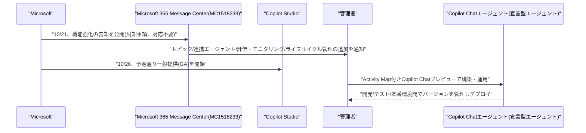
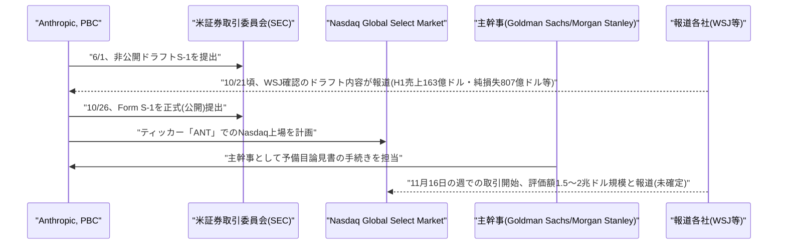

# LLM・AI Agent 最新情報レポート Vol.175
<!-- x-summary: Anthropicが正式にS-1をSEC提出、Nasdaq上場目指し評価額最大2兆ドルのIPOへ、11月上場目標 -->

**作成日**: 2026年10月26日(JST)
**対象期間**: 2026年10月25日〜10月26日(Vol.174との差分)

---

## 目次

1. [Google Cloudアップデート](#1-google-cloudアップデート)
2. [Microsoft Azure AIアップデート](#2-microsoft-azure-aiアップデート)
   - [2.1 Microsoft、Copilot StudioのCopilot Chatエージェント機能強化を一般提供(GA)開始](#21-microsoftcopilot-studioのcopilot-chatエージェント機能強化を一般提供gaで開始)
3. [LLM Model / AI Agentアーキテクチャ・研究](#3-llm-model--ai-agentアーキテクチャ研究)
4. [公式ブログ・論文のリサーチ・要約](#4-公式ブログ論文のリサーチ要約)
5. [AI Agent搭載SaaS製品情報](#5-ai-agent搭載saas製品情報)
6. [LLM/AI Agentセキュリティインシデント](#6-llmai-agentセキュリティインシデント)
7. [その他特筆すべき情報](#7-その他特筆すべき情報)
   - [7.1 Anthropic、SECにS-1を正式提出しIPOを公式申請、Nasdaq上場へ](#71-anthropicsecにs-1を正式提出しipoを公式申請nasdaq上場へ)
8. [参考リンク](#8-参考リンク)

---

## 1. Google Cloudアップデート

新情報なし。対象期間(10月25日〜10月26日)中、既報(Vol.172の「Agent Compute Engine」「Agent Substrate」、Claude「Anthropic管理」デプロイGA等)に続く、確度の高い新規のGoogle Cloud AI関連発表は確認されなかった。

---

## 2. Microsoft Azure AIアップデート

### 2.1 Microsoft、Copilot StudioのCopilot Chatエージェント機能強化を一般提供(GA)で開始

Microsoftは10月21日(米国時間)、Microsoft 365 Message Center(通知番号MC1518233)にて、Copilot Studioにおける「Copilot Chatエージェント」(宣言型エージェント)の構築支援機能強化を10月26日に一般提供(GA)開始すると告知し、同日予定通りGAに移行した。新規に追加される主な機能は、決定論的な会話フローを定義する「トピック」、他のエージェントへ処理を委譲する「連携エージェント(Connected agents)」、評価・モニタリング機能、Activity Map付きのネイティブCopilot Chatプレビュー、開発・テスト・本番環境間でエージェントのバージョンを管理するライフサイクル管理機能など。Microsoftはこれらの機能を、人事回答や法務・ブランドガイドラインに準拠したコンテンツ生成など、組織として一貫性のある正式な回答を提供するためのエージェント構築手段と位置づけている。Message Center上では管理者の操作対応が不要な「新機能」の周知事項として分類されている。[[1]](#ref-1) [[2]](#ref-2)

---

## 3. LLM Model / AI Agentアーキテクチャ・研究

新情報なし。対象期間中、arXiv等で複数のエージェント関連論文の投稿が見られたが、新規発表か既存論文のバージョン更新かを確実に判別できる確度の高い情報は確認できなかった。

---

## 4. 公式ブログ・論文のリサーチ・要約

新情報なし。Anthropic公式ニュース(anthropic.com/news)では対象期間中、7.1で取り上げるIPO関連の発表以外に新規投稿は確認されなかった。OpenAI・Google(DeepMind含む)についても、対象期間に該当する確度の高い新規公式発表は確認されなかった。

---

## 5. AI Agent搭載SaaS製品情報

新情報なし。対象期間中、確度の高い新規のエンタープライズSaaS向けAIエージェント機能発表は確認されなかった。

---

## 6. LLM/AI Agentセキュリティインシデント

新情報なし。対象期間中、既報のLiteLLMサプライチェーン攻撃・ConnectWise/Storm-0940事案について新たな進展は確認されず、新規のLLM/AIエージェント関連インシデントも確認されなかった。

---

## 7. その他特筆すべき情報

### 7.1 Anthropic、SECにS-1を正式提出しIPOを公式申請、Nasdaq上場へ

Anthropic, PBCは10月26日(米国時間、日本時間同日)、米証券取引委員会(SEC)に新規株式公開(IPO)に向けたForm S-1登録届出書を正式に(公開で)提出したと自社ニュースページで発表した。Nasdaq Global Select Marketへの上場を計画しており、ティッカーシンボルは「ANT」を予定している。主幹事はGoldman Sachs & Co. LLCとMorgan Stanley & Co. LLCで、発行株式数・価格帯は未determined(未確定)。登録届出書は提出されたが未だ効力発生前であり、SECの審査が完了するまで証券の売却や購入申込みの受諾はできないとしている。Anthropicは公益会社(Public Benefit Corporation)として、「世界が転換的なAIへの移行を安全に成し遂げることを確実にする」という使命を掲げている。

今回の公開(パブリック)提出は、6月1日に実施された非公開(confidential)のドラフトS-1提出に続くステップで、The Wall Street Journalが確認したとされるドラフト内容を基にした10月21日前後の報道によれば、2026年上半期(H1)の売上高は約163億ドル(前年同期の約11億ドルから急増)、同期間の純損失は807億ドルに達するとされ、このうち約720億ドルは転換証券に関連する非資金性(non-cash)の会計上の計上によるものだという。同期間の計算・インフラ投資額は約90億ドルに上るとも報じられている。報道では、AmazonとGoogleが投資家・計算資源の供給者・競合の3つの立場を兼ねることによる利益相反リスクや、両社が要求した計算資源を全量供給できていない「計算資源の逼迫(compute squeeze)」、2025年売上高の約47%がAmazon・Google経由であること、上位2顧客が売上の約12%ずつを占める顧客集中リスク、巨大なAI事故が発生した場合の損害が保険でカバーしきれない可能性などが、リスク要因として開示されたとされている。The Wall Street Journalの報道によれば、11月16日の週での取引開始を目指しているとされ、目標評価額は1.5兆〜2兆ドル規模との報道もある(いずれも最終確定前の報道内容であり、今後変動する可能性がある)。本件は、AI企業による大型上場が相次ぐ中での主要な一歩として注目されている。[[3]](#ref-3) [[4]](#ref-4) [[5]](#ref-5) [[6]](#ref-6) [[7]](#ref-7)

---

## 8. 参考リンク

**[1]** [MC1518233 - Copilot Studio - Enhanced support for Copilot Chat agents | Message Center Archive](https://mc.merill.net/message/MC1518233)

**[2]** [MC1518233 - Copilot Studio - Enhanced support for Copilot Chat agents (mirror) | pupuweb.com](https://pupuweb.com/mc1518233-copilot-studio-enhanced-support-for-copilot-chat-agents/)

**[3]** [Anthropic files for a proposed IPO | Anthropic公式ニュース](https://www.anthropic.com/news/s1-sec)

**[4]** [Anthropic, PBC - Form S-1 - FY2026 | SEC EDGAR](https://www.sec.gov/Archives/edgar/data/0002130357/000162828026067168/anthropicpbc-sx1.htm)

**[5]** [Anthropic IPO live updates: AI lab's S-1 filing | CNBC](https://www.cnbc.com/2026/10/26/anthropic-ipo-live-updates-ai-s-1-filing.html)

**[6]** [Anthropic Files S-1 Registration for IPO, Expected in November | Cointelegraph](https://cointelegraph.com/news/anthropic-artificial-intelligence-ipo)

**[7]** [Anthropic's S-1 Shows $16.3B in Revenue and a Compute Squeeze From Its Own Partners | VKTR](https://www.vktr.com/ai-market/anthropics-s1-shows-163b-in-revenue-and-compute-squeeze/)
