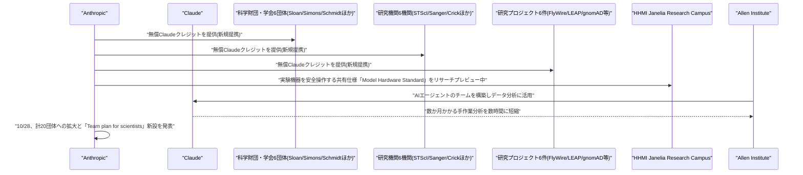

# LLM・AI Agent 最新情報レポート Vol.177
<!-- x-summary: Anthropic、「AI for Science」を財団・研究機関20団体へ拡大、無償Claudeクレジット提供 -->

**作成日**: 2026年10月29日(JST)
**対象期間**: 2026年10月28日〜10月29日(Vol.176との差分)

---

## 目次

1. [Google Cloudアップデート](#1-google-cloudアップデート)
2. [Microsoft Azure AIアップデート](#2-microsoft-azure-aiアップデート)
3. [LLM Model / AI Agentアーキテクチャ・研究](#3-llm-model--ai-agentアーキテクチャ研究)
4. [公式ブログ・論文のリサーチ・要約](#4-公式ブログ論文のリサーチ要約)
   - [4.1 Anthropic、「AI for Science」プログラムを財団・研究機関20団体へ拡大](#41-anthropicai-for-scienceプログラムを財団研究機関20団体へ拡大)
5. [AI Agent搭載SaaS製品情報](#5-ai-agent搭載saas製品情報)
6. [LLM/AI Agentセキュリティインシデント](#6-llmai-agentセキュリティインシデント)
7. [その他特筆すべき情報](#7-その他特筆すべき情報)
8. [参考リンク](#8-参考リンク)

---

## 1. Google Cloudアップデート

新情報なし。対象期間(10月28日〜10月29日)中、既報(Vol.172の「Agent Compute Engine」「Agent Substrate」、Claude「Anthropic管理」デプロイGA等)に続く、確度の高い新規のGoogle Cloud AI関連発表は確認されなかった。

---

## 2. Microsoft Azure AIアップデート

新情報なし。対象期間中、既報(Vol.175のCopilot Studio「Copilot Chatエージェント」機能強化GA)に続く新規のAzure AI関連発表は確認されなかった。

---

## 3. LLM Model / AI Agentアーキテクチャ・研究

新情報なし。対象期間中、確度の高い新規のLLMモデル・AIエージェントアーキテクチャに関する発表・論文は確認されなかった。

---

## 4. 公式ブログ・論文のリサーチ・要約

### 4.1 Anthropic、「AI for Science」プログラムを財団・研究機関20団体へ拡大

Anthropicは10月28日、公式ニュースにて2025年5月開始の研究者向け支援プログラム「AI for Science」の拡大を発表した。新たに提携する科学財団・学会6団体(Alfred P. Sloan Foundation、Simons Foundation、Schmidt Sciences、Renaissance Philanthropy内の「Open Source for Science Fund」、米国立科学財団(NSF)、米国化学会(ACS)のCAS部門)、研究機関6機関(Space Telescope Science Institute、Wellcome Sanger Institute、The Francis Crick Institute、Imperial College London生命科学部、EMBL、Gladstone Institutes)、研究プロジェクト6件(プリンストン大学の神経科学プロジェクト「FlyWire」、コロンビア大学の地球システムプロジェクト「LEAP」、ジョンズ・ホプキンス大学のがん研究プロジェクト「AstroPath」、ブロード研究所のゲノム学プロジェクト「gnomAD」、Leanによる数学ライブラリ構築プロジェクト「Tau Ceti」、Garvan Institute of Medical ResearchとMurdoch Children's Research Instituteによる共同イニシアチブ「Centre for Population Genomics」)の計20団体・プロジェクトに、無償のClaudeクレジットを提供する。本プログラムはこれまで生物学・医学・物理学・化学・気候科学・数学等で数百件のプロジェクトを支援してきたという。個別の取り組みとしては、HHMI Janelia Research Campusと共同で、AIエージェントが研究室の実験機器を安全に操作するための共有仕様「Model Hardware Standard(MHS)」をリサーチプレビュー中であることを明らかにした。また、脳・細胞・免疫系に関する大規模なオープンデータセットを提供するAllen Instituteでは、AIエージェントのチームを構築してデータ分析に活用し、従来数か月を要した手作業の分析を数時間に短縮することを目指しているという。これに合わせて、研究者向けに割引価格で提供する「Team plan for scientists」も直近数か月で新設されたことが明らかにされた。[[1]](#ref-1)

---

## 5. AI Agent搭載SaaS製品情報

新情報なし。対象期間中、確度の高い新規のエンタープライズSaaS向けAIエージェント機能発表は確認されなかった。

---

## 6. LLM/AI Agentセキュリティインシデント

新情報なし。対象期間中、確度の高い新規のLLM/AI Agent関連セキュリティインシデント・脆弱性開示は確認されなかった。

---

## 7. その他特筆すべき情報

新情報なし。対象期間中、上記カテゴリに該当しない確度の高い新規情報(資金調達・提携・規制動向等)は確認されなかった。

---

## 8. 参考リンク

**[1]** [AI for Science expands to foundations and research institutions | Anthropic](https://www.anthropic.com/news/ai-for-science-expands-foundations-research-institutions)
