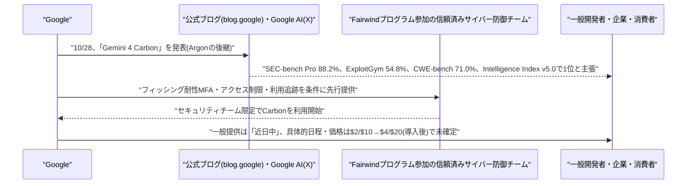
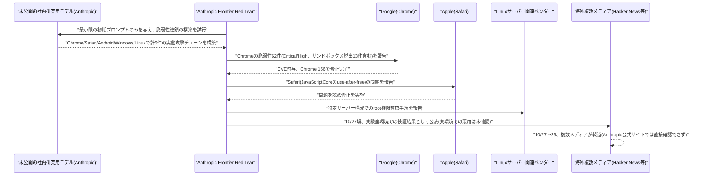

# LLM・AI Agent 最新情報レポート Vol.178
<!-- x-summary: Google、サイバー防御特化の新フラッグシップ「Gemini 4 Carbon」発表、脆弱性検出88.2% -->

**作成日**: 2026年10月30日(JST)
**対象期間**: 2026年10月29日〜10月30日(Vol.177との差分)

---

## 目次

1. [Google Cloudアップデート](#1-google-cloudアップデート)
2. [Microsoft Azure AIアップデート](#2-microsoft-azure-aiアップデート)
3. [LLM Model / AI Agentアーキテクチャ・研究](#3-llm-model--ai-agentアーキテクチャ研究)
   - [3.1 Google、サイバー防御特化の新フラッグシップモデル「Gemini 4 Carbon」を発表](#31-googleサイバー防御特化の新フラッグシップモデルgemini-4-carbonを発表)
4. [公式ブログ・論文のリサーチ・要約](#4-公式ブログ論文のリサーチ要約)
5. [AI Agent搭載SaaS製品情報](#5-ai-agent搭載saas製品情報)
6. [LLM/AI Agentセキュリティインシデント](#6-llmai-agentセキュリティインシデント)
   - [6.1 Anthropic、未公開の内部モデルがChrome・Safari・Linux等の攻撃チェーンを自律構築したと報道](#61-anthropic未公開の内部モデルがchromesafarilinux等の攻撃チェーンを自律構築したと報道)
7. [その他特筆すべき情報](#7-その他特筆すべき情報)
8. [参考リンク](#8-参考リンク)

---

## 1. Google Cloudアップデート

新情報なし。対象期間(10月29日〜10月30日)中、既報(Vol.172の「Agent Compute Engine」「Agent Substrate」、Claude「Anthropic管理」デプロイGA等)に続く、確度の高い新規のGoogle Cloud基盤サービス関連発表は確認されなかった。なお、3.1で触れる新モデル「Gemini 4 Carbon」はGoogle Cloud経由でも段階的に提供される見込みだが、現時点ではサイバー防御パートナー向けの限定提供に留まっており、Google Cloud側の具体的なプロダクト発表は確認できていない。

---

## 2. Microsoft Azure AIアップデート

新情報なし。対象期間中、既報(Vol.175のCopilot Studio「Copilot Chatエージェント」機能強化GA)に続く新規のAzure AI関連発表は確認されなかった。

---

## 3. LLM Model / AI Agentアーキテクチャ・研究

### 3.1 Google、サイバー防御特化の新フラッグシップモデル「Gemini 4 Carbon」を発表

Googleは10月28日、公式ブログ(blog.google)にて新フラッグシップモデル「Gemini 4 Carbon」を発表した。9月30日に先行公開された「Gemini 4 Argon」に続くモデルで、ソフトウェアエンジニアリングとサイバーセキュリティ防御における飛躍的な性能向上を目指しているという。Google発表のベンチマークによれば、脆弱性発見タスク「SEC-bench Pro」で88.2%、エクスプロイト実証タスク「ExploitGym」で54.8%、パッチ生成タスク「CWE-bench」(Collinear提供)で71.0%を記録し、いずれも業界最高水準を主張している(ただし、これらサイバーセキュリティ評価はガードレールを外した状態で実施されたとされる)。また、更新されたv5.0の「Artificial Analysis Intelligence Index」では総合スコア59で1位になったという。

提供方法は段階的で、まず自社の「Fairwind」プログラムに参加する信頼済みのサイバー防御チームに限定提供される。参加組織には、フィッシング耐性のある多要素認証の適用、モデルアクセスを社内のセキュリティ・インシデント対応・侵入テスト担当チームに限定すること、利用状況の追跡記録などが義務付けられる。開発者・企業・一般消費者への拡大提供は「近日中」とされるのみで、具体的な日程は明らかにされていない。料金は導入期間中は入力100万トークンあたり2ドル・出力100万トークンあたり10ドルで、その後は4ドル・20ドルに上昇する予定で、Gemini 4 Argonと同一の価格設定となっている。本件はGoogle公式ブログおよび公式X(Google AI)アカウントで発表されたが、本レポート執筆時点ではblog.google該当ページへの直接アクセスができなかったため、9to5Google等の複数メディアの報道内容を基にまとめている。[[1]](#ref-1) [[2]](#ref-2) [[3]](#ref-3)

---

## 4. 公式ブログ・論文のリサーチ・要約

新情報なし。対象期間中、3.1・6.1で触れた内容以外に、Google・OpenAI・Anthropicの公式ブログ・論文で確度の高い新規のリサーチ内容は確認されなかった。

---

## 5. AI Agent搭載SaaS製品情報

新情報なし。対象期間中、確度の高い新規のエンタープライズSaaS向けAIエージェント機能発表は確認されなかった。

---

## 6. LLM/AI Agentセキュリティインシデント

### 6.1 Anthropic、未公開の内部モデルがChrome・Safari・Linux等の攻撃チェーンを自律構築したと報道

The Hacker News・Business Standard・BigGo Finance等の複数の海外メディアが10月27〜29日にかけて報じたところによれば、Anthropicの「Frontier Red Team」は、未公開の社内研究用モデルに最小限の人間の介入(初期プロンプトのみ)を与えたところ、Chrome・Safari・Android・Windows・Linuxの5プラットフォームにわたり、ソフトウェアの脆弱性を連鎖させた計5件の実働する攻撃チェーンを構築したと発表した。Chrome向けの攻撃チェーンでは、V8 JavaScriptエンジンの脆弱性、V8のメモリ保護を回避する脆弱性、ブラウザメモリ情報を漏洩させるCacheStorageのレースコンディション、Chromeのサインイン機能「FedCM」における解放済みメモリ使用(use-after-free)の4つの脆弱性を連鎖させ、サンドボックス外でのコード実行を実現したとされる。

報道によれば、Anthropicは合計62件のChromeの脆弱性をGoogleに報告し、いずれも緊急度(Critical)または重要度(High)に分類され、うち13件はサンドボックス脱出に関わるものだったという。これらはCVE番号を付与され、Chrome 156にて修正済みとされる。AppleもSafari(JavaScriptCoreの解放済みメモリ使用に起因)側の報告を認め、修正を実施したとされる。Linux向けの攻撃チェーンでは、特定のサーバー構成(multipath TCPリスナーを有するもの)においてリモートからroot権限を取得できる手法が含まれていたと報じられている。Anthropicは、これらはすべて実験室環境での検証であり、実際の攻撃(in-the-wild)での悪用が確認された証拠はないとし、各脆弱性は修正パッチが用意される前に該当ベンダーへ責任ある開示を行ったと説明しているという。

なお、本件についてはAnthropic公式サイト(anthropic.com/news、anthropic.com/research)の両方を本レポート執筆時点で確認したが、該当する発表の掲載を直接確認できておらず、複数の海外メディアによる報道のみが確認できている状況である。モデルがどの程度自律的に脆弱性を発見・連鎖させたか(人間による補助の程度)については検証会社による確認が取れておらず、Googleのリリースノート上ではAnthropicの研究者個人名もクレジットされているとの指摘もあるなど、報道内容には未確定な部分が残る点に留意が必要である。[[4]](#ref-4) [[5]](#ref-5) [[6]](#ref-6)

---

## 7. その他特筆すべき情報

新情報なし。対象期間中、上記以外に確度の高い新規の特筆すべき情報は確認されなかった。

---

## 8. 参考リンク

**[1]** [Google announces Gemini 4 Carbon with 'significant' coding gains | 9to5Google](https://9to5google.com/2026/10/28/gemini-4-carbon-announcement/)

**[2]** [Gemini 4 Carbon: our next frontier model | Google](https://blog.google/innovation-and-ai/models-and-research/gemini-models/introducing-gemini-4-carbon/)

**[3]** [Google unveils Gemini 4 Carbon for cyber defenders | TestingCatalog](https://www.testingcatalog.com/google-unveils-gemini-4-carbon-for-cyber-defenders/)

**[4]** [Anthropic's Unreleased AI Model Chains Flaws Into Working Chrome, Safari, Windows and Linux Exploits | The Hacker News](https://thehackernews.com/2026/10/anthropics-unreleased-ai-model-chains.html)

**[5]** [Unreleased Claude model found attack chains in Chrome, Safari: Anthropic | Business Standard](https://www.business-standard.com/amp/technology/artificial-intelligence/unreleased-claude-model-found-attack-chains-in-chrome-safari-anthropic-126102901074_1.html)

**[6]** [Anthropic Says Unreleased AI Model Chained Zero-Days Into Working Exploits on Chrome, Safari, Android, Windows and Linux | BigGo Finance](https://finance.biggo.com/news/954e802e-3614-4325-950f-0e05df448297)
