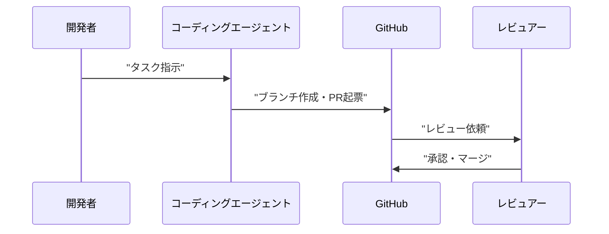

# LLM・AI Agent 最新情報レポート Vol.179
<!-- x-summary: GitHub Octoverse 2026発表、9月のPRの4割超をAIエージェントが起票、月間マージPRは2.2億件 -->

**作成日**: 2026年10月31日(JST)
**対象期間**: 2026年10月30日〜10月31日(Vol.178との差分)

> 注記: 本日はリサーチ環境の制約(一部の公式サイト・セキュリティ情報源に接続不可)により、一次情報の網羅的な確認ができていません。確認できなかった項目は「新情報なし」としています。

---

## 目次

1. [Google Cloudアップデート](#1-google-cloudアップデート)
2. [Microsoft Azure AIアップデート](#2-microsoft-azure-aiアップデート)
3. [LLM Model / AI Agentアーキテクチャ・研究](#3-llm-model--ai-agentアーキテクチャ研究)
4. [公式ブログ・論文のリサーチ・要約](#4-公式ブログ論文のリサーチ要約)
5. [AI Agent搭載SaaS製品情報](#5-ai-agent搭載saas製品情報)
6. [LLM/AI Agentセキュリティインシデント](#6-llmai-agentセキュリティインシデント)
7. [脆弱性情報](#7-脆弱性情報)
8. [その他特筆すべき情報](#8-その他特筆すべき情報)
9. [参考リンク](#9-参考リンク)

---

## 1. Google Cloudアップデート

新情報なし。(Vertex AIがGemini Enterprise Agent Platformへ統合された既報の流れ以外に、対象期間の新規発表は確認できなかった。)

---

## 2. Microsoft Azure AIアップデート

新情報なし。

---

## 3. LLM Model / AI Agentアーキテクチャ・研究

新情報なし。(Anthropic公式ニュースの最新投稿は10月28日付で、いずれも既報。)

---

## 4. 公式ブログ・論文のリサーチ・要約

新情報なし。(Anthropic公式ニュース[[1]](#ref1)に10月29日以降の新規投稿は確認できず。Google・OpenAIの公式サイトは接続できず未確認。)

---

## 5. AI Agent搭載SaaS製品情報

### 5.1 GitHub Octoverse 2026:エージェントがPRの4割超を起票

GitHubは10月28日(GitHub Universe)、Octoverse 2026を公表した。Satya Nadella氏は、9月時点でGitHub上のプルリクエストの40%超をAIエージェントが起票したと述べ、GitHubのJay Parikh氏は月間マージPRが約2億2,000万件に達し、1年弱前の約3倍になったと報告した[[2]](#ref2)[[3]](#ref3)。

- エージェント関与PRは複数ファイル変更の割合が87%(従来PRは79%)、2週間以内のマージ率は90%(従来86%)と報じられている[[3]](#ref3)
- 「40%超」の定義(起票か、初稿作成か)は報道間で表現が異なり、一次情報での最終確認が必要[[3]](#ref3)

---

## 6. LLM/AI Agentセキュリティインシデント

### 6.1 AGENTS.mdをDownloadsに置きコーディングエージェントを乗っ取る手法(Forever Security、10月22日報告・本レポート初出)

Forever Securityは、ブラウザがユーザー操作なしでDownloadsフォルダへファイルを保存できる点と、エージェントが作業ディレクトリの指示ファイルを信頼する点を組み合わせた攻撃を報告した。Codexでは90%超の試行で悪性npmパッケージ(MALFEXキャンペーン関連)のインストールに至り、Claude Codeでは`CLAUDE.md`により`ANTHROPIC_BASE_URL`を攻撃者サーバーへ向けさせる経路が約50%で成功したという。実被害の広がりは確認されておらず、IDCは「早期警告」と評している[[4]](#ref4)[[5]](#ref5)。

- 推奨対応: `~/Downloads`でエージェントを起動しない/自分で作成していない`AGENTS.md`・`CLAUDE.md`は実行前に確認/`~/.codex/config.toml`と`.claude/settings.json`の不審な設定を点検/混入が疑われる場合はトークンをローテーション

---

## 7. 脆弱性情報

### 7.1 AI関連

新情報なし。(対象期間に公開された、日付とCVSSを確認できるAI関連の新規脆弱性は見つからなかった。NVD・GitHub Security Advisoriesへ直接接続できず、網羅性は限定的。)

### 7.2 実行環境(Python・Node.js・Linux)

新情報なし。(CISA KEVおよび各公式セキュリティリリースへ接続できず、対象期間の新規該当は確認できていない。)

---

## 8. その他特筆すべき情報

新情報なし。

---

## 9. 参考リンク

[1] Anthropic News: https://www.anthropic.com/news
[2] GitHub Blog "Octoverse: Commits, pushes reach new highs in 2026 as developers build with agents": https://github.blog/news-insights/octoverse/octoverse-commits-pushes-reach-new-highs-in-2026-as-developers-build-with-agents/
[3] Crypto Briefing "Satya Nadella says AI agents now open over 40% of GitHub pull requests": https://cryptobriefing.com/ai-agents-open-40-percent-github-pull-requests/
[4] BleepingComputer "AI coding agents hijacked using AGENTS.md file in Downloads folder": https://bleepingcomputer.com/news/security/ai-coding-agents-hijacked-using-agentsmd-file-in-downloads-folder
[5] Help Net Security "AI coding agents fall for malicious instructions planted in the Downloads folder": https://www.helpnetsecurity.com/?p=389068
