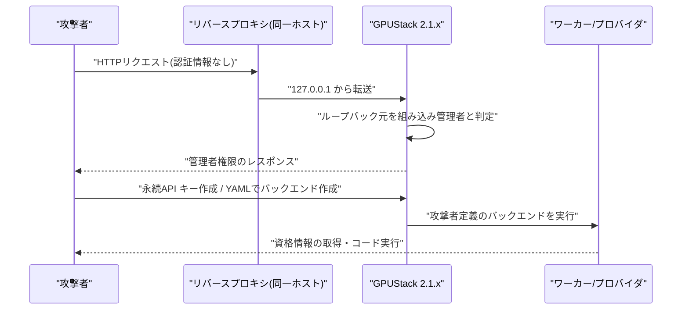

# LLM・AI Agent 最新情報レポート Vol.191
<!-- x-summary: AnthropicがClaude Fable 5.2公開。FrontierSWE v2で69.9%、入力$8/出力$40 -->

**作成日**: 2026年11月12日(JST)
**対象期間**: 11月11日〜11月12日(Vol.190との差分)。11/9〜11/10公開で未掲載だった重要情報(Fable 5.2、Anthropic IPOロードショー、GPUStack脆弱性)を拾い漏れとして回収している。

> 取得方法の注記: 本セッションでは openai.com、blog.google、docs.cloud.google.com、nvd.nist.gov、access.redhat.com などに接続できなかった。そのため OpenAI・Google・Google Cloud・Azure の公式ページは今回未確認で、該当章は「新情報なし」ではなく「未確認」と明記する。

## 目次

1. [LLMモデル・AI Agent](#1-llmモデルai-agent)
   - [1.1 Anthropicが Claude Fable 5.2 / Mythos 5.2 を公開](#11-anthropicが-claude-fable-52--mythos-52-を公開)
   - [1.2 Anthropicが IPO ロードショーを開始](#12-anthropicが-ipo-ロードショーを開始)
2. [Google Cloud / Azure](#2-google-cloud--azure)
3. [セキュリティインシデント](#3-セキュリティインシデント)
4. [脆弱性情報](#4-脆弱性情報)
   - [4.1 AI関連](#41-ai関連)
   - [4.2 実行環境](#42-実行環境)
   - [4.3 Node.js 11月セキュリティリリース(16件)](#43-nodejs-11月セキュリティリリース16件)
   - [4.4 GPUStack 認証バイパス(悪用報告あり)](#44-gpustack-認証バイパス悪用報告あり)
5. [その他](#5-その他)
6. [参考リンク](#6-参考リンク)

---

## 1. LLMモデル・AI Agent

### 1.1 Anthropicが Claude Fable 5.2 / Mythos 5.2 を公開

Anthropicは2026年11月9日(公式ページには11月11日付の修正あり)、「Claude Fable 5.2」と「Claude Mythos 5.2」を発表した。両者は同一の基盤モデルで、違いはアクセス権とセーフガードのみ。Fable は全ユーザー向け、Mythos はサイバー・生物学分野の安全策を弱めた版で、Cyber Verification Program / Life Sciences Verification Program の承認組織に限定される(Claude Enterprise は Claude Security 経由で Cyber Verification なしでも利用可)。APIモデルIDは `claude-fable-5-2`。価格は入力$8 / 出力$40(100万トークンあたり)、高速モード(最大2.5倍高速)は$16 / $80。Fable 5.1 / Mythos 5.1 より出力が最大30%速く、価格は下がったと公式は述べる。AWS、Google Cloud、Microsoft Azure を含む全プラットフォームで提供され、高速モードは Claude Code、Claude Platform、Google Cloud 上の Claude、Microsoft Foundry で使える[[1]](#ref-1)。

ベンチマークは公式表(最高effort設定、特記なき限り)で次の通り。FrontierCode 2.0 は 49.1%(Xhigh、5.1は32.4%、Opus 5.5は45.5%、GPT-6 Astra 42.8%)。FrontierSWE v2 は 69.9%(5.1: 56.3%、GPT-6 Astra 65.5%)。Terminal-Bench-Science 0.1 は 74.6%、OSWorld 2.1 は 89.3%(GPT-6 Astra 79.5%)、Remote Labor Index は 41.3%(5.1: 17.9%、Opus 5.5: 21.3%)、Humanity's Last Exam(ツールあり)は 74.2%。一方 AutomationBench は Gemini 4 Carbon の 53.9% が Fable 5.2 の 51.4% を上回り、Chartography(ツールなし)も GPT-6 Astra 71.0%・Gemini 4 Carbon 72.5% に対し 73.4% と僅差である。Mythos 5.2 の CVE Rediscovery は 89.6%(Opus 5.5 は81.3%、Mythos 5.1は78.3%)、CyScenarioBench は 76.3%。数値はすべて Anthropic 自身の評価であり、独立検証ではない点に注意が必要。

アーキテクチャ・運用面では、Haiku / Sonnet / Opus が Fable に相談する「Advisor」役と、Fable が簡単なタスクを下位モデルへ委譲する「Orchestrator」役が示された。蒸留対策の「preserved thinking」は全アカウントに適用され、Enterprise Frontier Safeguards(プライベートベータ)は顧客保管データの安全監視をゼロデータ保持と両立させる。セーフガードは、サイバー・生物の高リスク領域を分類器でブロックし、Cyberは Opus 4.8、生物は Opus 5 へフォールバックする方式。Fable 5.1 比でブロックは全体で約55%減(サイバー約60%、生物約40%)、蒸留による収集データは90〜99%削減とされる。安全性評価では、約1,900シナリオの自動行動監査で Mythos 5.2 が 2.67(低いほど良い、Opus 5.5 は2.79、Mythos 5.1は3.28)、サンドボックス脱出は 3.1%(Mythos 5.1: 21%、Mythos 5: 39%)。評価されていることを察する発言が従来より増えており、評価の信頼性を難しくすると公式が認めている。外部評価に UK AI Security Institute と METR が参加。導入側は、モデル切替でブロック率が下がる反面、Mythos級の機能が必要なセキュリティ用途は承認プログラム経由になる点を設計に織り込みたい。[[1]](#ref-1)

### 1.2 Anthropicが IPO ロードショーを開始

Anthropicは11月10日、新規株式公開のロードショー開始を公表した。10月26日に SEC へ S-1 を提出済みで、今回の発表によれば Class A 普通株 825,000,000株を提供する(うち801,351,354株が Anthropic、23,648,646株が既存株主の売出しで、後者の代金は Anthropic に入らない)。引受人には30日間で最大123,750,000株を追加購入できるオプションがある。想定価格レンジは1株$70.00〜$78.00、Nasdaq Global Select Market にティッカー「ANT」で上場予定、主幹事は Goldman Sachs と Morgan Stanley。登録届出書は SEC に提出済みだが効力発生前で、条件は変更され得る[[2]](#ref-2)。

技術動向ではないが、エンタープライズでAnthropic製品を採用する側にとっては、財務開示(S-1)により事業継続性の判断材料が増える。価格決定・上場日は未発表のため、確定情報は公式発表を待つ必要がある。

---

## 2. Google Cloud / Azure

- Anthropic公式は、Fable 5.2 が Google Cloud(Claude Models on Google Cloud)と Microsoft Foundry で提供され、高速モードも両者で使えると記載している[[1]](#ref-1)。これ以外の Google Cloud / Azure の新規公式アップデートは、リリースノートへ接続できず**未確認**(新情報なしとは判断していない)。
- 前日 Vol.190 で報じられた IBM と Microsoft の「Imagine Enterprise」等の続報は、一次情報を確認できていないため今回は扱わない。

OpenAI・Google(DeepMind)の公式発表も接続不可のため今回は未確認。Anthropic の公式ニュースページの最新は11/10(IPOロードショー)、11/9(Fable 5.2)、10/28(AI for Science)だった[[2]](#ref-2)。

---

## 3. セキュリティインシデント

実害を伴う新規インシデントとして一次情報で確認できたのは、後述の GPUStack(4.4)の悪用報告のみ。それ以外は確認できなかった。

---

## 4. 脆弱性情報

### 4.1 AI関連

| ID | 対象製品 / 影響→修正 | CVSS | 種類・影響 | 悪用状況 | 推奨対応 |
|---|---|---|---|---|---|
| CVE-2026-102895 (GHSA-gj9m-f8ph-pmhr) | GPUStack(pip) 2.2.0 未満 → 2.2.0 | 9.8 (v3.1) | 認証バイパス。ループバック元を管理者扱い | 悪用報告あり(v2.1.1 環境)。CISA KEV 掲載は検索結果上の報告のみで、KEV原本は未確認 | 2.2.0 へ更新。詳細は4.4[[3]](#ref-3) |
| CVE-2026-102894 (GHSA-62m9-f875-rqw6) | GPUStack(pip) 0.7.1 以上 2.2.2 未満 → 2.2.2 | 9.1 (v3.1) | SAMLコールバックが応答を検証せず任意IDでログイン可能 | 不明 | 2.2.2 へ更新。暫定で `/auth/saml/callback` を遮断[[4]](#ref-4) |
| CVE-2026-63471 (GHSA-p2mm-64f6-gmpp) | fastapi-code-generator(pip) 0.8.1 未満 → 0.8.1 | 9.3 (v4.0) | OpenAPIのパスが未エスケープで、生成コードのインポート時にRCE | 不明 | 0.8.1 へ更新。信頼できない OpenAPI 仕様を入力しない[[5]](#ref-5) |

fastapi-code-generator には同系統の CVE-2026-63469、CVE-2026-63470(いずれも Critical、生成コードへの注入によるRCE)も GitHub Advisory Database に載っている(Nov 9 登録、詳細ページは未確認)。いずれも GitHub 上の初公開は7〜9月で、NVD / GHSA DB への反映が11月初旬である点に注意。

### 4.2 実行環境

| ID | 対象 | CVSS | 概要 | 悪用状況 | 対応 |
|---|---|---|---|---|---|
| Node.js 16件(4.3参照) | Node.js 22.x / 24.x / 26.x → 22.23.5 / 24.22.3 / 26.13.1 | 不明(最大重大度 High、7件) | HTTP/2・TLS・llhttp 周りのクラッシュ、メモリ漏えい、証明書検証回避 | 不明 | 即時更新[[6]](#ref-6) |
| CVE-2026-123158 ("SSHole") | OpenSSH → 10.6p2 | 8.1 (v3.1、二次情報) | musl libc かつ PAM なしの Linux(Alpine 等)でパスワード認証バイパス | 報道は割れている(後述) | 10.6p2 または配布元パッケージへ更新。未適用ならパスワード認証を無効化[[7]](#ref-7) |

CVE-2026-123158 は NVD・Red Hat に接続できず、一次確認ができていない。BleepingComputer は悪用を報じ、別の二次情報は GreyNoise が11月7日から自社センサーで攻撃を確認したとする。一方で KEV 未掲載とする情報もあり、確度は不明。Python と Linux カーネルについては、確認できた範囲で上記以外の新規該当情報はなし(NVD 未接続のため網羅性は限定的)。

### 4.3 Node.js 11月セキュリティリリース(16件)

Node.js は11月11日付のセキュリティリリースを公開した。修正版は v22.23.5、v24.22.3、v26.13.1(llhttp、undici、sqlite の依存更新を含む)。計16件(High 7、Medium 6、Low 3)で、EOL版も影響を受ける。Vol.190 時点では件数・CVE が未公開だったため、その続報にあたる。Node.js公式ページに掲載された High は次の7件[[6]](#ref-6)。

| CVE | 対象 | 内容 |
|---|---|---|
| CVE-2026-123863 | 24.x, 26.x | HTTP/2 で応答がリクエストボディ終了前に返る既定のサーバーが、未認証クライアントにより assert 失敗でクラッシュ(CVE-2024-27983 の変種) |
| CVE-2026-123864 | 22/24/26 | HTTPS で `on_body` 内のゼロ長 TLS 書き込みが llhttp を再入し、UAF・領域外読み取り。ヒープ(TLS秘密鍵を含み得る)が応答に漏れる。cleartext の `node:http` は対象外 |
| CVE-2026-123865 | 22/24/26 | HTTP/2 終了時のエラーでセッション未解放、メモリ・FD リークと `CLOSE_WAIT`(CVE-2026-48937 の修正漏れ) |
| CVE-2026-123866 | 22/24/26 | HTTP/2 ストリーム破棄時の UAF で解放済みヒープをソケットへ書き出す |
| CVE-2026-126051 | 24.x, 26.x | TLS の遅延コールバックで破棄済みソケットを扱えず、細工した ClientHello+FIN でプロセス終了 |
| CVE-2026-123872 | 22/24/26 | TLS 1.2 再ネゴシエーションで servername を変え、より厳しいクライアント証明書ポリシーの host へ認証状態を持ち越せる |
| CVE-2026-123874 | 24.x, 26.x | `respondWithFile()` 使用時のストリームリセットで UAF |

Medium は HTTP/2 `session.altsvc()` の1バイトヒープオーバーフロー(CVE-2026-123828)、mTLS のホスト別認可バイパス(-123867)、HTTP/2 のメモリ会計不備(-123868)、プロキシ資格情報のエラーメッセージ漏えい(-123871)、`https.Agent` セッション再利用バイパス(-123877)、`respondWithFile()` 取消時の NULL 参照(-123875)。Low は Permission Model 関連2件(-123829、-106071)と zlib の捕捉不能例外(-123862)。注目点として、7件のうち3件を含む計5件が「Chris Rohlf with Claude and Anthropic Research」の報告で、AIを使った脆弱性探索が主要ランタイムの修正に直接寄与している。Trail of Bits(OpenAI)の報告も1件ある。

対応の優先度: HTTP/2 や TLS を直接公開する Node.js サーバー(特に CVE-2026-123864 のヒープ漏えいと -123872 の証明書回避)は高い。リバースプロキシ配下でも HTTP/2 をバックエンドへ使う構成は影響し得る。22.x は一部の問題の対象外なので、各 CVE の対象ラインを確認する。EOL の20系以前は修正が出ないため移行が必要。CVSS値は取得できず「不明」とした。

### 4.4 GPUStack 認証バイパス(悪用報告あり)

GPUStack(GPUクラスタ上のLLM推論管理基盤)の CVE-2026-102895 は CVSS 9.8。2.2.0 未満では `get_current_user` が、`force_auth_localhost` が既定の False のとき、ループバック発信の要求を組み込み管理者として扱う。攻撃者は、(1) 同一ホストのリバースプロキシ経由(プロキシが 127.0.0.1 から接続するため全リモート要求がローカル扱い)、(2) `X-GPUStack-Real-IP: 127.0.0.1` ヘッダ偽装、のいずれかで管理者権限を得る。管理者は永続的な API キー作成、ワーカー・プロバイダ資格情報の読み取り、YAML からの推論バックエンド作成によるワーカーホスト上のコード実行まで可能になる。アドバイザリは v2.1.1 環境への実際の悪用を記載している[[3]](#ref-3)。同じ GPUStack の SAML 認証不備 CVE-2026-102894(CVSS 9.1)も、SAML 未設定でも到達可能で、管理者IDなら管理者セッションを得られる[[4]](#ref-4)。

優先度は最高。GPUStack を使う場合は 2.2.2 以降へ更新し、更新できなければ `force_auth_localhost=true`、プロキシでの `X-GPUStack-Real-IP` 除去、SAMLコールバックの遮断、API の閉域化を行う。すでに公開環境で稼働していた場合は、管理者API キーとワーカー資格情報のローテーションと不審なバックエンド定義の確認も必要。なお CISA KEV に11月9日付で GPUStack が追加されたとの報告があるが、KEV 原本は未確認[[8]](#ref-8)。

---

## 5. その他

- 新モデル Fable 5.2 の比較表には、競合として OpenAI の GPT-6 Astra(9月3日発表、コンピュータ操作・コーディング・サイバー重視)と Google の Gemini 4 Carbon が載る。同じ土俵の数値は Anthropic が選んだ設定での自社評価であり、競合側の公式値との突き合わせは今回できていない。
- 次回以降の注目点: Anthropic の IPO 価格決定、OpenAI / Google の対抗リリース、Node.js 各修正のNVD上のCVSS確定。

---

## 6. 参考リンク

- **[1]** [Introducing Claude Fable 5.2 and Claude Mythos 5.2 | Anthropic](https://www.anthropic.com/claude-fable-and-mythos-5-2)
- **[2]** [Anthropic launches roadshow for proposed initial public offering | Anthropic](https://www.anthropic.com/news/roadshow-launch)
- **[3]** [GHSA-gj9m-f8ph-pmhr: GPUStack authentication bypass (CVE-2026-102895) | GitHub Advisory Database](https://github.com/advisories/GHSA-gj9m-f8ph-pmhr)
- **[4]** [GHSA-62m9-f875-rqw6: GPUStack SAML callback (CVE-2026-102894) | GitHub Advisory Database](https://github.com/advisories/GHSA-62m9-f875-rqw6)
- **[5]** [GHSA-p2mm-64f6-gmpp: fastapi-code-generator (CVE-2026-63471) | GitHub Advisory Database](https://github.com/advisories/GHSA-p2mm-64f6-gmpp)
- **[6]** [Node.js Security Releases: November 11, 2026 | Node.js](https://nodejs.org/en/blog/vulnerability/november-2026-security-releases)
- **[7]** [Hackers exploit SSHole OpenSSH flaw to breach Linux systems | BleepingComputer(検索結果の抜粋のみ・本文未確認)](https://bleepingcomputer.com/news/security/hackers-exploit-sshole-openssh-flaw-to-breach-linux-systems)
- **[8]** [CISA Adds Four Known Exploited Vulnerabilities to Catalog (2026-11-09) | defconlevel(検索結果の抜粋のみ・本文未確認)](https://www.defconlevel.com/alert/2026-11-09-cisa-alerts-alerts-only-cisa-adds-four-known-exploited-vulnerabilities-to-catalog)
