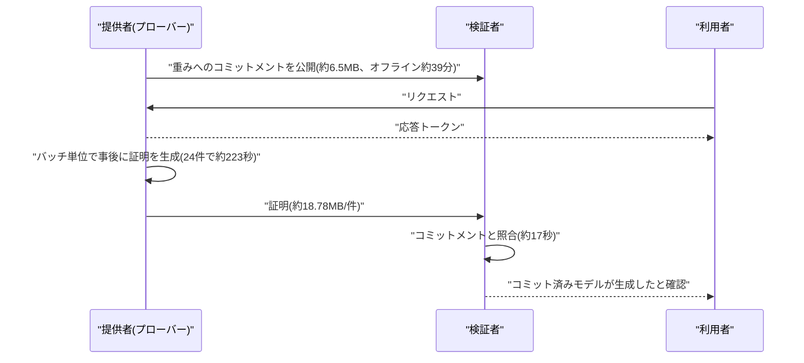

# LLM・AI Agent 最新情報レポート Vol.192
<!-- x-summary: Anthropicが記憶設計「dreaming」公開。Opus 5.5のCL-Benchが0.655→0.838 -->

**作成日**: 2026年11月13日(JST)
**対象期間**: 11月12日〜11月13日(Vol.191との差分)。当該期間に Anthropic 公式ページへ新規投稿はなかったため、11/6公開で未掲載だった研究記事と、11/2公開で未掲載だった研究記事(7日超のため補完扱い)、および GitHub Advisory Database に11/9〜11/10に反映された脆弱性を回収している。

> 取得方法の注記: 本セッションでは openai.com、deepmind.google、docs.cloud.google.com、learn.microsoft.com に接続できなかった(名前解決エラー)。そのため OpenAI・Google・Google Cloud・Azure の公式ページは今回も**未確認**で、該当箇所は「新情報なし」ではなく「未確認」と記す。接続できたのは anthropic.com、github.com など。NVD・各ディストリビューションのアドバイザリも未確認。

## 目次

1. [LLMモデル・AI Agent・公式研究](#1-llmモデルai-agent公式研究)
   - [1.1 Anthropicがエージェント記憶の設計「dreaming」を公開](#11-anthropicがエージェント記憶の設計dreamingを公開)
   - [1.2 Anthropicが LLM 推論の「証明可能性」(FlashProve)を公開(補完)](#12-anthropicが-llm-推論の証明可能性flashproveを公開補完)
2. [Google Cloud / Azure / OpenAI / Google](#2-google-cloud--azure--openai--google)
3. [セキュリティインシデント](#3-セキュリティインシデント)
4. [脆弱性情報](#4-脆弱性情報)
   - [4.1 AI関連](#41-ai関連)
   - [4.2 実行環境](#42-実行環境)
   - [4.3 React Server Components の認証不要RCE](#43-react-server-components-の認証不要rce)
5. [その他](#5-その他)
6. [参考リンク](#6-参考リンク)

---

## 1. LLMモデル・AI Agent・公式研究

### 1.1 Anthropicがエージェント記憶の設計「dreaming」を公開

Anthropic Engineering は2026年11月6日、「The components of agent memory」を公開した。エージェント記憶を「経験から得た知識をセッションをまたいで読める文脈として保持するもの」と定義し、重みの更新、会話内の in-context learning、コンパクションは対象外とする。中心概念は「dreaming」で、エージェントがオフラインでログやトランスクリプトを見直し、誤りの修正、ノート作成、記憶構造の整理を行う処理だ。人間が睡眠中に記憶を固定する過程に例えられ、関連研究として Letta と UC Berkeley の「sleep-time compute」(arXiv 2504.13171)が挙げられている[[1]](#ref-1)。

評価の数値は具体的である。CL-Bench 1.0 のデータベースタスク(各質問を新規セッションで開始し、永続メモリディレクトリのみ引き継ぐ)では、平均報酬が記憶なしから記憶ありで Opus 5.5 が 0.655→0.838、Sonnet 5.5 が 0.644→0.833、Opus 5 が 0.564→0.828、Opus 4.7 が 0.383→0.700、Sonnet 5 が 0.306→0.610、Sonnet 4.6 が 0.330→0.364 となった。世代が進むほど記憶の使い方が上達し、Opus 5 は規則・根拠・落とし穴を記録する学習ループを初めて完走したとされる。Pokémon Red では、Sonnet 3.7 が413ファイル・225フォルダを作ってバッジ1個、Claude Fable 5 は9ファイルと `global.md` でバッジ4個で、画面に出ない戦略や計画だけを保存していた。記憶の書き方の指示も効果が分かれ、「失敗だけを記録せよ」と強制すると Opus 5 で 0.234、Opus 4.7 で 0.150 低下した一方、記憶を使う目的だけを伝える方式は Opus 4.7 / Opus 5 で良好だった。Sonnet 4.6 は記憶の読み出しと仮説検証を促すと 0.364→0.641 に改善した[[1]](#ref-1)。

dreaming の効果は、Pokémon の Mt. Moon で誤って書かれたノートを転写と照合して修正し、修正版は行動1,935回目で Cerulean City に到達、未修正版は同じ場所を3回ループしたという例で示された。Wiki 型の記憶では、約35万ファイル・4.2億トークンの Stainless コーパス(25問、Opus 5 による128回の dreaming)で、Wiki のみの正答基準達成率が13%→48%、Wiki+検索が54%→61%(検索のみ53%)となり、1問あたり約2万トークンを節約した。Harvey LAB の合併文書(24問)では Wiki 87%、検索のみ73%。ただし効果のないタスクもあり、Wiki が元コーパスの1.77倍に膨らんだ例もある。複数エージェントが1つの共有表へ書くと57事実中41(72%)しか残らず、契約ごとにページを分けて原文の条項を保持すると57事実すべて(100%)が残った。常時ロードされる最上位層は小さく保つ必要があり、Claude Code は `MEMORY.md` の先頭200行または25KBのみ読み込む。未解決の課題として、書き込みの時期(セッション中は即時だが本題の邪魔、dreaming は遅延)、記憶の鮮度維持、保守コストと誤りの蓄積が挙げられている。数値はすべて Anthropic 自身の評価である。導入側にとっては、エージェントの記憶を「何を書かせるか」より「何のために使うか」を指示し、並列エージェントの共有書き込みは分割設計にする、という実装上の示唆が得られる[[1]](#ref-1)。

### 1.2 Anthropicが LLM 推論の「証明可能性」(FlashProve)を公開(補完)

Anthropic の Frontier Red Team は11月2日に「Progress on provable inference for large language models」を公開した。対象期間(7日以内)からは外れるが、これまでの daily に載っておらず、推論基盤の信頼性に関わるため補完として掲載する。課題は、利用者が返ってきた応答を実際にどのモデルが生成したか確認できない点にある。ルーターが安価なモデルに差し替える、攻撃者がトークン列を改ざんするといった事態を、軽量な検証者が、重みを知ることなく検証する仕組みを目指す。著者は Roy Rinberg と Alex Allain(Anthropic)ほか、EPFL、MIT、StarkWare、Succinct の共同研究者である[[2]](#ref-2)。

手法は、ソフトウェアのみで動く zkSNARK だ。提供者がまず重みへの短いコミットメントを公開し(オフライン段階)、リクエストごとに「コミット済みモデルがこの出力トークンを生成した」という証明を作る(オンライン段階)。情報理論的な IOP をハッシュ関数でコンパイルする構成でポスト量子安全性を持ち、証明は重み・中間値・どのエキスパートが動いたかを隠すが、アーキテクチャは隠さない。実装の FlashProve は、400B パラメータ(アクティブ約17B)の MoE である Llama 4 Maverick の4ビット公開重みを、H100 1枚と24 CPUコアで証明した。オフラインは約39分(モデルごとに1回、約1,600万リクエスト分有効)、24リクエストのバッチで約223秒(約110トークン/秒)、1,024トークン窓で1トークンを検証する証明は約18.78MB。検証側は約6.5MBのコミットメントと証明を取得し、24スレッドで約17秒、単一スレッドで約21秒かかる。vLLM(FP8、H100 8枚)との比較では1GPUあたり約72倍遅い(24バッチで66〜77倍、最高負荷で約94倍)。先行研究との比較では、VerInf が同モデルで約0.02トークン/秒(1,000トークンに14.3時間)、zkLLM が LLaMA-2-13B で約2.5トークン/秒とされる[[2]](#ref-2)。

形式検証として、Lean でプロトコルを記述し、ランダムオラクルモデルのもとで完全性・健全性・ゼロ知識性の3性質を証明した。日常利用向けの C++ 検証器は形式保証がないが、Lean 検証器とは全テストで一致している。ライセンスは Apache 2.0 で、ブログ、技術報告、仕様、プローバー、検証器、Lean 証明が公開され、重みは Hugging Face から Meta のライセンスで別途取得する。限界として、証明対象は整数化したモデルの貪欲デコードであり、浮動小数点やサンプリング出力とは一致しない可能性があること、コンテキストが1,024トークンに限られること、サイドチャネルは対象外であることが挙げられている。実運用にはまだ遠い(約72倍のコスト)が、モデル差し替え検知や承認済みモデルのみの提供といった監査用途の土台として注視する価値がある[[2]](#ref-2)。

---

## 2. Google Cloud / Azure / OpenAI / Google

OpenAI、Google(DeepMind、blog.google)、Google Cloud リリースノート、Azure / Microsoft Foundry の各公式ページには接続できず、**未確認**である(新情報なしとは判断していない)。検索では OpenAI の11月の発表、Google の11月の Gemini 発表とも該当を見つけられなかった。Anthropic のニュースページの最新は11/10(IPOロードショー)で、11/12付の見出しはあるが記事はなかった[[3]](#ref-3)。研究ページの最新は11/9(電子回路設計の検証記事、本文は未取得)だった[[4]](#ref-4)。

---

## 3. セキュリティインシデント

一次情報で確認できた新規インシデントはない。検索では11月3日に Glow Labs が「MCPhantom」(コーディングエージェントのセッション記録に基づく研究)を公表したとの記述が CSA の日報にあったが、本文を確認できていないため掲載しない。Vol.191 の GPUStack 悪用報告の続報も確認できなかった。

---

## 4. 脆弱性情報

### 4.1 AI関連

GitHub Advisory Database(pip、critical / high、mcp)の新着を確認した。Vol.191 掲載の GPUStack、fastapi-code-generator 以降に、同DBで11/9〜11/10に反映された次の項目がある。

| ID | 対象製品 / 影響→修正 | CVSS | 種類・影響 | 悪用状況 | 推奨対応 |
|---|---|---|---|---|---|
| CVE-2026-87008 (GHSA-85gg-2gfq-q95m) | code-graph-rag(pip、MCPサーバー機能あり) 0.0.586 以下 → 0.0.587 | 7.1 (v3.1) | `structural_search` / `structural_replace` が symlink を解決せずパス検査し、プロジェクト外のファイル読み取り・上書きが可能(MCP経由では承認要件も回避) | PoC はアドバイザリ内で確認。実際の悪用は不明 | 0.0.587 以降へ更新[[5]](#ref-5) |
| CVE-2026-77604 (GHSA-vvr2-h2jp-838m) | code-graph-rag(pip) | High(スコアは未取得) | MCP の paginated read_file でパストラバーサル | 不明 | 詳細ページは未確認。上記と同様に更新 |

CVE-2026-87008 は GitHub 初公開が8月10日、NVD 掲載が11月5日、GitHub Advisory Database 反映が11月9日であり、公開日が古い点に注意。攻撃の成立には、解析対象リポジトリに攻撃者が symlink を紛れ込ませる必要がある(AV:L / UI:R)。信頼できないリポジトリを AI コーディング支援に解析させる運用では、`.env` などの資格情報が読まれる経路になる。

### 4.2 実行環境

Node.js の11月セキュリティリリース(16件、v22.23.5 / v24.22.3 / v26.13.1)は Vol.191 で掲載済みで、差分はない。Python 本体・Linux カーネルについては、接続できた GitHub Advisory Database では新規の該当を確認できなかった。NVD、Red Hat、Ubuntu、Debian、python.org のアドバイザリは未接続のため、**網羅性は限定的**である。OpenSSH "SSHole"(CVE-2026-123158)の KEV 掲載有無も、引き続き一次確認できていない。

### 4.3 React Server Components の認証不要RCE

npm の critical 新着のうち、広く使われる基盤に関わるのが React Server Components の脆弱性である。

| ID | 対象製品 / 影響→修正 | CVSS | 種類・影響 | 悪用状況 | 推奨対応 |
|---|---|---|---|---|---|
| CVE-2026-126187 (GHSA-xqc2-xf4c-x3h3) | react-server-dom-webpack / -parcel / -turbopack 19.0.0〜19.0.8、19.1.0〜19.1.9、19.2.0〜19.2.8、19.3.0 → 19.0.9、19.1.10、19.2.9、19.3.1 | 9.5 (v4.0) | 信頼できないデータの逆シリアル化(CWE-502)による認証不要のリモートコード実行 | 悪用の報告なし。EPSS 1.763%(30日、78パーセンタイル) | 直ちに修正版へ更新[[6]](#ref-6) |
| CVE-2026-125120 (GHSA-pcrw-h46h-c93h) | mongoose(npm) 6.13.11未満、7.0.0〜7.8.12未満、8.0.0〜8.24.3未満、9.0.0〜9.9.2未満 → 6.13.11 / 7.8.12 / 8.24.3 / 9.9.2 | 9.8 (v3.1) | `sanitizeFilter` が `countDocuments()` に適用されず NoSQL インジェクション(CWE-943) | 悪用の報告なし。EPSS 0.566% | 修正版へ更新。暫定で `pre('countDocuments')` フックから `mongoose.sanitizeFilter(this.getFilter())` を呼ぶ[[7]](#ref-7) |

CVE-2026-126187 は upstream の公開が10月14日で、GitHub Advisory Database への反映が11月10日である。アドバイザリによれば、RSC に対応するフレームワーク・バンドラー・プラグインを使うアプリだけが対象で、サーバーがない、またはRSC非対応のアプリは影響しない。悪用が成立するのは「応答が複数の型付き配列と攻撃者制御の値を含む、きわめてまれなケース」とされ、条件は限定的だが、成立すれば未認証で RCE に至るため、Next.js など RSC 採用フレームワークの利用者は、フレームワーク側が取り込んだ react-server-dom-* のバージョンを確認して更新するのが最優先である。AI エージェントの管理画面や Web UI を RSC で構築している場合も対象になり得る。mongoose は、フィルタに利用者入力を渡す `countDocuments()` がある場合に限り影響する。

---

## 5. その他

- Anthropic の研究ページには、11/9「Testing Claude on real-world electronics design」(短いプロンプトから3種の電子機器を設計し、企業が試作)、11/6「Teaching AI to build scientific models」、11/5「AI for scientific discovery: How researchers use Claude」(207,000件の研究セッション分析)、11/4「Investigating vault particles with Claude」がある。本文は今回取得できておらず、見出しと一行説明のみで、内容は未確認。
- 次回以降の注目点: Anthropic の IPO 価格決定、OpenAI / Google の対抗リリース、OpenAI・Google・Azure の公式ページ確認(接続許可が必要)、Node.js 各 CVE の NVD 上の CVSS 確定。

---

## 6. 参考リンク

- **[1]** [The components of agent memory | Anthropic Engineering](https://www.anthropic.com/research/components-of-agent-memory)
- **[2]** [Progress on provable inference for large language models | Anthropic](https://www.anthropic.com/research/provable-inference)
- **[3]** [News | Anthropic](https://www.anthropic.com/news)
- **[4]** [Research | Anthropic](https://www.anthropic.com/research)
- **[5]** [GHSA-85gg-2gfq-q95m: code-graph-rag structural tools follow out-of-root symlinks (CVE-2026-87008) | GitHub Advisory Database](https://github.com/advisories/GHSA-85gg-2gfq-q95m)
- **[6]** [GHSA-xqc2-xf4c-x3h3: React Server Components unauthenticated RCE (CVE-2026-126187) | GitHub Advisory Database](https://github.com/advisories/GHSA-xqc2-xf4c-x3h3)
- **[7]** [GHSA-pcrw-h46h-c93h: Mongoose sanitizeFilter not applied to countDocuments (CVE-2026-125120) | GitHub Advisory Database](https://github.com/advisories/GHSA-pcrw-h46h-c93h)
