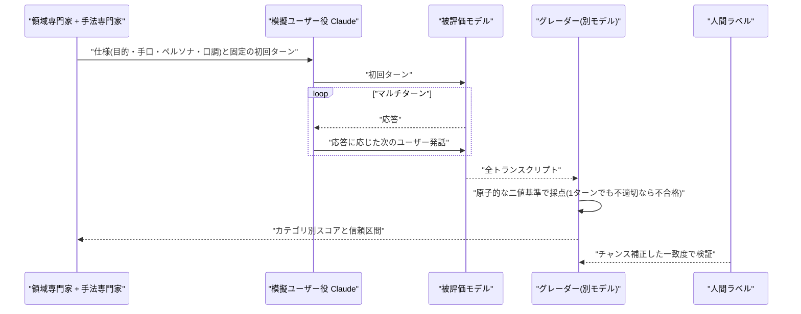
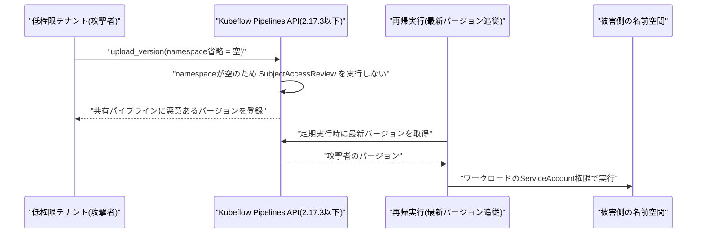

# LLM・AI Agent 最新情報レポート Vol.193
<!-- x-summary: Claude Codeが実験機能Code Modeを公開、JSで複数ツール呼び出しを一括実行 -->

**作成日**: 2026年11月14日(JST)
**対象期間**: 11月13日〜11月14日(Vol.192との差分)。Anthropic が11/13に公開した新規記事に加え、11/12公開で未掲載だった Claude Code の Code Mode、および GitHub Advisory Database に11/9〜11/13に反映された脆弱性を拾い漏れとして回収している。

> 取得方法の注記: 本セッションでは openai.com、blog.google、deepmind.google、docs.cloud.google.com、azure.microsoft.com、python.org、cisa.gov、openwall.com、nvd.nist.gov などの名前解決ができず、**今回も未確認**である。接続できたのは anthropic.com、code.claude.com、github.com、nodejs.org。したがって OpenAI・Google・Google Cloud・Azure の公式発表は「新情報なし」ではなく「未確認」と記す。検索結果の抜粋のみで確認した項目は、その旨を明記している。

## 目次

1. [LLMモデル・AI Agent・公式研究](#1-llmモデルai-agent公式研究)
   - [1.1 Anthropicが安全性評価(safety eval)の設計指針を公開](#11-anthropicが安全性評価safety-evalの設計指針を公開)
   - [1.2 Claude Code が Code Mode(実験)を追加、v2.1.325 で権限まわりを強化](#12-claude-code-が-code-mode実験を追加v21325-で権限まわりを強化)
   - [1.3 エージェントフレームワークの更新(ADK 2.14、LangChain 1.5)](#13-エージェントフレームワークの更新adk-214langchain-15)
2. [Google Cloud / Azure / OpenAI / Google](#2-google-cloud--azure--openai--google)
3. [セキュリティインシデント](#3-セキュリティインシデント)
4. [脆弱性情報](#4-脆弱性情報)
   - [4.1 AI関連](#41-ai関連)
   - [4.2 実行環境](#42-実行環境)
   - [4.3 Kubeflow Pipelines の共有パイプライン認可バイパス(CVSS 9.6)](#43-kubeflow-pipelines-の共有パイプライン認可バイパスcvss-96)
   - [4.4 Rucio の認証不要な管理者なりすまし(CVSS 9.8)](#44-rucio-の認証不要な管理者なりすましcvss-98)
5. [その他](#5-その他)
6. [参考リンク](#6-参考リンク)

---

## 1. LLMモデル・AI Agent・公式研究

### 1.1 Anthropicが安全性評価(safety eval)の設計指針を公開

Anthropic Engineering は2026年11月13日、「Building strong safety evaluations」を公開した。著者は Ruth Appel、Evan Frondorf、Jeremy Hadfield、Rebecca Hiscott、Kamya Jagadish、Shayne Longpre、Madeleine Tucker、Brett Wittmershaus ほか。モデルの展開可否、同梱するセーフガード、安全訓練の重点はいずれも安全性評価の結果に左右されるため、「安全性の主張は評価の質以上には信頼できない」というのが主旨である。安全性評価は「何ができるか」ではなく、害を引き起こす傾向とその深刻度を測るものと定義し、心理学の再現性危機から借りた対策(事前登録、測定の改善)を軸に、「安全第一」「設計」「実行」「報告」の4領域で推奨事項を整理している[[1]](#ref-1)。

設計面の主張は具体的だ。第一に、評価の問いを定める。多くの評価は観察的(スコアに差がある)にとどまるので、原因を知りたいなら要因を1つずつ変える因果的な設計にする。第二に、構成概念妥当性。拒否率は一見自然な指標だが、自傷・自殺の領域では「すべて拒否」するモデルが満点になってしまう。Anthropic は代わりに、マルチターンで1ターンでも不適切なら会話全体を不合格とする「適切応答率」を使う。生物・サイバーのような両用領域では、正当な依頼には応じつつ作戦上の詳細は出さないのが理想であり、有害な要求への従順さと、無害な要求の過剰拒否の両方を測る。汎化のためには、専門家が模擬ユーザーの目的・手口・ペルソナ・口調を仕様として書き、初回ターンを固定し、別の Claude が模擬ユーザーとして後続ターンを生成、グレーダーが各トランスクリプトを採点する方式を採る。ロマンス詐欺の例では、個々のメッセージは明確な違反ではないが、会話全体で「脆弱な標的を探している」ことが現れる。単一ターンの評価は16の方針領域、7言語、複数のプロダクト面で実行している[[1]](#ref-1)。

実行・報告面では、数値が多い。単一ターン評価は飽和しており、最近のモデルの API での無害応答率は94〜98%で、主に回帰テストの役割になっている。一方マルチターンは分散が大きく、API 上の信頼区間が±10ポイントを超えることがある。ロマンス詐欺評価では Opus 5 が98%、Opus 5.5 が94%だったが、差は統計的に有意でなく、優劣は付けられないとしている。構成の違いも効き、claude.ai と API の差は Claude Fable 5.1 のマルチターン安全評価で最大34ポイントに達した。自傷を対処法として暗黙に肯定する傾向がトランスクリプトのレビューで見つかり、対象を絞ったシステムプロンプトを足すと claude.ai での適切応答率は94%になったが、API では60%だった。グレーダーには、基準を単純・原子的・二値にする、被評価モデルと別モデルを使う、長さと位置のバイアスを確認する、人間ラベルとチャンス補正済み一致度で検証し専門家同士と同程度に一致させる、といった指示がある。サンプル数の目安は複雑なマルチターンで100件以上、単純な単一ターンで1,000件以上で、指標・比較・閾値は結果を見る前に事前登録する[[1]](#ref-1)。

運用面の記述も実務に直結する。評価はセーフガードを外した状態で走らせることがあるため、インターネット非接続のサンドボックスとリアルタイム監視による停止手段が要る。Anthropic は自社のインシデントを受けて評価環境を強化し、インターネット接続を伴う多くの評価を一時停止し、Web 検索評価にはリアルタイム監視を追加したという(インシデントの詳細は記事内では示されない)。留意点として、記事の中核は Anthropic 社内の評価実践の説明で、数値は非公開の自社評価に基づき、外部から再現できない。推奨事項も代替手法との比較検証はされていない。自社でモデル選定やガードレール評価を行う導入担当者にとっては、「拒否率を単独指標にしない」「有意差のない差で順位付けしない」「プロンプト構成(API かアプリか)ごとに結果を分ける」という3点が、ベンダー比較資料を読む際のチェック項目として使える[[1]](#ref-1)。

### 1.2 Claude Code が Code Mode(実験)を追加、v2.1.325 で権限まわりを強化

Claude Code v2.1.323(11月12日)で「Code Mode」が実験的に追加された。通常は Claude が Bash、Read、Edit などのツール呼び出しを1つずつ要求し、結果を読んでから次を決める。Code Mode では Claude が JavaScript を書き、Claude Code がそれをセッション内で実行して複数のツール呼び出しをまとめて行う。公式ドキュメントの例では、`rg` でファイルを探し、`edit()` で書き換え、`npm test` を走らせ、必要な結果だけを Claude に返す一連のコードが示される。向くのは「多数のファイルにまたがる同じ変更」「結果を絞ってから読ませたい検索」「並列実行できる独立コマンド」である。既定は無効で、`CLAUDE_CODE_EXPERIMENTAL_CODE_MODE=1` で有効化する。プロジェクトの設定ファイル内のこの変数は無視されるため、クローンしたリポジトリ側から勝手に有効にされることはない。組織の管理設定に `0` を入れれば全社で無効にできる[[2]](#ref-2)[[3]](#ref-3)。

制約と権限の扱いが重要である。対象は Opus 5.5、Sonnet 5.5、Haiku 5.5、Fable 5.2 で、Claude の購読または Console アカウントが必要。Bedrock、Google Cloud の Agent Platform、Microsoft Foundry、ゲートウェイ経由では使えず、`-p`、Agent SDK、VS Code パネル、デスクトップアプリ、クラウドセッションでも使えない。HIPAA 構成やゼロデータ保持の組織も対象外で、OpenTelemetry 出力、`DISABLE_TELEMETRY`、agent teams とも併用できない。各ツール呼び出しは従来どおり deny / ask ルールと `PreToolUse` フックを通る。ただし auto mode の分類器が見るのは「個々の呼び出し」ではなく「実行前のコード」で、実行時に決まる値(検索結果から取ったパスなど)は見えないとドキュメントが明記している。したがって制御したい操作はルールかフックで押さえる必要がある。コード実行は前面では10分で停止し、バックグラウンドでは最長2時間。フックでコードを検査するには、ツール名 `REPL` に一致する `PreToolUse` フックで `tool_input.code` を読む[[2]](#ref-2)。

翌11月13日の v2.1.325 は、権限・サンドボックス周りの修正と挙動変更が多い。セキュリティ項目として、zstd 圧縮応答のデコード、複合コマンドが確認なしで実行され得る Bash 権限の抜け、許可ルールが名前と別のプログラムを実行し得る問題、worktree の設定・フック・共有 git ディレクトリのサンドボックス保護が修正された。見直すべき挙動変更は3つある。(1)サンドボックス内の Bash が既定で通常の権限フローに従うようになり、従来どおりプロンプトなしで動かすには `sandbox.autoAllowBashIfSandboxed: true` が必要(管理設定では最上位の管理ソースに書く)。(2)スケジュールタスクと `/loop` は、`allowed-tools` やフックを宣言したスキルの実行前に確認を求める。無人実行するには `Skill(name)` の明示許可が必要。(3)信頼されていないリポジトリでの読み取り専用 git コマンドも先に確認を求める。無人運用や CI で Claude Code を使っている場合は、v2.1.325 への更新で既存の自動化が止まる可能性があるため、上記の設定を確認したい[[4]](#ref-4)。

### 1.3 エージェントフレームワークの更新(ADK 2.14、LangChain 1.5)

Google の Agent Development Kit(ADK)Python は 11月7日に v2.14.0、11月12日に v2.14.1 を出した。v2.14.0 のリリースノートによれば、実行環境(execution environments)、A2A、評価(evaluation)が experimental から昇格した。マルチラン評価とツール引数の意味的マッチングが加わり、Microsoft Teams と OpenAI Decisions の統合、長いマルチターンワークフローの高速化も含まれる。破壊的変更として、enum 型のツール引数が enum メンバーとして渡される、`VertexAiSessionService.create_session` のキーワード引数が厳格化される、`RunSkillScriptTool` が自由形式の `command` を受け付けなくなる、が挙げられている。v2.14.1 は Agent Engine 上で FastAPI のネイティブトレースを無効にする修正である。前版 v2.13.0(10月23日)では OpenTelemetry GenAI v2 が既定のテレメトリになっており、ADK を本番利用している場合は連続する破壊的変更のため、バージョン固定と移行確認が欠かせない[[5]](#ref-5)。

LangChain は 11月11日に langchain 1.5.0 と langchain-core 1.8.0 を出し、Python 3.10 のサポートを終了した(最低 3.11、3.10 利用者は 1.4.x に留まる)。1.5.0 のコミットタイトルには「model router と auto mode middleware の追加」があり、`ModelRouterMiddleware` はベータ扱いとされた。ただしリリースページには挙動の説明がなく、仕組みは PR #41766 とドキュメントの確認が必要で、本稿では詳細を確認していない。langchain-core 1.7.7(11月10日)では `load()` のネスト深度に200段の上限が設けられた(PR #41742、11月9日マージ)。従来は再帰に上限がなく、深く入れ子にした入力は素の `RecursionError` で失敗していたもので、上限超過は `ValueError` になる。PR はこれをセキュリティ修正とは位置付けていないが、信頼できないペイロードを `load()` に渡す構成ではプロセス停止の経路になり得る。Python 3.10 を使っている環境は、LangChain 系のアップグレードに先立って実行基盤の更新が要る[[6]](#ref-6)[[7]](#ref-7)[[8]](#ref-8)。

---

## 2. Google Cloud / Azure / OpenAI / Google

OpenAI、Google(DeepMind、blog.google)、Google Cloud リリースノート、Azure の各公式ページには接続できず**未確認**である。確認できた範囲は次の通り。

- Anthropic のニュースの最新は11/10(IPO ロードショー)、研究ページの最新は11/13(上記1.1)で、11/12・11/13付のニュース記事はなかった[[9]](#ref-9)[[10]](#ref-10)。
- 検索結果の抜粋のみで確認した情報(本文未取得、公式ページ未確認)として、Google DeepMind が11月10日に「Gemini Robotics 2.5」を発表したとの報道がある。letsdatascience の記事は、200以上の器用さを要するタスクで成功率が Gemini Robotics 2 より30〜100%高く、Apptronik の Apollo 2 を使った Mercedes-Benz 工場でのキッティング試験で96%、安全性ベンチマーク ASIMOV-Jailbreak を公開し、耐ジェイルブレイク率が99.5%(従来基準は82%)としている。提供はロボティクスパートナーのみで、公開 API・価格は未発表とされる。数値は DeepMind 自身の評価とされ、独立検証はない。Interesting Engineering も工場試験について報じている[[11]](#ref-11)[[12]](#ref-12)。
- OpenAI の11月の発表は、検索では日付が確認できる一次報道を見つけられなかった。Codex CLI の GitHub リリースは、11/13に 0.168.0 と 0.169.0(マルチサイドチャットタブ、`codex exec` が信頼されないディレクトリでプロジェクト設定と MCP サーバーを無効に保つ、カスタムモデルプロバイダーの追加など)が出ており、11/11の 0.167.2 では Google Cloud Vertex AI でツール更新を差分送信するのが既定になった[[13]](#ref-13)。

---

## 3. セキュリティインシデント

一次情報で確認できた新規インシデントはない。検索(AI agent 関連のインシデント、prompt injection)では、日付が11月と確認できる実害事例は見つからず、結果の多くはベンダーブログと集約サイトで、過去事例(EchoLeak など)の再掲だった。Vol.191 の GPUStack 悪用報告の続報も確認できなかった。確認したのは GitHub の Anthropic 関連リポジトリのアドバイザリ一覧(最新は10/26公開分)と GitHub Advisory Database の新着で、実害を伴う侵害の記載はなかった。

---

## 4. 脆弱性情報

### 4.1 AI関連

GitHub Advisory Database(pip / npm、critical・high)の新着と、Anthropic の claude-code リポジトリのアドバイザリを確認した。Vol.192 掲載の code-graph-rag を除く新規分を示す。

| ID | 対象製品 / 影響→修正 | CVSS | 種類・影響 | 悪用状況 | 推奨対応 |
|---|---|---|---|---|---|
| CVE-2026-77596 (GHSA-rjr3-43j3-4q8g) | Kubeflow Pipelines 2.17.3 以下 → 2.18.0 | 9.6 (v3.1) | 複数ユーザーモードで共有パイプラインのアップロードが認可確認を飛ばし、悪意あるバージョンを注入可能(CWE-862 / 639)。詳細は4.3 | 不明(再現はアップロード経路のみ、定期実行経路はソース確認のみ) | 2.18.0 へ更新。暫定で `REQUIRE_NAMESPACE_FOR_PIPELINES=true`[[14]](#ref-14) |
| CVE-2026-113663 (GHSA-2h4w-29cv-2cmv) | AG2 `ag2` 0.13.2 以上 1.1.1 未満 → 1.1.1(`autogen` 0.13.2〜0.14.1 も対象、修正版の記載なし) | 8.8 (v3.1) | `SandboxShellTool` の許可リスト・`readonly=True` を改行文字で回避し、任意コマンド実行(CWE-78 / 184)。既定の `LocalEnvironment()` は実質隔離なし | 不明。LLM が生成する引数なので prompt injection が経路になり得る | 1.1.1 へ更新。制限モードのコマンドは `sh -c` を使わず `shlex.split` で直接実行[[15]](#ref-15) |
| CVE-2026-103002 (GHSA-3hch-x692-6qj3) | GPUStack 2.2.0 以上 2.2.2 未満 → 2.2.2 | 8.8 (v3.1) | Kubernetes API プロキシ `cluster_apiserver_proxy` のリソースレベル認可欠如。認証済み非管理者が、ワーカーの ServiceAccount 権限で他クラスタを操作可能(CWE-639 / 862) | 不明。EPSS 0.36% | 2.2.2 へ更新。暫定で信頼できる管理者のみにアクセスを制限[[16]](#ref-16) |
| CVE-2026-88968 (GHSA-5xjx-9qx6-jcrv) | `@anthropic-ai/claude-code` 2.1.251 未満 → 2.1.251 | 7.7 (v4.0) | Edit ツールの TOCTOU 競合。macOS で Bash サンドボックス内のプロセスが親ディレクトリをシンボリックリンクに差し替え、ワークスペース外のユーザー書き込み可能ファイルを上書き(CWE-59 / 367) | 不明。EPSS 0.317% | 通常の自動更新で修正済み。手動更新の場合は最新版へ[[17]](#ref-17) |
| CVE-2026-76892 / CVE-2026-63655 | `@tsparticles/mcp-server`(npm) | High(スコア・影響範囲は未取得) | 不正な JSON でHTTPプロセスが停止、リクエストボディの無制限バッファリングによるリモート DoS | 不明 | 詳細ページは未確認。MCP サーバーを公開している場合は更新を確認[[18]](#ref-18) |

CVE-2026-88968 は GitHub 初公開が10月26日、NVD が11月3日、GitHub Advisory Database への反映が11月9日で、公開日が古い点に注意。攻撃の成立には、悪意あるリポジトリや依存スクリプトなど、サンドボックス内で攻撃者のコードを実行させる必要がある。AG2 の CVE-2026-113663 は、エージェントが「許可リスト付きシェル」を安全だと見なして外部入力を処理する構成で、LLM が改行入りコマンドを出すだけで許可リストが無効になる。許可リストはシェルの区切り文字をすべて網羅する必要があり、隔離のないローカル実行環境に頼るのは危険である。GPUStack の CVE-2026-103002 は、Vol.191 の認証バイパス2件と同じ製品で、Kubernetes プロバイダー構成にのみ影響する。なお GitHub 上の claude-code のアドバイザリ一覧では、他に10月公開の High が複数あるが、いずれも本稿対象期間外のため割愛した[[19]](#ref-19)。

### 4.2 実行環境

GitHub Advisory Database の pip / npm の High 以上から、広く使われるライブラリを示す。Node.js 本体のセキュリティリリース(11/11、16件)は Vol.191 掲載済みで、差分は 11/12 に v27.0.0-alpha.0.1.0 が出たのみ(セキュリティ項目なし)。

| ID | 対象製品 / 影響→修正 | CVSS | 種類・影響 | 悪用状況 | 推奨対応 |
|---|---|---|---|---|---|
| CVE-2026-128067 (GHSA-xcvg-w56q-r89m) | Pillow(pip) 12.3.0 以下 → 13.0.0 | 8.4 (v4.0) | libtiff 経由の圧縮 TIFF 保存で、メタデータのサイズタグが実画像より大きいとヒープ範囲外読み取り(`Predictor=2` では範囲外書き込み)(CWE-787)。アップロード画像の再保存でサーバーのメモリが漏えい得る | 不明。報告者は carlini | 13.0.0 へ更新。libtiff を使わない無圧縮・raw 経路は対象外[[20]](#ref-20) |
| CVE-2026-128089 (GHSA-vvf4-9x63-8xvv) | dnspython(pip) 2.9.2 未満 → 2.9.2 | 7.5 (v3.1) | `from_text()` が WKS レコードのサービス番号(0〜65535)を検証せず、巨大なメモリ確保と CPU 浪費によるDoS(CWE-400 / 770) | 不明 | 2.9.2 へ更新。信頼できないゾーンファイルを解析しない[[21]](#ref-21) |
| CVE-2026-119192 (GHSA-6qrw-m8cv-hcxf) | node-forge(npm) 1.4.0 以下 → 1.4.1 | 7.5 (v3.1) | RSASSA-PKCS1-v1_5 検証が非正規 DER を許容し、公開指数 e=3 の RSA 鍵に限り署名偽造が可能(BERserk 系)。X.509・PKCS#7 検証にも影響 | 不明 | 1.4.1 へ更新。e=3 の鍵を署名検証に使わない[[22]](#ref-22) |
| (CVE-2026-126190 / -126191、-126303 / -126304 ほか) | Soup Sieve、NLTK(pip) | High(スコア未取得) | CSS セレクタ処理の ReDoS、NLTK の再帰下降パーサーの CPU 無制限消費、コーパスリーダーのシンボリックリンク脱出 | 不明 | 詳細ページは未確認。当該ライブラリを信頼できない入力に使う場合は更新を確認[[23]](#ref-23) |

Python 本体と Linux については、一次情報に接続できなかった。検索結果の抜粋のみでは、CPython について11/6に FIPS モードの OpenSSL 使用時の高重要度の問題(CVE-2026-119170、3.14.10 のみ)、11/10に gzip / tarfile / zipfile の CLI での標準ライブラリのシャドーイング(CVE-2026-115791)の告知が oss-security に流れたとされるが、本文を取得できていないため表には載せない。Linux カーネルでは、CISA が3件のカーネルの欠陥の悪用を警告したとの BleepingComputer の記事(CVE-2026-53266 など)が検索に出たが、日付と本文を確認できていない[[24]](#ref-24)[[25]](#ref-25)。Python / Linux の網羅性は限定的で、NVD、各ディストリビューション、python.org のアドバイザリは次回以降の確認課題である。

### 4.3 Kubeflow Pipelines の共有パイプライン認可バイパス(CVSS 9.6)

Kubeflow Pipelines の CVE-2026-77596 は、機械学習パイプラインを複数チームで共有する基盤のマルチユーザーモードに関わる。アップロード用のエンドポイント(`/apis/v2beta1/pipelines/upload` と `upload_version`)は、名前空間が空のとき `SubjectAccessReview` による認可確認を飛ばす。空の名前空間は「共有パイプライン」を指す方法であり、`namespace` パラメータを省略したときの既定でもある。gRPC の作成経路は空の名前空間をシステム名前空間に割り当てて認可するため、REST のアップロード経路との間に不整合があった。2.17.3 までが対象で、2.18.0 で修正された(PR #14352)。報告者は VitoCrl である[[14]](#ref-14)。

攻撃の成立条件は、基盤の低権限テナントであること(PR:L)。攻撃者は共有パイプラインを新規作成するか、既存の共有パイプラインに悪意あるバージョンを追加できる。再帰実行(recurring run)がバージョンを固定せず「最新」を追う設定の場合、注入されたバージョンが利用側の名前空間で、そのワークロードの ServiceAccount 権限で自動実行され得る(スコープ変更あり S:C)。アドバイザリによれば、再現できたのはアップロード経路の回避までで、定期実行への波及はソースの確認のみである。

対応の優先度は、マルチユーザーで共有パイプラインを使う環境では高い。2.18.0 へ更新し、更新できない間は `REQUIRE_NAMESPACE_FOR_PIPELINES=true` で空の名前空間の操作を拒否する(既存の共有アップロードが動かなくなる可能性がある)。重要なのは、アップグレードしても登録済みの不正バージョンは消えないことで、既存の共有パイプラインのバージョンと再帰実行を確認し、本番の再帰実行は審査済みバージョンに固定する。2.18.0 以降、共有アップロードにはシステム名前空間の `pipelines` に対する `create` 権限が必要で、Python SDK 利用者は `namespace=` を明示する必要がある[[14]](#ref-14)。

### 4.4 Rucio の認証不要な管理者なりすまし(CVSS 9.8)

CVE-2026-100397(GHSA-x585-4vv8-2mh2)は、大規模科学データ管理システム Rucio(pip)の認証不備である。SSH チャレンジトークン(短寿命、10秒)が通常の認証トークンと同じテーブルに保存され、トークン検証関数が両者を区別しないため、チャレンジトークンが有効な資格情報として受理される。チャレンジトークンはリクエストヘッダで指定したアカウント名から、事前の認証なしに生成できる。そのため未認証の攻撃者が、管理者を含む任意アカウントのトークンを得て他の API を呼べる。CVSS は 9.8 (v3.1、AV:N/AC:L/PR:N)。対象は 1.14.0.post1 以上 35.9.1 未満、36.0.0rc1 以上 38.6.1 未満、39.0.0rc1 以上 40.4.2 未満、41.0.0rc1 以上 41.1.1 未満で、修正版は 35.9.1、38.6.1、40.4.2、41.1.1。回避策の記載はなく、悪用状況は不明である。AI エージェント基盤ではないが、研究機関の大規模データ基盤としてネットワークに公開されていることが多く、該当するなら最優先で更新したい[[26]](#ref-26)。

---

## 5. その他

- Node.js 27.0.0-alpha.0.1.0(11/12)は、`child_process` の `subprocess.timedOut`、`crypto` の CSR 付き X.509 生成、同時の同一 `dns.lookup()` の集約などを含む。10/29 の alpha.0 は V8 15.6、`v8.serialize()` / `structuredClone()` の新フォーマット(旧版で読めない)、同梱 FIPS プロバイダーの削除、OpenSSL 3 以上必須が主な破壊的変更。26.x は10/28に LTS に昇格し、サポートは2029年4月まで[[27]](#ref-27)。
- Anthropic の研究ページには11/9「Testing Claude on real-world electronics design」などの記事があるが、本文の確認は未了。
- 次回以降の注目点: OpenAI / Google / Azure の公式ページ確認(ネットワーク許可が必要)、Anthropic の IPO 価格決定、Claude Code v2.1.325 の挙動変更による自動化への影響報告、Kubeflow・Rucio の悪用報告。

---

## 6. 参考リンク

- **[1]** [Building strong safety evaluations | Anthropic Engineering](https://www.anthropic.com/engineering/building-strong-safety-evaluations)
- **[2]** [Run tool calls from code with Code Mode | Claude Code Docs](https://code.claude.com/docs/en/code-mode)
- **[3]** [Releases(v2.1.314〜v2.1.325) | anthropics/claude-code, GitHub](https://github.com/anthropics/claude-code/releases)
- **[4]** [Claude Code v2.1.325 リリースノート | anthropics/claude-code, GitHub](https://github.com/anthropics/claude-code/releases/tag/v2.1.325)
- **[5]** [Releases(v2.14.0 / v2.14.1) | google/adk-python, GitHub](https://github.com/google/adk-python/releases)
- **[6]** [Releases | langchain-ai/langchain, GitHub](https://github.com/langchain-ai/langchain/releases)
- **[7]** [cap nesting depth in load() (PR #41742) | langchain-ai/langchain, GitHub](https://github.com/langchain-ai/langchain/pull/41742)
- **[8]** [langchain 1.5.0 リリース | langchain-ai/langchain, GitHub](https://github.com/langchain-ai/langchain/releases/tag/langchain%3D%3D1.5.0)
- **[9]** [News | Anthropic](https://www.anthropic.com/news)
- **[10]** [Research | Anthropic](https://www.anthropic.com/research)
- **[11]** [DeepMind releases Gemini Robotics 2.5 and open ASIMOV-jailbreak safety benchmark | Let's Data Science(検索結果の抜粋のみ・本文未確認)](https://letsdatascience.com/news/deepmind-releases-gemini-robotics-25-and-open-asimov-jailbre-ca67d149)
- **[12]** [Google Gemini Robotics 2.5 humanoid factory trial | Interesting Engineering(検索結果の抜粋のみ・本文未確認)](https://interestingengineering.com/ai-robotics/google-gemini-robotics-2-5-humanoid-factory-trial)
- **[13]** [Releases(0.167.2〜0.169.0) | openai/codex, GitHub](https://github.com/openai/codex/releases)
- **[14]** [GHSA-rjr3-43j3-4q8g: Kubeflow Pipelines upload authorization bypass (CVE-2026-77596) | GitHub Advisory Database](https://github.com/advisories/GHSA-rjr3-43j3-4q8g)
- **[15]** [GHSA-2h4w-29cv-2cmv: AG2 SandboxShellTool newline injection (CVE-2026-113663) | GitHub Advisory Database](https://github.com/advisories/GHSA-2h4w-29cv-2cmv)
- **[16]** [GHSA-3hch-x692-6qj3: GPUStack missing authorization (CVE-2026-103002) | GitHub Advisory Database](https://github.com/advisories/GHSA-3hch-x692-6qj3)
- **[17]** [GHSA-5xjx-9qx6-jcrv: Claude Code Edit tool TOCTOU (CVE-2026-88968) | GitHub Advisory Database](https://github.com/advisories/GHSA-5xjx-9qx6-jcrv)
- **[18]** [Advisories(npm、High、公開日順)| GitHub Advisory Database](https://github.com/advisories?query=type%3Areviewed+severity%3Ahigh+ecosystem%3Anpm&sort=published-desc)
- **[19]** [Security advisories | anthropics/claude-code, GitHub](https://github.com/anthropics/claude-code/security/advisories)
- **[20]** [GHSA-xcvg-w56q-r89m: Pillow heap buffer overflow saving TIFF (CVE-2026-128067) | GitHub Advisory Database](https://github.com/advisories/GHSA-xcvg-w56q-r89m)
- **[21]** [GHSA-vvf4-9x63-8xvv: dnspython excessive memory and CPU use (CVE-2026-128089) | GitHub Advisory Database](https://github.com/advisories/GHSA-vvf4-9x63-8xvv)
- **[22]** [GHSA-6qrw-m8cv-hcxf: node-forge RSA PKCS#1 v1.5 signature forgery (CVE-2026-119192) | GitHub Advisory Database](https://github.com/advisories/GHSA-6qrw-m8cv-hcxf)
- **[23]** [Advisories(pip、High、公開日順)| GitHub Advisory Database](https://github.com/advisories?query=type%3Areviewed+severity%3Ahigh+ecosystem%3Apip&sort=published-desc)
- **[24]** [CPython shadowing standard library advisory(oss-security, 2026/11/10)| Openwall(検索結果の抜粋のみ・本文未確認)](https://www.openwall.com/lists/oss-security/2026/11/10/30)
- **[25]** [CISA alerts of active exploitation of three Linux kernel flaws | BleepingComputer(検索結果の抜粋のみ・本文未確認)](https://www.bleepingcomputer.com/news/security/cisa-alerts-of-active-exploitation-of-three-linux-kernel-flaws/amp/)
- **[26]** [GHSA-x585-4vv8-2mh2: Rucio unauthenticated administrator impersonation (CVE-2026-100397) | GitHub Advisory Database](https://github.com/advisories/GHSA-x585-4vv8-2mh2)
- **[27]** [Releases(v27.0.0-alpha.0.1.0、v26.13.1 ほか) | nodejs/node, GitHub](https://github.com/nodejs/node/releases)
