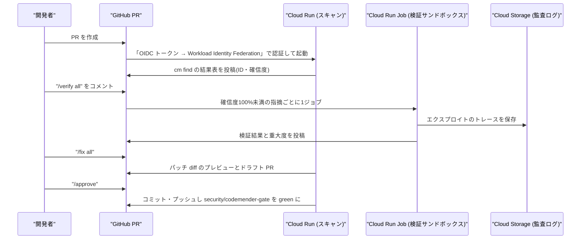

# LLM・AI Agent 最新情報レポート Vol.194
<!-- x-summary: Google CloudがCodeMenderをPRに統合する構成を公開、検証→修正→承認を自動化 -->

**作成日**: 2026年11月15日(JST)
**対象期間**: 11月14日〜11月15日(Vol.193との差分)。11/14〜15に新規公開された主要な公式記事は確認できなかったため、11/11〜11/13公開で未掲載だった Google Cloud の CodeMender 記事、LangChain / LlamaIndex のリリース、Microsoft Aspire の脆弱性を拾い漏れとして回収している。

> 取得方法の注記: 本セッションでは openai.com、blog.google、azure.microsoft.com、learn.microsoft.com、docs.cloud.google.com、googlecloudpresscorner.com、mail-archive.com などの名前解決ができず、**今回も未確認**である。接続できたのは anthropic.com、code.claude.com、cloud.google.com(ブログ)、github.com、nodejs.org、ubuntu.com。OpenAI・Azure・blog.google の公式発表は「新情報なし」ではなく「未確認」と記す。

## 目次

1. [LLMモデル・AI Agent・公式研究](#1-llmモデルai-agent公式研究)
   - [1.1 Google Cloud が CodeMender を Pull Request に組み込む参照アーキテクチャを公開](#11-google-cloud-が-codemender-を-pull-request-に組み込む参照アーキテクチャを公開)
   - [1.2 LangChain と LlamaIndex が Python 要件を引き上げ](#12-langchain-と-llamaindex-が-python-要件を引き上げ)
2. [クラウド・SaaS(Google Cloud / Azure)](#2-クラウドsaasgoogle-cloud--azure)
3. [セキュリティインシデント](#3-セキュリティインシデント)
4. [脆弱性情報](#4-脆弱性情報)
   - [4.1 AI関連](#41-ai関連)
   - [4.2 実行環境](#42-実行環境)
   - [4.3 Microsoft Aspire Dashboard の認可欠如(CVSS 9.1)](#43-microsoft-aspire-dashboard-の認可欠如cvss-91)
5. [その他](#5-その他)
6. [参考リンク](#6-参考リンク)

---

## 1. LLMモデル・AI Agent・公式研究

OpenAI・Google DeepMind・Microsoft の公式サイトには接続できなかった。Anthropic のニュース(最新は11/10の IPO ロードショー)、Engineering(最新は11/13の「Building strong safety evaluations」)、Research(最新は同11/13)は確認したが、いずれも Vol.193 までに掲載済みで、11/14〜15 の新規記事は無かった。

### 1.1 Google Cloud が CodeMender を Pull Request に組み込む参照アーキテクチャを公開

Google Cloud は 2026年11月11日、セキュリティ&アイデンティティ分野のブログで「Don't just flag it, fix it: How to run CodeMender in your pull requests」を公開した。著者は Cloud & AI Security Architects の Manish Gaur 氏と Collin Frierson 氏。自律的なコードセキュリティエージェント CodeMender(Google の AI Threat Defense の一部)を、GitHub の Pull Request(PR)と Cloud Run で動かす参照実装で、リファレンスは GitHub 上の `codemender-gitops-starter-kit`(GCP-Architecture-Guides)とされる。記事は GA・価格・リージョンを明記しておらず、正式サポートの製品統合ではなく「流用して作る参照設計」として読むのが妥当である(別途、検索結果の抜粋では、CodeMender のドキュメントが限定顧客向けの Public Preview と説明しているとの情報もあるが、ドキュメント本体は未確認)[[1]](#ref-1)。

処理は PR のタイムライン上で完結する。PR が Cloud Run のスキャンを起動し、`cm find` が検出結果の表(ID と確信度つき)を1件のコメントとして投稿する。確信度が100%未満の指摘は `/verify <id>`(または `/verify all`)で、エフェメラルなサンドボックス内でエクスプロイトを実際に構築・実行して検証し、トレースを折りたたみブロックで示す。成果物は監査用に Cloud Storage へストリームされ、シミュレーション結果により重大度が変わり得る。続く `/fix` でパッチを統一 diff として作成してドラフト PR を開き、`/approve` でブランチへコミット・プッシュして、コミットステータス `security/codemender-gate` を green にする。ただしブランチ保護でこのステータスを必須にしない限りゲートは助言にとどまる、と記事は注意している[[1]](#ref-1)。

設計上の見どころは認証とサンドボックスの扱いである。長期の鍵を持たず、GitHub Actions の OIDC トークンを Workload Identity Federation で Google Cloud の資格情報に交換する。記事は、発行元(issuer)の検証だけでは全 GitHub リポジトリが同じ issuer を共有するため不十分で、`attribute_condition` で制限する必要があると強調する。条件にはリポジトリ名ではなく、変更や再取得で乗っ取られ得ない不変の `repository_id` を使うべきとする。検証は「1指摘につき1つの Cloud Run ジョブ」で、第2世代実行環境(microVM)、最小権限の専用サービスアカウント(Compute Engine 既定のものは避ける)、Direct VPC egress でエグレス経路なしの構成を勧める。生成したエクスプロイトという信頼できないコードを実行するための対策である。さらに、成功文字列の有無だけで判定するとモックサーバーのクラッシュやタイムアウトを「安全」と誤判定する(フェイルオープン)ため、未完了の実行は「inconclusive」として扱うよう求めている[[1]](#ref-1)。

AIの企画・導入側にとっては、「検出→再現→修正」をエージェントに任せる際の統制点(ブランチ保護、人間の `/approve`、不変IDによる認証条件、エグレス遮断)を具体的に示した資料として参考になる。一方で、エージェントが PR 上のテキストの影響を受ける点(プロンプトインジェクション)や、検証精度の数値は記事に示されておらず、導入判断には自組織での評価が要る。

### 1.2 LangChain と LlamaIndex が Python 要件を引き上げ

GitHub のリリースページによれば、langchain-openai 1.8.0(11月13日、`b5e6e31`)は Python 3.10 のサポートを終了し、最低 Python 3.11、最低 `langchain-core` 1.8.0 になった。3.10 の利用者は 1.7.x に解決され続ける。機能面では GA となった OpenAI の Decisions API 向けに `OpenAIClassifier` が追加され(#41787)、モデルプロファイルが更新された(#41828)。リリースページが挙げる変更はこの4件のみで、Decisions API 自体の仕様は未確認である。Google ADK 2.14.0 も `OpenAIDecisionsClassifier` を追加しており、分類器を意思決定ノードとして使う設計が各フレームワークで揃いつつある[[2]](#ref-2)[[4]](#ref-4)。

LlamaIndex は v0.14.26(11月13日)を公開した。`llama-index-core` 0.14.26 は langchain-community の非推奨化で壊れた langchain ブリッジのインポートを修正(#22570)し、全インテグレーションの uv.lock を更新するセキュリティ再ロック(#24039)を行った。注意すべきは、セキュリティ修正のために各インテグレーションの `requires-python` を引き上げた破壊的変更(#24040)で、具体的な引き上げ先はリリースページからは確認できなかった。LangChain・LlamaIndex の双方がロックファイルの更新と Python 下限の引き上げに動いており、Python 3.10 以前で稼働する RAG・エージェント基盤は、ライブラリ更新の前に実行環境の更新計画が必要になる[[2]](#ref-2)[[3]](#ref-3)。

---

## 2. クラウド・SaaS(Google Cloud / Azure)

Google Cloud ブログのトップ(cloud.google.com/blog)を確認した。見出しには、Gemini for healthcare、TPU 8tx / 8i Max、AlloyDB の `ai.classify` / `ai.extract`、Organization Policy の agentic cloud governance 更新、Cloud CISO Perspectives 2027、XCPE ボットネットの Threat Intelligence レポートなどが並ぶ[[5]](#ref-5)。このうち CodeMender の記事は 1.1 に詳述した。

他の項目は、公式の本文を開けなかったため本稿では詳細を書かない。検索結果の抜粋に基づく未確認の情報として、(a) TPU 8tx(機密推論向け)と 8i Max は11月9日に blog.google で発表されたとされる(blog.google は接続不可)、(b) Gemini for healthcare は11月10日のプレスリリースで米国プレビューとされる(プレスルームは接続不可)、(c) AlloyDB の `ai.classify` / `ai.extract` は11月12日にプレビューとされる(元記事の URL を推測したが 404)。いずれも次回以降の確認課題とする。なお、同ブログの AlloyDB AI functions の記事(7月2日付)と IAM のエージェント統制の記事(5月6日付)は対象期間外である。

Azure / Microsoft Foundry は、azure.microsoft.com と learn.microsoft.com に接続できず**未確認**。検索では11月の Foundry による Copilot エージェント基盤の提供を伝える報道(Redmond Magazine)が出たが、本文を取得できていない。

---

## 3. セキュリティインシデント

LLM/AI Agent 関連のインシデントについて「AI agent security incident prompt injection breach」で検索したが、2026年11月に起きた個別の侵害を示す報道は見つからなかった(結果は2026年春〜夏の事例の解説が中心)。公式の速報ページ(各社のセキュリティブログ)を網羅的に確認できていないため、「新情報なし」とは断定せず、**11月14〜15日分は確認できた範囲で該当なし**とする。

---

## 4. 脆弱性情報

確認先は GitHub Advisory Database(pip の critical 一覧は最新が11月13日の Rucio、npm の critical 一覧は最新が11月10日、MCP 関連 High は最新が11月11日)、Ubuntu のセキュリティ通知、Node.js 公式ブログ、cpython のセキュリティアドバイザリページである。NVD・CISA・python.org には接続できなかった。

### 4.1 AI関連

Vol.192・193 掲載分(GPUStack、fastapi-code-generator、Kubeflow Pipelines、Rucio、AG2、`@tsparticles/mcp-server`、claude-code CVE-2026-88968 など)を除くと、GitHub Advisory Database の pip・npm の critical / MCP 関連 High に、11月14日以降に公開された新規の AI 関連アドバイザリは確認できなかった。**新情報なし**(最新の MCP 関連 High は11月11日の `@microsoft/aspire-cli`、これは 4.3 で扱う)。

### 4.2 実行環境

| ID | 対象製品 / 影響→修正 | CVSS | 種類・影響 | 悪用状況 | 推奨対応 |
|---|---|---|---|---|---|
| CVE-2026-119170 | CPython 3.14.10 のみ | 不明(Python Security Response Team は「高重要度」と告知したとされる) | OpenSSL を FIPS モードで使う場合の `hashlib` の FIPS 強制ロジックの退行。修正は FIPS 制約の適用判定の変更 | 不明。悪用の報告はないとされる(二次情報) | 3.14.10 を FIPS モードで使う環境は修正版の有無を確認。公式告知は未確認[[12]](#ref-12) |
| CVE-2026-115791 | CPython(影響バージョンは不明) | 不明 | gzip / tarfile / zipfile の CLI で、展開したファイルが標準ライブラリのモジュールを覆い隠す(シャドーイング)問題。11月10日に告知されたとされる | 不明 | 影響バージョンは CVE レコードで要確認。信頼できない圧縮ファイルを CLI で展開するときは作業ディレクトリに注意[[12]](#ref-12) |
| 該当なし | Node.js | - | 11/11 のセキュリティリリース(22.23.5・24.22.3・26.13.1)は Vol.191 掲載済み。11/12 の 27.0.0-alpha 以降にセキュリティ項目なし | - | - [[7]](#ref-7) |
| 該当なし | Ubuntu のカーネル・Apache | 不明 | 11/12〜13 の通知として、Apache HTTP Server(USN-9090-1、CVE-2026-42356 ほか、全 LTS 対象)、Linux カーネルの FIPS(USN-9027-2)・NVIDIA Tegra(USN-9091-1)がある。重要度とCVSSは通知一覧に表示がなく未確認 | 不明 | 使用中のカーネル系列の通知を個別に確認[[8]](#ref-8) |

CPython の2件は、python.org・NVD に接続できず、検索結果の抜粋(stack.watch、oss-security の中継。いずれも本文は未取得)だけが根拠で、本文は取得できていない。このため CVSS・影響バージョン・修正バージョンは不明とした。cpython リポジトリの GitHub セキュリティアドバイザリページには公開済みのアドバイザリが無かった。Linux 本体は、検索上、CISA KEV への最新のカーネル追加は10月28日の CVE-2026-46300(連邦機関の期限10月31日)で、11月の追加は確認できなかった(二次情報、CISA は未接続)。

### 4.3 Microsoft Aspire Dashboard の認可欠如(CVSS 9.1)

Microsoft は 2026年11月10日に Aspire の複数の脆弱性を公開し、GitHub が11月11〜12日に反映した。最も重大な CVE-2026-118740(GHSA-4g86-54fm-h9h8、CWE-862)は CVSS 3.1 で 9.1(`AV:N/AC:L/PR:N/UI:N`、機密性・完全性が High)。スタンドアロンまたは AppHost 配下の Aspire Dashboard で、認証なしの NotFound ルートによりテレメトリの削除が可能になり、ブラウザートークン認証のスタンドアロン構成ではトークンも露出し得る。影響は Dashboard 13.6.5 未満(13.6.3 と 13.6.4 に当該ルートがあり、これらは修正先として不適切)と、Aspire.Dashboard.Sdk の各プラットフォーム用パッケージ(linux-x64 / arm64、musl、osx、win)。EPSS は 0.923%(61パーセンタイル)で、悪用・PoC の報告は確認できなかった[[9]](#ref-9)。

攻撃が成立するには、攻撃者が Dashboard のネットワーク経路に到達できる必要がある。開発用途で `0.0.0.0` に公開した Dashboard や、社内ネットワークから到達できる共有環境が該当する。対応は 13.6.5 以降への更新だが、**パッケージ参照を更新しても既存の Dashboard イメージは置き換わらない**と Microsoft は注記している。コンテナは `mcr.microsoft.com/aspire/dashboard:13.6.5` を明示して再作成し、Compose・Kubernetes のマニフェストも直す。AppHost は `Aspire.Hosting.AppHost` または `Aspire.AppHost.Sdk` の版を上げ、解決された Dashboard SDK パッケージが 13.6.5 以上であることを確認して再起動する。優先度は、外部・共有ネットワークに Dashboard を公開している環境で高い[[9]](#ref-9)。

同時に公開された CVE-2026-120778(GHSA-m63f-xhvm-6mv5、CVSS 3.1 7.3、CWE-379)は、Linux / macOS で `aspire sdk generate` / `dump` / `export` を実行する際、安全でない一時ディレクトリにより MSBuild のレスポンスファイル探索が操作され、実行した開発者の権限でコードが実行される問題である。影響は NuGet の `Aspire.Cli` 13.2.0〜13.6.5 未満と npm の `@microsoft/aspire-cli` 13.4.2〜13.6.5 未満で、Aspire は .NET とは別に配布されるため .NET ランタイム・SDK の更新では直らない。共有開発機やCIランナーで他ユーザーが書き込めるディレクトリがある場合に注意が必要で、EPSS は 0.444% である。そのほか GitHub の一覧には、Aspire.Hosting の権限昇格 CVE-2026-120006(High、11月10日)と、.NET HotReload.Watch.Aspire の CVE-2026-114155(Moderate)が載るが、詳細ページは未確認である[[6]](#ref-6)[[10]](#ref-10)。Aspire は AI アプリのオーケストレーションにも使われ、MCP 関連の検索にも現れたため、AI 基盤を .NET で構成している場合は影響範囲を点検するとよい。

---

## 5. その他

Claude Code は 11月13日に v2.1.325 を公開した(Vol.193 掲載済み)。以降の新版は確認できなかった。Anthropic の公式ページでは、11月14〜15日の新規記事は無い[[11]](#ref-11)。

---

## 6. 参考リンク

- **[1]** [Don't just flag it, fix it: How to run CodeMender in your pull requests | Google Cloud Blog](https://cloud.google.com/blog/products/identity-security/how-to-run-codemender-in-your-pull-requests)
- **[2]** [langchain-openai 1.8.0 リリース | GitHub (langchain-ai/langchain)](https://github.com/langchain-ai/langchain/releases/tag/langchain-openai%3D%3D1.8.0)
- **[3]** [Releases(v0.14.26) | GitHub (run-llama/llama_index)](https://github.com/run-llama/llama_index/releases)
- **[4]** [Releases(v2.14.0 / v2.14.1) | GitHub (google/adk-python)](https://github.com/google/adk-python/releases)
- **[5]** [Google Cloud Blog トップ | Google Cloud](https://cloud.google.com/blog)
- **[6]** [GHSA-m63f-xhvm-6mv5: Aspire Elevation of Privilege (CVE-2026-120778) | GitHub Advisory Database](https://github.com/advisories/GHSA-m63f-xhvm-6mv5)
- **[7]** [Node.js ブログ(11/11 セキュリティリリース、11/12 27.0.0-alpha) | Node.js](https://nodejs.org/en/blog)
- **[8]** [Ubuntu Security Notices | Ubuntu](https://ubuntu.com/security/notices)
- **[9]** [GHSA-4g86-54fm-h9h8: Aspire Security Feature Bypass (CVE-2026-118740) | GitHub Advisory Database](https://github.com/advisories/GHSA-4g86-54fm-h9h8)
- **[10]** [Aspire 関連アドバイザリ一覧 | GitHub Advisory Database](https://github.com/advisories?query=type%3Areviewed+Aspire)
- **[11]** [Changelog(v2.1.325 ほか) | Claude Code Docs](https://code.claude.com/docs/en/changelog)
- **[12]** [CPython 3.14.10 hashlib FIPS enforcement regression (CVE-2026-119170) | stack.watch(二次情報、未確認)](https://stack.watch/vuln/CVE-2026-119170/)
