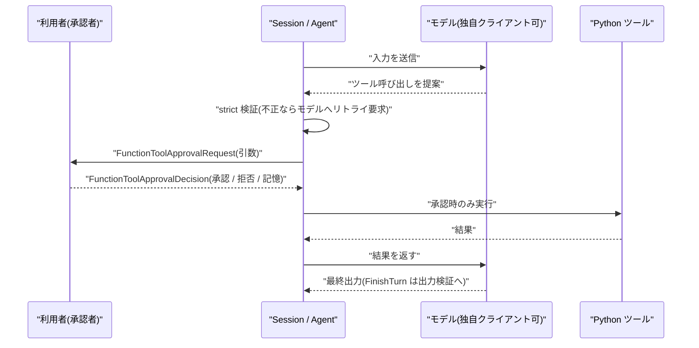

# LLM・AI Agent 最新情報レポート Vol.196
<!-- x-summary: Claude Code 2.1.326公開、Bash・サンドボックスの権限チェックを大幅に厳格化 -->

**作成日**: 2026年11月17日(JST)
**対象期間**: 11月16日〜11月17日(Vol.195との差分)。Anthropic の公式ニュースに新規記事は無く(最新は11/10)、openai.com・blog.google・Google Cloud/Azure の公式ドキュメントはこのセッションのネットワーク設定で開けなかったため、GitHub のリリースとアドバイザリを一次情報の中心にしている。

## 目次

1. [エージェント開発ツールの更新](#1-エージェント開発ツールの更新)
   - [1.1 Claude Code v2.1.326:権限・サンドボックスの厳格化と既定モードの変更](#11-claude-code-v21326権限サンドボックスの厳格化と既定モードの変更)
   - [1.2 OpenAI Agents SDK 0.24.0-alpha.8:ツール承認・独自モデルクライアント・Realtime 音声](#12-openai-agents-sdk-0240-alpha8ツール承認独自モデルクライアントrealtime-音声)
2. [公式発表の確認状況](#2-公式発表の確認状況)
3. [脆弱性情報](#3-脆弱性情報)
   - [3.1 AI関連](#31-ai関連)
   - [3.2 実行環境・周辺基盤](#32-実行環境周辺基盤)
   - [3.3 aiohttp の DoS 系アドバイザリ9件が一斉公開(修正版 3.14.4)](#33-aiohttp-の-dos-系アドバイザリ9件が一斉公開修正版-3144)
4. [参考リンク](#4-参考リンク)

---

## 1. エージェント開発ツールの更新

### 1.1 Claude Code v2.1.326:権限・サンドボックスの厳格化と既定モードの変更

Anthropic は 11月16日、Claude Code の v2.1.326 を公開した(GitHub のリリース一覧で Latest)。目玉の新機能は、11/12 の v2.1.323 で実験導入された Code Mode(Claude が JavaScript を書いてツールを呼び出す方式)をエージェントチームと併用できるようになったことで、両方を有効にしていたセッションは Code Mode で起動する。ほかに、`--allowedTools` / `--disallowedTools` / `--tools` に完結していないルールを書くと起動時に警告する機能、OpenTelemetry の resource 属性に `host.name` / `host.id` を加える `OTEL_RESOURCE_INCLUDE_HOST`(既定はオフ)、`/help <command>` の追加などが入った。[[1]](#ref-1) [[2]](#ref-2)

運用に効くのはセキュリティと権限まわりの変更である。リリースノートによれば、(1) Bash と PowerShell で、承認を求める、または承認者がいない場面では拒否するコマンドが増えた。(2) auto mode では `$HOME` で始まる、またはプログラム名を持たないワイルドカードの許可ルールが無視され、安全性チェックが判定する。(3) macOS・Linux・WSL のサンドボックスは、既定で一部の機微なホームディレクトリへ書き込めなくなり、必要なら `sandbox.filesystem.allowWrite` で許可する。(4) `.credentials.json` など Claude Code のサインイン用ファイルへの書き込みを拒否する。(5) フックが `"decision": "block"` を返したとき、ブロックが効くケースが増えた。(6) worktree に隔離したサブエージェントは、チェックアウトと共有するブランチを書き換えうる git コマンドを一部拒否する。また設定値のネストが64階層を超えると警告つきで破棄される(従来は極端な深さでクラッシュしうる状態だった)。[[2]](#ref-2)

留意点は、既定モードの扱いである。組織ポリシーが読み込まれていない場合、モード未設定のターミナル/VS Code セッションが auto mode で始まるようになり、HIPAA 構成の組織も auto mode が既定になる(`disableAutoMode` で無効化可能)。管理者は、フックが常に block を出力している設定や、ワイルドカード許可ルール、`sandbox` の書き込み許可を見直す必要がある。リリースノートは「変更の多くが挙動を変えうる」と明記しており、CI や自己ホストランナーで使っている場合は更新前に検証環境で確認したい。なお、v2.1.316 で告知された Opus 4.8 の fast mode は 11月30日に廃止され、以降はエラーになる(Opus 5.5 への移行が推奨されている)。[[1]](#ref-1)

---

### 1.2 OpenAI Agents SDK 0.24.0-alpha.8:ツール承認・独自モデルクライアント・Realtime 音声

OpenAI の `openai-agents-python` は 11月16日に v0.24.0-alpha.8(プレリリース)を公開した。0.24.0 の安定版は 10月15日に出ており、その後 alpha.6(11/3)、alpha.7(11/8)、alpha.8(11/16)と短い間隔で次世代 API の検証版が続いている。alpha.6 以降は PyPI ではなく GitHub Releases で配布され、Linux x86_64、macOS(Apple Silicon)、Windows x64 向けの wheel を提供する。alpha.8 で ARM64 Linux 用の wheel が加わり、両 Linux wheel は glibc 2.28 以上に対応する。[[3]](#ref-3) [[4]](#ref-4)

alpha.8 の中身は三つに整理できる。第一に、Python のツール呼び出しを実行前に人が確認する承認フローで、`FunctionToolApprovalRequest` / `FunctionToolApprovalDecision` により引数を見て承認・拒否でき、判断を Session の残りで記憶させられる。`run_input_policy_before_approval=True` で入力ポリシーを承認判定の前にも走らせられる。strict なツールで引数が不正な場合は、承認やコールバックの前にモデルへリトライ可能なエラーを返す。第二に、独自のモデルクライアントの接続で、Responses・Chat Completions の非同期クライアント、LiteLLM、AnyLLM、カスタムアダプタをネイティブのツールループに載せられる。第三に、WebSocket・WebRTC・SIP のいずれでも Session に Realtime 音声を追加できる。ほかにチェックポイントからの保留中ツール要求・承認の再開、ツール出力のトークン上限の設定、ネイティブのストリーミング HTTP での HTTP/2 ネゴシエーションが入った。[[4]](#ref-4)

alpha.7 では、新規 Environment の書き込みポリシーが strict になる、同梱モデルの既定の reasoning effort が一部で `low` から `medium` に変わる、MCP の承認モード名が変わる、といった互換性に影響する変更があった。alpha.8 のノートは「alpha.8 で作った予算つきチェックポイントは alpha.7 で開けない可能性がある」として、保存状態のバックアップを推奨している。本番導入の判断材料としては、API が alpha のたびに変わる(alpha.6 では `Turn.wait()` が `get_result()` に置換)点が最大のリスクで、現時点では評価用途にとどめ、安定版の `0.24.0` を基準に追従するのが安全である。[[3]](#ref-3)

---

## 2. 公式発表の確認状況

**Anthropic**: 公式ニュースの最新は 11月10日の「Anthropic launches roadshow for proposed initial public offering」で、その前が 11月9日の Claude Fable 5.2 / Mythos 5.2(Vol.191 掲載済み)。ニュース一覧の 11月16日の見出しは日付のみで記事は無かった。新規の公式記事は無し。Claude Code のリリース(1.1節)が当日の公式動向である。[[5]](#ref-5)

**エージェント基盤**: MCP 仕様の最新安定版は 2026-07-28 のままで新版は無い。[[6]](#ref-6) Google ADK の最新は v2.14.1(11月12日)で、11/14 以降の更新は無かった。[[7]](#ref-7) vLLM の最新は v0.33.0(11月2日、PyTorch 2.14、CUDA 13.0 既定)、Ollama の最新は v0.40.16(11月9日)で、いずれも前回までに確認済みの範囲から新しい安定版は出ていなかった。[[16]](#ref-16) [[17]](#ref-17) LangChain は 11/15 の langchain-core 1.8.1 が最新(Vol.195 掲載済み)。

**Linux**: CISA KEV への Linux カーネル関連の追加を検索したが、11月分の追加は見つからなかった(確認できた最新の報道は 10/28 の Fragnesia(CVE-2026-46300)で、本セッションでは検索結果の見出しのみ確認)。KEV カタログ自体は開いていないため、「11月は追加なし」とは断定しない。

**確認できなかったもの**: openai.com、blog.google、docs.cloud.google.com(Google Cloud リリースノート)、learn.microsoft.com(Foundry の更新情報)は名前解決に失敗して開けなかった。このため OpenAI・Google・Google Cloud・Azure の 11/16〜11/17 の公式発表の有無は未確認で、「新情報なし」とは判断していない。検索では Microsoft Ignite(11月開催予定)で Foundry の発表が出る可能性が示唆されたが、これは報道・予測であり、内容は確認できていない。これらのドメインがセッションの許可リストに入れば、次回以降に再確認する。

---

## 3. 脆弱性情報

GitHub Advisory Database の pip(High)・npm(High)・全体(Critical)の一覧を確認した。Critical の最新は 11月13日の Rucio(掲載済み)で、新規の Critical は無かった。[[13]](#ref-13) [[14]](#ref-14)

### 3.1 AI関連

| 識別子 | 対象・影響/修正バージョン | CVSS | 種類・影響 | 悪用状況 | 推奨対応 |
|---|---|---|---|---|---|
| CVE-2026-68934(GHSA-jq3q-62jc-fqq9) | npm `code-review-mcp-server` 1.5.3 未満 / 1.5.3 | 8.7(v4) | OS コマンドインジェクション(CWE-78)。MCP ツール `getLocalGitDiff` / `codeReview` / `createPR` / `getPRTemplate` の `folderPath`・`baseBranch` が `execSync()` 経由でシェルに渡る | KEV・PoC は不明(アドバイザリに注入例の記載あり) | 1.5.3 以上へ更新(回避策なし) |

これは AI エージェントが呼ぶ MCP サーバー自体の脆弱性で、攻撃条件はツール引数を制御できること(低権限、ネットワーク経由)である。MCP サーバーでは引数の一部をプロンプトインジェクションで攻撃者が間接的に操作できる場合があるため、エージェントが信頼できない入力(PR の説明、ブランチ名など)を扱うなら、実質的に悪用経路が開く。修正は `execSync()` を引数配列の `execFileSync()` に置き換えるもので、公開は 7月6日、GitHub Advisory Database への登録が 11月16日である。優先度は、このサーバーを使っている環境では高い。[[11]](#ref-11)

前回までに掲載済みの Claude Code の Edit ツール TOCTOU(CVE-2026-88968)、`@tsparticles/mcp-server`(CVE-2026-76892 ほか)、GPUStack などは再掲しない。

### 3.2 実行環境・周辺基盤

| 識別子 | 対象・影響/修正バージョン | CVSS | 種類・影響 | 悪用状況 | 推奨対応 |
|---|---|---|---|---|---|
| CVE-2026-128124 ほか9件(GHSA-jm3w-gw2p-xjfj 他) | pip `aiohttp` 3.14.3 以下 / 3.14.4 | 8.2〜8.7(v4、確認した2件) | イベントループ停止、サイズ制限回避などの DoS(3.3節) | KEV・PoC は不明(EPSS 0.52%) | 3.14.4 へ更新 |
| CVE-2026-129297(GHSA-72px-j8gh-p79x) | pip `mail-parser` 4.6.1 以下 / 4.6.2 | 7.5(v3.1) | 送信元 IP アドレスの偽装(CWE-20, 345)。`get_server_ipaddress()` が攻撃者指定の値を返す | 不明 | 4.6.2 へ更新。戻り値の `None` を処理し、SPF/DKIM/DMARC など外部の判定を使う |
| CVE-2026-129295(GHSA-r7w7-vpq8-c5vv) | pip `mail-parser`(影響範囲は個別アドバイザリ未確認) | High(スコア未確認) | メールヘッダ解析の多項式 ReDoS | 不明 | 4.6.2 以降へ更新して確認 |
| CVE-2026-128134(GHSA-7mxv-7h3q-9324) | pip `nltk` 3.10.3 以下 / 3.10.4(ただし注記では修正リリース未確認の記載あり) | 7.8(v3.1) | 信頼できない検索パス(CWE-426, 427)。`dot2img` が PATH 上の `dot` を直接実行し、書き込み可能な PATH 要素から任意コード実行 | 不明 | 修正版の有無を確認し、PATH の書き込み可能ディレクトリを除去 |
| CVE-2026-128118(GHSA-m9j8-jcmv-hp69) | npm `@sveltejs/kit` 3.0.0〜3.1.0 / 3.1.1 | 7.5(v3.1) | `src/params.js` 経由の import で server-only モジュールがクライアントバンドルに入り、秘密情報が露出しうる(CWE-200) | 不明 | 3.1.1 へ更新し、露出が疑われる秘密情報はローテーション |

nltk は 11/13〜11/16 に CPU 消費型 DoS を含む9件、aiohttp は11月16日に9件、mail-parser は6件が登録された。nltk と mail-parser は一覧の記載のみで個別の影響バージョンまでは確認していないため、CVE-2026-129295 は「High」としか書けない。[[12]](#ref-12) [[10]](#ref-10) [[13]](#ref-13) [[15]](#ref-15)

Python 本体、Node.js 本体(11月のセキュリティリリースは Vol.191 掲載済み)、Linux の主要基盤パッケージについて、11/16〜11/17 に新しい公式セキュリティリリースは確認できなかった。ただし Ubuntu・Red Hat・Debian のアドバイザリページは今回開いておらず、「新情報なし」とは言い切れない。

### 3.3 aiohttp の DoS 系アドバイザリ9件が一斉公開(修正版 3.14.4)

aiohttp は 3.14.3 以下に影響する High の DoS 系アドバイザリを 11月16日付けで一斉に登録した(GHSA-jm3w、5pv8、xgw8、24c4、3rp8、pw86、28qf、h4cc、5rmc)。タイトルから分かる内容は、`add_domain()` のワイルドカード照合、URL エンコードされたフォームの大量フィールド、base64 の multipart による `client_max_size` 回避、WebSocket の `max_msg_size`(整数オーバーフロー)・受信キュー制限の回避、upgrade リクエストでの無制限バッファリング、連結された圧縮ストリームによる CPU 消費などである。このうち GHSA-jm3w(CVE-2026-128124、CVSS v4 8.2)は、複数の `*` を持つドメインマスクの正規表現が多項式時間になり、長い `Host` ヘッダでイベントループを止められる。回避策は `*` を1つ以下にすること。GHSA-xgw8(CVE-2026-128126、CVSS v4 8.7)は `Request.post()` にフィールド数の上限がなく、MultiDict への挿入が二次時間になり、既定の `client_max_size` 内のフォーム POST 1発でイベントループを塞げる。いずれも修正版は 3.14.4 である。[[8]](#ref-8) [[9]](#ref-9)

攻撃条件は認証不要のネットワーク経由で、影響は可用性のみ(機密性・完全性への影響は無い)。ただし aiohttp は LLM SDK、エージェントのゲートウェイ、MCP サーバーの HTTP トランスポートの下回りとして広く使われるため、インターネットに公開した推論ゲートウェイや Webhook 受信口では優先的に更新したい。アドバイザリが GitHub に出たのは 11月8日で、NVD への登録が 11月13日、レビュー済みへの更新が 11月16日という順であり、各 CVE は個別に確認したのが上の2件のみである。残る7件の CVSS と修正版は、一覧のタイトルと同じ 3.14.4 に含まれると見込まれるが、未確認である。

---

## 4. 参考リンク

- **[1]** [Releases · anthropics/claude-code | GitHub](https://github.com/anthropics/claude-code/releases)
- **[2]** [Release v2.1.326 · anthropics/claude-code | GitHub](https://github.com/anthropics/claude-code/releases/tag/v2.1.326)
- **[3]** [Releases · openai/openai-agents-python | GitHub](https://github.com/openai/openai-agents-python/releases)
- **[4]** [Release v0.24.0-alpha.8 · openai/openai-agents-python | GitHub](https://github.com/openai/openai-agents-python/releases/tag/v0.24.0-alpha.8)
- **[5]** [Newsroom | Anthropic](https://www.anthropic.com/news)
- **[6]** [Releases · modelcontextprotocol/modelcontextprotocol | GitHub](https://github.com/modelcontextprotocol/modelcontextprotocol/releases)
- **[7]** [Releases · google/adk-python | GitHub](https://github.com/google/adk-python/releases)
- **[8]** [GHSA-jm3w-gw2p-xjfj: aiohttp event loop stall in add_domain() | GitHub Advisory Database](https://github.com/advisories/GHSA-jm3w-gw2p-xjfj)
- **[9]** [GHSA-xgw8-8ccx-rmqh: aiohttp URL-encoded form fields block the event loop | GitHub Advisory Database](https://github.com/advisories/GHSA-xgw8-8ccx-rmqh)
- **[10]** [GHSA-72px-j8gh-p79x: mail-parser sender IP address spoofing | GitHub Advisory Database](https://github.com/advisories/GHSA-72px-j8gh-p79x)
- **[11]** [GHSA-jq3q-62jc-fqq9: code-review-mcp-server command injection | GitHub Advisory Database](https://github.com/advisories/GHSA-jq3q-62jc-fqq9)
- **[12]** [GHSA-7mxv-7h3q-9324: nltk local code execution via writable PATH element in dot2img | GitHub Advisory Database](https://github.com/advisories/GHSA-7mxv-7h3q-9324)
- **[13]** [Reviewed pip advisories (High, published after 2026-11-12) | GitHub Advisory Database](https://github.com/advisories?query=type%3Areviewed+severity%3Ahigh+published%3A%3E2026-11-12+ecosystem%3Apip)
- **[14]** [Reviewed npm advisories (High, published after 2026-11-14) | GitHub Advisory Database](https://github.com/advisories?query=type%3Areviewed+severity%3Ahigh+published%3A%3E2026-11-14+ecosystem%3Anpm)
- **[15]** [GHSA-m9j8-jcmv-hp69: SvelteKit server-only module import guard bypass | GitHub Advisory Database](https://github.com/advisories/GHSA-m9j8-jcmv-hp69)
- **[16]** [Releases · vllm-project/vllm | GitHub](https://github.com/vllm-project/vllm/releases)
- **[17]** [Releases · ollama/ollama | GitHub](https://github.com/ollama/ollama/releases)
