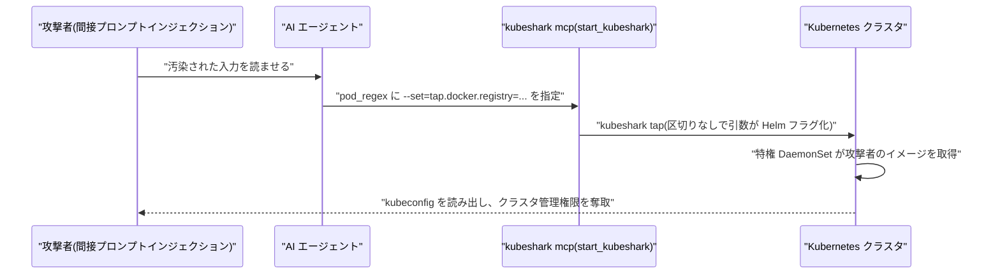

# LLM・AI Agent 最新情報レポート Vol.197
<!-- x-summary: vLLM v0.34.0公開、Model Runner V2に一本化しMistral Large 4に対応 -->

**作成日**: 2026年11月18日(JST)
**対象期間**: 11月17日〜11月18日(Vol.196との差分)。openai.com・blog.google・Google Cloud/Azure の公式ページはこのセッションのネットワーク設定で開けなかったため、Anthropic の公式ニュース、GitHub のリリースとアドバイザリを一次情報の中心にしている。

## 目次

1. [推論基盤の更新](#1-推論基盤の更新)
   - [1.1 vLLM v0.34.0:Model Runner V2 への一本化と拡張可能な KV キャッシュ](#11-vllm-v0340model-runner-v2-への一本化と拡張可能な-kv-キャッシュ)
2. [公式発表の確認状況](#2-公式発表の確認状況)
3. [脆弱性情報](#3-脆弱性情報)
   - [3.1 AI関連](#31-ai関連)
   - [3.2 実行環境・周辺基盤](#32-実行環境周辺基盤)
   - [3.3 Arize Phoenix の書式文字列インジェクション(CVSS 10.0)](#33-arize-phoenix-の書式文字列インジェクションcvss-100)
   - [3.4 Kubeshark の MCP ツールから始まるクラスタ乗っ取り(CVSS 7.2)](#34-kubeshark-の-mcp-ツールから始まるクラスタ乗っ取りcvss-72)
4. [参考リンク](#4-参考リンク)

---

## 1. 推論基盤の更新

### 1.1 vLLM v0.34.0:Model Runner V2 への一本化と拡張可能な KV キャッシュ

vLLM プロジェクトは 11月16日、v0.34.0 を公開した(GitHub の Latest)。412 人(うち初参加 120 人)による 1,061 コミットを含み、11月2日の v0.33.0(PyTorch 2.14 への更新、CUDA 12.9 の wheel 終了)から約2週間での更新である。PyTorch は 2.14.0、FlashInfer は 0.7.3 のままで、`transformers` は `>= 5.16.1, < 5.23.0` に固定される。`pip install vllm` は CUDA 13.0 向けで、ROCm 10.0 と XPU は別の index、Docker イメージは CUDA・ROCm・CPU・XPU が用意されている。[[1]](#ref-1) [[2]](#ref-2)

技術的な中心は二つある。一つは「Model Runner V1 の削除」で、GPU 実行系は Model Runner V2 のみになった。`VLLM_USE_V2_MODEL_RUNNER` を 1 以外にすると起動時にエラーになる。もう一つは「拡張可能な KV キャッシュ(extensible KV cache)」が既定で有効になったことで、ウォームアップ後に空いているメモリからキャッシュ容量を決める。リリースノートの例では、H200 上の MiniMax-M3 でキャッシュが 433k トークンから 672k トークンへ増える。代償として、モデルによってはトークンあたりのデコード遅延が増えうると明記されている。この変更に合わせて `gpu_memory_utilization` の既定値が 1.0 になった。投機的デコードでは suffix decoding とカスタム speculator が新しい runner で動き、draft モデルの CUDA graph にも対応した。サービング面では、checkpoint/restore のエンドポイント、フォールトトレラントな DP+EP のスケールダウン、オプトインの cache-aware admission が加わった。性能はノート記載の値(ベンダー報告)で、Step5 を 4×GB200 で動かすとデコードが最大 1.95 倍、GLM-5.3-Flash は DEP4 比で出力スループット 1.6 倍、GLM-5.3 の長いプロンプトの TTFT は 32K〜128K トークンで 1.24〜1.40 倍高速化したとされる。[[1]](#ref-1)

新規対応モデルは Mistral Large 4(総パラメータ 1T、アクティブ 52B、FP8 と NVFP4)、MiniMax-M3.1-Flash、Ricursive Ripple-65B Preview、Zyphra ZAYA1、Liquid AI の LFM3 系(テキスト・VL・音声)、音声認識系の NVIDIA Nemotron-3.5-Transcribe と Canary-1B-v2 など。ただし Keye-VL モデル、QuTLASS と `fp_quant` のチェックポイント、Marlin W4A8(代替は `--quantization humming`)は削除された。自己ホストで運用している場合の注意点は、既定の `--block-size` が 16 から 64 に変わること、ROCm 7.2 の成果物が無くなり ROCm 10.0 への移行が必要なこと、`huggingface_hub >= 2.0.0` など依存の下限が上がったことである。従来の挙動を保つには `--block-size 16`、`--gpu-memory-utilization 0.9`、`--no-enable-extensible-kv-cache` を明示する。性能値は vLLM 自身の報告であり、自社ワークロードで再計測してから本番に反映したい。なお、Ollama の最新安定版は 11月9日の v0.40.16(Ripple Preview を追加)で、11/10 の v0.40.17 は rc1 のままだった。[[1]](#ref-1) [[16]](#ref-16)

---

## 2. 公式発表の確認状況

**Anthropic**: 公式ニュースの最新は 11月10日の IPO ロードショー開始、その前が 11月9日の Claude Fable 5.2 / Mythos 5.2(いずれも Vol.191 掲載済み)で、新規記事は無かった。Claude Code の最新は v2.1.326(11月16日、Vol.196 掲載済み)。[[9]](#ref-9) [[15]](#ref-15)

**エージェントフレームワーク**: langchain-core 1.8.2(11月17日)は `langsmith_gateway` への `headers` 追加、`aparse_result` のオーバーライドに関する説明、スキーマ生成時の警告フィルタ競合の修正といった小規模な更新で、同日の langchain-openai 1.8.1 は「done」イベントからの関数呼び出し引数の復元を修正した。11/15 には langchain-xai 1.4.0 と langchain-mistralai 1.2.0 が `ChatXAI` / `ChatMistralAI` を LangSmith ゲートウェイ経由にしている。[[10]](#ref-10) Google ADK の最新は v2.14.1(11月12日)で、11/14 以降の更新は無い。[[11]](#ref-11) OpenAI Agents SDK の最新は v0.24.0-alpha.8(11月16日、Vol.196 掲載済み)のまま。[[12]](#ref-12) MCP 仕様の最新安定版は 2026-07-28 で新版は無い。[[13]](#ref-13)

**Node.js**: セキュリティリリースの最新は 11月11日(Vol.191 掲載済み)で、その後の告知は無い。[[14]](#ref-14)

**確認できなかったもの**: openai.com、blog.google、docs.cloud.google.com(Google Cloud リリースノート)、learn.microsoft.com / azure.microsoft.com(Azure・Foundry)、nvd.nist.gov は名前解決に失敗して開けなかった。このため OpenAI・Google・Google Cloud・Azure の 11/17〜11/18 の公式発表の有無は未確認で、「新情報なし」とは判断しない。検索でも 11月分の該当発表は確認できなかった(Microsoft Ignite 2026 の発表も検索結果には出ていない)。Linux カーネルについては、検索結果で AF_UNIX の use-after-free(CVE-2026-80521、CVSS 7.8)に Google kernelCTF の公開エクスプロイトが出たとの報道があったが、NVD やディストリビューションのアドバイザリを開けず裏が取れていないため、本号の表には載せていない。次回以降にこれらのドメインが許可されれば再確認する。セキュリティインシデント(実際の侵害・漏えい)は、検索では 11月分の新規事案を確認できなかった。

---

## 3. 脆弱性情報

GitHub Advisory Database の Critical・High(reviewed)の一覧と、MCP 関連の一覧を確認した。Critical で新規に確認できたのは Phoenix(11月17日)のみ。[[6]](#ref-6) [[7]](#ref-7) [[8]](#ref-8)

### 3.1 AI関連

| 識別子 | 対象・影響/修正バージョン | CVSS | 種類・影響 | 悪用状況 | 推奨対応 |
|---|---|---|---|---|---|
| CVE-2026-53998(GHSA-gfv3-m769-5xm3) | pip `arize-phoenix` 13.0.0 以上 15.7.0 未満 / 15.7.0 | 10.0(v3.1) | 書式文字列インジェクション(CWE-134, 200)。GraphQL の `applyChatTemplate` でサーバー内情報(環境変数など)が読める(3.3節) | KEV・PoC は不明 | 15.7.0 以上へ更新。`PHOENIX_SECRET` と保存済み API キーのローテーション |
| CVE-2026-129236(GHSA-8vf2-hxg5-crqh) | Go `kubeshark` v53.1.0 以上 v53.4.0 未満 / v53.4.0 | 7.2(v3.1。報告者の評価は 8.3) | MCP ツール `start_kubeshark` の引数インジェクション(CWE-88)から、イメージ差し替えによるクラスタ乗っ取り(3.4節) | KEV・PoC は不明 | v53.4.0 へ更新。`--allow-destructive` を使わない |
| CVE-2026-129235(GHSA-gj7r-p794-hhq5) | Go `kubeshark`(影響範囲は個別アドバイザリ未確認) | Moderate | MCP の `download_file` が検証なしのパスに書き込む | 不明 | 上記と同じ v53.4.0 以降へ更新して確認 |

前回までに掲載済みの `code-review-mcp-server`(CVE-2026-68934)、Claude Code の Edit ツール TOCTOU、`@tsparticles/mcp-server`、GPUStack、Kubeflow Pipelines などは再掲しない。MCP 関連の一覧では、10月下旬〜11月上旬に Code Graph RAG(CVE-2026-87008、CVE-2026-77604、いずれも High)、`fast-agent-mcp` の認証なし 0.0.0.0 待ち受け(CVE-2026-102610、Moderate)、LiteLLM のソルトキー再利用による管理者権限昇格(CVE-2026-114612、High、10月27日)なども登録されているが、一覧のタイトルのみの確認で、本号では詳細を調べていない。

### 3.2 実行環境・周辺基盤

| 識別子 | 対象・影響/修正バージョン | CVSS | 種類・影響 | 悪用状況 | 推奨対応 |
|---|---|---|---|---|---|
| CVE-2026-110789(GHSA-rvfr-cqwq-rc4j) | npm `@libp2p/crypto`(影響範囲は一覧のみで未確認) | High(スコア未確認) | ASN.1 DER デコーダが攻撃者指定の長さで無制限の同期ループに入り、Node のイベントループを認証前に停止 | 不明 | 修正版へ更新(版は個別アドバイザリで要確認) |
| CVE-2026-119793(GHSA-x2vm-cf3p-m2w8) | npm `@libp2p/gossipsub`(同上) | High(スコア未確認) | 既定設定でトピックごとのエントリに上限が無く、メモリが際限なく増える | 不明 | 同上 |
| CVE-2026-128120(GHSA-3r8g-jcqq-3p5j) | npm `@sveltejs/kit`(影響範囲は一覧のみ) | High(スコア未確認) | リモート関数の `form` のフォームデータ解析での DoS | 不明 | 3.1.1 以降へ更新(Vol.196 の CVE-2026-128118 と同系統の修正) |

Python 本体、Node.js 本体、Linux の主要基盤パッケージについて、11/17〜11/18 に新しい公式セキュリティリリースは確認できなかった。ただし Ubuntu・Red Hat・Debian のアドバイザリと NVD は今回開けておらず、「新情報なし」とは言い切れない。aiohttp の9件(修正版 3.14.4)、mail-parser、nltk は Vol.196 で掲載済み。

### 3.3 Arize Phoenix の書式文字列インジェクション(CVSS 10.0)

LLM の可観測性ツール Arize Phoenix(pip `arize-phoenix`)に、CVSS 3.1 で 10.0 の脆弱性 CVE-2026-53998 が登録された(GitHub での公開は 11月9日、NVD と GitHub Advisory Database への反映が 11月16〜17日)。影響は 13.0.0 以上 15.7.0 未満。GraphQL の `applyChatTemplate` が、ユーザー指定のテンプレートを f-string 方式のフォーマッタ(`FStringTemplateFormatter._format()`)にそのまま渡すため、`{...}` の属性たどりでサーバー側の情報を応答として取り出せる。アドバイザリによれば、読み出せるのはサーバーのファイルパス、読み込み済み Python モジュール名、内部の設定定数、環境変数で、属性アクセスを制限するはずの `DotDict.__getattr__()` は実質的に機能していない。[[3]](#ref-3)

攻撃の成立条件は低い。認証を無効にした既定のインストールでは資格情報なしで呼べ、認証を有効にしていても任意のアカウント(権限不問)で足りる。深刻なのは漏れる値の使い道で、環境変数の `PHOENIX_SECRET` が漏れると管理者権限の JWT を偽造でき、保存済みの LLM API キーや OAuth トークンを守る Fernet 鍵も導出できる、とアドバイザリは説明している。つまり読み取り専用の脆弱性でも、実際には認証の突破と保存済み認証情報の復号に発展する。優先度は高い。Phoenix を社内で共有している、またはインターネットから到達できる場合は、15.7.0 以上へ更新し、更新前に漏えいしていたおそれがあるなら `PHOENIX_SECRET` を含む環境変数の秘密情報と保存済み API キーを入れ替える必要がある。なお修正 PR(#13197)を含む arize-phoenix v15.7.0 のリリースページの日付は 2026年5月13日で、公開日(11月9日)とは半年のずれがある。この食い違いの理由は確認できていない。[[3]](#ref-3) [[4]](#ref-4)

### 3.4 Kubeshark の MCP ツールから始まるクラスタ乗っ取り(CVSS 7.2)

Kubernetes のトラフィック可視化ツール Kubeshark の CLI には `kubeshark mcp` サブコマンドがあり、AI エージェントから Kubeshark を操作する MCP サーバーとして動く。この `start_kubeshark` ツールが、呼び出し側の `pod_regex` を、`--` の区切りなしで `kubeshark tap` の位置引数に渡していた(CWE-88)。値が `--set=` で始まると Helm のフラグとして解釈され、`tap.docker.registry` と `tap.docker.tag` を書き換えられる。結果として worker・hub・front のイメージが攻撃者のレジストリから取得される。worker の DaemonSet は特権付き・ホストネットワーク・ホストファイルシステムのマウントで動くため、攻撃者のイメージから cluster-admin の kubeconfig を読み出してクラスタを乗っ取れる。影響は v53.1.0 以上 v53.4.0 未満(本文では v53.3.0 が最後の影響版)で、修正は v53.4.0(PR #1957)。GitHub での公開は 8月13日、NVD への登録と更新が 11月16日である。[[5]](#ref-5)

CVSS が 7.2 に抑えられているのは前提条件が重いためで、アドバイザリは報告者の 8.3 から下げた理由として、MCP サーバーがローカルの stdio でネットワーク待ち受けが無いこと、実行ホストが DaemonSet を展開できる高権限の kubeconfig を持っている必要があることを挙げている。さらにこのツールは `--allow-destructive` 付きで起動した場合にのみ登録される。逆に言えば、そのオプションを付け、信頼できない内容(Issue、ログ、Web ページ)を読むエージェントに接続した構成は、プロンプトインジェクションからクラスタ全体の侵害につながる。対応は v53.4.0 への更新に加え、`--allow-destructive` を必要な時だけに限る、MCP サーバーを実行するマシンの kubeconfig 権限を最小にする、が回避策として示されている。同じ Kubeshark の `download_file`(CVE-2026-129235、Moderate)も同日に登録されている。[[5]](#ref-5) [[8]](#ref-8)

---

## 4. 参考リンク

- **[1]** [Release v0.34.0 · vllm-project/vllm | GitHub](https://github.com/vllm-project/vllm/releases/tag/v0.34.0)
- **[2]** [Releases · vllm-project/vllm | GitHub](https://github.com/vllm-project/vllm/releases)
- **[3]** [GHSA-gfv3-m769-5xm3: Phoenix format string injection in applyChatTemplate | GitHub Advisory Database](https://github.com/advisories/GHSA-gfv3-m769-5xm3)
- **[4]** [Release arize-phoenix-v15.7.0 · Arize-ai/phoenix | GitHub](https://github.com/Arize-ai/phoenix/releases/tag/arize-phoenix-v15.7.0)
- **[5]** [GHSA-8vf2-hxg5-crqh: Kubeshark MCP start_kubeshark argument injection | GitHub Advisory Database](https://github.com/advisories/GHSA-8vf2-hxg5-crqh)
- **[6]** [Reviewed High advisories (published after 2026-11-15) | GitHub Advisory Database](https://github.com/advisories?query=type%3Areviewed+severity%3Ahigh+published%3A%3E2026-11-15)
- **[7]** [Reviewed Critical advisories (published after 2026-11-15) | GitHub Advisory Database](https://github.com/advisories?query=type%3Areviewed+severity%3Acritical+published%3A%3E2026-11-15)
- **[8]** [Reviewed MCP-related advisories (published after 2026-11-15) | GitHub Advisory Database](https://github.com/advisories?query=type%3Areviewed+mcp+published%3A%3E2026-11-15)
- **[9]** [Newsroom | Anthropic](https://www.anthropic.com/news)
- **[10]** [Releases · langchain-ai/langchain | GitHub](https://github.com/langchain-ai/langchain/releases)
- **[11]** [Releases · google/adk-python | GitHub](https://github.com/google/adk-python/releases)
- **[12]** [Releases · openai/openai-agents-python | GitHub](https://github.com/openai/openai-agents-python/releases)
- **[13]** [Releases · modelcontextprotocol/modelcontextprotocol | GitHub](https://github.com/modelcontextprotocol/modelcontextprotocol/releases)
- **[14]** [Vulnerability Security Releases | Node.js](https://nodejs.org/en/blog/vulnerability)
- **[15]** [Releases · anthropics/claude-code | GitHub](https://github.com/anthropics/claude-code/releases)
- **[16]** [Releases · ollama/ollama | GitHub](https://github.com/ollama/ollama/releases)
