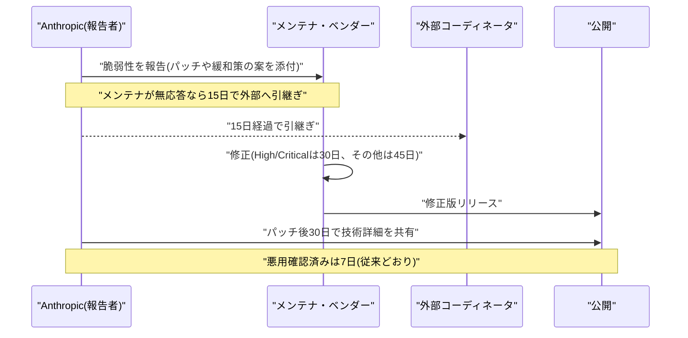

# LLM・AI Agent 最新情報レポート Vol.198
<!-- x-summary: Anthropic、脆弱性開示を90日から30日へ短縮。AIの発見力向上で2027年1月適用 -->

**作成日**: 2026年11月19日(JST)
**対象期間**: 11月18日〜11月19日(Vol.197との差分。Anthropic 研究ページの11月16〜17日分は未掲載だったため回収して掲載)。openai.com・blog.google・Google Cloud ドキュメント・Microsoft(learn / azure / news)・python.org はこのセッションのネットワーク設定で名前解決できず開けなかった。Anthropic の公式ページ、GitHub のリリースとアドバイザリ、Node.js 公式、Ubuntu のセキュリティ通知を一次情報の中心にしている。

## 目次

1. [Anthropic の公式発表](#1-anthropic-の公式発表)
   - [1.1 Anthropic が脆弱性の協調開示期限を 90日から 30日へ短縮](#11-anthropic-が脆弱性の協調開示期限を-90日から-30日へ短縮)
   - [1.2 Claude のエージェント群がブラックホール物理の未解決問題2件を解いたと発表](#12-claude-のエージェント群がブラックホール物理の未解決問題2件を解いたと発表)
2. [開発ツール・フレームワークの更新](#2-開発ツールフレームワークの更新)
   - [2.1 OpenAI Agents SDK 0.25.0:既定モデルが gpt-6-luna に、Runloop 提供を削除](#21-openai-agents-sdk-0250既定モデルが-gpt-6-luna-にrunloop-提供を削除)
   - [2.2 LangChain 各パッケージが Claude Fable/Mythos 5.2 と GPT-6.2 Astra/Sol に対応](#22-langchain-各パッケージが-claude-fablemythos-52-と-gpt-62-astrasol-に対応)
   - [2.3 Claude Code v2.1.327](#23-claude-code-v21327)
3. [公式発表の確認状況](#3-公式発表の確認状況)
4. [脆弱性情報](#4-脆弱性情報)
   - [4.1 AI関連](#41-ai関連)
   - [4.2 実行環境](#42-実行環境)
   - [4.3 needrestart の権限昇格(USN-9151-1)](#43-needrestart-の権限昇格usn-9151-1)
5. [参考リンク](#5-参考リンク)

---

## 1. Anthropic の公式発表

### 1.1 Anthropic が脆弱性の協調開示期限を 90日から 30日へ短縮

Anthropic は 11月16日、研究ページで「協調的脆弱性開示(CVD)ポリシーのタイムライン更新」を公開した。AI モデルが脆弱性を見つける力を急速に高めており、従来の 90 日という開示猶予は「修正は人間の速度で進み、同じバグを別の人が独立に見つける可能性は低い」という前提に立っていたが、どちらも成り立たなくなったというのが理由である。同社は、モデルが修正パッチの作成も支援できるようになったこと、あるモデルが見つけた脆弱性を別のモデルが見つける可能性が高まり「再発見率が上がっている」ことを挙げている。新しい期限は 2027年1月1日以降にベンダーやメンテナへ報告する案件に適用され、すでに進行中の案件は従来の期限のままである。[[1]](#ref-1)

変更点は次の表のとおり。深刻度が High / Critical の案件の開示期限が 90 日から 30 日に、それ以外が 45 日になる。メンテナが反応しない場合に外部のコーディネータへ引き継ぐまでの期間は 30 日から 15 日、パッチ公開後に技術詳細を共有するまでの待機は 45 日から 30 日になった。実際に悪用されている脆弱性は従来どおり 7 日で変わらない。また、すでに 90 日を超えて未公開の High / Critical 案件には追加で 30 日を与え、その後 2027年1月1日から同社のダッシュボードで公開するとしている。

| 項目 | 従来 | 新ポリシー |
|---|---|---|
| High / Critical の開示期限 | 90日 | 30日 |
| その他の開示期限 | 90日 | 45日 |
| メンテナ無応答時の外部コーディネータ引継ぎ | 30日 | 15日 |
| パッチ後に技術詳細を共有するまで | 45日 | 30日 |
| 悪用が確認された脆弱性 | 7日 | 7日(変更なし) |

留意点は三つある。第一に、重要インフラのように 30〜45 日では配備できないソフトウェアや、仕様・RFC の変更を要する欠陥は、ベンダーと個別に期限を合意するとしている。第二に、人間のレビューを経ていない AI 発見の結果(OSS Scanner の出力など)は今回の更新の対象外である。第三に、同社はメンテナ支援として、報告にパッチや緩和策を添えること、大量の報告を送る前に処理可能なペースを合意することを挙げ、OSS Scanner、Claude for Open Source Program(適格なメンテナに Claude Ultra を6か月無償)、Cyber Verification Program を紹介している。OSS を利用する企業側には、アドバイザリが出てから修正版を取り込むまでの猶予が短くなる可能性があり、依存関係の更新を自動化する運用の重要性が増す。なお、これは一社の方針であり、他社や業界標準が追随するかは未確定である。[[1]](#ref-1)

### 1.2 Claude のエージェント群がブラックホール物理の未解決問題2件を解いたと発表

Anthropic は 11月17日、Claude が量子重力とブラックホールに関する理論物理の未解決問題2件を解いたとする記事とプレプリント2本を公開した。研究者 Hongbin Chen が8月に副業的に始めたもので、Claude に未解決問題の一覧を出させたところ 22 件の候補が返り、候補ごとに別のエージェントを約6週間バックグラウンドで走らせた。各エージェントは互いの進捗投稿を読める構成で、特別なセットアップはしていない。論文本文は Claude がほぼ自力で執筆し、物理学者が主要な結果をすべて確認したという。[[2]](#ref-2)

一つ目は、ホーキング=ページ転移が弱結合でも急激に起きるかという問題である。1983年の Hawking と Page の計算は大きな宇宙の領域に限られ、ゲージ理論側の同じ転移は1999年に特定されたものの、急激か緩やかかは未解決で、2003年の計算は数千のダイアグラムを含む3ループの数値が必要で未完だった。Claude は N=4 超対称ヤン=ミルズ理論でこの転移が急激であると結論した。計算のほぼすべてを独立した2つのエージェントが二重に実施し、公表済みの結果とも照合した。二つ目はモジュラーブートストラップが与える3次元重力の最軽量ブラックホール質量の上限 M₁ ≤ c/Λ で、Hellerman の2009年の評価は c/6、数値では c/9.1 程度、解析的には c/8.5 が証明済みだった。Claude は大きな c で方法を支配するスペクトル曲線を見つけ、Λ ≈ 9.1266 を厳密に導いて、この手法ではこれが最適であることを示した。あるエージェントが数値結果の規則性に気づき、球充填問題に取り組む別のエージェントがそれを手法にした。この手法は OpenAI のモデルが最近証明した球充填の結果も再現したと記事は述べる。以前の Claude は同じ問題に61回の並列試行で失敗しており、今回は別の2エージェントが独立に同じ答えに到達した。モジュラーブートストラップの結果は9月に証明支援系 Lean で形式検証された。[[2]](#ref-2)

限界も明記されている。ホーキング=ページ側では他の時空の履歴を完全には解析しておらず、この理論でのハゲドン転移は未確認である。ブートストラップ側はブラックホールのスピンを無視しており、ブラックホールが現れ始める c/12 には単独では届かない。正しい3次元量子重力理論を特定するものでもない。エンジニアにとっての含意は、長時間・並列・相互参照型のエージェント構成と、二重実施や形式検証という検証の組み合わせが「成果の信頼性」を担保する設計として示されている点である。ただし結果は Anthropic の自己発表で、物理コミュニティによる査読は今後である。[[2]](#ref-2)

---

## 2. 開発ツール・フレームワークの更新

### 2.1 OpenAI Agents SDK 0.25.0:既定モデルが gpt-6-luna に、Runloop 提供を削除

OpenAI の Agents SDK(Python)は 11月17日に v0.25.0 を公開した(GitHub 上の Latest。一覧ページ上は18日表示、リリース本文の日付は17日)。Vol.196 で扱った 0.24.0-alpha.8(ツール承認、アプリ側のモデルクライアント、Realtime 音声)の次の安定版にあたる。破壊的変更は三つある。ベータ提供だった Runloop サンドボックスプロバイダの削除(移行先の例は Modal、または 0.24.0 に留まる)、Pydantic のコンテキストのチェックポイント仕様変更(RunState スキーマ 1.22)、そして `OpenAIResponsesCompactionSession` の既定モデルが `gpt-6-luna` になったことである。従来の挙動を保つには `model="gpt-4.1"` を指定する。[[3]](#ref-3)

技術面では、ハンドオフで例外から復帰するオプトインの `failure_error_function`、ネストしたエージェントツールの承認を出力ガードレール付きで再開できる対応、承認結果の保持、MCP v2 の Streamable HTTP での同時リクエスト(v1 は従来どおり直列)、失敗・未完了の Responses 呼び出しでもプロバイダ報告のトークン使用量を保持する修正などが入った。MCP の最小バージョンは 1.21.2 に上がった。Chat Completions でのツール要求は `gpt-6-sol` と `gpt-6-luna` では reasoning effort 未指定時に非推論モードが既定になる。リリースノートに現れる `gpt-6-luna`・`gpt-6-sol` は SDK 側の記述であり、価格や性能は OpenAI の公式ページを開けなかったため確認できていない。[[3]](#ref-3)

影響として、Pydantic 製のコンテキストを複数ワーカー間でチェックポイント共有している場合は、読み取り側を先にアップグレードする必要があるとノートが注意している。セッション圧縮の既定モデルが変わるとコストと挙動が変わるため、固定したい場合は明示指定が望ましい。[[3]](#ref-3)

### 2.2 LangChain 各パッケージが Claude Fable/Mythos 5.2 と GPT-6.2 Astra/Sol に対応

LangChain は 11月18日、`langchain-anthropic` 1.7.11 と `langchain-openai` 1.8.2 を含む複数パッケージを公開した。anthropic 側は Claude Fable と Mythos 5.2 のサポート追加(#41770)、空の thinking ブロック開始時のチャンク送出、ツール呼び出しを強制しない場合の拒否に対する `ModelRefusalError`、サーバー呼び出しでのネストした `caller` の保持、Python 3.10 のパートナーパッケージからの削除を含む。openai 側は「GPT-6.2 Astra と Sol のサポート」(#41922)、モデル間での非同期 HTTP クライアント共有の廃止(#41944)、`langsmith_gateway` ヘッダ送信(#41901)である。同日、langchain-core 1.8.3(警告抑制をコンテキストローカルにする修正)、langchain 1.5.1/1.5.2(ヒューマンインザループの合成ツールメッセージに出所メタデータ追加)も出た。[[4]](#ref-4) [[5]](#ref-5)

ここで注意が必要なのは GPT-6.2 の位置づけである。LangChain のリリースノートには対応を示す1行があるだけで、OpenAI 側の公式発表は openai.com を開けず確認できていない。WebSearch では、GPT-6.2 Astra/Sol の公式リリースは見つからず、名前は11月初旬のリーク報道が中心で、API 変更履歴にも6.2 の記載がないと伝える二次情報があった(確定情報ではない)。したがって「LangChain のコードが 6.2 の識別子を受け付けるようになった」ことは事実だが、モデルが一般提供されたとは断定できない。次回以降、OpenAI 公式の確認が取れた時点で扱う。[[4]](#ref-4)

### 2.3 Claude Code v2.1.327

Claude Code は 11月17日に v2.1.327 を公開した(v2.1.326 は Vol.196 掲載済み)。追加は `/install-github-app` がリポジトリを変更する前の確認、`claude mcp add-json <name> -` で標準入力から JSON を読む機能(トークンをコマンドラインに残さないため。セッション内では使えない)、Claude アプリのゲートウェイ向けに課金グループ名を付ける `attributionProject` 設定、`/tui classic`、`/status` での壊れた設定ファイル一覧など。修正には、プロジェクトスコープの `claude mcp add`/`remove` が `.mcp.json` の他のトップレベルキーを消す問題、`--disallowedTools` の括弧付きルール、停止が長引いたリモート MCP サーバーを約1日バックグラウンドで再試行する挙動、Grep の `head_limit`/`offset` の重複・欠落の解消が含まれる。リリースノートは 100,000 文字で切れており、末尾の約 15,000 文字は読めていない。[[6]](#ref-6)

---

## 3. 公式発表の確認状況

**Anthropic**: 公式ニュースの最新は 11月10日の IPO ロードショー開始で、その前が 11月9日の Claude Fable 5.2 / Mythos 5.2(いずれも掲載済み)。研究ページでは 11月13日の安全性評価(Vol.193 掲載済み)に続き、11月16日の CVD(1.1)と 11月17日のブラックホール物理(1.2)が新規だった。[[1]](#ref-1) [[2]](#ref-2)

**OpenAI / Google / Microsoft**: openai.com、blog.google、docs.cloud.google.com、learn.microsoft.com、azure.microsoft.com、news.microsoft.com は名前解決に失敗して開けなかった。Google Cloud と Azure のリリースノートは確認できていないため、これらの観点を「新情報なし」とは言えない。WebSearch では Microsoft Ignite 2026 が 11月17〜20日(サンフランシスコ)に開催中との情報があるが、発表内容を示す一次情報や信頼できる報道は見つからなかった(事前予想記事のみ)。openai.com・blog.google・Microsoft の各ドメインを許可すれば、次回から公式ページを確認できる。

**エージェントフレームワーク**: google/adk-python の最新は v2.14.1(11月12日)、LlamaIndex は v0.14.26(11月13日)、Ollama は v0.40.16(11月9日)、MCP 仕様の最新は 2026-07-28 版、MCP Python SDK は v2.3.0(10月2日)で、いずれも対象期間に新規リリースは無かった。

**Node.js**: セキュリティリリースの最新は 11月11日(26.13.1、24.22.3、22.23.5)で、11月17日には 27.0.0-alpha.0.1.1 が出たのみ。[[7]](#ref-7)

---

## 4. 脆弱性情報

### 4.1 AI関連

| 識別子 | 対象・影響/修正バージョン | CVSS | 種類・影響 | 悪用状況 | 推奨対応 |
|---|---|---|---|---|---|
| CVE-2026-63496(GHSA-xvcc-vqjv-phqh) | npm `@augment-vir/node` 31.73.5 未満 / 31.73.5 | 7.8(v3.1) | `grep()` の検索パターンがシェル文字列に埋め込まれ、`$()` によるコマンド置換が成立(CWE-78)。信頼できない入力を渡すアプリで任意コマンド実行 | KEV 不明。アドバイザリに PoC 記載あり | 31.73.5 へ更新。入力を渡している箇所を確認 |
| CVE-2026-73864(GHSA-88q3-gch3-5396) | npm `install-artifact-from-github` 1.6.0 以下 / 1.7.0 | 7.5(v3.1) | ビルド済みネイティブアドオンを整合性検証なしで取得し `require()` する(CWE-494)。ミラー環境変数や http へのダウングレードで任意コード実行につながる | KEV・悪用は不明 | 1.7.0 へ更新。回避策はソースビルド(`DEVELOPMENT_SKIP_GETTING_ASSET`)とミラー変数を信頼できる先のみにすること |
| CVE-2026-69157(GHSA-pfwx-xjp4-qxcj) | Rust `atomic-server` 0.29.0〜0.40.1 / 修正版の記載なし | 9.8(v3.1) | 認証なしで `/setup` の招待を利用でき、Drive 全体への書き込み権限を得る(CWE-306) | KEV 不明。報告者が書き込みを確認 | `/setup` を外部に公開しない。未取得の新規インスタンスの有無を確認 |

上の3件はいずれも「AI 製品そのもの」ではない。[[9]](#ref-9) [[10]](#ref-10) [[11]](#ref-11) `@augment-vir/node` と `install-artifact-from-github` は Node.js 開発で広く使われる周辺パッケージ、`atomic-server` は知識グラフサーバーで「エージェント」という語は同製品のアクセス主体を指す。AI/LLM 領域の GitHub レビュー済みアドバイザリを「llm」「mcp」「agent」で確認した範囲では、Arize Phoenix(CVE-2026-53998)、Kubeshark の MCP ツール(CVE-2026-129236、CVE-2026-129235)、ag2(CVE-2026-113663)などが最新で、Vol.197 までに掲載済みか、11月10日以前のものだった。Claude Code のセキュリティアドバイザリの最新は 10月26日(Edit ツールの TOCTOU)で、新規は無かった。なお atomic-server の本件は 7月6日付のアドバイザリが 11月18日に GitHub のデータベースへ追加されたもので、新規公開ではない(`@augment-vir/node`、`install-artifact-from-github` も同様に公表日が過去で、データベース追加が11月18日)。

CVSS 9.0 以上の `atomic-server`(CVE-2026-69157)は、攻撃の成立条件が「`/setup` の URL を知っていて到達できること」だけである。招待は1回限りだが、使用回数の確認と減算が競合でき、有効期限の判定も反転しているとアドバイザリは述べる。修正版の記載が無いため、対応の優先度は、外部公開している場合は高く、社内限定なら中程度とみなし、まず公開範囲の制限と、インスタンスが既に確保済みか(未確保なら第三者に取られる)の確認を行うべきである。

### 4.2 実行環境

| 識別子 | 対象・影響/修正バージョン | CVSS | 種類・影響 | 悪用状況 | 推奨対応 |
|---|---|---|---|---|---|
| CVE-2026-124757(USN-9151-1) | Ubuntu `needrestart`(26.10 は 3.11-1ubuntu2.26.10.1、26.04 LTS は 3.11-1ubuntu2.26.04.1、24.04 LTS は 3.6-7ubuntu4.6、22.04 LTS は 3.5-5ubuntu2.6 に修正) | 不明(通知に記載なし) | systemd の cgroup パスとプロセス名の扱いの不備によるローカル権限昇格(4.3節) | KEV・PoC は不明 | 通常のパッケージ更新 |
| CVE-2026-128134(GHSA-7mxv-7h3q-9324) | pip `nltk`(影響範囲は一覧のみで未確認) | High(スコア未確認) | Graphviz 用の書き込み可能な PATH エントリ経由のローカルコード実行 | 不明 | 修正版へ更新(Vol.196 掲載済み) |
| CVE-2026-125704(USN-9152-1) | Ubuntu `GStreamer`(16.04〜26.04 LTS) | 不明 | 細工した入力でクラッシュまたはプログラム実行 | 不明 | 通常のパッケージ更新 |

Python 本体は python.org を開けず確認できなかった。Node.js 本体は新規のセキュリティリリース無し(3章)。Linux では Ubuntu の直近10件の通知(11月17〜18日)を確認し、上表のほか cloud-init(USN-9153-1、ユーザーアカウントへの不正アクセスの可能性)も確認したが、CVE 番号が通知上に無く重要度判断ができなかった。Red Hat・Debian と NVD は今回も開けておらず、網羅は保証できない。

### 4.3 needrestart の権限昇格(USN-9151-1)

Ubuntu は 11月18日、`needrestart` の脆弱性 USN-9151-1(CVE-2026-124757)を公表した。Armaan Sandhu が発見し、systemd の cgroup パスとプロセス名を適切に扱っていないことで、ローカルの攻撃者が権限昇格できる可能性があるとしている。16.04 から 26.10 までの全リリースが対象で、20.04 と 18.04 は Ubuntu Pro(ESM Apps)経由の修正になる。needrestart は `apt` 実行後にサービス再起動の要否を判定するため、サーバーに広く入っており、共有ホストやコンテナホストでは影響が大きい。ただし CVSS・悪用状況・攻撃の詳細な前提条件は通知から読み取れず、「ローカル攻撃者が必要」という以上は不明である。優先度は、複数ユーザーが使うホストでは高く、単一管理者のホストでは通常更新の範囲とする。[[8]](#ref-8)

---

## 5. 参考リンク

- **[1]** [Updating our coordinated vulnerability disclosure policy timelines | Anthropic](https://www.anthropic.com/research/coordinated-vulnerability-disclosure-timelines)
- **[2]** [Claude solves two open problems in the physics of black holes | Anthropic](https://www.anthropic.com/research/claude-black-hole-physics)
- **[3]** [Release v0.25.0 | openai/openai-agents-python | GitHub](https://github.com/openai/openai-agents-python/releases/tag/v0.25.0)
- **[4]** [langchain-openai 1.8.2 と各パッケージのリリース一覧 | langchain-ai/langchain | GitHub](https://github.com/langchain-ai/langchain/releases)
- **[5]** [langchain-anthropic 1.7.11 | langchain-ai/langchain | GitHub](https://github.com/langchain-ai/langchain/releases/tag/langchain-anthropic%3D%3D1.7.11)
- **[6]** [Releases(v2.1.327、v2.1.326)| anthropics/claude-code | GitHub](https://github.com/anthropics/claude-code/releases)
- **[7]** [Node.js ブログ(リリース一覧)| Node.js](https://nodejs.org/en/blog)
- **[8]** [USN-9151-1: needrestart vulnerability | Ubuntu Security Notices](https://ubuntu.com/security/notices/USN-9151-1)
- **[9]** [GHSA-xvcc-vqjv-phqh / CVE-2026-63496 | GitHub Advisory Database](https://github.com/advisories/GHSA-xvcc-vqjv-phqh)
- **[10]** [GHSA-88q3-gch3-5396 / CVE-2026-73864 | GitHub Advisory Database](https://github.com/advisories/GHSA-88q3-gch3-5396)
- **[11]** [GHSA-pfwx-xjp4-qxcj / CVE-2026-69157 | GitHub Advisory Database](https://github.com/advisories/GHSA-pfwx-xjp4-qxcj)
