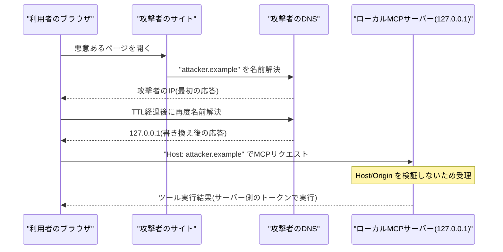

# LLM・AI Agent 最新情報レポート Vol.199
<!-- x-summary: Anthropicが公募価格を1株83ドルで決定、Nasdaq「ANT」で11/19に取引開始 -->

**作成日**: 2026年11月20日(JST)
**対象期間**: 11月19日〜11月20日(Vol.198との差分)。openai.com・blog.google・docs.cloud.google.com・Microsoft(learn / azure)関連ドメインはこのセッションのネットワーク設定で名前解決できず開けなかったため、OpenAI・Google・Google Cloud・Azure の公式発表の有無は未確認。Anthropic の公式ページ、GitHub のリリースとアドバイザリ、Node.js 公式、Ubuntu のセキュリティ通知を一次情報の中心にしている。

## 目次

1. [Anthropic の公式発表](#1-anthropic-の公式発表)
   - [1.1 Anthropic が公募価格を 1株83ドルに決定、11月19日に Nasdaq で取引開始](#11-anthropic-が公募価格を-1株83ドルに決定11月19日に-nasdaq-で取引開始)
2. [開発ツール・フレームワークの更新](#2-開発ツールフレームワークの更新)
   - [2.1 Claude Code v2.1.328 / v2.1.329:Bedrock・Foundry 等で Auto mode、MCP フックの失敗時ブロック](#21-claude-code-v21328--v21329bedrockfoundry-等で-auto-modemcp-フックの失敗時ブロック)
   - [2.2 LangChain が GPT-6.2 対応と Python 3.10 切り捨てを進める](#22-langchain-が-gpt-62-対応と-python-310-切り捨てを進める)
3. [公式発表の確認状況](#3-公式発表の確認状況)
4. [脆弱性情報](#4-脆弱性情報)
   - [4.1 AI関連](#41-ai関連)
   - [4.2 実行環境](#42-実行環境)
   - [4.3 Todoist MCP サーバーの DNS リバインディング(CVSS 9.3)](#43-todoist-mcp-サーバーの-dns-リバインディングcvss-93)
5. [参考リンク](#5-参考リンク)

---

## 1. Anthropic の公式発表

### 1.1 Anthropic が公募価格を 1株83ドルに決定、11月19日に Nasdaq で取引開始

Anthropic は 11月18日、ニュースページで「Anthropic prices initial public offering」を公開し、新規株式公開(IPO)の公募価格を Class A 普通株 1株あたり 83.00 ドルに決めたと発表した。募集・売出しの総数は 9億8,000万株で、内訳は Anthropic 自身が売る 9億5,635万1,354株と、既存株主が売る 2,364万8,646株。既存株主の分の売却代金は Anthropic には入らない。引受人には 30 日間のオプションがあり、最大 1億4,700万株を追加で購入できる。上場先は Nasdaq Global Select Market、ティッカーは「ANT」。SEC の登録届出書は 11月18日に有効となり、取引開始は 11月19日、受渡し(クロージング)は 11月20日の予定で、通例のクロージング条件に従う。主幹事は Goldman Sachs と Morgan Stanley。[[1]](#ref-1)

発表ページ自体には時価総額や調達総額の記載はない。単純計算(本レポートでの算術で、引受手数料前)では、総額は約813億ドル、Anthropic 分は約794億ドル、オプション全行使分は約122億ドルになる。10月26日の S-1 提出、11月10日のロードショー開始に続く最後の手続きで、時系列は公式ニュース一覧で確認できる。[[2]](#ref-2)

エンジニアにとっての意味は、モデルや API の仕様が変わったという話ではなく、ベンダーの資金力・開示義務・ガバナンスが変わる点にある。上場企業になると、四半期決算や重要契約の開示、リスク要因の公表が定期的に出るため、Claude を基盤に据えるときのベンダー評価材料が増える。一方、価格・提供条件・データ取り扱いが直ちに変わるという情報は、今回確認できた範囲にはない。取引初日の値動きなど市場側の情報は本レポートでは確認しておらず、扱わない。

---

## 2. 開発ツール・フレームワークの更新

### 2.1 Claude Code v2.1.328 / v2.1.329:Bedrock・Foundry 等で Auto mode、MCP フックの失敗時ブロック

Claude Code は 11月19日に v2.1.328(01:14 表示)と v2.1.329(22:14 表示)を GitHub で公開した(前回掲載は v2.1.327)。v2.1.328 の目玉は Auto mode の対象拡大で、Claude Opus 4.6 と Sonnet 4.6 を Amazon Bedrock、Google Cloud の Agent Platform、Microsoft Foundry、Claude apps gateway で使う場合にも Auto mode が使えるようになり、権限モードを指定していない対話セッションは Auto mode で始まる。[[3]](#ref-3)

セキュリティ面で実務に効くのは、`mcp_tool` フックに `"onFailure": "block"` が追加された点。従来のコマンド型・HTTP 型フックと同じく、フックの呼び出し自体が失敗した場合にそのアクションをブロックできる。ポリシー判定を MCP サーバーに外出ししている場合、サーバー障害時に素通しになる(フェイルオープン)事態を防げる。そのほか `claude -p --resume` / `--continue` がフックで保留(defer)されたツール呼び出しを再実行するのを止める環境変数 `CLAUDE_CODE_DISABLE_DEFERRED_TOOL_RESUME`、セルフホストランナーの `--repository-folder` `--hook-label` `--metadata key=value` と新しいオーケストレータ指標が加わった。[[3]](#ref-3)

v2.1.329 では、信頼ダイアログにフォルダ内フックの宣言場所を表示する警告、managed settings のフックが読み込めなかった場合の警告、`/mcp` で接続を拒否したリモート HTTP MCP サーバーの JSON-RPC エラーを表示する「Server message」行などが入った。`/teleport` が開いている会話を置き換えず新規セッションを開始するようになった変更や、ネットワーク停止・ファイルロック後に `~/.claude.json` が初期値に戻る不具合の修正もある。GitHub のリリースページは更新履歴が一部省略されており、全文は各タグのページ側にある。リポジトリ内の設定ファイルから実行されるフックの出所が見えるようになる変更は、不審なリポジトリを開く際のリスク低減につながる。[[3]](#ref-3)

### 2.2 LangChain が GPT-6.2 対応と Python 3.10 切り捨てを進める

LangChain は 11月18〜19日に複数パッケージを更新した。langchain-openai は 1.8.2(11/18)で GPT-6.2 Astra / Sol に対応し、非同期 HTTP クライアントがモデル間で共有される不具合を修正、1.8.3(11/19)で GPT-6.2 の Codex プロンプトキャッシュを有効化、1.8.4(11/19)でストリーム中のサーバーエラーを再試行可能として分類し、langgraph 1.2.16 以上を要求するようになった。langchain 1.5.1 / 1.5.2 は警告フィルタの競合修正と、Human-in-the-loop(HITL)の合成ツールメッセージへの出所メタデータ付与。langchain-core は 1.8.4(11/19、Latest)で、メッセージ終了イベントの finish reason を標準化した。langchain-groq / deepseek / xai の各 1.x 更新では `langsmith_gateway` ヘッダの送出が加わった。[[4]](#ref-4)

langchain-openrouter 0.3.0(11/19)は Python 3.10 を「EOL」として切り捨て、最低要件が Python 3.11 と langchain-core 1.8.3 以上になった。Vol.198 で扱った LangChain / LlamaIndex の Python 要件引き上げの流れの続きで、Python 3.10 環境でエージェントを動かしているチームは、依存パッケージ単位で更新が止まる可能性がある。なお finish reason の標準化は、プロバイダ間で停止理由を同じ値で扱えるようにする変更だが、本レポートでは具体的な値の一覧までは確認していない。

---

## 3. 公式発表の確認状況

**Anthropic**: ニュースページの最新は 11月18日の IPO 価格決定(1.1節)で、その前が 11月10日、11月9日の Claude Fable 5.2 / Mythos 5.2(掲載済み)。ページ上部に「Nov 19, 2026」の日付見出しがあるが記事は付いていなかった。新モデル・新研究の公式記事は無し。[[2]](#ref-2)

**エージェント基盤**: MCP 仕様の最新安定版は 2026-07-28 のままで新版なし。[[18]](#ref-18) Google ADK の最新は v2.14.1(11月12日)で、それ以降の更新は無し。[[17]](#ref-17) vLLM の最新は v0.34.0(11月16日、掲載済み)。[[16]](#ref-16) OpenAI Agents SDK の最新は v0.25.0(11月18日、掲載済み)で、それ以降のリリースは無し。[[19]](#ref-19)

**Microsoft / Azure**: 検索では「Copilot のエージェント基盤を Foundry に開放(MCP 対応、プレビュー)」(Redmond Magazine)や「Microsoft が自社モデルとエージェントの継続改善機能を発表」(SiliconANGLE、11月17日)といった見出しが見つかったが、いずれも本文を開けておらず(ドメインが名前解決できない)、内容は未確認のため掲載しない。learn.microsoft.com と azure.microsoft.com も同様に未確認で、「新情報なし」とは判断していない。

**Google / Google Cloud**: docs.cloud.google.com(リリースノート)、blog.google は開けなかった。検索で確認できた範囲では、Vertex AI は 4月22日の Cloud Next で「Gemini Enterprise Agent Platform」に再編済みという既出情報にとどまり、11月分の新規発表は確認できていない。未確認であり「新情報なし」とは断定しない。

**OpenAI**: openai.com が開けず、公式発表の有無は未確認。GitHub 上のリリース(Agents SDK)のみ確認した。

**Linux**: CISA KEV への Linux カーネル関連の追加を検索したが、11月分は見つからなかった(確認できた直近は 10月28日の CVE-2026-46300。検索結果の見出しのみ確認)。KEV カタログは開いておらず「追加なし」とは断定しない。

**Node.js**: 公式のセキュリティリリース一覧の最新は 11月11日(「November 2026 Security Releases」)で、その後の新規は無し。最新 LTS は v26.13.1。11月11日分の詳細ページは今回開いていない。[[15]](#ref-15)

---

## 4. 脆弱性情報

### 4.1 AI関連

GitHub Advisory Database で 11月18〜19日に掲載された MCP サーバーなど AI 周辺の項目。CVSS は各アドバイザリのページで確認した値。

| CVE / ID | 対象製品・影響範囲 → 修正版 | CVSS | 種類・影響 | 悪用状況 | 推奨対応 |
|---|---|---|---|---|---|
| CVE-2026-76807 / GHSA-833v-v58w-294h | @doist/todoist-mcp(npm)10.3.2 以下 → 10.3.3 | 9.3(3.1) | HTTP モードで Host / Origin 未検証。DNS リバインディングでタスク等を改変・削除可能(4.3節) | 不明(実証は報告者による作成・完了操作) [[5]](#ref-5) | 10.3.3 へ更新。HTTP モードを使わない |
| CVE-2026-77283 / GHSA-mx6p-3fg7-v6pj | obsidian-sync-mcp(npm)0.5.6 以下 → 0.5.7 | 8.8(v4) | 認証なしモードで Host / Origin 未検証。悪意あるページが Obsidian の保管庫を読み書き・削除 | 不明 [[6]](#ref-6) | 0.5.7 へ更新。`MCP_AUTH_TOKEN` を必ず設定 |
| CVE-2026-130008 / GHSA-q433-mp6c-8v4f | StacklokLabs/sqlite-mcp(Go)0.1.2 未満 → 0.1.2 | 8.2(3.1) | 読み取り専用モードを、文の連結と `describe_table` の SQL インジェクションで回避。`ATTACH DATABASE` で任意の SQLite ファイルを読み書き。認証なしで全インターフェースの 8080 番で待受 | 不明 [[7]](#ref-7) | 0.1.2 へ更新。認証プロキシ配下に置く |
| CVE-2026-62964 / GHSA-w42c-h7hr-f67p | zzet/gortex(Go)0.55.0 未満 → 0.55.0 | 7.8(3.1) | MCP の `write_file` `edit_file` `move_inline` が絶対パスでリポジトリ外へ書込み。プロンプトインジェクションされたエージェント経由でシェル起動ファイル等を改変され得る | 不明 [[8]](#ref-8) | 0.55.0 へ更新。書込みツールを信頼できない入力に晒さない |
| CVE-2026-76818 / GHSA-r7wg-f7r2-8wf7 | axon-mcp(pip)0.1.0 以下 → 修正版なし | 7.5(3.1) | `axon rtk-install` が整合性検証なしでバイナリを取得・実行(配布経路が侵害された場合に成立) | 不明(現状は前提条件なしでは悪用不可と記載) [[9]](#ref-9) | 当該コマンドを使わない。修正版の公開を待つ |
| CVE-2026-68903 / GHSA-jw3m-8q7m-f35r | LLMKube(Go)0.8.28 以下 → 0.9.0 | 7.7(3.1) | `Model.spec.source` の絶対パス・`file://` を許可し、コントローラの SA トークンやノード上のファイルを読取り可能。モデルキャッシュは既定で有効 | 不明 [[10]](#ref-10) | 0.9.0 へ更新。Model リソースの作成権限を絞る |

そのほか、GitHub の一覧には @connorbritain/mssql-mcp-core(npm、書込みツールの SQL インジェクション、CVE-2026-63129)も High として載っていたが、CVSS・影響バージョンは未確認のため表には入れていない。[[12]](#ref-12) 一覧に出ていた Arize Phoenix(CVE-2026-53998)と gpustack(CVE-2026-102894 / 102895)は前回までに掲載済み。

### 4.2 実行環境

| CVE / ID | 対象製品・影響範囲 → 修正版 | CVSS | 種類・影響 | 悪用状況 | 推奨対応 |
|---|---|---|---|---|---|
| CVE-2026-97698(および -97699) / GHSA-phmp-hrw4-r36r | mistune(pip、Markdown パーサ)3.3.4 未満 → 3.3.4 | 7.5(3.1) | リンク href 解析の二次時間計算量で DoS。`" | 3.3.4 以上へ更新。信頼できない Markdown の入力長を制限 |
| USN-9173-1 | Ubuntu 24.04 / 22.04 の Linux カーネル(6.8.0-151 等)。CVE は 582 件超の参照 | 不明(Ubuntu のページに優先度の記載なし) | ネットワーク、ファイルシステム、BPF、KVM 等の多数の脆弱性 | 不明 [[13]](#ref-13) | 更新後に再起動。サードパーティのカーネルモジュールは再ビルド |
| USN-9176-1 | Ubuntu の Ruby(ruby3.0 / 3.2 / 3.3)。例:24.04 は 3.2.3-1ubuntu0.24.04.9 | 不明(CVE 未採番、GHSA 7件) | 正規表現・大文字小文字変換の処理による DoS、任意コード実行の可能性、情報漏えい | 不明 [[14]](#ref-14) | 通常のシステム更新を適用 |

Ubuntu は 11月19日に Linux カーネル関連の通知を多数出している(USN-9168-2、9170-1/-2、9171-1/-2、9172-1、9173-1、9174-1、9175-1)。[[20]](#ref-20) Python 本体・Node.js 本体に新規のセキュリティリリースは確認できなかった(Node.js の最新は 11月11日、3節参照)。python.org は開けず、Python 本体の新規告知は未確認。

### 4.3 Todoist MCP サーバーの DNS リバインディング(CVSS 9.3)

CVE-2026-76807 は、Todoist 公式の MCP サーバー `@doist/todoist-mcp` の、オプションのセルフホスト版 `todoist-mcp-http` に関する問題。10.3.2 以下が影響を受け、10.3.3 で修正された。stdio で動かす構成は対象外。サーバーは既定で `127.0.0.1` に待ち受けるが、`Host` と `Origin` ヘッダを検証していなかった。さらにミドルウェアが確認するのは呼び出し元ではなくサーバー自身の Todoist トークンのため、ブラウザは資格情報を持たなくてもサーバーのトークンでツールを実行させられる。CVSS 3.1 は 9.3(`AV:N/AC:L/PR:N/UI:R/S:C/C:H/I:H/A:N`)。[[5]](#ref-5)

成立条件は、利用者が HTTP モードのサーバーを自分の PC で起動したまま、攻撃者のウェブページを開くこと。報告者はタスクの作成と完了を実証し、同じ経路でタスク・コメント・ラベル・フィルタ・ゴールの更新や削除ができるとしている。同日公開の obsidian-sync-mcp(CVE-2026-77283、CVSS v4 8.8)も同じ構造で、認証なしモードでは README のクイックスタートや既定の docker-compose 構成がそのまま対象になる。こちらは `MCP_AUTH_TOKEN` を設定すれば回避でき、ブラウザは Bearer トークンを付けられないため偽造リクエストは 401 になる。[[6]](#ref-6)

対応の優先度は、ローカルで HTTP モードの MCP サーバーを使っている開発者・チームでは高い。まず 10.3.3 / 0.5.7 へ更新し、更新できない場合は HTTP モードを止めるか Bearer トークンを必須にする。アドバイザリは、Host の許可リスト、Origin の拒否、ローカルでも実行ごとのトークン、の3点を推奨している。これらは Host・Origin 検証だけでは呼び出し元の認証にならない点も指摘している。悪用の実例は今回確認できておらず、「不明」としている。

---

## 5. 参考リンク

- **[1]** [Anthropic prices initial public offering | Anthropic](https://www.anthropic.com/news/anthropic-prices-initial-public-offering)
- **[2]** [Newsroom(ニュース一覧) | Anthropic](https://www.anthropic.com/news)
- **[3]** [Releases(v2.1.328 / v2.1.329) | anthropics/claude-code(GitHub)](https://github.com/anthropics/claude-code/releases)
- **[4]** [Releases(langchain-core 1.8.4 ほか) | langchain-ai/langchain(GitHub)](https://github.com/langchain-ai/langchain/releases)
- **[5]** [GHSA-833v-v58w-294h(CVE-2026-76807) | GitHub Advisory Database](https://github.com/advisories/GHSA-833v-v58w-294h)
- **[6]** [GHSA-mx6p-3fg7-v6pj(CVE-2026-77283) | GitHub Advisory Database](https://github.com/advisories/GHSA-mx6p-3fg7-v6pj)
- **[7]** [GHSA-q433-mp6c-8v4f(CVE-2026-130008) | GitHub Advisory Database](https://github.com/advisories/GHSA-q433-mp6c-8v4f)
- **[8]** [GHSA-w42c-h7hr-f67p(CVE-2026-62964) | GitHub Advisory Database](https://github.com/advisories/GHSA-w42c-h7hr-f67p)
- **[9]** [GHSA-r7wg-f7r2-8wf7(CVE-2026-76818) | GitHub Advisory Database](https://github.com/advisories/GHSA-r7wg-f7r2-8wf7)
- **[10]** [GHSA-jw3m-8q7m-f35r(CVE-2026-68903) | GitHub Advisory Database](https://github.com/advisories/GHSA-jw3m-8q7m-f35r)
- **[11]** [GHSA-phmp-hrw4-r36r(CVE-2026-97698) | GitHub Advisory Database](https://github.com/advisories/GHSA-phmp-hrw4-r36r)
- **[12]** [Reviewed advisories(2026-11-18〜20 一覧) | GitHub Advisory Database](https://github.com/advisories?query=type%3Areviewed+published%3A2026-11-18..2026-11-20+severity%3Ahigh)
- **[13]** [USN-9173-1: Linux kernel vulnerabilities | Ubuntu Security Notices](https://ubuntu.com/security/notices/USN-9173-1)
- **[14]** [USN-9176-1: Ruby vulnerabilities | Ubuntu Security Notices](https://ubuntu.com/security/notices/USN-9176-1)
- **[15]** [Vulnerability(セキュリティリリース一覧) | Node.js](https://nodejs.org/en/blog/vulnerability)
- **[16]** [Releases(v0.34.0) | vllm-project/vllm(GitHub)](https://github.com/vllm-project/vllm/releases)
- **[17]** [Releases(v2.14.1) | google/adk-python(GitHub)](https://github.com/google/adk-python/releases)
- **[18]** [Releases(2026-07-28) | modelcontextprotocol/modelcontextprotocol(GitHub)](https://github.com/modelcontextprotocol/modelcontextprotocol/releases)
- **[19]** [Releases(v0.25.0) | openai/openai-agents-python(GitHub)](https://github.com/openai/openai-agents-python/releases)
- **[20]** [Ubuntu Security Notices(一覧) | Ubuntu](https://ubuntu.com/security/notices)
