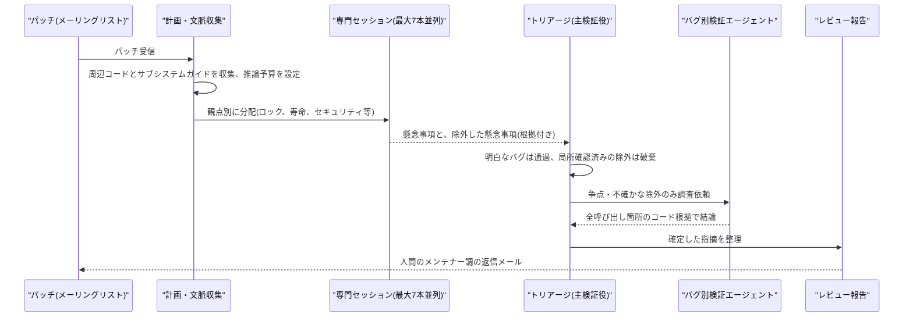
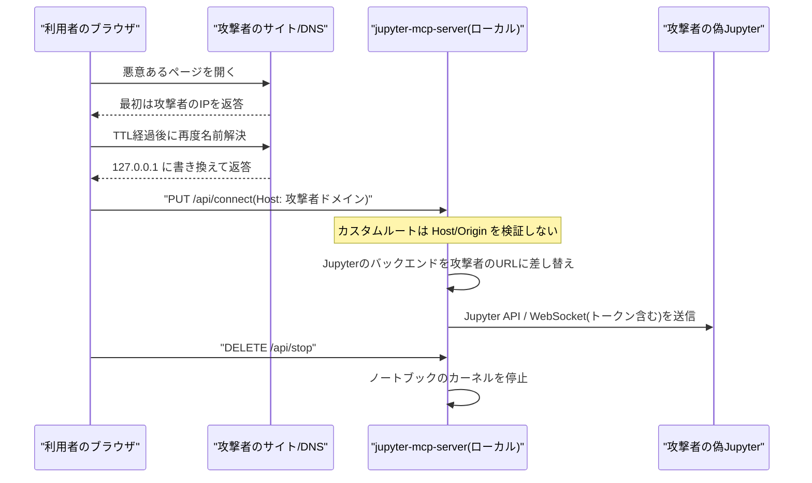

# LLM・AI Agent 最新情報レポート Vol.200
<!-- x-summary: OpenAI Agents SDKがv1.0.0-alpha.1を公開、Codexをモデルプロバイダに追加 -->

**作成日**: 2026年11月21日(JST)
**対象期間**: 11月20日〜11月21日(Vol.199との差分)。一部、11月14〜19日公開で未掲載だった Google Cloud の話題を拾い漏れ回収として掲載。openai.com・deepmind.google・Microsoft(learn / azure / techcommunity)・cisa.gov はこのセッションのネットワーク設定で名前解決できず開けなかったため、これらの公式発表の有無は未確認(2章参照)。

## 目次

1. [公式発表・企業動向](#1-公式発表企業動向)
   - [1.1 Anthropic が IPO のクロージングを発表、プライベートプレースメントを含め総額約1,195億ドル](#11-anthropic-が-ipo-のクロージングを発表プライベートプレースメントを含め総額約1195億ドル)
2. [開発ツール・フレームワークの更新](#2-開発ツールフレームワークの更新)
   - [2.1 OpenAI Agents SDK v1.0.0-alpha.1:Codex をモデルプロバイダとして追加](#21-openai-agents-sdk-v100-alpha1codex-をモデルプロバイダとして追加)
   - [2.2 Claude Code v2.1.330:組み込みのグラフ描画「easel」と rm の承認強化](#22-claude-code-v21330組み込みのグラフ描画easelと-rm-の承認強化)
   - [2.3 Google ADK v2.15.0:マルチラン評価指標と Visual Agent Builder の削除](#23-google-adk-v2150マルチラン評価指標と-visual-agent-builder-の削除)
3. [Google Cloud・Google の更新](#3-google-cloudgoogle-の更新)
   - [3.1 Google が Linux カーネル向けエージェント型レビュー「Sashiko」の7か月の運用実績を公開](#31-google-が-linux-カーネル向けエージェント型レビューsashikoの7か月の運用実績を公開)
   - [3.2 Cloud Storage に「object enrichments」がプレビュー登場](#32-cloud-storage-に-object-enrichments-がプレビュー登場)
   - [3.3 BigQuery・Looker に AI エージェントの観測・評価機能(11月14日公開の拾い漏れ回収)](#33-bigquerylooker-に-ai-エージェントの観測評価機能11月14日公開の拾い漏れ回収)
4. [公式発表の確認状況](#4-公式発表の確認状況)
5. [脆弱性情報](#5-脆弱性情報)
   - [5.1 AI関連](#51-ai関連)
   - [5.2 実行環境](#52-実行環境)
   - [5.3 jupyter-mcp-server の管理ルートが DNS リバインディングで乗っ取られる(CVSS v4 9.3)](#53-jupyter-mcp-server-の管理ルートが-dns-リバインディングで乗っ取られるcvss-v4-93)
6. [参考リンク](#6-参考リンク)

---

## 1. 公式発表・企業動向

### 1.1 Anthropic が IPO のクロージングを発表、プライベートプレースメントを含め総額約1,195億ドル

Anthropic は 11月20日、新規株式公開(IPO)のクロージングと、同時に実施したプライベートプレースメントのクロージングを発表した。Vol.199 で報じた公募価格(1株83ドル)・Nasdaq Global Select Market での「ANT」取引開始(11月19日)に続く確定報である。公式ページによると、売り出された Class A 普通株は 1,127,000,000株で、引受人の追加購入オプション 147,000,000株を全数行使した結果を含む。内訳は Anthropic が 1,103,351,354株、売出株主が 23,648,646株。IPO の総額は約935億ドルで、このうち約916億ドルが Anthropic の手取り(引受手数料・諸費用の控除前)となり、売出株主分は Anthropic に入らない。[[1]](#ref-1)

同時に行われたプライベートプレースメントでは、Class N 株 313,253,007株が同じ1株83ドルで、AMD、Broadcom、Google、Micron、Microsoft、NVIDIA、TSMC Partners の7社に売却され、総額は約260億ドル。この株式は1933年証券法に基づく登録はされていない。IPO とプライベートプレースメントを合わせた総額は約1,195億ドル(控除前)である。主幹事は Goldman Sachs と Morgan Stanley で、SEC が登録届出書の効力発生を宣言したのは11月18日。ニュース一覧ページでも、11月20日付の本件が最新の掲載で、その前が11月18日の公募価格決定、11月10日のロードショー開始だった。[[1]](#ref-1) [[2]](#ref-2)

影響として、プレースメントの引受先が GPU・ネットワーク・メモリ・ファウンドリ・クラウドの主要サプライヤーに揃っている点は、計算資源の調達関係が株主関係としても結びついたことを意味する。ただし、発表は調達資金の使途について記述していない(ページ内に記載なし)。上場後の株主構成や規制上の開示は SEC 提出書類で確認する必要があり、本レポートでは公式ニュースページの記載の範囲にとどめる。エンジニアの実務に直接の技術的影響はないが、API 提供の継続性や価格方針を気にする企画担当者は、今後の決算開示を追う価値がある。

---

## 2. 開発ツール・フレームワークの更新

### 2.1 OpenAI Agents SDK v1.0.0-alpha.1:Codex をモデルプロバイダとして追加

OpenAI Agents SDK(Python)は 11月20日、プレリリースの v1.0.0-alpha.1 を GitHub Releases で公開した。最大の変更は、Codex を明示的に選ぶ(opt-in)モデルプロバイダとして加えたことで、`agents.models.codex` から `CodexProvider` を import し、`RunConfig(model_provider=CodexProvider())` の形で実行ごとに指定する。既定では保存済みの Codex ログインを使い、API キーを渡すこともできる。配布は PyPI ではなく GitHub Releases の wheel のみで、CPython 3.10〜3.14、Linux x86-64 / ARM64、Apple silicon 上の macOS 11 以降、Windows x64 向けに用意され、pip には `--only-binary=:all:` を付けて入れる。各 wheel のリンクには SHA-256 が付き、`SHA256SUMS` も提供される。[[3]](#ref-3)

技術的には、Codex Core `rust-v0.166.0` を PyO3 経由で wheel に組み込んでいる。これにより、`codex app-server` を別プロセスで起動して JSON-RPC で通信する従来の方式を介さず、Python から直接呼び出せる。プロバイダは複数の呼び出しで共有でき、使い終えたら `await provider.aclose()` で閉じる必要がある。ストリーミング、ハンドオフ、Python ツール実行前の承認での一時停止、型付き出力の検証が SDK 側の機能として動き、ネイティブコマンドは Codex 側のサンドボックスと承認設定に従う。修正点として、Codex の自動セッション圧縮がローカルの会話履歴を使うようになった(承認での一時停止後も同様)が、圧縮自体には別途 OpenAI のクライアントや認証情報が必要。保存されたサンドボックスのマニフェストはインラインのバイナリファイルを再開時も保持するようになり、マニフェストを共有する場合は先に全リーダーを更新するか、古い SDK には `LocalFile` を使うよう注意書きがある。[[3]](#ref-3)

v0.24.0-alpha.8 からの移行では破壊的変更が多い。`Agent.run()` や `Session.submit()` は `Runner.run()` / `Runner.run_streamed()` に置き換え、`agents.classic` からの import は `agents` に直す。alpha.8 の `SessionState` と Runner の `RunState` は形式が異なるため、保留中のネイティブ実行や承認は alpha.8 の環境で完了させ、履歴は新しい SDK セッションで始める。メンテナーは、マージ済みコミットでテストスイートが通り、4種の wheel を CI で作成して CPython 3.10 と 3.14 で新規インストールを検証し、Linux x86-64・CPython 3.12 でライブモデルに対するサンプルも実行したと記している。ただしアルファ版であり、本番利用の可否や v1.0.0 の時期は公式ページに書かれていない。直前の安定版は 11月17日付の v0.25.0(Vol.199 掲載)である。[[8]](#ref-8)

### 2.2 Claude Code v2.1.330:組み込みのグラフ描画「easel」と rm の承認強化

Anthropic の Claude Code は 11月20日に v2.1.330 を公開した(前回掲載は v2.1.329)。目玉は、依頼に応じてグラフを描く組み込みの mod「easel」で、MCP のメトリクス結果にも使われる。Pro と Max、提供されている Team / Enterprise の macOS と Linux のみが対象で、自動のグラフ表示は `/config` で切れる。企業向けでは、`claude auth login` の後に Enterprise Admin Console の組織設定を適用し、組織のクラウドプロバイダやゲートウェイを使うようになった。サインインのリンクは短縮され、全体を表示したい場合は `CLAUDE_CODE_FULL_SIGN_IN_LINK=1` を付ける。リリースノートは全体で約150項目と記載されている。[[4]](#ref-4)

安全性・挙動に関する変更が実務上重要である。root・ホーム・トップレベルのフォルダ・作業フォルダを対象とする `rm` コマンドの承認要件が増え、承認できる人がいない環境では拒否される。`ExitWorktree` が他のセッションの使用中のワークツリーを削除する不具合、`/rewind` が古いファイルを復元する不具合、圧縮後に数分固まる不具合も修正された。定期タスクと `/loop` の最長実行期間は、セッションが動いている限り 7日から30日に延びた(従来作成分は7日のまま)。`deniedMcpServers` の名前指定は、名前を付けた claude.ai コネクタだけを隠すようになり、同じ URL の全コネクタを塞ぐには正確な URL を拒否に指定する。セルフホストランナーには `--start-dir` / `SELF_HOSTED_RUNNER_START_DIR` と2つの新メトリクスが加わり、403 のログ文言が変わったため、旧文言に合わせたアラートは見直しが必要。[[4]](#ref-4)

留意点は、`deniedMcpServers` の意味が変わった点で、ポリシーで MCP を制限している組織は設定の再確認が要る。easel は組み込みツールのため、MCP の許可/拒否リストで除外していても、以前は毎回の起動時に「enterprise policy でブロック」という誤警告が出ていた(今回修正。ツール自体はブロックのまま)。[[4]](#ref-4)

### 2.3 Google ADK v2.15.0:マルチラン評価指標と Visual Agent Builder の削除

Google の Agent Development Kit(Python)は 11月19日に v2.15.0 を公開した。評価面では、複数回実行した結果を扱う `pass@k` と `pass^k` の指標と、ツール呼び出し引数の部分点採点が加わった。前の v2.14.0(11月7日、チェンジログ上は11月4日)で入ったマルチラン評価(`--num_runs` / `--parallelism`)と `ToolArgsMatcher` の続きで、エージェントの非決定性を「k回のうち1回でも成功」「k回すべて成功」の2軸で測れるようになる。統合では `GoogleMapsToolset` に Street View 画像・住所検証・逆ジオコーディングが加わり、BigQuery の `ask_data_insights` はプロジェクトやデータセットをまたぐテーブル検索の範囲指定に対応した。[[9]](#ref-9)

基盤面では、実験的な `BufferedSessionService` がセッションの書き込みをバックグラウンドでまとめて行い、`FsspecArtifactService` がアーティファクトの書き込み・削除・バージョン管理に対応した。ライブのツール呼び出しはバックグラウンドタスクで動いて音声が途切れにくくなり、RAG メモリ検索も高速化された。破壊的変更として、ADK Web の対話型 Visual Agent Builder が削除され、`McpInstructionProvider` はセッション状態からプロンプト引数を自動補完しなくなり、動的な指示ルーティングが既定で有効になった。v2.14.1(11月12日)は Agent Engine での FastAPI ネイティブトレースを無効にする修正だった。ADK を使う場合、Visual Agent Builder 依存のワークフローと、MCP の指示プロバイダの引数補完に頼る実装は更新前に確認が必要。[[9]](#ref-9)

---

## 3. Google Cloud・Google の更新

### 3.1 Google が Linux カーネル向けエージェント型レビュー「Sashiko」の7か月の運用実績を公開

Google Cloud ブログは、Gemini を使うオープンソースのエージェント型コードレビュー「Sashiko」の運用実績を、Google AI & Infrastructure の Roman Gushchin と Eric Brewer の署名記事として公開した(ページ上の掲載日は11月19日。検索結果の別の抜粋には11月18日付とする記述もあり、日付は1日のずれがある)。Sashiko は、Linux カーネルのパッチが統合される前にバグを見つけるためのシステムで、2026年の前半に Linux Foundation へ寄贈された。記事は、Linux カーネルが3,500万行超で年間8万5,000件超の変更を受け、少数のメンテナーが手作業でレビューしている状況を課題とし、コード生成よりもレビューが速度を制約していると述べる。[[5]](#ref-5)

仕組みは「候補の発見」と「検証」の分離である。パッチ周辺のコード(変更関数、構造体定義、直接の呼び出し元)とサブシステムのガイドを集めて計画を立て、最大7本のセッションを並列で走らせる。各セッションは、コミットの意図、実装との一致、制御フロー、リソースの寿命、ロック、セキュリティ、ハードウェアのいずれかに専念し、1セッションあたり平均約100回の git ツール呼び出しを行い、実際の懸念事項と、根拠付きで除外した懸念事項の2つのリストを出す。次に主検証役が両方を監査し、除外の理由が「見えていない呼び出し元やロックが防ぐだろう」という仮定に基づく場合は追加調査に回す。難しい案件は1件ごとの検証エージェントが担当し、全呼び出し箇所のコード上の証拠なしにはバグの主張も除外も認めない。最終報告は、メーリングリストの流儀でメンテナーが質問するような文面で出力される。[[5]](#ref-5)

成果の数値は Google 自身の記載である。約7か月の運用で、1日約1,200件のレビューを100超のカーネルメーリングリストに対して実施し、2026年3月以降の累計は24万1,000件。70超のリストがレビューメールの受信に参加し、1,500人超のカーネル開発者が返信した。メインラインの2,000超のコミットと、今年の Linux カーネル CVE のうち528件で Sashiko が言及されている。60日以内の事後修正率は、過去の基準(Linux 6.2〜6.19)の3.4%から Linux 7.2 では2.2%へ、相対で35%低下したが、筆者らは他の要因の寄与もあり得ると断っている。21,500件のコミットでは、Sashiko のレビューが問題なしだったパッチの事後修正率は0.9%、重大警告を無視して統合されたパッチは7.6%で、約8倍(パッチの大きさを補正すると6.3倍)だった。また、人間が見逃したバグのみを集めたほぼ1,000件のベンチマークで、Gemini 4 Carbon(高い思考レベル)を使った Sashiko は75.8%を検出したという。LWN.net が7.2サイクルで最大のバグ報告元だったと報じたとの記述も同記事にあるが、LWN の原記事は今回確認していない。[[5]](#ref-5)

教訓として、記事は(1)直感よりベンチマーク駆動、(2)コーディングエージェントは自分のコードのレビューが苦手(動く解を作るのは仕事全体の5〜10%に過ぎない)、(3)プロンプト・ツール呼び出し・推論・除外したバグをすべて公開することが信頼を生む、を挙げる。別モデル(OSS やローカルを含む)への差し替えや非 Linux プロジェクトへの適用も可能とされ、GCC・LLVM・Git への展開も示唆されている。企画担当者にとっては、「並列の専門家+反証を求める検証役」という構成が、レビュー系エージェントの再現性の高い設計パターンとして参考になる。一方で数値は運営元による集計であり、第三者の検証は未確認である。

### 3.2 Cloud Storage に「object enrichments」がプレビュー登場

Google Cloud は 11月20日、Cloud Storage の新機能「object enrichments」をプレビューとして発表した。画像や PDF などのオブジェクトに AI モデルで文脈メタデータを付け、オブジェクトの「object context」(オブジェクトに付くキーと値の組)へ書き戻す、完全マネージドの機能である。画像の物体検出・顔検出・ラベル付け・不適切コンテンツ検出と、PDF を Finance・Games・News・Health などに分ける分類モデルが先行提供で、Google は画像系モデルを Google フォトなど社内サービスと同じものだとしている。Gemini ベースのマルチモーダル処理(要約・エンティティ抽出・文字起こし・翻訳)は「近日」で、利用にはアクセス申請(storage-ai@google.com)が必要。[[6]](#ref-6)

設定は3段階で、対象バケットと処理リージョンを決め、5つの自社モデルから選び、サービスに IAM 権限を与える。コンソールでコード不要、API でも設定できる。モデル推論、応答の解析、書き込み、再試行とスロットリングをサービスが担い、数百万〜数十億のオブジェクトに拡張できるとされる。コンテキストはオブジェクトのコピー・移動・レプリケーションに付いて回り、削除すれば一緒に消え、IAM で読み書きを制御でき、一覧のフィルタにも使え、Storage Insights データセット経由で BigQuery の SQL 分析にも流せる。Cloud Storage の MCP サーバーと組み合わせれば、エージェントに IAM の範囲内でアクセスさせられる。[[6]](#ref-6)

価格は公表価格で、画像または PDF 1,000万件の付与が約700ドル、他クラウドの類似サービスより75%安いというのが Google の主張である(比較の条件は記事内では未提示)。顧客事例として、Hyperscience の文書分類精度が50%超向上し推論コストが2〜3分の1に、L'Oréal のクリエイティブ資産のラベル付けが約100倍速く、Vivint は AI 開発期間が6か月から1か月になったとある。いずれも導入元の自己申告である。プレビューのため SLA や対応リージョンは別途確認が必要で、RAG やエージェントの前処理(ETL)を自前で持っているチームは、置き換えの費用対効果を試算する価値がある。[[6]](#ref-6)

### 3.3 BigQuery・Looker に AI エージェントの観測・評価機能(11月14日公開の拾い漏れ回収)

Google Cloud は 11月14日付で、BigQuery と Looker の AI エージェントを観測・評価する機能群を発表していた(掲載済みの日報には見当たらないため、公開日を明記して回収する)。対象は、BigQuery と Looker の自社(1P)データエージェントと、ADK や LangGraph で作った自作(3P)エージェントである。GA の機能は、Gemini Enterprise 内の BigQuery データエージェントへの A2A ワークフロー、1P 会話ログの BigQuery へのマネージド出力、Conversational Analytics API(監査ログ、VPC Service Controls、CMEK、データレジデンシー)、BigQuery Studio のエージェント監視ダッシュボード、Looker System Activity ダッシュボード。プレビューは、Looker のユーザー評価とクエリ確認、プロジェクト・ユーザー・エージェント単位の日次トークンクォータ、BigQuery のネイティブなエージェント評価である。[[7]](#ref-7)

技術的には、1P エージェントは Cloud Monitoring のメトリクス、Cloud Trace のスパン、BigQuery の会話ログを自動で出力し、自作エージェントは ADK / LangGraph 用の `BigQueryAgentAnalyticsPlugin` を1行で組み込んで、ツール呼び出しの木構造や時系列、マルチモーダルのペイロードを BigQuery に流せる。会話ログは顧客所有の `agent_events` テーブルに Storage Write API で書かれ、データセットの IAM・CMEK・VPC-SC を引き継ぐ。運用メトリクスと整形済みトレースにはプロンプト、応答、内部の思考、生成 SQL を含めない。ログ記録はエージェントごとのオプトインで、行レベルセキュリティ、列レベルのポリシータグ、動的マスキングを使うターンは「失敗時に止める(fail-closed)」ためログに残さず、ログ記録自体の失敗は処理を止めない(fail-open)。ログは `AI.GENERATE` でのエラー要約や `AI.EMBED` と `VECTOR_SEARCH` による問題のクラスタリングにも使え、OSS の Prism は Conversational Analytics エージェントを BigQuery テーブルや Looker Explore に対して回帰テストする。[[7]](#ref-7)

コスト面では、会話ログの1ターンごとに入力・出力・思考・キャッシュ・合計のトークンとレイテンシを記録し、`big_query_max_billed_bytes` によるクエリのスキャンバイト上限、ドライランによる超過クエリのブロック、日次トークンクォータをコンソールまたは `gcloud` で設定できる。価格は記事内に具体額がなく、Conversational Analytics には試用向けの販促価格があり、追跡機能には取り込みと保管のコストがかかるとだけ書かれている。データ基盤の上でエージェントを動かす構成では、ガバナンスとコスト上限を最初から組み込むための具体的な部品一式として参考になる。

---

## 4. 公式発表の確認状況

今回確認した範囲は次の通り。Anthropic のニュース一覧(最新は11月20日のIPO クロージング。11月9日の Claude Fable 5.2 / Mythos 5.2 以降、新モデルの発表はなし)、Google Cloud のブログ(AI & Machine Learning)、GitHub のリリース(anthropics/claude-code、openai/openai-agents-python、langchain-ai/langchain、google/adk-python、vllm-project/vllm、modelcontextprotocol/modelcontextprotocol)、Node.js の公式ブログ、Ubuntu のセキュリティ通知、GitHub Advisory Database。[[2]](#ref-2) [[20]](#ref-20) [[21]](#ref-21) [[22]](#ref-22)

- **OpenAI**:openai.com は名前解決できず公式ページは未確認。検索では11月16日に研究者向けの ChatGPT 無償提供プログラム(最大20万人)を拡大したという報道が見つかっただけで、一次情報は確認できていない。GitHub 上の Agents SDK の新リリース(2.1節)が確認できた最新の動きである。
- **Google / DeepMind**:blog.google と deepmind.google は未確認(deepmind.google は名前解決不可)。Google Cloud ブログは開けたため、3章の記事を掲載した。
- **Azure / Microsoft Foundry**:learn.microsoft.com、azure.microsoft.com、techcommunity.microsoft.com は名前解決できず公式ページは未確認。検索結果には Foundry Agent Service の Hosted agents の GA や長時間実行の耐障害性のパブリックプレビューへの言及があるが、日付と内容は本文を読んでおらず掲載しない。
- **MCP 仕様**:最新のリリースは 2026-07-28(安定版)のままで、新しい版は確認できなかった。vLLM の最新は v0.34.0(11月16日、Vol.198 掲載済み)で新リリースはなし。

---

## 5. 脆弱性情報

### 5.1 AI関連

GitHub Advisory Database で11月19〜20日に掲載された、MCP サーバーとエージェント周辺ライブラリの項目。CVE・CVSS・影響バージョンは各アドバイザリのページで確認した値。

| CVE / ID | 対象製品・影響範囲 → 修正版 | CVSS | 種類・影響 | 悪用状況 | 推奨対応 |
|---|---|---|---|---|---|
| CVE-2026-77359 / GHSA-9x8x-crjq-g64h | jupyter-mcp-server(pip)1.0.2 以下 → 1.0.3 | 9.3(v4) | standalone の streamable-http モードで、カスタム管理ルートに Host / Origin 検証がなく、DNS リバインディングで Jupyter のバックエンドを差し替えられ、トークンが攻撃者側に送られる(5.3節) | 不明 [[10]](#ref-10) | 1.0.3 へ更新。`MCP_TOKEN` を必須にし 127.0.0.1 に束縛 |
| CVE-2026-77318 / GHSA-24pw-rf5p-mgp7 | jupyter-mcp-server(pip)1.0.2 以下 → 1.0.3 | 7.3(v4) | `/mcp` はトークンが必要だが、`/api/connect`・`/api/stop` は認証なし(CWE-306)。PoC で `/mcp` が 401、`/api/connect` が `{"success":true}` | PoC あり(アドバイザリ内)。KEV は不明 [[11]](#ref-11) | 1.0.3 へ更新。ネットワークに公開しない |
| CVE-2026-77312 / GHSA-p34x-fmph-9fjx | flyto-core(pip)2.26.7 以下 → 2.26.8 | 10.0(v3.1 の GitHub 表示。本文記載は 9.3 で食い違い) | `data.csv.write`・`data.json_to_csv`・`file.copy`・`file.move` 等がパスガードを呼ばず、絶対パスで任意ファイル書き込み(CWE-22)。シェル起動ファイル等の上書きでコード実行に至り得る。CVE-2026-67429 の修正漏れ | 不明 [[12]](#ref-12) | 2.26.8 へ更新。レシピエンジン・MCP `execute_module` を信頼できない入力に公開しない |
| CVE-2026-77316 / GHSA-6pm8-6f34-9v3g | flyto-core(pip)2.26.7 以下 → 2.26.8 | 7.1(v3.1。本文は 6.8 と記載) | SSRF ガードの DNS リバインディング(TOCTOU)。検証時と接続時で別々に名前解決するため、127.0.0.1 や 169.254.169.254(クラウドのメタデータ)に到達可能 | 不明 [[13]](#ref-13) | 2.26.8 へ更新。クラウド環境ではメタデータ保護(IMDSv2 等)を有効に |
| CVE-2026-128138 / GHSA-x8q7-6c7m-52gw | nltk(pip)3.10.3 以上 3.10.4 未満(修正は 3.10.4 と記載だが、注記では修正版のリリース未確認) | 9.8(v3.1) | `nltk.internals.java()` の JVM 引数インジェクションの修正漏れ。`cmd` の先頭要素の `-jar` や `@argfile` で任意 JAR を実行(CWE-77, 88)。成立には、アプリが先頭要素や `StanfordSegmenter` の `java_class` を攻撃者に左右させる必要がある | 不明。報告者は Moderate と提案 [[14]](#ref-14) | 外部入力を `java()` や `java_class` に渡さない。修正版のリリースを確認 |
| CVE-2026-128135 / GHSA-wr3g-j6qj-xpgh | nltk(pip)3.9.4 以上 3.10.3 以下(修正は 3.10.4 と記載だが、修正 PR は未マージとの注記) | 7.1(v3.1) | `nltk.pathsec.ZipFile` がハードリンクを検出せず、`nltk_data` 内に置かれたハードリンク経由でダウンロード時に任意ファイルを上書き。ローカル攻撃者が前提(CWE-59, 73) | 不明(コード実行は「あり得るが未実証」) [[15]](#ref-15) | `fs.protected_hardlinks=1` を有効に。共有・予測可能な data root を避ける |

なお、同じ一覧には Etherpad の事前認証での任意ファイル読み取り(CVE-2026-114516、npm `ep_etherpad-lite` 1.8.14 以上 3.3.3 未満、CVSS 9.8、修正は 3.3.3)も載っていた。AI 関連ではなく、公開日も10月27日のため表には入れていない。[[23]](#ref-23) Arize Phoenix(CVE-2026-53998)と Todoist MCP(CVE-2026-76807)は Vol.198〜199 で掲載済みである。

### 5.2 実行環境

| CVE / ID | 対象製品・影響範囲 → 修正版 | CVSS | 種類・影響 | 悪用状況 | 推奨対応 |
|---|---|---|---|---|---|
| CVE-2026-105803 / GHSA-x72p-hmqp-46hw | Git LFS(Go)v3 は 3.0.0 以上 3.8.1 未満、旧系は 1.3.0〜2.13.3(旧系に修正版なし)→ 3.8.1 | 8.6(v4) | `.lfsconfig` のキーのフィルタ不備で、悪意あるリポジトリからの取得後にカスタム転送コマンドを実行(CWE-777, 1286) | 不明。回避策なし [[16]](#ref-16) | 3.8.1 へ更新。信頼できないリポジトリを clone しない |
| CVE-2026-105802 / GHSA-xrgv-7vx6-5vx6 | 同上(3.0.0 以上 3.8.1 未満、旧系は 0.6.0〜2.13.3) → 3.8.1 | 8.6(v4) | サブモジュールの Git 設定値の改行文字を検証せず、設定オプションを偽装してコマンド実行(CWE-144) | 不明 [[17]](#ref-17) | 3.8.1 へ更新 |
| CVE-2026-69260 / GHSA-w3f2-pr6x-wwjc | 同上(3.0.0 以上 3.8.1 未満、旧系は 0.5.0〜2.13.3) → 3.8.1 | 7.6(v4) | SSH URL のパス部分が単一引数として扱われず、リモートでコマンド実行の可能性(CWE-78)。リモート側がシェルへ渡す場合のみ成立 | 不明 [[18]](#ref-18) | 3.8.1 へ更新。回避策は `lfs.sshTransfer` を `never` に |
| USN-9182-1 | Ubuntu の nginx(例:24.04 は 1.24.0-2ubuntu7.21、22.04 は 1.18.0-6ubuntu14.24) | 不明(CVE-2026-125283、-123640、-118899。Ubuntu のページに優先度の記載なし) | `try_files` と `alias` 設定で DoS、ClientHello の処理で情報漏えい(18.04〜24.04 のみ修正)、TLS 接続で DoS(18.04〜22.04 のみ修正) | 不明 [[19]](#ref-19) | 更新して nginx を再起動 |

Git LFS の3件は GitHub 上では10月22日付でメンテナーが公開し、NVD への掲載が11月19日、GitHub Advisory Database への掲載が11月20日。本レポートで初めて取り上げる。Ubuntu は11月20日付で Linux カーネル関連の通知(USN-9184-1、9183-1、9173-2、9168-3、9167-2、9169-2、9170-3)も多数出しているが、一覧ページには優先度の記載がなく個別の内容は未確認のため、表には入れていない。[[21]](#ref-21) Python 本体と Node.js 本体の新規セキュリティリリースは確認できず、Node.js の最新のセキュリティリリースは11月11日(26.13.1、24.22.3、22.23.5)のまま、その後は 11月12日と17日の 27.0.0 アルファのみである。[[20]](#ref-20) python.org と CISA KEV は開けず、Python 本体の告知と KEV の追加は未確認。

### 5.3 jupyter-mcp-server の管理ルートが DNS リバインディングで乗っ取られる(CVSS v4 9.3)

CVE-2026-77359 は、Jupyter ノートブックを MCP 経由でエージェントに操作させる `jupyter-mcp-server`(pip)の 1.0.2 以下に影響し、1.0.3 で修正された。standalone の `streamable-http` モードでは、`/mcp` エンドポイントは偽造された `Host` / `Origin` ヘッダを拒否するが、同じアプリ上のカスタム管理ルートには同じブラウザ由来オリジンの保護がない。このため、攻撃者のウェブページから DNS リバインディングを使うと、被害者のブラウザ経由で、ローカル・LAN・VPN・Docker で公開されたリスナーに届く。`PUT /api/connect` で有効な Jupyter のバックエンド(`runtime_url` と `document_url`)を差し替えられ、サーバーは Jupyter の API と WebSocket のトラフィック(トークンを含む)を攻撃者のインフラへ送る。`DELETE /api/stop` で実行中のノートブックのカーネルも止められる。報告者は avishaigonen-pluto と yotampe-pluto で、修正は PR #262 とコミット c2e98fc。[[10]](#ref-10)

同時に公開された CVE-2026-77318(CVSS v4 7.3)は、同じルートの認証欠如(CWE-306)を、ネットワーク上の攻撃者の視点から述べたもの。`/mcp` が 401 を返す一方、`/api/connect` が認証なしで成功する PoC が示されている。成立条件は、利用者が standalone の HTTP モードでサーバーを起動していること(DNS リバインディングの場合はさらにその最中に攻撃者のページを開くこと)で、stdio など別の使い方は記載の範囲外である。[[10]](#ref-10) [[11]](#ref-11)

対応の優先度は、HTTP モードで jupyter-mcp-server を動かしている開発者・チームでは高い。まず 1.0.3 へ更新し、更新できなければ HTTP モードを止めるか、127.0.0.1 に束縛したうえで `MCP_TOKEN` を全ルートで必須にする。アドバイザリは、状態を変える処理の前に Host / Origin の検証を行うこと、状態の読み書きを行うルートに Bearer トークンを求めること、既定で 127.0.0.1 に束縛し非ループバックは明示的な許可リストにすること、の3点を提案している。Vol.199 の Todoist MCP と同じ「ローカル MCP サーバーの管理面に Host / Origin 検証がない」型の問題で、MCP サーバーを自作・導入する際は、`/mcp` 以外に付けたルートも同じ保護の対象かを点検項目に加える価値がある。

---

## 6. 参考リンク

- **[1]** [Anthropic announces closing of initial public offering … and closing of concurrent private placement | Anthropic](https://www.anthropic.com/news/ipo-close)
- **[2]** [Newsroom(ニュース一覧) | Anthropic](https://www.anthropic.com/news)
- **[3]** [Agents SDK v1.0.0-alpha.1 | openai/openai-agents-python(GitHub)](https://github.com/openai/openai-agents-python/releases/tag/v1.0.0-alpha.1)
- **[4]** [Release v2.1.330 | anthropics/claude-code(GitHub)](https://github.com/anthropics/claude-code/releases/tag/v2.1.330)
- **[5]** [Sashiko: Lessons from building an agentic code review system for Linux | Google Cloud Blog](https://cloud.google.com/blog/products/application-development/lessons-from-building-sashiko-an-agentic-code-review-system)
- **[6]** [Introducing object enrichments: Transform unstructured data into agent-ready context | Google Cloud Blog](https://cloud.google.com/blog/products/storage-data-transfer/cost-effective-ai-context-extraction-from-unstructured-gcs-data)
- **[7]** [New AI agent observability and governance across BigQuery and Looker | Google Cloud Blog](https://cloud.google.com/blog/products/data-analytics/enterprise-ai-agent-observability-with-bigquery-and-looker)
- **[8]** [Releases | openai/openai-agents-python(GitHub)](https://github.com/openai/openai-agents-python/releases)
- **[9]** [Releases(v2.15.0 / v2.14.1 / v2.14.0) | google/adk-python(GitHub)](https://github.com/google/adk-python/releases)
- **[10]** [GHSA-9x8x-crjq-g64h(CVE-2026-77359) | GitHub Advisory Database](https://github.com/advisories/GHSA-9x8x-crjq-g64h)
- **[11]** [GHSA-24pw-rf5p-mgp7(CVE-2026-77318) | GitHub Advisory Database](https://github.com/advisories/GHSA-24pw-rf5p-mgp7)
- **[12]** [GHSA-p34x-fmph-9fjx(CVE-2026-77312) | GitHub Advisory Database](https://github.com/advisories/GHSA-p34x-fmph-9fjx)
- **[13]** [GHSA-6pm8-6f34-9v3g(CVE-2026-77316) | GitHub Advisory Database](https://github.com/advisories/GHSA-6pm8-6f34-9v3g)
- **[14]** [GHSA-x8q7-6c7m-52gw(CVE-2026-128138) | GitHub Advisory Database](https://github.com/advisories/GHSA-x8q7-6c7m-52gw)
- **[15]** [GHSA-wr3g-j6qj-xpgh(CVE-2026-128135) | GitHub Advisory Database](https://github.com/advisories/GHSA-wr3g-j6qj-xpgh)
- **[16]** [GHSA-x72p-hmqp-46hw(CVE-2026-105803) | GitHub Advisory Database](https://github.com/advisories/GHSA-x72p-hmqp-46hw)
- **[17]** [GHSA-xrgv-7vx6-5vx6(CVE-2026-105802) | GitHub Advisory Database](https://github.com/advisories/GHSA-xrgv-7vx6-5vx6)
- **[18]** [GHSA-w3f2-pr6x-wwjc(CVE-2026-69260) | GitHub Advisory Database](https://github.com/advisories/GHSA-w3f2-pr6x-wwjc)
- **[19]** [USN-9182-1: nginx vulnerabilities | Ubuntu Security Notices](https://ubuntu.com/security/notices/USN-9182-1)
- **[20]** [Blog(Node.js リリース・セキュリティリリース一覧) | Node.js](https://nodejs.org/en/blog)
- **[21]** [Ubuntu Security Notices(一覧) | Ubuntu](https://ubuntu.com/security/notices)
- **[22]** [AI & Machine Learning(ブログ一覧) | Google Cloud Blog](https://cloud.google.com/blog/products/ai-machine-learning)
- **[23]** [Reviewed advisories(critical、2026-11-20 前後の一覧) | GitHub Advisory Database](https://github.com/advisories?query=type%3Areviewed+published%3A2026-11-20..2026-11-21+severity%3Acritical)
