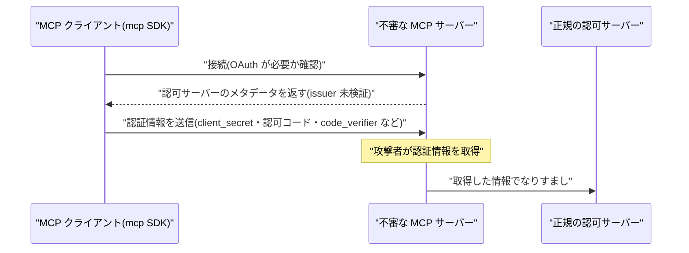

# LLM・AI Agent 最新情報レポート Vol.201
<!-- x-summary: OpenAI Codex 0.171.0公開、GPT-6.2 Sol/Astraを追加しSolを既定モデルに変更 -->

**作成日**: 2026年11月22日(JST)
**対象期間**: 11月21日〜11月22日(Vol.200との差分)。日曜朝の実行で新規の公式発表が少ないため、11月19〜20日公開で未掲載だった MCP 関連の脆弱性3件と Codex の安定版リリースを拾い漏れ回収として掲載。openai.com・blog.google・deepmind.google・Microsoft・cisa.gov・nvd.nist.gov・一部の報道サイトはこのセッションのネットワーク設定で名前解決できず開けなかった(3章参照)。

## 目次

1. [開発ツール・フレームワークの更新](#1-開発ツールフレームワークの更新)
   - [1.1 OpenAI Codex 0.171.0:GPT-6.2 Sol / Astra を追加し Sol を既定に、リモート実行を強化](#11-openai-codex-01710gpt-62-sol--astra-を追加し-sol-を既定にリモート実行を強化)
2. [その他の観点の確認結果](#2-その他の観点の確認結果)
3. [公式発表の確認状況](#3-公式発表の確認状況)
4. [脆弱性情報](#4-脆弱性情報)
   - [4.1 AI関連](#41-ai関連)
   - [4.2 実行環境](#42-実行環境)
   - [4.3 MCP Python SDK の OAuth クライアントが認証情報を信頼できないサーバーへ送り得る](#43-mcp-python-sdk-の-oauth-クライアントが認証情報を信頼できないサーバーへ送り得る)
   - [4.4 CodeWhale の automation が auto_approve 既定 true で承認を素通りさせる](#44-codewhale-の-automation-が-auto_approve-既定-true-で承認を素通りさせる)
5. [未確認情報](#5-未確認情報)
6. [確認ログ](#6-確認ログ)
7. [参考リンク](#7-参考リンク)

---

## 1. 開発ツール・フレームワークの更新

### 1.1 OpenAI Codex 0.171.0:GPT-6.2 Sol / Astra を追加し Sol を既定に、リモート実行を強化

OpenAI の Codex(Rust 実装の CLI / TUI)は 11月20日に 0.171.0 を安定版として公開した。GitHub Releases の「Latest」に付いているのはこの版で、翌21日には 0.173.0-alpha.4 までのプレリリースが続いているが、alpha 側にはリリースノートがなく内容は確認できない。Vol.200 で扱った Agents SDK の Codex プロバイダは Codex Core `rust-v0.166.0` を組み込んでおり、本体はそこから 0.171.0 まで進んでいる。[[1]](#ref-1) [[2]](#ref-2)

中身は2系統ある。まずモデル面では、GPT-6.2 Sol と Astra がモデルカタログに加わり、「Sol が既定の選択」になった。続いて操作面では、TUI ワークスペースが既定で有効になり、ドキュメントや画像のプレビュー、サブエージェントの会話記録(transcript)を表示できる。`codex exec --remote <ADDR>` は、すでに動いている app server に対して非対話セッションを開始・再開する。TUI の `/rc` と `/remote` はリモート制御とデバイスのペアリングコードを扱う。`tui_extensions_statusline` を有効にすると、`/statusline` で MCP のステータスライン選択・作成もできる。

不具合修正は、エージェントを長時間回す運用に効くものが多い。セッションを切り替えても下書きや待機中のフォローアップが元のスレッドに残る。作業ディレクトリを変えても権限プロファイルが維持される。遅れて届いた完了イベントが、新しいターンの承認を取り消さなくなった。ターンの途中で方向を修正(steer)しても、先の編集が集計 diff から消えない。さらに、リフレッシュトークンを出さず ID トークンだけを発行する ID プロバイダでも、企業向けの MCP サインインが通る。ビルドは Rust 1.99.1 に移った。

留意点は2つある。リリースページが載せるのは PR タイトルとリンクで、各変更の詳細な説明や破壊的変更の節はない。そのため、`/rc` のペアリングがどんなセキュリティモデルで動くかは本文から判断できない。また、Sol と Astra の性能・価格の根拠は OpenAI の公式ページ(openai.com は開けず未確認)にあり、この節ではリリースノートに書かれた事実だけを扱った。GPT-6.2 の詳細は Vol.198〜199 の記載を参照してほしい。

---

## 2. その他の観点の確認結果

今回は新規の公式発表が乏しかったため、確認した範囲と最新の更新日だけを記す。

- **Anthropic**:ニュース一覧の最新は11月20日の IPO クロージング(Vol.200 掲載済み)。11月9日の Claude Fable 5.2 / Mythos 5.2 以降、新モデルの発表はない。Claude Code の最新は v2.1.330(11月20日、Vol.200 掲載済み)で新リリースなし。[[3]](#ref-3) [[4]](#ref-4)
- **OpenAI Agents SDK**:最新は 11月20日の v1.0.0-alpha.1(Vol.200 掲載済み)。安定版の最新は 11月18日の v0.25.0(Vol.199 掲載済み)。[[5]](#ref-5)
- **Google ADK**:最新は 11月19日の v2.15.0(Vol.200 掲載済み)。[[6]](#ref-6)
- **LangChain / LlamaIndex**:LangChain の最新は11月19日の langchain-openai 1.8.5・langchain-core 1.8.4 など(Vol.200 掲載済み)。LlamaIndex の最新は 11月13日の v0.14.26 で、`requires-python` を引き上げた。[[7]](#ref-7) [[8]](#ref-8)
- **推論基盤**:vLLM の最新は v0.34.0(11月16日、Vol.198 掲載済み)。Ollama の最新は v0.40.17(11月10日)で、新リリースなし。[[9]](#ref-9) [[10]](#ref-10)
- **MCP 仕様**:最新の安定版は 2026-07-28 のまま。[[11]](#ref-11)
- **Google Cloud / Azure のアップデート**:Google Cloud のリリースノートのフィード(docs.cloud.google.com)と Microsoft の各ドメインが開けず、一次情報では新規の更新を確認できなかった。「新情報なし」とは言えないため、確認の状況は 3章に記録した。

---

## 3. 公式発表の確認状況

試した範囲と結果は 6章の確認ログに表で残した。要点は次の通り。

- **開けた**:anthropic.com/news、GitHub Releases(claude-code、openai-agents-python、openai/codex、google/adk-python、langchain、llama_index、vllm、ollama、MCP 仕様)、GitHub Advisory Database、ubuntu.com/security/notices、nodejs.org の脆弱性ブログ一覧。
- **開けなかった**:openai.com、blog.google、deepmind.google、ai.google.dev、docs.cloud.google.com(cloud.google.com のフィードは 301 でこちらへ転送された)、siliconangle.com、nvd.nist.gov、thehackernews.com、securityonline.info、letsdatascience.com。いずれも「名前解決できない(ENOTFOUND)」で、実行環境側の許可ドメインの制約と考えられる。
- 検索では、Microsoft の11月17日付の「自社モデルとエージェント継続改善」に関する SiliconANGLE の記事が見つかったが、本文を読めず、他媒体も読めていないため掲載しない(5章)。

---

## 4. 脆弱性情報

### 4.1 AI関連

GitHub Advisory Database で11月19〜20日に掲載された項目のうち、これまでのレポートに載せていなかったもの。CVE・CVSS・影響バージョンは各アドバイザリのページで確認した値。Vol.200 までに掲載済みの MCP サーバー関連(jupyter-mcp-server、flyto-core、nltk、Todoist MCP、obsidian-sync-mcp など)は再掲しない。

| CVE / ID | 対象製品・影響範囲 → 修正版 | CVSS | 種類・影響 | 悪用状況 | 推奨対応 |
|---|---|---|---|---|---|
| CVE-2026-115563 / GHSA-qx49-fqc8-xw99 | `mcp`(MCP Python SDK、pip)1.9.1〜1.29.1 および 2.0.0〜2.1.1 → 1.30.0 / 2.2.0 | 7.5(v3.1。対話型 `OAuthClientProvider` は 6.5) | OAuth クライアントが接続先 MCP サーバーの指定した認可サーバーへ client_secret・認可コード・PKCE の code_verifier・署名付きアサーションを送り得る(4.3節) | 不明 [[12]](#ref-12) | 1.30.0 / 2.2.0 へ更新し、`issuer=` を指定、保存済みの登録情報を消去、接続した可能性があれば secret を再発行 |
| CVE-2026-83817 / GHSA-8hp3-xxrg-v9c8 | `codewhale`(npm)および `codewhale-tui`(Rust)0.8.67 以下 → 0.9.0 | 7.5(v3.1) | automation の `auto_approve` が省略時 `true` になり、1回の承認で、変更系ツールを人の介在なしに実行し続ける定期ジョブを作れる(4.4節) | 不明 [[13]](#ref-13) | 0.9.0 へ更新。それまでは `automation_create` の承認時に `auto_approve` と `allow_shell` を確認 |
| CVE-2026-130007 / GHSA-m932-63jc-4jqq | `k8s-mcp-server`(Go、`github.com/reza-gholizade/k8s-mcp-server`)1.1.0 未満 → 1.1.0 | 7.9(v4) | 既定の SSE/HTTP モードが認証・セッショントークン・Origin 検証なしで `tools/call` を実行し、0.0.0.0:8080 で待ち受ける。到達できる者は、サーバーに設定された Kubernetes 権限で、リソースの作成・削除や Helm の導入・更新までできる(CWE-306) | 不明 [[14]](#ref-14) | 1.1.0 へ更新し、127.0.0.1 に束縛するか認証付きプロキシの背後に置く。可能なら読み取り専用モード、または STDIO を使う |

補足として、CISA の KEV に11月18日付で LiteLLM の CVE-2026-40217(GHSA-wxxx-gvqv-xp7p)が追加されたという報道が検索で見つかった。GitHub のアドバイザリ自体は読めたが、KEV 追加の事実は一次情報を読めていないため 5章に回した。アドバイザリの内容は、カスタムコードのガードレール用エンドポイント `POST /guardrails/test_custom_code` の自作サンドボックスを抜けて、プロキシのプロセス内で任意コードを実行できるというもの(pip `litellm` 1.81.8 以上 1.83.10 未満、CVSS v4 7.5、EPSS 68.9%)。到達にはプロキシ管理者の認証情報が要る。修正版は欄では 1.83.10、本文では 1.83.11 と食い違っているため、最新版へ更新するのが確実である。回避策は、リバースプロキシでこのエンドポイントを遮断すること。[[15]](#ref-15)

### 4.2 実行環境

新情報なし。確認した範囲は次の通り。GitHub Advisory Database の pip・npm の Critical 一覧では、Python・Node.js のランタイム本体や pip・npm 本体の新規項目はなく、最新の掲載は pip が11月20日(jupyter-mcp-server、flyto-core:Vol.200 掲載済み)、npm が11月20日(Etherpad:Vol.200 掲載済み)だった。Node.js の公式セキュリティリリースは11月11日が最新(今回の確認では詳細未読。以前のレポートでの掲載有無は未照合)。Ubuntu のセキュリティ通知は11月20日が最新で、Linux カーネル各種(USN-9184-1、9183-1 ほか)と nginx(USN-9182-1)は Vol.199〜200 で扱った範囲に入る。優先度(Priority)は一覧ページに表示がなく、新たに High 以上と確認できたものはない。[[16]](#ref-16) [[17]](#ref-17) [[18]](#ref-18) [[19]](#ref-19)

### 4.3 MCP Python SDK の OAuth クライアントが認証情報を信頼できないサーバーへ送り得る

MCP の公式 Python SDK `mcp` に、OAuth クライアントが「接続中の MCP サーバーが指定した場所」へ認証情報を送ってしまう欠陥が見つかった(CVE-2026-115563、11月19日公開)。SDK の OAuth クライアントが認可サーバーの `issuer` を一貫して検証せず、保存済み・事前発行の認証情報も特定の認可サーバーに結び付けられていなかった。悪意あるサーバー、または侵害されたサーバーは、`client_secret`・認可コード・PKCE の `code_verifier`・署名付きクライアントアサーションのいずれかを受け取り得る。影響は 1.9.1〜1.29.1 と 2.0.0〜2.1.1(2.0.0a1 などのプレリリースを含む)で、修正は 1.30.0 と 2.2.0。GitHub は High の 7.5(AV:N/AC:L/PR:N/UI:N、機密性のみ High)とし、ユーザーがサインインを始める必要がある対話型の `OAuthClientProvider` は 6.5 と注記している。[[12]](#ref-12)

成立条件はやや限定的である。HTTP 越しに SDK の OAuth プロバイダを使い、しかも正規の認可サーバー向けの認証情報を持ったまま、完全には信頼できない MCP サーバーへ接続するアプリが対象になる。SDK で作った MCP サーバー自身、stdio クライアント、独自にトークンやヘッダーを付けるクライアントは影響を受けない。一方で、MCP クライアントが多数のサードパーティ製サーバーにつながる構成では前提が満たされやすい。

対応の優先度は、MCP クライアントを自社開発し、OAuth で外部のサーバーに接続している組織が高い。アップグレードだけでは不十分な点に注意が要る。`ClientCredentialsOAuthProvider` と `PrivateKeyJWTOAuthProvider` では `issuer=`(例:`"https://auth.example.com"`)を明示して初めて結び付けられ、省略すると非推奨の警告が出て、3.0 で必須になる。非推奨の 1.x の `RFC7523OAuthClientProvider` には `issuer` の設定がないため、上の2つへの移行が必要。保存済みの OAuth クライアント情報は消して再登録させ、事前登録済みの場合はそのレコードに `issuer` を設定する。信頼できないサーバーに接続した可能性があれば、client secret の再発行とトークンの失効を認可サーバー側で行う。旧版向けの回避策は、OAuth 対応クライアントを信頼できるサーバーにだけつなぐことのみで、他にない。

### 4.4 CodeWhale の automation が auto_approve 既定 true で承認を素通りさせる

AI コーディングエージェント CodeWhale(npm `codewhale`、Rust `codewhale-tui`)の 0.8.67 以下に、定期実行(automation)で自動承認が既定で有効になる欠陥があった(CVE-2026-83817、11月19日公開、CWE-862 / CWE-1188、CVSS v3.1 7.5、AV:N/AC:H/PR:N/UI:R で機密性・完全性・可用性とも High)。以前の修正(CVE-2026-45374)でタスク経路は自動承認を明示的なオプトインにしたが、automation の仕組みには同じ強化が入っていなかった。`auto_approve` を省略すると `true` として解決され、スケジューラがそれを明示的に渡すため、タスク経路の既定が効かない。修正は 0.9.0 で、報告者の提案は `automation_create` のスキーマ既定と automation 側の既定を `false` に揃えることである。アドバイザリの本文は報告者の記述で、コード上の主張を当方で検証してはいない(メンテナーが報告を確認し、0.9.0 に修正が入ったとは記されている)。[[13]](#ref-13)

攻撃の流れは次の通り。プロンプトインジェクションでモデルに無害そうな定期ジョブを作らせる。ユーザーに表示される承認は `automation_create` の1回だけで、スキーマからは自動承認が既定になることが読み取りにくい。その後は、ファイル書き込みやパッチなどの変更系ツールが、人のいない状態で毎回実行される。`allow_shell` も有効なら、シェルコマンドが黙って実行され得る。個別製品の問題ではあるが、「1回の承認が継続的な権限に化ける」点は他のエージェントの定期実行機能にも通じる設計上の論点で、承認画面に自動承認の有無を明示させる設計が望ましい。

---

## 5. 未確認情報

- **CISA KEV(11月18日)に LiteLLM CVE-2026-40217 など4件が追加**:Synology DSM(CVE-2024-10441)、Apache Axis(CVE-2026-90436)、Vanderbilt REDCap(CVE-2026-90817)と合わせた4件で、期限は LiteLLM が12月2日、他3件が11月21日、という内容を検索結果の抜粋で確認した。cisa.gov は名前解決できず、報道(thehackernews.com、securityonline.info、letsdatascience.com)は3つとも開けなかったため本文には載せなかった。LiteLLM のアドバイザリ自体は 4.1 節で確認済み。
- **Microsoft が11月17日に自社モデルとエージェントの継続改善に関する発表**:検索で SiliconANGLE(siliconangle.com)の見出しと日付のみ確認。siliconangle.com は名前解決できず、Microsoft の公式ドメインも開けなかった。
- **OpenAI の GPT-6.2 Astra / Sol の発売に関する詳細**:Vol.198〜199 掲載済み。今回は openai.com が開けず新規の追加情報は取れていない。

---

## 6. 確認ログ

| 情報源 | 試したURL・手段 | 結果 | 確認できた最新の更新日 |
|---|---|---|---|
| Anthropic | anthropic.com/news | 取得成功 | 11月20日(IPO クロージング) |
| Claude Code | github.com/anthropics/claude-code/releases | 取得成功 | 11月20日(v2.1.330) |
| OpenAI | openai.com/news/rss.xml | 失敗(ENOTFOUND)。別手段として GitHub の openai/codex・openai-agents-python のリリースを取得、検索で公式転載先を探したが本文は読めず | GitHub 上は 11月21日(Codex 0.173.0-alpha.4)、安定版は 11月20日(0.171.0) |
| OpenAI Agents SDK | github.com/openai/openai-agents-python/releases | 取得成功 | 11月20日(v1.0.0-alpha.1) |
| Google / DeepMind | blog.google/technology/ai/rss/、ai.google.dev の changelog | 失敗(ENOTFOUND)。google/adk-python のリリースは取得成功。deepmind.google と developers.googleblog.com は今回未試行 | ADK は 11月19日(v2.15.0) |
| Google Cloud | cloud.google.com/feeds/vertex-ai-release-notes.xml → 301 → docs.cloud.google.com | 転送先が失敗(ENOTFOUND)。再試行は未実施 | 不明(取得できず) |
| Azure / Microsoft Foundry | 検索のみ。microsoft/agent-framework のリリースページは 404、learn・azure・devblogs は今回未試行 | 一次情報は取得できず | 不明 |
| LangChain / LlamaIndex | GitHub Releases | 取得成功 | LangChain 11月19日、LlamaIndex 11月13日 |
| MCP 仕様 | github.com/modelcontextprotocol/modelcontextprotocol/releases | 取得成功 | 2026-07-28(安定版) |
| vLLM / Ollama | GitHub Releases | 取得成功 | vLLM 11月16日(v0.34.0)、Ollama 11月10日(v0.40.17) |
| GitHub Advisory Database | pip・npm の Critical、High の MCP 関連、litellm、CVE-2026-40217 | 取得成功 | 11月20日 |
| Ubuntu | ubuntu.com/security/notices | 取得成功 | 11月20日 |
| Node.js | nodejs.org/en/blog/vulnerability | 取得成功 | 11月11日 |
| CISA / NVD | 検索のみ(cisa.gov は未試行、nvd.nist.gov は失敗) | 一次情報は取得できず | 不明 |

注:openai.com・Microsoft・Google 系の公式ドメインは、手順の「同一URLの再試行」と「別ドメイン・別形式」を一部しか実施できていない。次回の拾い漏れ回収の対象とする。

---

## 7. 参考リンク

- **[1]** [Release rust-v0.171.0 | openai/codex(GitHub)](https://github.com/openai/codex/releases/tag/rust-v0.171.0)
- **[2]** [Releases | openai/codex(GitHub)](https://github.com/openai/codex/releases)
- **[3]** [Newsroom(ニュース一覧) | Anthropic](https://www.anthropic.com/news)
- **[4]** [Releases | anthropics/claude-code(GitHub)](https://github.com/anthropics/claude-code/releases)
- **[5]** [Releases | openai/openai-agents-python(GitHub)](https://github.com/openai/openai-agents-python/releases)
- **[6]** [Releases | google/adk-python(GitHub)](https://github.com/google/adk-python/releases)
- **[7]** [Releases | langchain-ai/langchain(GitHub)](https://github.com/langchain-ai/langchain/releases)
- **[8]** [Releases | run-llama/llama_index(GitHub)](https://github.com/run-llama/llama_index/releases)
- **[9]** [Releases | vllm-project/vllm(GitHub)](https://github.com/vllm-project/vllm/releases)
- **[10]** [Releases | ollama/ollama(GitHub)](https://github.com/ollama/ollama/releases)
- **[11]** [Releases | modelcontextprotocol/modelcontextprotocol(GitHub)](https://github.com/modelcontextprotocol/modelcontextprotocol/releases)
- **[12]** [GHSA-qx49-fqc8-xw99(CVE-2026-115563):MCP Python SDK OAuth client | GitHub Advisory Database](https://github.com/advisories/GHSA-qx49-fqc8-xw99)
- **[13]** [GHSA-8hp3-xxrg-v9c8(CVE-2026-83817):CodeWhale automation auto-approval default | GitHub Advisory Database](https://github.com/advisories/GHSA-8hp3-xxrg-v9c8)
- **[14]** [GHSA-m932-63jc-4jqq(CVE-2026-130007):k8s-mcp-server missing authentication | GitHub Advisory Database](https://github.com/advisories/GHSA-m932-63jc-4jqq)
- **[15]** [GHSA-wxxx-gvqv-xp7p(CVE-2026-40217):LiteLLM sandbox escape in custom-code guardrail | GitHub Advisory Database](https://github.com/advisories/GHSA-wxxx-gvqv-xp7p)
- **[16]** [GitHub Advisory Database:pip の Critical 一覧 | GitHub](https://github.com/advisories?query=type%3Areviewed+ecosystem%3Apip+severity%3Acritical)
- **[17]** [GitHub Advisory Database:npm の Critical 一覧 | GitHub](https://github.com/advisories?query=type%3Areviewed+ecosystem%3Anpm+severity%3Acritical)
- **[18]** [Ubuntu Security Notices | Ubuntu](https://ubuntu.com/security/notices)
- **[19]** [Node.js Vulnerability Reports(セキュリティリリース一覧) | Node.js](https://nodejs.org/en/blog/vulnerability)
