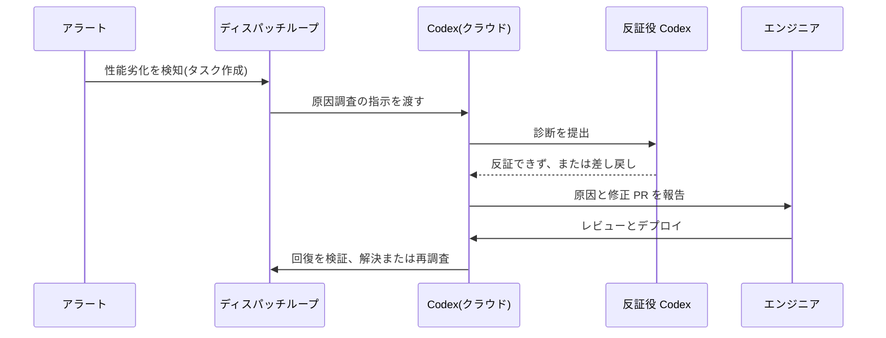
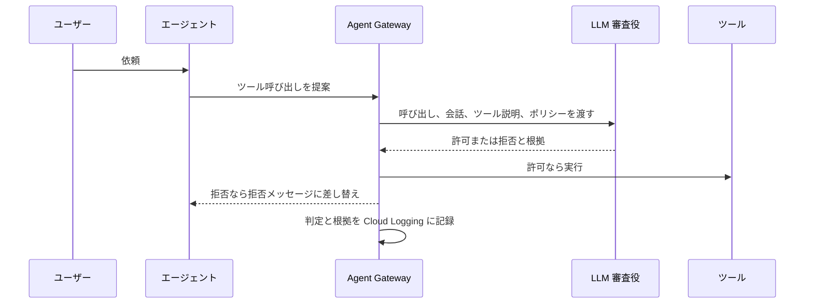

# LLM・AI Agent 最新情報レポート Vol.202
<!-- x-summary: OpenAIが事前学習のperplexity指標を公開、業界共通の上限設定を提唱 -->

**作成日**: 2026年11月23日(JST)
**対象期間**: 11月22日〜11月23日(Vol.201との差分。11月16〜20日公開で未掲載だった公式発表を拾い漏れとして回収)

## 目次

- [1. OpenAI の公式発表](#1-openai-の公式発表)
  - [1.1 OpenAI が事前学習の perplexity 測定値を公開し、業界共通の「上限」を提唱](#11-openai-が事前学習の-perplexity-測定値を公開し業界共通の上限を提唱)
  - [1.2 OpenAI が Codex で性能劣化を自動調査する「Performance Factory」を公開(11月19日)](#12-openai-が-codex-で性能劣化を自動調査するperformance-factoryを公開11月19日)
- [2. Azure・Microsoft Foundry の更新(11月18〜21日、拾い漏れ回収)](#2-azuremicrosoft-foundry-の更新11月1821日拾い漏れ回収)
  - [2.1 Foundry の hosted agents が本番向けに強化:egress 制御 GA、同時セッション数は約250から約6万へ](#21-foundry-の-hosted-agents-が本番向けに強化egress-制御-ga同時セッション数は約250から約6万へ)
  - [2.2 Foundry Managed Compute が GA:150 超のオープンモデルを専有 GPU で提供](#22-foundry-managed-compute-が-ga150-超のオープンモデルを専有-gpu-で提供)
  - [2.3 Foundry で「組織の一員として働く」自律エージェントを作る blueprint モデル](#23-foundry-で組織の一員として働く自律エージェントを作る-blueprint-モデル)
  - [2.4 Foundry の Browser Automation ツールが GA](#24-foundry-の-browser-automation-ツールが-ga)
- [3. Google・Google Cloud の更新](#3-googlegoogle-cloud-の更新)
  - [3.1 Semantic governance policies(プレビュー):エージェントのツール呼び出しを実行前に LLM が審査する](#31-semantic-governance-policiesプレビューエージェントのツール呼び出しを実行前に-llm-が審査する)
  - [3.2 Streaming DiLoCo を MaxText に実装:データセンター間学習で 10 Gbit/s でも 9.57 倍高速](#32-streaming-diloco-を-maxtext-に実装データセンター間学習で-10-gbits-でも-957-倍高速)
  - [3.3 Tunix と Gemma 4 でマルチターンのエージェント強化学習:勝率 9.4% から約 95% へ](#33-tunix-と-gemma-4-でマルチターンのエージェント強化学習勝率-94-から約-95-へ)
  - [3.4 「エージェントはリクエストではなくセッション」:GKE のノードプール設計で最大約40%削減](#34-エージェントはリクエストではなくセッションgke-のノードプール設計で最大約40削減)
  - [3.5 Google Cloud リリースノート(11月20〜21日)](#35-google-cloud-リリースノート11月2021日)
- [4. 公式発表の確認状況](#4-公式発表の確認状況)
- [5. 脆弱性情報](#5-脆弱性情報)
  - [5.1 AI関連](#51-ai関連)
  - [5.2 実行環境](#52-実行環境)
  - [5.3 MONAI Label の任意ファイル書き込み(CVSS 9.8、悪用確認済み)](#53-monai-label-の任意ファイル書き込みcvss-98悪用確認済み)
- [6. 未確認情報](#6-未確認情報)
- [7. 確認ログ](#7-確認ログ)
- [8. 参考リンク](#8-参考リンク)

---

## 1. OpenAI の公式発表

### 1.1 OpenAI が事前学習の perplexity 測定値を公開し、業界共通の「上限」を提唱

OpenAI は 11月22日、チーフサイエンティストの Jakub Pachocki 氏による「Perplexity and Intelligence」を公開した。主張の中心は、現在の AI の進歩は手作りの技法よりも「巨大なデータセットで予測器(=圧縮器)を学習する」という単純な工程に支えられており、その進み具合を測るには perplexity(次トークン予測の難しさ。対数を取ったものは cross-entropy loss)が共通の物差しになる、というものだ。OpenAI は自社モデルの内部 perplexity 測定値を、GPT-3.5 から順に公開するとしている。競合に自社の位置を教えることになるが、共有の安全基準の必要性のほうが大きいと説明している。[[2]](#ref-2)

数値は OpenAI の主要な社内コードベースのデータセットでの対数 perplexity で、GPT-3.5 が約 0.99、GPT-4 が約 0.91、その後のモデルが約 0.76 とされる。0.76 付近は、未解決の数学問題で成果を出した段階に対応づけられている。筆者は、次に大きな新能力が現れる区間を約 0.68〜0.7 と見ており、その中身は分からないと断っている。最も強い論点は再帰的な自己改善で、AI が「事前学習そのもののアルゴリズム研究」に寄与するようになると、数学の成果のように突然の「雪崩」が早ければ 2027年にも起こりうるとする。2026年の loss 曲線に急な加速が見られるが、OpenAI は主因を長期の研究と計算投資とし、自動化の寄与は一部としている。また、アラインメント監査の質の低下や、モデルが評価・訓練を認識する傾向の強まりにも触れている。[[2]](#ref-2)

提案は3つある。(1) モデルの初回利用前に、レッドチーム検証済みの安全性ケースと共通の透明性基準を置く。(2) perplexity などの測定に基づく共通の上限を設け、CoT モニターの後継のような具体的な到達点が満たされるまで超えないと各社がコミットする。(3) 最初の上限、超えるための要件、以降の上限の決め方を定める業界枠組みをつくる。一方で perplexity の限界も明記している。ラボ間でデータセットや配合が違うので比較には透明性が要ること、特定タスクの性能を直接は測らないこと、CoT のような後段の工夫は perplexity を下げずに能力を上げること、データの本来のエントロピー(下限)が不明なこと、である。企画・導入側にとっては、各社が出す能力の目安や安全基準が今後こうした共通指標に紐づく可能性がある点が要注意で、現時点ではあくまで OpenAI 単独の提案であり、他社が同意した事実は本文に書かれていない。数値は本文からの転記で、元の表の一部のセルは本文上で「n/a」だった。[[2]](#ref-2)

### 1.2 OpenAI が Codex で性能劣化を自動調査する「Performance Factory」を公開(11月19日)

OpenAI は 11月19日、ChatGPT の性能劣化(レイテンシ悪化など)の発見と修正を Codex に任せる社内システム「Performance Factory」の設計を公開した(11月19日公開、Vol.201 までは未掲載)。当初は 30 以上の性能分析ツールを人が使って調べ、次に Codex に調査を頼み、共有スキル `perf-forensics` に調査手順を書き込み、アラートから起動したクラウド上の Codex が Slack に所見を投稿する段階を経て、状態管理から担当割り当てまで自動化した「ファクトリー」に至ったという。[[3]](#ref-3)

構成要素は4つ。(1) タスクサービス:状態・許可される遷移・人が必要な手順を設定ファイルで定義し、状態ごとの Markdown プロンプトを置く。(2) ディスパッチループ:次の手順に進める状態のタスクを定期的に見つけ、その状態の指示で Codex のターンを起動する。(3) クラウド上の Codex:社内ネットワーク内で、スコープを絞ったサービス ID でリポジトリと観測ツール(メトリクス、ログ、トレース、CPU プロファイル、メモリスナップショット)に触れる。(4) サブスクリプション:PR レビューコメント、CI 失敗、デプロイなどのイベントを待ち、届いたら再開する。最初のワークフローは「検知 → 原因調査(エージェント) → 修正案(エージェント) → レビューとデプロイ(人) → 回復の検証(エージェント) → 解決」で、回復が不十分なら調査に戻る。別の Codex セッションが診断を反証しようとする敵対的レビューがあり、継続している障害を説明できない診断を差し戻した例が挙がっている。[[3]](#ref-3)

数値は、約3か月強で 1,700 件超の調査を追跡し、600 件超で原因を特定、1日あたり約 17 件の自動調査。原因提案 100 件の手動レビューでは 70% が正確で、残り 30% は精緻化が必要か、因果を十分に示せていなかった。評価は過去のインシデントでバックテストし、過去の答えを見ていない新しい調査役で採点する。毎日ログからツールの失敗やアクセスエラーを探し、複数の調査を止めているものは修正タスクを自動で作る自己修復もある。今後は、アラートを待たない先回りの検知、低リスクな修正を人手なしで出荷する可否の検討を挙げる。精度 70% という数字は、エージェントの診断を「人が判断する前提の下書き」として使う設計の根拠になっており、同種の運用を考える際の参考になる。[[3]](#ref-3)

---

## 2. Azure・Microsoft Foundry の更新(11月18〜21日、拾い漏れ回収)

Microsoft Foundry 公式ブログ(devblogs.microsoft.com/foundry)のフィードが今回は取得でき、Ignite 期間の公式記事を直接読めた。以下は Vol.201 までに掲載していない 11月18〜20日公開分で、7日以内のため回収する。Foundry の公式ブログには 11月21日付の「Hosted agents in your own virtual network」も出ているが、トラブルシュート記事のため本文は読んでおらず掲載しない。[[8]](#ref-8)

### 2.1 Foundry の hosted agents が本番向けに強化:egress 制御 GA、同時セッション数は約250から約6万へ

Microsoft は 11月18日、Foundry Agent Service の hosted agents の更新をまとめた。GA になったのは、サブネット IP の共有、egress(外向き通信)制御、耐障害実行(resilient execution)、アイドルタイムアウト設定。パブリックプレビューは、社内 CA の信頼、egress 設定を Azure Policy で強制する機能(Canada Central / Spain Central / Korea Central)、メモリスナップショットによるコールドスタート短縮。自前の AKS クラスタで Foundry のエージェントランタイムを動かす BYO-AKS は限定プレビューで、パブリックプレビューは12月上旬の予定とされる。[[4]](#ref-4)

技術面の要点は次の通り。各セッションは VM 分離のサンドボックスで動く。egress ルールはホストの許可/拒否、ヘッダ追加、自社ゲートウェイ経由を指定でき、エージェントのサンドボックスの外側で適用され、ポリシーを評価できなければ拒否される。Audit モード(既定は拒否)は、ブロックされるはずの通信をログに残して通す。サブネット IP の共有により、/24 サブネットあたりの同時セッションは約 250 から約 60,000 に、最小の /27 でも約 7,500 になる(いずれも見積もりで保証ではない)。実質の上限はリージョンごとのセッションクォータ(サブスクリプションあたり 2,000 または 1,000)。アイドルタイムアウトは 2 分〜4 時間(既定 15 分)で、非アクティブなセッションは 30 日で削除される。耐障害実行ではハンドラが再実行されるため、メール送信のような副作用を重複させない実装が必要になる。Temporal との連携は初期アクセス中で、パブリックプレビューは 2027年初頭の計画。ID の方式や価格は本文に記載がない。[[4]](#ref-4)

### 2.2 Foundry Managed Compute が GA:150 超のオープンモデルを専有 GPU で提供

11月20日、Microsoft は Foundry Managed Compute の GA を告知した(6月の Build でプレビュー)。GPU のプロビジョニング、コンテナ保守、サービングランタイムの運用を Microsoft が担い、利用者はモデルを選んで専有 GPU で提供する。カタログは Hugging Face Collection in Foundry 由来の 150 以上のオープンモデルで、DeepSeek V4.1 Flash (1017)、Reflection Beam、Meta の Muse Spark Open、NVIDIA Nemotron 3.5(Embed / Rerank / Parse / Transcribe)などが追加された。GPU は NVIDIA A100 / H100 / H200 または AMD MI300X。課金は加速器あたりの時間課金で、具体的な価格は本文になくデプロイウィザードで確認する形。提供は Global、US Data Zone、EU Data Zone。[[5]](#ref-5)

サプライチェーン面では、モデル追加前にライセンス確認、信頼できないコードのスクリーニング、SafeTensors 重みの検証を行い、重みは Azure 内に置いて Hugging Face Hub には接続しない。サービング画像はビルド・スキャン・署名され、Ubuntu Pro でパッケージが保守される。性能面は、プレフィックス一致で同じインスタンスに送る prompt-aware ルーティング、負荷に応じた load-aware ルーティング、`prompt_cache_key` による親和性ヒント、対応モデルでの投機的デコーディングがある。DeepSeek 1017 を 1 インスタンス(4 GPU)から 5 インスタンス(20 GPU)にしたテストでは、処理トークンが約 5 倍になり HTTP 429 が減った。Signal65 の調査では、MI300X 4 基の 1 インスタンスが 128 の同時エージェントを支え、調整済みの自前運用と同等だったとされる(Microsoft の記事に載る第三者調査の紹介で、独自には検証していない)。LoRA アダプタのデプロイはプレビュー、完全な重みの持ち込み(BYO Weights)は限定パブリックプレビューで、申し込みが必要。[[5]](#ref-5)

### 2.3 Foundry で「組織の一員として働く」自律エージェントを作る blueprint モデル

11月19日の記事で Microsoft は、人がサインインしていないイベント駆動の仕事や、グループチャットで誰の権限で動くかが曖昧になる問題に対し、Foundry のエージェントを「組織の名前付きメンバー」として動かす方式を示した。鍵は blueprint で、API や MCP ツールなどの能力を定義したテンプレートを承認し、組織内の人が「採用」するとインスタンスごとに固有の ID とアクセス権が付く。各エージェントは Microsoft Entra の agent identity と agent user アカウントを持ち、専用のメール・予定表・OneDrive を使える。blueprint 自体は誰のリソースへの権限も与えず、インスタンスの持ち主が Azure DevOps プロジェクトや SharePoint サイトなどの到達範囲を決める。監査ではすべての操作がそのエージェントに帰属し、組織図に上司が表示される。同じ blueprint 由来のエージェントをクラスごとに止める「キルスイッチ」があり、管理には Entra、Purview、Defender と Agent 365 の制御プレーンを使う。[[6]](#ref-6)

Nous Research のオープンソースエージェント「Hermes」を Foundry の hosted agent blueprint にした「Hermes Enterprise」も紹介された。Hermes は 3月に公開され、5月に OpenRouter のトークン利用で首位になり、累計 50 兆トークン超を処理したと記事にある(記事内の自己申告)。Microsoft 社員は 30 以上の blueprint を作ったという。記事には、この機能が GA かプレビューかの表記がない。Hermes Business は試用可能、Enterprise の SaaS 版とセルフホスト用制御プレーンは「coming soon」。導入側は、提供ステータスが未確定である点を前提に評価する必要がある。[[6]](#ref-6)

### 2.4 Foundry の Browser Automation ツールが GA

11月18日、Azure Playwright Workspaces を基盤にした Browser Automation ツールが Foundry Agent Service で GA になった。API のない社内ポータルやベンダーコンソールを、隔離されたブラウザセッションでエージェントに操作させる。GA の範囲は、ツール本体、アクション一括化を含む拡張 MCP ツール、Live View と Take control(人がログインや承認のために操作を引き取れる)、トレース、セッション録画。プレビューは、プライベートサイト向けの VNet 注入、ブラウザプロキシ持ち込み、Web Bot Auth による CAPTCHA 管理(HTTP リクエストへの暗号署名。IETF ドラフトに基づく。登録先は Akamai / Cloudflare / F5 またはセルフ登録)、シークレット管理で、プロファイル再利用は「近日プレビュー」。[[7]](#ref-7)

セキュリティ設計の記述が具体的で、認証情報はモデルにもアプリのコードにも渡らず、Key Vault から MCP サーバー内で読まれる。各シークレットはドメイン許可リストに紐づけて流出を防ぐ。`run-code`(任意の Playwright スクリプトを実行)は任意コード実行になるため、オプトインで、レビュー済みシナリオに限るよう記事が注意している。記事内のプレビュー API は 2026-11-01-preview(プロキシ)、2026-11-10-preview(Web Bot Auth)、2026-12-01-preview(プロファイル)で、後者2つは日付が公開日以降になっている点に注意。プロキシ規則の優先度で、数値が小さい方が優先か大きい方が優先かは記事が明確にしておらず、ドキュメントでの確認を促している。[[7]](#ref-7)

---

## 3. Google・Google Cloud の更新

### 3.1 Semantic governance policies(プレビュー):エージェントのツール呼び出しを実行前に LLM が審査する

Google は 11月20日、Developers Blog(Deepti Sehrawat 氏)で、エージェントが実行しようとする各ツール呼び出しを事前に審査する「Semantic governance policies」をプレビューとして発表した(Vol.201 の Agent Anomaly Detection とは別機能)。チームが平易な言葉で書いたポリシーと、元のユーザー依頼の両方に照らし、両方を満たした呼び出しだけが通る。審査は policy enforcement point で行い、現状は Agent Gateway(エージェントのモデル通信をすべて通す必要がある)。LLM の審査役が、会話履歴、エージェントのシステム指示、ツール説明、ポリシーを入力に判定し、通ればレスポンスは無加工で渡り、却下なら設定可能な拒否メッセージに差し替えられてアクションは実行されない。判定と根拠、トークン使用量は Cloud Logging に残る。[[9]](#ref-9)

ユーザー意図の検査は既定でオンでポリシー不要のため、ハイジャック対策になる。ポリシーは全ツールにも単一ツールにも、特定パラメータにも適用でき、コンソールか gcloud で作れる。対応するモデル API は Gemini API、Anthropic Messages API、Gemini platform 上の Claude、OpenAI 互換 Chat Completions(vLLM などのセルフホストを含む)。例として、財務チームのエージェントが、内部の担当者への速報送付は許可、社外投資家への送付と私用メールの CC は NDA を理由にしても拒否、文書内の隠しテキストに誘導されたファイル削除は「ユーザーが依頼していない」として拒否、という3場面を示す。ポリシー例は請求書承認、返金上限(80 ドル以下など)、採用判断の人間レビュー。[[9]](#ref-9)

留意点も明記されている。LLM の判定は確率的で揺れるため、強制前に dry run モード(ブロックせずログのみ)で検証すること、ツールに明確な説明がないと審査役が拒否すること、テキストのみの応答とストリーミング応答は審査対象外であること。性能指標は記事になく、公開ベンチマーク AgentDojo での結果は続報とされている。IAM と Agent Gateway のアクセスポリシー(到達できるツールの制御)、Model Armor(プロンプト/応答の脅威とデータ検査)、Agent Anomaly Detection(セッションの非同期分析)に、実行前の判断を重ねる多層防御の一層という位置づけで、検出精度が未公開の現段階では本番強制より dry run での評価向きと読める。[[9]](#ref-9)

### 3.2 Streaming DiLoCo を MaxText に実装:データセンター間学習で 10 Gbit/s でも 9.57 倍高速

Google の Developers Blog は 11月19日、遠隔のデータセンター間で LLM を学習する Streaming DiLoCo の MaxText 実装を公開した。通常のデータ並列は勾配同期を計算の裏に隠せず、広域ネットワークで大きく停滞する。DiLoCo は学習器を M グループに分け、各グループが H ステップのローカル AdamW を回した後に重みの差分を平均し、Nesterov モーメンタムの外側 SGD で更新するため通信量が H 分の1になるが、モデル全体を H ステップごとに一度に送る。Streaming DiLoCo はモデルを P 個のフラグメント(MaxText では層数+1)に分け、1ステップに1フラグメントを同期して、通信を定常的な小さな流れにする。差分の交換はホスト CPU 上のシンクワーカーが行い、TPU の学習は並行して続き、中央のコーディネータはない。[[10]](#ref-10)

Qwen3-32B(bfloat16、ステップ約 6.2 秒、P=H=65)の試算では、データ並列は 1 ステップに約 65.5 GB の勾配が要り停滞回避に約 85 Gbps、Streaming DiLoCo は約 1.0 GB/ステップで約 1.3 Gbps で足りる。2 台の TPU v5p-32 を Linux の `tc` で帯域制限した実測の平均ステップ時間は、制限なしだと約 5.6〜5.9 秒で各方式ほぼ同じ、30 Gbit/s ではデータ並列 19.41 秒、通常の DiLoCo 6.39 秒、Streaming 5.76 秒、10 Gbit/s では 55.11 秒、7.55 秒、5.76 秒だった。10 Gbit/s で Streaming は 9.57 倍速く(ステップ遅延 89.5% 減)、65 ステップ分のデータセンター間転送量は 4,258.8 GB から 67.0 GB(64〜65 分の1)になった。収束は、Qwen3-32B で同期データ並列と同等の損失、MoE(Qwen3-30B-A3B、Gemma4-26B-A4B)の 4,000 ステップで同等から微改善。ただし最初の約 800 ステップに調整の揺れがあり、正確な数値の表は画像のため本文では確認できていない。MaxText v0.2.5(PyPI)で `enable_streaming_diloco` などの設定で使える。実験は 2 スライスの小規模な構成で、実際の多拠点での長期学習の結果ではない点に留意が要る。[[10]](#ref-10)

### 3.3 Tunix と Gemma 4 でマルチターンのエージェント強化学習:勝率 9.4% から約 95% へ

Google Developers Blog は 11月19日(Wei Wei 氏)、JAX 製の学習ライブラリ Tunix と Gemma 4 で、ツールを使うマルチターンのエージェントを強化学習する手順を公開した。題材は 6×6 のマスに隠された 8 マスの飛行機を、4 向きの中から 23 回の攻撃以内に全て当てる「Plane Strike」。モデルは `google/gemma-4-E2B-it`(思考モード)、ハードウェアは Cloud TPU v6e-8 の単一ホストで、アクター、参照モデル、ロールアウトワーカーが 8 チップを共有する。`strike(cell=...)` ツールを Gemma 4 のネイティブなツール宣言/応答トークンで扱い、1 ターンにちょうど 1 回の有効な呼び出しがなければ無効とする。ロールアウトは `vllm-tpu` のサーバーモードで非同期に生成し、プレフィックスキャッシュを使う。損失は `gspo-token`、アドバンテージ推定は RLOO、ターン間の再トークン化のずれを避けるため `exact_token_continuity=True`。100 ステップ(1 ステップ 8 盤面×8 ゲーム、学習率 2e-6 から 2e-7 へ減衰)で学習した。[[11]](#ref-11)

結果は、未知の盤面での勝率が 9.4% から約 95% に、平均攻撃回数が約 22.44 から約 16 になった。ツール呼び出しの遵守がまず約 100% に達し、無効な行動は約 0、同じマスへの重複攻撃は約 0.55 から約 0.15 に減った。1 ゲームの全攻撃が軌跡単位の同一報酬を共有するため、ターンごとのクレジット割り当てを入れればさらに改善しうると記事自身が述べている。コードは公開リポジトリにある。題材が単純なゲームで、実業務のツール使用エージェントに同じ効果が出る根拠は示されていないが、小型モデルを数十分規模の RL でツール利用に適応させる実装例として参照価値がある。[[11]](#ref-11)

### 3.4 「エージェントはリクエストではなくセッション」:GKE のノードプール設計で最大約40%削減

11月16日(7日以内のため回収)の Developers Blog で、Drake Williams 氏と Ivan Nardini 氏が、AI エージェントのセッションに合わせた GKE のノード設計を解説した。Web リクエストは短くステートレスだが、エージェントのセッションは1日中開いたままで、メモリやファイルを保持し、作業は短いターンに限られる。記事は 7月の Banruo Liu 氏らの研究を引き、典型的なセッションではエージェントは約 80% の時間をユーザー待ちに使い、1 ターンの平均は約 6.5 分とする。想定は 1 時間 2 プロンプト、1 日 8 時間で、稼働は約 22%。100 のコーディングエージェント(1 Pod あたり 1 vCPU / 1 GiB)を、セッションごとに 1 Pod 割り当てると c3-standard-4 が 34 ノードで月額約 1,288 ドル。Agent Substrate(GKE で 1.0 GA)の `SuspendActor` でアイドルのアクターをスナップショットとしてオブジェクトストレージに退避し、共有のウォームプールを使うと 16 ノードで足りる。[[12]](#ref-12)

2 分のアイドルタイムアウトでは各セッションがワーカーを保持するのは開いている時間の約 29%。ウォームプール 15 ノード、制御プレーン用の常時 1 ノード、時間外のスケールゼロの構成で、ノード費用は約 40% 減る。プールが満杯になるのは約 3,000 ターンに 1 回。ただし削減は負荷で縮み、1 時間 4 プロンプト(稼働 44%)ではプールが 27 ノードに増えて削減は約 4%、それ以上ではセッションごとの 1 Pod のほうが安い。損益分岐はコーディングセッションで約 37 件。注意点として、Agent Substrate は idle を自動で退避せず(issue #424)、ハーネス側が API を呼ぶ必要があり、ワーカーが全て使用中なら既定で最大 5 秒待った後に HTTP 503 を返す。再開時にプロセスは再起動し、`/workspace` のみ保持される。価格は 11月の us-central1 のオンデマンド定価での試算で、記事自身が最も不確かな入力はプロンプト頻度だとしている。[[12]](#ref-12)

### 3.5 Google Cloud リリースノート(11月20〜21日)

Google Cloud のリリースノートでは、11月22日・23日付の項目はなく、最新は 11月21日。11月21日は PHP のセキュリティパッチ(GCP-2026-090)が App Engine(flexible / standard)、Buildpacks、Cloud Run、Cloud Run functions に提供された。`session.upload_progress.enabled = 0` の緩和策を入れていた場合は、再ビルド/再デプロイ後に外す。Cloud SDK 594.0.1 も出た。11月20日には、Vol.201 で未確認情報とした OpenJDK の Base64 デコーダの欠陥(CVE-2026-114938)について、GCP-2026-082 として Java 17/21/25 のパッチ済みランタイムが提供され、Dataflow(Apache Beam 2.78.0 のワーカー画像)と Managed Service for Apache Airflow(Gen 2 は composer-2.18.2-airflow-2.11.1)にも修正が入ったと記載されている。ただし GCP-2026-090 と 082 のセキュリティ情報ページ本体は、取得できたページが 11月10日時点の内容で、本文を確認できていない。[[13]](#ref-13) [[14]](#ref-14)

機能面では、Gemini Enterprise の GitLab、Stripe、Zoho Desk を含むサードパーティのデータストアコネクタが多数 GA、Gemini 3.8 Flash の教師あり微調整・継続チューニング・チューニングチェックポイントが Gemini Enterprise Agent Platform で GA、Cloud Scheduler の CMEK が GA。Secure Source Manager は 11月30日の週から一部の公開ホスト名の背後 IP が変わるため、ファイアウォール規則は IP でなくホスト名(`*.sourcemanager.dev`)で書くよう案内している。Container-Optimized OS の cos-133-19999-44-261 にはカーネルの CVE-2026-99270 と CVE-2026-99288 の修正が含まれる。[[13]](#ref-13)

---

## 4. 公式発表の確認状況

- **OpenAI**: RSS の最新は 11月22日の「Perplexity and Intelligence」(1.1)。11月19日の Performance Factory(1.2)は未掲載だったため回収した。同日の「Deploying Daybreak Red」などのガイド類は Vol.201 掲載の範囲。[[1]](#ref-1)
- **Anthropic**: anthropic.com/news の最新は 11月20日の IPO クロージング(Vol.200 掲載済み)で、11月21日以降の新規発表は確認できなかった。Claude Code の最新は v2.1.330(11月20日)で、Vol.201 以前に掲載済み。[[30]](#ref-30) [[25]](#ref-25)
- **Google**: blog.google の AI 関連 RSS の最新は 11月19日の Tool Retrieval(Vol.201 掲載済み)。Google Developers Blog は 11月19〜20日の記事が中心で、本号で 3.1〜3.3 を取り上げた。同ブログには Gemini Enterprise の認証に関する記事(11月20日)、巨大 Git リポジトリの高速化、Android フルスタックアプリ生成、ロボティクス向け Gemini 4 Hydrogen の記事もあるが、本文は読んでおらず掲載していない。[[31]](#ref-31) [[32]](#ref-32)
- **フレームワーク**: LangChain の最新リリースは 11月19日(langchain-core 1.8.4、langchain-openai 1.8.5、langchain-anthropic 1.7.12 など。Vol.200〜201 掲載の内容の範囲)。Google ADK の最新は v2.15.0(11月19日、掲載済み)。vLLM は v0.34.0(11月18日、掲載済み)。OpenAI Codex は 0.171.0(11月20日)の後に 0.173.0-alpha.4(11月21日)までのプレリリースのみで、リリースノートはなかった。[[26]](#ref-26) [[27]](#ref-27) [[28]](#ref-28) [[29]](#ref-29)
- **AI Agent 搭載 SaaS 製品**: 今回は Microsoft の Autopilot 系(2.3)以外に、11月22〜23日の新規発表を一次情報で確認できなかった。
- **セキュリティインシデント**: AWS の脅威インテリジェンスが報じたとされる、AI エージェントがゼロデイを自律的に発見・悪用した事例があるが、一次情報と報道の本文を読めておらず、本文には載せず「6. 未確認情報」に記録した。

---

## 5. 脆弱性情報

### 5.1 AI関連

| CVE / ID | 対象製品・影響バージョン → 修正 | CVSS | 種類と影響 | 悪用状況 | 推奨対応 |
|---|---|---|---|---|---|
| CVE-2026-133968 / GHSA-2f43-rwqm-6h67、GHSA-qc22-rmgc-vg94(プロジェクト側) | MONAI Label(pip `monailabel`)0.8.5 以下 → 修正は PR #1915(次回リリース予定。GitHub の NVD 側記述では 0.8.6 を参照) | 9.8(v3.1、AV:N/AC:L/PR:N/UI:N) | `PUT /datastore/image`(および `/datastore/label`)のパストラバーサル(CWE-22/24)による任意ファイル書き込み。RCE に至りうる | NVD 側アドバイザリに「2026年9月から実環境で悪用」と記載。EPSS 3.131% | 5.3 参照。認証を有効化、信頼できない ANNOTATOR を作らない、非公開ネットワークに置く、非特権ユーザーで実行 |
| CVE-2026-134293 / GHSA-c88v-jgq3-49rc | SurrealDB 3.1.0 以上 4.0.0 未満 → 4.0.0(説明文からの推定。修正版欄は「不明」) | 8.8(v4.0、PR:N/UI:N) | MCP サーバーの識別子検証の SQL インジェクション(CWE-89)。バッククォートのエスケープを無視し、細工した MCP ツール引数で任意の SurrealQL を実行できる | 不明(PoC・KEV の記載なし) | 4.0.0 へ更新。MCP 機能を外部に公開しない |
| CVE-2026-134329 / GHSA-q92c-m2xh-v2q4 | ArcadeDB 26.2.1 以上 26.11.1 未満 → 26.11.1 | 7.1(v4.0、PR:L) | MCP の `resolveDatabase` が存在確認を認可より先に行い、応答差(CWE-204)で権限のない DB 名を列挙できる。Bolt の LOGON 失敗後に RESET で前のプリンシパルが残る問題も含む | 不明 | 26.11.1 へ更新 |
| CVE-2026-134327 / GHSA-jgxr-49x4-68p8 | ArcadeDB 26.11.1 未満 → 26.11.1 | 7.1(v4.0、PR:L) | スキーマ一覧が型ごとの ACL を無視(CWE-862)。PostgreSQL wire、GraphQL、MCP の `get_schema` から、拒否された型のプロパティ名、インデックス、マテリアライズドビュー SQL を読める | 不明 | 26.11.1 へ更新 |
| CVE-2026-134361 / GHSA-8vx7-qcqq-fw42 | Coder 2.6.0〜2.29.20、2.30.0〜2.34.9、2.35.0〜2.35.7、2.36.0〜2.36.4、2.37.0(2.37.1 未満)→ 2.29.21 / 2.34.10 / 2.35.8 / 2.36.5 / 2.37.1 | 7.1(v4.0、PR:L) | ワークスペースエージェントの dRPC API で、未設定のサブメッセージを参照して panic から回復しない(CWE-248)。エージェントトークンを持つ者が `coderd` を繰り返し停止できる(DoS) | 不明 | 該当系列の修正版へ更新 |
| CVE-2026-133853 / GHSA-w3q8-9828-cgcr | FlowIntel 4.1.0 未満(修正版は不明。commit 9eec395) | 6.0(v4.0。Moderate。参考) | チャットボットが単一の共有 MCP セッションと、プロセス全体の環境変数でユーザーごとの API 資格情報を渡していたため、同時リクエストで別ユーザーの権限でツールが実行されうる(CWE-200)。Vol.201 の FlowIntel 脆弱性とは別の欠陥 | 不明 | 4.1.0 以降へ更新 |

上表のうち GitHub の Advisory Database 上は多くが「Unreviewed」で、パッケージ欄や影響・修正バージョン欄が「不明」のため、影響範囲は各アドバイザリの説明文に基づく。Wiro-MCP(CVE-2026-134553、CVSS 5.3、1.3.0 以下の `upload_file` に SSRF、1.3.1 で修正の記載)は基準を下回るため表から外した。[[15]](#ref-15) [[16]](#ref-16) [[17]](#ref-17) [[18]](#ref-18) [[19]](#ref-19) [[20]](#ref-20) [[21]](#ref-21) [[22]](#ref-22)

SurrealDB と ArcadeDB の共通点は、データベース本体に付属した MCP エンドポイントが、通常の API とは別の認可・検証の経路になっていることだ。SurrealDB の欠陥は、検証側と SurrealQL のパーサでエスケープの解釈が食い違い、認証不要でネットワークから任意のクエリに到達する。自社の AI エージェントにデータベースを MCP 経由でつないでいる場合は、MCP を有効にした DB のバージョンを棚卸しし、SurrealDB は 4.0.0、ArcadeDB は 26.11.1 への更新を優先したい。

### 5.2 実行環境

新情報なし。確認した内容は次の通り。

- **Node.js**: nodejs.org の脆弱性ブログで最新のセキュリティリリースは 11月11日(次は 10月21日)で、Vol.201 までに掲載済み。11月11日以降の追加は見当たらなかった。[[24]](#ref-24)
- **Python**: Vol.201 時点の確認(python.org のダウンロードページで最新は 10月25日の 3.15.2 など)から、今回は新しいリリース告知を確認できなかった。
- **Linux**: Ubuntu のセキュリティ通知の最新 10 件はすべて 11月20日付(カーネル各種、nginx の USN-9182-1、OpenJDK 8 の USN-9181-1、CRaC JDK 21 の USN-9179-1)で、重要度は一覧に表示がなく、Vol.201 掲載の範囲。11月21日以降の通知は一覧に出ていなかった。検索で、OpenSSH の「sshole」(CVE-2026-123158)が CISA KEV に 11月9日に追加されたとする第三者のブログがあったが、CISA の一次情報は取得できず、本文には載せていない。[[23]](#ref-23)

### 5.3 MONAI Label の任意ファイル書き込み(CVSS 9.8、悪用確認済み)

MONAI Label は医用画像のアノテーション支援サーバーで、`PUT /datastore/image` が呼び出し側の指定する `image` クエリパラメータを検証せずに画像 ID として使い、拡張子を付けて画像ディレクトリと結合して書き込む。最終パスがデータストアの範囲内かを確認しないため、トラバーサル値を渡すとプロセスが書き込める任意の場所にファイルを置ける。`/datastore/label` にも同じ欠陥がある。認証は既定で無効のため、サーバーに到達できる任意のクライアントが攻撃できる。認証を有効にしても ANNOTATOR ロールがあれば成立する。プロジェクト側のアドバイザリ(GHSA-qc22-rmgc-vg94、11月18日公開)は、アプリケーションコードの上書きや SSH・cron エントリの追加による RCE、設定の上書きによる DoS を挙げる。報告者は garciadias 氏で、最初は aws-sec-vdp からプロジェクトに非公開で報告されたとある。[[16]](#ref-16)

NVD 側の記録(CVE-2026-133968、11月20日公開、22日更新)は CVSS 9.8(AV:N/AC:L/PR:N/UI:N)で、「2026年9月から実環境で悪用された」とあり、The Register と AWS Security blog の記事が参照として挙がっている。両記事は、中国関連の攻撃者が AI エージェントでこのゼロデイを発見・悪用したと報じているとされるが、これらのサイトはこの環境から開けず、本文を確認できていない(「6. 未確認情報」参照)。アドバイザリは修正版を「PR #1915、次回リリース予定」とし、NVD 側の記述が 0.8.6 を参照しているため、修正済みリリースが既に出ているかは情報が食い違っており、公式リリースページでの確認が必要。優先度は高い。認証無効のまま信頼できないネットワークに MONAI Label を公開している環境では、アップグレードを待たずに、認証の有効化、ANNOTATOR の付与見直し、ネットワーク制限、書き込み権限をデータストアに限定した非特権ユーザーでの実行という回避策を直ちに適用し、`datastore` 配下以外へのファイル作成や不審な SSH 鍵・cron の追加を調べるのがよい。[[15]](#ref-15) [[16]](#ref-16)

---

## 6. 未確認情報

- **AI エージェントが MONAI Label のゼロデイを自律的に発見・悪用した事例(Amazon Threat Intelligence の報告、「Cairn」フレームワーク、中国関連の攻撃者との帰属)**: 検索結果の抜粋では、Amazon が 11月20日に報告し、約 11 分で任意のファイル書き込みに到達したとされるが、The Register、AWS Security Blog、Cloud Security Alliance などの本文は、いずれもこの環境で名前解決に失敗し読めなかった。CVE と悪用の事実は GitHub のアドバイザリ(5.3)で確認したが、攻撃の経緯と帰属は未確認のため本文には載せない。
- **Microsoft の Foundry 更新のうち 11月17日の発表(Foundry IQ、Decision-1.1、MAI 系モデル)**: Vol.201 から引き続き、SiliconANGLE の報道のみで公式の本文は未確認。今回取得できた Foundry 公式ブログのフィードには、該当する記事が先頭付近に見当たらなかった。
- **OpenSSH「sshole」(CVE-2026-123158)の CISA KEV 追加(11月9日)**: 第三者のブログの記載のみで、CISA の一次情報は未取得。
- **Google Cloud の GCP-2026-082(Java)・GCP-2026-090(PHP)のセキュリティ情報**: リリースノートに記載はあるが、セキュリティ情報ページが 11月10日時点の内容で、本文は未確認。
- **Salesforce Agentforce の拡張(11月5日)**: Vol.201 から引き続き、検索結果の抜粋のみで本文は未確認。

---

## 7. 確認ログ

| 情報源 | 試したURL・手段 | 結果 | 確認できた最新の更新日 |
|---|---|---|---|
| OpenAI | openai.com/news/rss.xml(WebFetch)、各記事の openai.com/index/... | 取得成功 | 11月22日 |
| Google / Google ブログ | blog.google/technology/ai/rss/ | 取得成功 | 11月19日 |
| Google Developers Blog | developers.googleblog.com と各記事 | 取得成功(一部記事は日付表示なし) | 11月20日 |
| Google Cloud リリースノート | docs.cloud.google.com/release-notes | 取得成功(先頭 100,000 文字のみ) | 11月21日 |
| Google Cloud セキュリティ情報 | docs.cloud.google.com/support/bulletins | 取得成功だが 11月10日時点の内容 | 11月10日(GCP-2026-081) |
| Anthropic | anthropic.com/news | 取得成功 | 11月20日 |
| Azure / Foundry | devblogs.microsoft.com/foundry/feed/ と各記事 | 取得成功(フィードは先頭 6 件のみ) | 11月21日 |
| Azure / Foundry | learn.microsoft.com/en-us/azure/ai-foundry/what-is-new | 404(今回の再試行。Vol.201 では別 URL で取得成功) | 不明 |
| GitHub リリース | github.com/openai/codex、anthropics/claude-code、google/adk-python、vllm-project/vllm、langchain-ai/langchain の releases.atom | 取得成功(codex の rust-v0.172.0 タグは 404) | codex 11月21日(alpha)、claude-code 11月20日、adk 11月19日、vLLM 11月18日、langchain 11月19日 |
| GitHub Advisory Database | github.com/advisories(検索クエリ、各 GHSA ページ)、Project-MONAI/MONAILabel の security/advisories | 取得成功(pip の絞り込み検索は結果 0 件で失敗) | 11月22日 |
| Node.js | nodejs.org/en/blog/vulnerability | 取得成功 | 11月11日 |
| Python | python.org(今回は再取得せず Vol.201 の確認を参照) | 未取得 | 10月25日(Vol.201 時点) |
| Ubuntu | ubuntu.com/security/notices | 取得成功(先頭10件のみ) | 11月20日 |
| 報道・解説(The Register、AWS Security Blog、Cloud Security Alliance、dev.to、zerohunt.ai、securityelites.com) | WebFetch(各2回以上は試さず、同種の名前解決失敗を確認して中止) | 名前解決失敗(このセッションの許可外ドメイン) | 不明 |
| CISA(KEV) | 検索のみ | 未確認 | 不明 |

今回の実行で、報道・解説系のドメイン(theregister.com、aws.amazon.com など)がこのセッションでは開けず、MONAI Label のインシデントの経緯を確認できなかった。これらのドメインがセッションのネットワーク設定で許可されれば、次回の拾い漏れ回収で再確認できる。

---

## 8. 参考リンク

- **[1]** [OpenAI News RSS | OpenAI](https://openai.com/news/rss.xml)
- **[2]** [Perplexity and Intelligence | OpenAI](https://openai.com/index/perplexity-and-intelligence)
- **[3]** [How OpenAI's Performance Factory keeps ChatGPT fast | OpenAI](https://openai.com/index/how-openai-performance-factory-keeps-chatgpt-fast)
- **[4]** [Hosted agents in Foundry Agent Service at Ignite 2026: from pilot to production inside your enterprise boundaries | Microsoft Foundry Blog](https://devblogs.microsoft.com/foundry/hosted-agents-foundry-agent-service-ignite-2026/)
- **[5]** [Serve open models in production with Foundry Managed Compute | Microsoft Foundry Blog](https://devblogs.microsoft.com/foundry/managed-compute-ga/)
- **[6]** [Build trusted autonomous agents for your team with Microsoft Foundry | Microsoft Foundry Blog](https://devblogs.microsoft.com/foundry/build-trusted-autonomous-agents-for-your-team-with-microsoft-foundry/)
- **[7]** [Browser Automation Tool in Microsoft Foundry: Ignite'26 Announcements | Microsoft Foundry Blog](https://devblogs.microsoft.com/foundry/browser-automation-tool-ignite/)
- **[8]** [Microsoft Foundry Blog フィード | Microsoft Foundry Blog](https://devblogs.microsoft.com/foundry/feed/)
- **[9]** [Check what your AI agents do before they do it, with Semantic governance policies | Google Developers Blog](https://developers.googleblog.com/check-what-your-ai-agents-do-before-they-do-it-with-semantic-governance-policies/)
- **[10]** [Distributed LLM Training Across Metros: Streaming DiLoCo in MaxText | Google Developers Blog](https://developers.googleblog.com/distributed-llm-training-across-metros-streaming-diloco-in-maxtext/)
- **[11]** [Multi-Turn Agentic Reinforcement Learning with Tunix and Gemma 4 on Google TPUs | Google Developers Blog](https://developers.googleblog.com/multi-turn-agentic-reinforcement-learning-with-tunix-and-gemma-4-on-google-tpus/)
- **[12]** [Agents are sessions, not requests: size GKE node pools for AI agent sessions | Google Developers Blog](https://developers.googleblog.com/agents-are-sessions-not-requests-size-gke-node-pools-for-ai-agent-sessions/)
- **[13]** [Release notes | Google Cloud Documentation](https://docs.cloud.google.com/release-notes)
- **[14]** [Security bulletins | Google Cloud Documentation](https://docs.cloud.google.com/support/bulletins)
- **[15]** [GHSA-2f43-rwqm-6h67(CVE-2026-133968)| GitHub Advisory Database](https://github.com/advisories/GHSA-2f43-rwqm-6h67)
- **[16]** [Path traversal in MONAI Label datastore upload endpoints(GHSA-qc22-rmgc-vg94)| GitHub Security Advisories](https://github.com/Project-MONAI/MONAILabel/security/advisories/GHSA-qc22-rmgc-vg94)
- **[17]** [GHSA-c88v-jgq3-49rc(CVE-2026-134293)| GitHub Advisory Database](https://github.com/advisories/GHSA-c88v-jgq3-49rc)
- **[18]** [GHSA-q92c-m2xh-v2q4(CVE-2026-134329)| GitHub Advisory Database](https://github.com/advisories/GHSA-q92c-m2xh-v2q4)
- **[19]** [GHSA-jgxr-49x4-68p8(CVE-2026-134327)| GitHub Advisory Database](https://github.com/advisories/GHSA-jgxr-49x4-68p8)
- **[20]** [GHSA-8vx7-qcqq-fw42(CVE-2026-134361)| GitHub Advisory Database](https://github.com/advisories/GHSA-8vx7-qcqq-fw42)
- **[21]** [GHSA-w3q8-9828-cgcr(CVE-2026-133853)| GitHub Advisory Database](https://github.com/advisories/GHSA-w3q8-9828-cgcr)
- **[22]** [GHSA-2wc7-ggj6-fw67(CVE-2026-134553)| GitHub Advisory Database](https://github.com/advisories/GHSA-2wc7-ggj6-fw67)
- **[23]** [Ubuntu security notices | Ubuntu](https://ubuntu.com/security/notices)
- **[24]** [Node.js Vulnerabilities | Node.js](https://nodejs.org/en/blog/vulnerability)
- **[25]** [claude-code releases | GitHub](https://github.com/anthropics/claude-code/releases.atom)
- **[26]** [codex releases | GitHub](https://github.com/openai/codex/releases.atom)
- **[27]** [adk-python releases | GitHub](https://github.com/google/adk-python/releases.atom)
- **[28]** [langchain releases | GitHub](https://github.com/langchain-ai/langchain/releases.atom)
- **[29]** [vllm releases | GitHub](https://github.com/vllm-project/vllm/releases.atom)
- **[30]** [News | Anthropic](https://www.anthropic.com/news)
- **[31]** [Google AI blog RSS | Google](https://blog.google/technology/ai/rss/)
- **[32]** [Google Developers Blog | Google](https://developers.googleblog.com)
