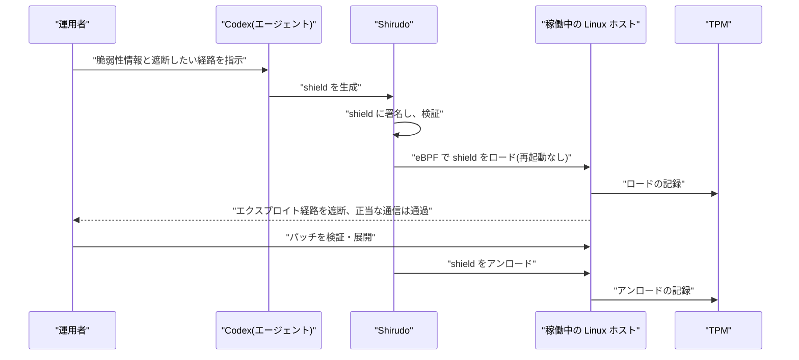

# LLM・AI Agent 最新情報レポート Vol.203
<!-- x-summary: OpenAIとCiscoがeBPFで再起動不要の脆弱性防御「Shirudo」をOSS公開 -->

**作成日**: 2026年11月24日(JST)
**対象期間**: 11月23日〜11月24日(Vol.202との差分。11月18〜21日公開で未掲載だった公式発表を拾い漏れとして回収)

## 目次

- [1. OpenAI・Google DeepMind の公式発表](#1-openaigoogle-deepmind-の公式発表)
  - [1.1 OpenAI と Cisco が eBPF による再起動不要の防御ランタイム「Shirudo」をオープンソース公開](#11-openai-と-cisco-が-ebpf-による再起動不要の防御ランタイムshirudoをオープンソース公開)
  - [1.2 DeepMind が Gemini 4 エージェントと Lean 形式検証で量子アルゴリズムのコストを最大290倍削減](#12-deepmind-が-gemini-4-エージェントと-lean-形式検証で量子アルゴリズムのコストを最大290倍削減)
  - [1.3 Genie 4 が Project Genie で提供開始(11月18日、拾い漏れ回収)](#13-genie-4-が-project-genie-で提供開始11月18日拾い漏れ回収)
- [2. Azure・Microsoft Foundry の更新(11月21〜23日)](#2-azuremicrosoft-foundry-の更新11月2123日)
  - [2.1 Foundry IQ にエンタープライズ知識グラフ(プレビュー)と反復検索モデル IQ Retriever Zero](#21-foundry-iq-にエンタープライズ知識グラフプレビューと反復検索モデル-iq-retriever-zero)
  - [2.2 Foundry の model router が Responses API に GA 対応、デプロイ不要の auto 指定も(プレビュー)](#22-foundry-の-model-router-が-responses-api-に-ga-対応デプロイ不要の-auto-指定もプレビュー)
  - [2.3 Foundry のエージェント品質・ガバナンス機能:Agent insights が GA、Guardrails と人手アノテーションはプレビュー](#23-foundry-のエージェント品質ガバナンス機能agent-insights-が-gaguardrails-と人手アノテーションはプレビュー)
  - [2.4 Azure AI Content Safety の一部機能が 2027年4月30日に廃止](#24-azure-ai-content-safety-の一部機能が-2027年4月30日に廃止)
- [3. Google Cloud・Google の更新](#3-google-cloudgoogle-の更新)
  - [3.1 Google Cloud リリースノート(11月19〜23日)](#31-google-cloud-リリースノート11月1923日)
  - [3.2 Google 検索の Personal Intelligence に Wallet を接続(11月23日)](#32-google-検索の-personal-intelligence-に-wallet-を接続11月23日)
- [4. 開発ツール・フレームワークのリリース](#4-開発ツールフレームワークのリリース)
  - [4.1 Claude Code v2.1.331:Code Mode が Bedrock・Foundry 等で利用可能に](#41-claude-code-v21331code-mode-が-bedrockfoundry-等で利用可能に)
  - [4.2 OpenAI Agents SDK v1.0.0-alpha.2:承認待ちの再開とツール実行フック](#42-openai-agents-sdk-v100-alpha2承認待ちの再開とツール実行フック)
- [5. 脆弱性情報](#5-脆弱性情報)
  - [5.1 AI関連](#51-ai関連)
  - [5.2 実行環境](#52-実行環境)
  - [5.3 LiteLLM のカスタムコードガードレールのサンドボックス脱出が CISA KEV に追加](#53-litellm-のカスタムコードガードレールのサンドボックス脱出が-cisa-kev-に追加)
- [6. その他の観点の確認結果](#6-その他の観点の確認結果)
- [7. 未確認情報](#7-未確認情報)
- [8. 確認ログ](#8-確認ログ)
- [9. 参考リンク](#9-参考リンク)

---

## 1. OpenAI・Google DeepMind の公式発表

### 1.1 OpenAI と Cisco が eBPF による再起動不要の防御ランタイム「Shirudo」をオープンソース公開

OpenAI は 11月23日、Cisco との共同で、稼働中の Linux システムをパッチの検証・展開が終わるまで再起動なしで守るオープンソースのランタイム「Shirudo」を公開した。eBPF(OS の特定ポイントで小さなプログラムを動かす Linux の仕組み)を使い、「shield」と呼ぶ一時的な防御を差し込んで、エクスプロイトが通る実行経路だけをブロックし、正当なリクエストは通す。コードは GitHub で BSD 2-Clause(BPF プログラムは BSD と GPL のデュアルライセンス)として公開され、VM のクイックスタート、Isovalent の自習ラボ、12月15日の技術ウェビナーが案内されている。価格の記載はない。[[1]](#ref-1) [[2]](#ref-2)

技術的な特徴は「エージェントが shield を作る」点にある。発表では、OpenAI の Codex で生成した shield が、稼働中の Elasticsearch に対する Java4Shell のエクスプロイト試行を、再起動なしでブロックした制御テストが示されている。中核機能は、ライブ保護、エージェント主導の shield 開発、署名・検証付きの shield 配布、そして TPM(Trusted Platform Module)を使ったハードウェアによる検証で、保護がいつロード・アンロードされたかを記録する。従来の「仮想パッチ」は WAF やネットワーク機器の署名に頼ることが多かったが、ホスト内のカーネル側でコード経路を塞ぐ点と、その作成をエージェントに任せる点が違いである。

留意点として、検証結果は単一の制御テスト(Elasticsearch と Java4Shell)で、実運用での誤検知率、shield 作成にかかる時間、対応できる脆弱性の種類は記事から読み取れない。また、shield はパッチの代替ではなく、パッチ適用までのつなぎとして位置づけられている。AI エージェントが生成した防御コードを本番ホストに入れる以上、署名と検証の運用設計が導入判断の中心になる。

### 1.2 DeepMind が Gemini 4 エージェントと Lean 形式検証で量子アルゴリズムのコストを最大290倍削減

Google DeepMind と Google Quantum AI は 11月23日、Gemini 4 のエージェントチームが量子アルゴリズムの回路を効率化し、その正しさを Lean で証明した研究を公開した(論文は arXiv:2611.09822)。早期の誤り訂正量子コンピュータで使える資源は限られるため、よく知られたアルゴリズムをより少ない資源で動かす回路を探すことが目的である。研究者が問題を選んで定義し、進捗を監督した。[[3]](#ref-3) [[4]](#ref-4)

手法は、独立した複数のエージェントチームが各自の問題に取り組み、4時間ごとに全チームの代表が仮想の会議で案を交換・議論・比較し、検証済みの案を共有ノートに書き込む、というものだ。量子回路は古典コンピュータでも現在の小型量子プロセッサでもテストできないため、正しさは Lean(定理証明支援系)での証明で担保した。協調するエージェントの案が数学的な保証を伴うよう、量子アルゴリズム向けの Lean ライブラリもオープンソースで作られている。成果は次の通りで、慣性核融合の計算コストは 11.8 分の1(必要な誤り訂正済み量子ビットは 5,650 から 4,338)、光に敏感な分子の量子シミュレーションは 8 倍安価、シトクロム P450 は 2.5 倍の改善(量子ビットメモリ 481 から 333)、Grover のある実装は 2.57 倍高速、量子状態に数を読み込む arcsin ルーチンは 290 倍高速になった。

著者らは、これらの改善後でも、科学シミュレーションは最初の誤り訂正量子コンピュータが提供しそうな資源を上回ると述べている。読者にとっての示唆は量子そのものより、「複数エージェントの議論と形式証明を組み合わせれば、人が検証しきれない成果にも正しさの保証を付けられる」という設計パターンにある。Lean ライブラリ、問題の仕様、検証済みの解は GitHub で公開されている。

### 1.3 Genie 4 が Project Genie で提供開始(11月18日、拾い漏れ回収)

Google は 11月18日、世界シミュレーションモデル Genie 4 を、新しい「Project Genie」体験(labs.google/projectgenie)で、対象となる Google AI Ultra 契約者向けに順次提供し始めた。Google AI Pro の会員は同ページでウェイトリストに登録できる。Genie 4 では、実行中の世界に対して天候の変更やキャラクターの追加などをプロンプトで途中から指示でき、シーンに合わせてリアルタイムのネイティブ音声も生成される。[[10]](#ref-10)

Project Genie では Genie 3 も選べ、1回の生成は最大3分(従来は60秒)、複数の世界の連結、360度パノラマ画像からの世界の生成、プロンプトで起こすリアルタイムのイベントに対応する。会話で世界を作る Project Genie エージェント、画面を観察して次の行き先を提案する Gemini 連携、世界を公開・リミックスできるコミュニティギャラリーも加わり、生成した映像と音声すべてに SynthID の透かしが入る。価格、Genie 4 のセッション上限、提供地域は記事に記載がない。企画・導入側にとっては、現時点ではコンシューマ向けの体験提供であり、API での提供の詳細は確認できていない点に注意が必要だ。

---

## 2. Azure・Microsoft Foundry の更新(11月21〜23日)

Azure Updates の RSS(Release Communications API)には、11月23日 UTC 夜(JST では 24日朝)に Foundry 関連の更新が一斉に登録された。個別の更新ページ(azure.microsoft.com/updates?id=...)は、この環境では「0 Updates found」と表示され本文を読めなかったため、以下は RSS に載っている説明文(途中で切れているものがある)に基づく。Microsoft Learn の本文は開けていない。[[5]](#ref-5)

### 2.1 Foundry IQ にエンタープライズ知識グラフ(プレビュー)と反復検索モデル IQ Retriever Zero

Microsoft は 11月23日、Foundry IQ に 3 件の更新を出した。Enterprise Knowledge Graph はパブリックプレビューで、内容間の関係に依存する質問のための新しい知識ソースである。インデックス作成時に、利用者が与えるオントロジーに沿って非構造化データから実体と関係を抽出する。Files knowledge source は GA で、マネージドな知識ソースにファイルを直接アップロードすると、Foundry IQ が処理・インデックスして知識ベース経由で検索できるようになり、ストレージアカウントやスケジュール実行のインデクサーが不要になる。[[5]](#ref-5)

IQ Retriever Zero(パブリックプレビュー)は反復型の検索モデルで、複雑な質問を小さな検索に分解し、結果を評価し、必要なら決められた予算の範囲で再検索したうえで、根拠を回答モデルに渡す。単発のベクトル検索で足りない多段の質問に向く設計である。なお、Vol.201・202 で「SiliconANGLE の報道のみで公式未確認」としていた Foundry IQ のエンタープライズ知識グラフは、今回 Azure Updates の RSS で存在を確認できた(Preview)。同じ報道にあった Decision-1.1 の GA と MAI 系モデルは、引き続き公式側で確認できていない。

### 2.2 Foundry の model router が Responses API に GA 対応、デプロイ不要の auto 指定も(プレビュー)

model router は、リソース・プロジェクト両方のエンドポイントで Responses API プロトコルに GA で対応した。router のデプロイ名をモデルとして指定すると、Responses ベースのアプリに自動モデル選択を足せる。あわせて 4 件がパブリックプレビューとして登録された。(1) デプロイなしで呼び出す機能で、対応リージョンで Responses または Chat Completions の model を `auto` にすると、既定の Balanced ルーティングモードでルーティングされる。(2) Messages API 対応で、Messages 形式を使うアプリやコーディングツールが、リクエスト・レスポンスの構造を変えずに自動モデル選択を使える(対象は対応モデルのみ)。(3) 自分のモデルデプロイを router で使う機能。(4) AI Gateway との併用で、gateway がモデルエイリアス背後のモデルを router でランク付けし、エイリアスの優先度・重み付けと合わせてバックエンドを選ぶ。gateway のアクセス制御は引き続き適用される。[[5]](#ref-5)

これらは、コストと品質のトレードオフをアプリ側のコードではなく基盤側に寄せる流れの延長にある。注意点は、各更新の説明文が途中で切れており、対応モデル、リージョン、料金の詳細は確認できていないことだ。11月14日のレポートで扱った model router の機能と重なる部分があるため、導入検討では Learn 側の最新の制約を確認してほしい。

### 2.3 Foundry のエージェント品質・ガバナンス機能:Agent insights が GA、Guardrails と人手アノテーションはプレビュー

Agent insights は GA となり、エージェントのトレースを分析して繰り返し現れるパターンを見つけ、関連する問題をグループ化する。利用者は insight をそれを裏付けるトレースと並べて確認でき、agent optimizer で修正案を試せる。パブリックプレビューでは、Guardrails の更新版が登場した。分類器、決定的ルール、LLM ベースの審査役を使ってエージェントの実行時の安全制御を設定でき、管理者ポリシーがプロジェクトに特定の制御を要求している場合は、その要件が画面に表示される。人手アノテーションは、レビュアーがエージェントのトレースに評価、タグ、コメント、期待する出力を付け、注釈付きトレースを評価の作成に使える。[[5]](#ref-5)

関連して、11月21日には「Foundry Canvas と VS Code でのガバナンスポリシーのガイダンス」が GA となり、エージェントの種類、モデル、ツールボックス、ガードレールに関する該当ポリシーが、構築中に警告つきで表示されるようになった。Foundry Toolkit for VS Code では、Microsoft Copilot harness を使うプロンプトエージェントのサポートがパブリックプレビュー(11月21日)、顧客管理のレジストリ(ACR 以外)にあるビルド済みイメージから hosted agents をデプロイする機能が GA(11月23日)になった。観測 → 注釈 → 評価 → 修正という運用ループを Foundry 内で閉じる構成で、Google Cloud の Agent Anomaly Detection(Vol.201)や semantic governance policies(Vol.202)と同じ方向の動きである。

### 2.4 Azure AI Content Safety の一部機能が 2027年4月30日に廃止

Microsoft は 11月23日、Azure AI Content Safety の一部機能を 2027年4月30日に廃止すると告知した。対象のプレビュー機能は、Analyze Multimodal、カスタムカテゴリ(rapid)(テキストと画像)、Text・Image・Prompt Shields の接続コンテナ、Text・Image の切断コンテナである。[[5]](#ref-5)

影響を受けるのは、オンプレミスやエッジでコンテナ版の Content Safety を使っている構成や、プレビューのカスタムカテゴリに依存している構成である。更新の説明文からは移行先の指定が読み取れなかったため、該当する利用者は、後継機能の有無を Learn の該当ページで確認し、廃止日までの移行計画を立てる必要がある。約5か月の猶予がある。

---

## 3. Google Cloud・Google の更新

### 3.1 Google Cloud リリースノート(11月19〜23日)

Google Cloud のリリースノート(Vol.202 は 11月21日までを扱った)のうち、未掲載の項目を整理する。11月23日は、App Engine(フレキシブル・スタンダード)、Cloud Run、Cloud Run functions で Node.js 26 と Python 3.15 のランタイムが GA になった(Python 3.15 の Cloud Run functions ランタイムは第2世代のみ)。BigQuery では `reservation_override_mode` と `disable_on_demand_billing` が GA で、`ALTER PROJECT SET OPTIONS` と `ALTER ORGANIZATION SET OPTIONS` により、クエリがオンデマンド課金へフォールバックできるか、予約スロットを使う必要があるかを制御できる。GKE の Policy Controller は 11月12日付で非推奨となり、サポート終了は 2027年12月31日で、GKE 1.39 以降のクラスタでは使えず、インストール済みクラスタは 1.39 以降へアップグレードできない。移行先は ValidatingAdmissionPolicy、Pod Security Admission、自己管理の OPA Gatekeeper である。[[7]](#ref-7)

AI 関連では、11月19日に Cloud Run で NVIDIA RTX PRO 6000 Blackwell の分割 GPU(フラクショナル GPU)がプレビューになり(サービス、ジョブ、ワーカープール対象。ワーカープールは CPU ベースのオートスケールも追加)、Agent Registry(プレビュー)に MCP ツールのメタデータ(IAP ポリシーのヒントと human-in-the-loop 制御)が追加された。CodeMender は Gemini 4 Hydrogen(プレビュー)を `--model gemini-4-hydrogen` で選べる(既定は Gemini 3.8 Flash で、このモデルのキャッシュ書き込み課金は 2027年1月12日開始)。11月20日には、Gemini 3.8 Flash の教師ありファインチューニング、継続チューニング、チューニングチェックポイントが GA になり、Gemini Enterprise で AirOps、Stripe、GitLab、Hugging Face を含む多数のサードパーティデータストアが GA になった。11月18日の Gemini Enterprise での Gemini 4 Neon GA は Vol.202 掲載済みである。11月21日の PHP セキュリティパッチ(GCP-2026-090)は、Cloud Run などで自動ベースイメージ更新がない場合に再ビルドと再デプロイが必要で、`session.upload_progress.enabled = 0` の一時対策は外すよう案内されている。

### 3.2 Google 検索の Personal Intelligence に Wallet を接続(11月23日)

Google は 11月23日(Search 担当 VP の Robby Stein 氏の投稿)、AI Mode の Personal Intelligence に Google Wallet を接続できるようにすると発表した。Wallet は同日から AI Mode で順次提供され、Drive と Gemini アプリへの接続は「数週間以内」である。Gmail、カレンダー、フォトはすでに接続できる。利用者は、検索のパーソナライズ設定の「接続済みアプリ」で選び、いつでもオン・オフを切り替えられる。[[11]](#ref-11)

AI Mode は Wallet の情報を読むだけで、お金の移動・管理・運用はできない。Wallet の用途としては、資産形成のマイルストーンの整理、日常の支出削減、クレジットカードのキャッシュバックや特典の活用が挙げられている。ほかに、Gemini アプリと AI Mode の間で文脈を共有する機能、AI Overviews と AI Mode が最近の検索文脈に基づいて回答する機能が予告され、回答の下の「Personalization」アイコンで、使われた文脈が分かるようになる予定である。個人データを横断してエージェントが参照する設計の一例で、企業内の導入では、同種の権限設計(読み取り専用、利用者によるオンオフ、利用文脈の表示)の参考になる。

---

## 4. 開発ツール・フレームワークのリリース

### 4.1 Claude Code v2.1.331:Code Mode が Bedrock・Foundry 等で利用可能に

Claude Code v2.1.331(11月23日)は、Code Mode を、Amazon Bedrock、Google Cloud の Agent Platform、Microsoft Foundry、Claude Platform on AWS 上のターミナルセッションで使えるようにした。`claude doctor` には API 接続性を報告するセクションが加わり、圧縮応答を途中で切るプロキシ向けに `CLAUDE_CODE_DISABLE_RESPONSE_COMPRESSION` で非圧縮のモデル応答を要求できる。プラグインマニフェストは `optionalDependencies` に対応した。[[12]](#ref-12)

修正では、不正な応答で MCP ツール呼び出しが最大30分ハングする問題、特定の XML タグを引用すると `/compact` が要約の一部を失う問題、Claude Desktop で Stop フックが最後の返信を拾えない問題が直された。予告として、11月30日以降、管理設定の `extraKnownMarketplaces` にあるプラグインマーケットプレイスは既定で自動更新されるようになる。望まない場合は該当エントリに `"autoUpdate": false` を設定する。組織で管理マーケットプレイスを配っている場合は、30日までに方針を決めておく必要がある。

### 4.2 OpenAI Agents SDK v1.0.0-alpha.2:承認待ちの再開とツール実行フック

OpenAI Agents SDK の v1.0.0-alpha.2(プレリリース、11月23日)は、Responses または Codex を使って、会話と保留中の承認をワーカーをまたいで再開できるようにした。`RunConfig.tool_execution` によるツール実行フック、オプションのランナーのテキスト秘匿(redaction)、より詳細なトレースも加わった。[[13]](#ref-13)

注意が必要なのは互換性で、このリリースは alpha.1 が読めない新しい RunState スキーマ(1.24)を書き込む。リリースノートは「書き手より先に読み手をアップグレードせよ」としている。alpha.1(11月20日)は Codex を `CodexProvider` でオプトインのモデルプロバイダとして追加したもので、Vol.201 で扱った。alpha 版の wheel は PyPI ではなく GitHub Releases のみで配布されている。

---

## 5. 脆弱性情報

### 5.1 AI関連

| CVE / ID | 対象製品・影響バージョン → 修正 | CVSS | 種類と影響 | 悪用状況 | 推奨対応 |
|---|---|---|---|---|---|
| CVE-2026-40217 / GHSA-wxxx-gvqv-xp7p | LiteLLM(pip `litellm`)1.81.8 以上 1.83.10 未満 → 1.83.10(Patches 欄は 1.83.11 と記載。要確認) | 7.5(v4.0、AV:N/AC:H/PR:H) | `POST /guardrails/test_custom_code` のカスタムサンドボックスをバイトコード操作で脱出し、プロキシプロセスで任意コード実行(CWE-420、CWE-913)。既定の Docker イメージでは root で動作 | **CISA KEV に 11月18日追加**。GHSA の EPSS は 78.004% | 1.83.10 以降(1.83.11 も確認)へ更新。更新できない間はリバースプロキシや API ゲートウェイで当該エンドポイントを遮断 |

新規の AI 関連の脆弱性は上記 1 件である。GitHub の Advisory Database の Critical / High(pip・npm)の 11月17〜23日分を確認したところ、AI・MCP 関連の jupyter-mcp-server(CVE-2026-77359 / 77318)、@doist/todoist-mcp(CVE-2026-76807)、flyto-core(CVE-2026-77312)、arize-phoenix(CVE-2026-53998)、mcp Python SDK(CVE-2026-115563)、codewhale、obsidian-sync-mcp、@connorbritain/mssql-mcp-core、code-review-mcp-server、axon-mcp は 11月17〜23日のレポートで掲載済みだった。MONAI Label(CVE-2026-133968)の KEV 追加(11月23日)も Vol.202 で扱った。[[8]](#ref-8) [[9]](#ref-9) [[16]](#ref-16)

### 5.2 実行環境

| CVE / ID | 対象製品・影響バージョン → 修正 | CVSS | 種類と影響 | 悪用状況 | 推奨対応 |
|---|---|---|---|---|---|
| USN-9188-1(CVE-2026-49264、49265、118669、49272) | python-oauthlib。49265 は Ubuntu 20.04〜26.10、49272 は 26.04 LTS・26.10 のみ(他 2 件は対象リリースの記載なし)→ 例: 24.04 LTS は 3.2.2-1ubuntu0.1、22.04 LTS は 3.2.0-1ubuntu0.2 | 不明(通知に記載なし) | PKCE code verifier の非定数時間比較でトークン取得・アカウント乗っ取りの可能性、クライアント識別の検証不備による他クライアントのトークン取得、device code の検証不備によるデバイス認可なしでのトークン取得、トークン失効エンドポイントの JSONP callback の不備 | 不明(通知に記載なし) | 各 Ubuntu のパッケージを更新。pip で入れた oauthlib は別途バージョン確認(通知は Ubuntu パッケージ向け) |
| USN-9187-1(CVE-2026-59843、59846、59847、59848、59850) | libssh。24.04 LTS は 0.10.6-2ubuntu0.6、22.04 LTS は 0.9.6-2ubuntu0.22.04.9(20.04 以前は ESM) | 不明(通知に記載なし) | 59847 は OpenSSL バックエンドでの AES-GCM タグの検証不備により、中間者が暗号化通信を検知されずに改変できる(20.04 のみ)。59850 は閉じたチャネルへのコールバックによる use-after-free(20.04 以前)。ほか DoS、ProxyCommand のユーザー名展開での情報露出 | 不明(通知に記載なし) | パッケージを更新し、libssh を使うアプリを再起動 |

上記 2 件は、Ubuntu の通知に重要度の記載がなく、CVSS も読めなかったため、選定基準(CVSS 7.0 以上、悪用確認、High 以上の通知)を満たすかを確認できていない。python-oauthlib は OAuth 連携を持つエージェント基盤やツールサーバーで広く使われているため、参考として掲載した。

- **Node.js**: nodejs.org の脆弱性ブログで最新のセキュリティリリースは 11月11日(v22.23.5、v24.22.3、v26.13.1。High 7 件)で、11月11〜12日のレポートで掲載済み。以降の追加はない。[[18]](#ref-18)
- **Python**: python.org のブログの最新は 11月18日で、セキュリティリリースとして告知された CPython・pip の新規リリースは見当たらなかった。直近の保守リリースは 10月26日の 3.15.2 など。[[20]](#ref-20)
- **Linux**: Ubuntu の通知の最新 10 件は 11月20〜23日付で、上記 2 件のほか Tomcat(USN-9186-1)、カーネル各種(USN-9184-1、9183-1、9173-2 など)がある。カーネルは重要度の表示がなく、内容は確認できていない。[[14]](#ref-14) [[15]](#ref-15)

### 5.3 LiteLLM のカスタムコードガードレールのサンドボックス脱出が CISA KEV に追加

LiteLLM は、複数の LLM プロバイダへの呼び出しを 1 つの API にまとめる AI ゲートウェイとして広く使われている。GitHub Security Advisory(GHSA-wxxx-gvqv-xp7p、CVE-2026-40217)によると、問題は `POST /guardrails/test_custom_code` で、利用者が与えた Python を独自のサンドボックスで実行する仕組みにある。バイトコードレベルの手法でこのサンドボックスを脱出でき、プロキシのプロセス内で任意コードが実行される。既定の Docker イメージではそのプロセスが root で動く。GHSA の公開は 5月7日(Advisory Database での確認は 5月11日)で、CISA の KEV カタログへの追加は 11月18日である。CISA のページで確認できたのは追加日までで、悪用の経緯や被害の詳細は、この環境で開けた一次情報には載っていない。[[8]](#ref-8) [[9]](#ref-9)

攻撃の成立条件は、既定の設定ではプロキシ管理者(proxy-admin)の認証情報を持っていることで、CVSS v4 が 7.5(AC:H、PR:H)にとどまるのはこのためである。ただし、LiteLLM では他の欠陥(例:同リポジトリの別アドバイザリにある、マスターキー漏えいや salt key の再利用による管理者への権限昇格)と組み合わさると、一般ユーザーの権限が管理者権限に、さらにホスト上の root 実行に連鎖しうる。この連鎖は、リポジトリの別アドバイザリの題名から見た推測であり、今回の KEV 追加がどの連鎖で悪用されたかは、読めた情報からは分からない。EPSS は 78.004% と高い。

対応の優先度は高い。LiteLLM を社内の LLM ゲートウェイとして立てている場合、(1) バージョンを 1.83.10 以降(Patches 欄は 1.83.11 とも書いており、リリースを確認)に上げる、(2) 更新できない間は `/guardrails/test_custom_code` をリバースプロキシで遮断する、(3) 管理者キー(マスターキーを含む)の発行・保管状況を見直し、コンテナを root で動かさない、の順で進めたい。修正では、独自のサンドボックスが RestrictedPython に置き換えられた。

---

## 6. その他の観点の確認結果

- **Anthropic**: anthropic.com/news の最新は 11月20日の IPO クロージングの発表(Vol.201 掲載済み)で、11月21日以降の新規記事はなかった。直近の Claude Code は 4.1 の通り。[[17]](#ref-17)
- **OpenAI**: ニュースの RSS の最新は Shirudo(11月23日)で、「Connected intelligence for in-house legal」と Richpanel の導入事例(11月23日)は事例・解説ページ。11月19日の Daybreak Red の展開ガイドは「supervised security investigations のリファレンスアーキテクチャ」と書かれているが、本文は PDF にあり、内容は読めていない(Vol.202 で Daybreak を扱った範囲を超える情報は得られなかった)。[[1]](#ref-1)
- **Google / DeepMind**: DeepMind のブログの最新は 11月23日の量子アルゴリズム(1.2)。blog.google の RSS の最新は同日の Personal Intelligence(3.2)で、11月19日の Tool Retrieval は Vol.201 で掲載済み。[[4]](#ref-4) [[19]](#ref-19)
- **主要フレームワーク**: Google ADK の最新は v2.15.0(11月19日、Vol.201 掲載済み)。LangChain は 11月23日に text-splitters 1.2.0、tests 1.2.0、qdrant 1.2.0、perplexity 1.5.0 など各パッケージで Python 3.10 のサポートを終了(Vol.201 以降の流れの続き)。Codex は 0.171.0(11月20日、掲載済み)が最新の安定版で、23日に出た alpha 版はリリースノートの記載なし。MCP 仕様の最新の安定版は 2026-07-28(7月28日)で、新しい版は出ていない。Microsoft Agent Framework の GitHub リリースページは 404 で開けなかった。[[21]](#ref-21) [[22]](#ref-22) [[23]](#ref-23) [[24]](#ref-24)
- **SaaS 製品・AI エージェント搭載製品**: 検索で Salesforce(Agentforce Coworker の Teams 対応、Hunter の GA が 11月予定)や ServiceNow の話題は見つかったが、公式ページを開けておらず、本文には載せていない(7章参照)。

---

## 7. 未確認情報

- **OpenRouter が 3 つの推論プロバイダを除外(Dragos のカナリアによるプロンプト窃取の検出)**: WebSearch の抜粋のみ。thenextweb.com、dragos.com、openrouter.ai がこの環境で名前解決できず、本文を読めていない。Vol.202 までの OpenRouter 関連の記載とは別件の可能性がある。
- **Together AI が、コーディングエージェントが公開リポジトリに露出させた認証情報により、6〜7月分のプロンプトサンプルが取得されたと公表**: WebSearch の抜粋のみ(digg.com、together.ai が開けなかった)。
- **Meta Muse の AI エージェントが悪意あるウェブページでハイジャックされたとする報告**: セキュリティベンダー(Aviatrix)のページの検索抜粋のみで、独立した確認なし。
- **GitHub が 12月2日から公開リポジトリで `pull_request_target` を既定でブロックする件**: Python Insider(11月18日の投稿 "De-fanging dangerous triggers in GitHub Actions across an organization")の冒頭の抜粋のみ。本文(PSF のブログ)と GitHub 側の公式告知は未確認。
- **Microsoft の Decision-1.1 の GA と MAI-Code-2 などの MAI 系モデル**: Vol.201・202 から継続。Azure Updates の RSS には該当する項目が見当たらなかった。
- **LiteLLM の KEV 追加の経緯(Google Threat Intelligence Group の報告、期限日など)**: 検索の抜粋にのみ記載があり、securityaffairs.com と letsdatascience.com は開けなかったため本文には載せていない。
- **Azure Updates の各項目の全文**: 個別ページが「0 Updates found」と表示され、RSS の説明文(途中で切れている)のみ確認。

---

## 8. 確認ログ

| 情報源 | 試したURL・手段 | 結果 | 確認できた最新の更新日 |
|---|---|---|---|
| OpenAI | openai.com/news/rss.xml | 取得成功 | 11月23日(Shirudo) |
| OpenAI | openai.com/index/introducing-shirudo、/index/the-silent-consensus、/business/learn/deploying-daybreak-red | 取得成功(Daybreak Red は本文が PDF のため概要のみ) | 11月23日 |
| OpenAI | github.com/openai/shirudo | 404(リポジトリ名が異なる可能性) | 不明 |
| OpenAI | github.com/openai/codex/releases、openai-agents-python/releases | 取得成功 | 11月23日 |
| Anthropic | anthropic.com/news | 取得成功 | 11月20日 |
| Anthropic | github.com/anthropics/claude-code/releases | 取得成功 | 11月23日(v2.1.331) |
| Google DeepMind | deepmind.google/blog/rss.xml と個別記事(量子、Genie 4、Gemini 4 Neon) | RSS・量子の記事は取得成功。Genie 4 は blog.google へのリダイレクトを辿って取得成功。Gemini 4 Neon は未取得(Vol.202 掲載済みのため) | 11月23日 |
| Google | blog.google/technology/ai/rss/、Search の Personal Intelligence の記事 | 取得成功 | 11月23日 |
| Google Cloud | docs.cloud.google.com/feeds/gcp-release-notes.xml | cloud.google.com から 301 でリダイレクト後に取得成功。フィードが大きく先頭部分のみ読んだ | 11月23日 |
| Azure | microsoft.com/releasecommunications/api/v2/azure/rss | 取得成功(説明文は途中で切れる) | 11月23日(UTC) |
| Azure | azure.microsoft.com/updates?id=581333、581343 | 取得はできたが「0 Updates found」で本文なし | 不明 |
| Azure / Foundry | devblogs.microsoft.com/foundry/feed/ | 取得成功(フィードの前半のみ) | 11月21日 |
| Azure / Foundry | raw.githubusercontent.com/MicrosoftDocs/azure-ai-docs/main/articles/foundry/whats-new-foundry.md、github.com/MicrosoftDocs/azure-ai-docs/commits/main、github.com/microsoft/agent-framework/releases | 404。Microsoft Learn MCP はこの環境にない。Learn の本文は未確認 | 不明 |
| Google ADK | github.com/google/adk-python/releases | 取得成功 | 11月19日(v2.15.0) |
| LangChain | github.com/langchain-ai/langchain/releases | 取得成功 | 11月23日 |
| MCP | github.com/modelcontextprotocol/modelcontextprotocol/releases | 取得成功 | 7月28日(2026-07-28 安定版) |
| GitHub Advisory | github.com/advisories(Critical、High の pip・npm、CVE-2026-40217 の検索)、GHSA-wxxx-gvqv-xp7p、GHSA-gfv3-m769-5xm3、GHSA-p34x-fmph-9fjx | 取得成功。api.github.com は 403 | 11月23日 |
| CISA | cisa.gov/known-exploited-vulnerabilities-catalog | 取得成功 | 11月23日追加分 |
| NVD | nvd.nist.gov/vuln/detail/CVE-2026-40217 | 本文なし(トップページのみ表示) | 不明 |
| Node.js | nodejs.org/en/blog/vulnerability と 11月11日の告知 | 取得成功 | 11月11日 |
| Python | python.org/news/security/ は blogs へリダイレクト、python.org/blogs | 取得成功(セキュリティ専用の一覧は見つからず) | 11月18日 |
| Ubuntu | ubuntu.com/security/notices、USN-9187-1、USN-9188-1 | 取得成功 | 11月23日 |
| 報道 | securityaffairs.com、letsdatascience.com、rescana.com、thenextweb.com、digg.com、dragos.com、together.ai、openrouter.ai | いずれも名前解決できず(この環境の許可ドメイン外) | 不明 |

---

## 9. 参考リンク

- **[1]** [OpenAI News RSS | OpenAI](https://openai.com/news/rss.xml)
- **[2]** [Introducing Shirudo | OpenAI](https://openai.com/index/introducing-shirudo)
- **[3]** [Finding faster quantum algorithms with agents and formal verification | Google DeepMind](https://deepmind.google/blog/finding-faster-quantum-algorithms-with-agents-and-formal-verification/)
- **[4]** [Google DeepMind Blog RSS | Google DeepMind](https://deepmind.google/blog/rss.xml)
- **[5]** [Azure Updates RSS | Microsoft](https://www.microsoft.com/releasecommunications/api/v2/azure/rss)
- **[6]** [Microsoft Foundry Blog フィード | Microsoft Foundry Blog](https://devblogs.microsoft.com/foundry/feed/)
- **[7]** [Release notes | Google Cloud Documentation](https://docs.cloud.google.com/feeds/gcp-release-notes.xml)
- **[8]** [LiteLLM has a sandbox escape in custom-code guardrail(GHSA-wxxx-gvqv-xp7p)| GitHub Advisory Database](https://github.com/advisories/GHSA-wxxx-gvqv-xp7p)
- **[9]** [Known Exploited Vulnerabilities Catalog | CISA](https://www.cisa.gov/known-exploited-vulnerabilities-catalog)
- **[10]** [Genie 4 is now available in Project Genie | Google](https://blog.google/innovation-and-ai/models-and-research/google-deepmind/genie-4-now-available-project-genie/)
- **[11]** [A more tailored Google Search that's uniquely yours | Google](https://blog.google/products-and-platforms/products/search/google-search-personal-intelligence-apps/)
- **[12]** [claude-code releases | GitHub](https://github.com/anthropics/claude-code/releases)
- **[13]** [openai-agents-python releases | GitHub](https://github.com/openai/openai-agents-python/releases)
- **[14]** [USN-9187-1: libssh vulnerabilities | Ubuntu](https://ubuntu.com/security/notices/USN-9187-1)
- **[15]** [USN-9188-1: OAuthLib vulnerabilities | Ubuntu](https://ubuntu.com/security/notices/USN-9188-1)
- **[16]** [GitHub Advisory Database(Critical、reviewed)| GitHub](https://github.com/advisories?query=type%3Areviewed+severity%3Acritical)
- **[17]** [News | Anthropic](https://www.anthropic.com/news)
- **[18]** [Node.js Security Releases: November 11, 2026 | Node.js](https://nodejs.org/en/blog/vulnerability/november-2026-security-releases)
- **[19]** [Google AI blog RSS | Google](https://blog.google/technology/ai/rss/)
- **[20]** [Python Insider | python.org](http://www.python.org/blogs/)
- **[21]** [adk-python releases | GitHub](https://github.com/google/adk-python/releases)
- **[22]** [langchain releases | GitHub](https://github.com/langchain-ai/langchain/releases)
- **[23]** [codex releases | GitHub](https://github.com/openai/codex/releases)
- **[24]** [modelcontextprotocol releases | GitHub](https://github.com/modelcontextprotocol/modelcontextprotocol/releases)
