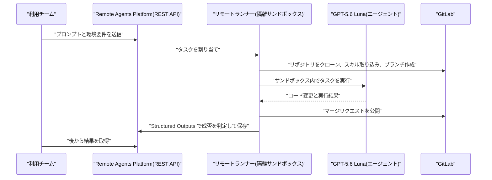

# LLM・AI Agent 最新情報レポート Vol.204
<!-- x-summary: OpenAIのGPT-6が推論とコードだけでタンパク質を設計、実験で結合を確認 -->

**作成日**: 2026年11月25日(JST)
**対象期間**: 11月24日〜11月25日(Vol.203との差分)

## 目次

- [1. OpenAI の公式発表](#1-openai-の公式発表)
  - [1.1 GPT-6 がタンパク質設計の能力を示す:322 個のミニバインダーのうち 35 個(10.9%)が標的に結合](#11-gpt-6-がタンパク質設計の能力を示す322-個のミニバインダーのうち-35-個109が標的に結合)
  - [1.2 アマチュア天文家が Codex と Astra で系外惑星候補を探索](#12-アマチュア天文家が-codex-と-astra-で系外惑星候補を探索)
  - [1.3 iFood が 15,000 リポジトリ向けのリモートエージェント基盤を構築](#13-ifood-が-15000-リポジトリ向けのリモートエージェント基盤を構築)
- [2. Azure・Microsoft Foundry の更新](#2-azuremicrosoft-foundry-の更新)
  - [2.1 Foundry の Ignite 2026 総括:本番トレースから評価・最適化へ戻す改善ループ](#21-foundry-の-ignite-2026-総括本番トレースから評価最適化へ戻す改善ループ)
  - [2.2 Foundry Agent Service に MCP ゲートウェイ、A2A パススルー、コスト制御が追加(11月24日)](#22-foundry-agent-service-に-mcp-ゲートウェイa2a-パススルーコスト制御が追加11月24日)
- [3. 開発ツール・フレームワークのリリース](#3-開発ツールフレームワークのリリース)
  - [3.1 OpenAI Agents SDK v0.26.0 が安定版に:破壊的変更を含む](#31-openai-agents-sdk-v0260-が安定版に破壊的変更を含む)
  - [3.2 OpenAI Codex 0.172.0](#32-openai-codex-01720)
- [4. 脆弱性情報](#4-脆弱性情報)
  - [4.1 AI関連](#41-ai関連)
  - [4.2 実行環境](#42-実行環境)
  - [4.3 ruflo の MCP ブリッジが無認証でシェルを渡す(CVSS 10.0)](#43-ruflo-の-mcp-ブリッジが無認証でシェルを渡すcvss-100)
  - [4.4 Drupal コアのインストーラ経由 RCE が CISA KEV に追加](#44-drupal-コアのインストーラ経由-rce-が-cisa-kev-に追加)
- [5. その他の観点の確認結果](#5-その他の観点の確認結果)
- [6. 未確認情報](#6-未確認情報)
- [7. 確認ログ](#7-確認ログ)
- [8. 参考リンク](#8-参考リンク)

---

## 1. OpenAI の公式発表

### 1.1 GPT-6 がタンパク質設計の能力を示す:322 個のミニバインダーのうち 35 個(10.9%)が標的に結合

OpenAI は 11月24日、GPT-6 ファミリーが、タンパク質設計用の専用モデルを設計工程で呼び出さずに、推論と汎用コードだけでタンパク質の構造とアミノ酸配列を設計できると発表した。内容はプレプリント「GPT-6 as a Universal Foundation Model for Protein Biology: Beyond Specialized Models」にまとめられ、OpenAI のサイトの Science セクションで公開された。社内の研究用モデルは、14 のタンパク質タスクの多くで専用モデルと同等以上だったという。製品としての提供や価格の記載はない。[[1]](#ref-1)

実験は提携先の Onava とのウェットラボで行われた。第1の実験では、GPT-6.2 がコードで3次元のミニバインダー形状を生成し、配列は SolubleMPNN、候補選別は他の専用モデルが担当した。試験した 322 個のうち 35 個(10.9%)が標的に結合した(PD-L1 が5個、IL-7Rα が3個、TrkA が1個、VEGF-A が8個、IL-17A が18個)。第2の実験では、既知の構造について元の配列を伏せたまま GPT-6.2 に配列を提案させ、初期スクリーニングで MDM2 は 88 個中 75 個(85%)、VEGF-A は 42 個中 26 個(62%)、PD-1 は 59 個中 8 個(14%)が結合した。未公開の3形状(PD-L1 が2つ、IL-7Rα が1つ)では 107 個中 14 個(13.1%)が結合している。抗体では、IL-4Rα 結合 VHH 6 種の結合ループの再設計で 182 個中 128 個(70%)、治療用抗体5種のループ残基の約半分を変えた断片で 272 個中 179 個(66%)が PD-1 または PD-L1 に結合した。

計算評価では、30 の MotifBench 課題で社内モデルが 43.7%(RFdiffusion は 27.8%、暫定値)、CATH コードからのフォールド設計 200 課題で 18.9%(Proteina は 17.1%)、小分子ドッキング PoseBusters で GPT-6.2 が 93%(DiffDock-L は 50%)だった。一方、配列からの構造予測は弱く、平均 TM-score は GPT-6.2 が 0.26、社内モデルが 0.38 で、ESMFold2 の 0.93 に大きく届かない。OpenAI 自身も、候補の選別に Boltz-2、OpenDDE、ESMFold2 といった専用モデルを使っており、完全にエンドツーエンドのゼロショット設計ではないと明記している。結合は初期段階の指標にすぎず、特異性や安定性、効果、安全性は未確認である。バイオセキュリティ上のリスクについては Preparedness Framework で評価するとしている。創薬や素材の企画に関わる読者にとっては、「汎用モデルがプロンプトで設計条件を受け取れる」点と、専用モデルとの併用が前提である点の両方が判断材料になる。

### 1.2 アマチュア天文家が Codex と Astra で系外惑星候補を探索

OpenAI は 11月24日、2人のアマチュア天文家が AI ツールで公開望遠鏡データから系外惑星の候補を探した事例を公開した。Kevin Bond 氏は Codex で約10万個の恒星の Kepler 観測データを、Ethan Byrd 氏は Astra で約1,900万個の恒星の TESS などの公開アーカイブを調べた。どの候補もまだ確認されておらず、専門家が評価している段階である。[[2]](#ref-2)

Bond 氏は、光度曲線を走査するエージェントと、検出候補を詳しく検査する別のエージェントの2段構成にした。探索は 200 を超える信号を検出し、そのうち 10 件は既知の惑星だった。既知惑星を回収できたことが、プログラムの信頼性の目安として使われている。候補の KIC 5689121 は 13.8 日周期で、惑星なら地球の約2.4倍の直径になる。KIC 6691030 は 4.8 日周期で、ネプチューンより小さい惑星と整合する。SETI Institute の天文学者が別の探索で両方の信号を独立に検出した。Byrd 氏は、Astra が公開手法の調査、探索ソフトの作成、有望信号の初期検査を担当し、最初の探索で 49 候補を得た。うち有力な1件を TESS 研究者に送っており、さらに2件が提出待ちである。

留意点として、これは「発見」ではなく「候補」である。連星の食や機器の温度変化などの偽陽性があり、確認には統計的検証や視線速度の測定、査読論文での公表が必要で、Bond 氏の候補でも数か月から数年かかりうるとされる。エージェントに既存の手法を組み合わせてソフトを書かせ、既知の答えで検証する、という進め方は、科学分野以外のデータ探索にも転用しやすい。

### 1.3 iFood が 15,000 リポジトリ向けのリモートエージェント基盤を構築

OpenAI は 11月24日の顧客事例で、ブラジルのフードデリバリー企業 iFood が構築した社内の「Remote Agents Platform」を紹介した。REST API 経由で 15,000 超のリポジトリに対するコーディングタスクを実行でき、これまでに 25,000 回超を実行し、270 億トークン超を消費、1 回あたりの平均コストは 0.04 ドルだという。[[3]](#ref-3)

構成は「決定的な前後処理」と「エージェント本体」の組み合わせである。リモートランナー上の隔離サンドボックスで、リポジトリのクローン、エージェントスキルの取り込み、作業ブランチの作成を決定的に行い、その間のタスク本体を GPT-5.6 Luna が実行し、最後にマージリクエストの公開と成果物の提供を行う。サンドボックスは Ubuntu で、Python、Java、Kotlin、C#、TypeScript、Rust、JavaScript、Go の環境を持ち、Nexus、GitLab、Docker、Snyk、Kubernetes、AWS に接続できる。各セッションの成否は Structured Outputs で定型の形式に整えて自動判定する。最初の用途である脆弱な依存関係の修正では、この基盤への移行後、修正の精度と解決した脆弱性の数がどちらも2倍超になった。

記事が示す教訓は、ボトルネックはユースケースではなく実行基盤であること、1 回あたりのコストを設計要素として扱うこと、成否を構造化して測ることである。数値は事例の自己申告で、「2倍超」の比較対象や母数は示されていない。

---

## 2. Azure・Microsoft Foundry の更新

### 2.1 Foundry の Ignite 2026 総括:本番トレースから評価・最適化へ戻す改善ループ

Microsoft は 11月24日、Foundry 公式ブログで Ignite 2026 の発表を総括した。中心は、本番のトレースを評価とエージェント最適化につなげる「継続的改善ループ」である。トレースを束ねて知見にする Insights と、会話全体を採点する multi-turn evaluation は GA である。人手による評価は preview で、HelpSteer3 での検証では人間の判断との一致が 65% から 81% に上がった(人間2人の間は 89%)。judge モデル Microsoft-Decision-1 は preview で、中央値の遅延 0.59 秒、1,000 回あたり約 0.12 ドルとされ、判定の約2%が再実行で変わる制約がある。スキル最適化は preview で、社内ベンチマークの平均改善は 9.2 ポイント、未見の質問で最大 19.9 ポイントと書かれている。変更は自動適用されない。[[4]](#ref-4)

モデルとデータ面では、Microsoft-Decision-1.1 が GA(Gemma 4 26B A4B ベース、入力 100 万トークンあたり 0.042 ドルから)、model router は `model="auto"` が preview で、振り分け対象は 7 プロバイダの 45 モデルである。Managed Compute は 150 超のオープンモデルを専有 GPU で提供する GA。Programmed Training は preview で、Python のドライバが生成・採点・更新を制御し、`sample`、`forward_backward`、`optim_step` などの API を使う。Microsoft IQ は GA で、Web IQ は 1,000 回あたり 1 ドルからである。FinOps のコスト制御は preview で、予算超過では HTTP 429(`x-ms-budget-cause: budget_exceeded`)を返し、一時エラーとして再試行すべきでないと明記されている。対象は GPT と o シリーズのトークンに限られ、請求額の上限保証ではない。

AKS 上で Foundry を動かす「AKS AI Manager」は limited preview で、hosted agents の public preview は 12月上旬の目標とされている。GA と preview が混在する大型の総括なので、導入判断では項目ごとの段階を確認する必要がある。MAI-Code-2 などは「coming soon」や限定公開であり、価格は promotional pricing と記載されている点にも注意したい。

### 2.2 Foundry Agent Service に MCP ゲートウェイ、A2A パススルー、コスト制御が追加(11月24日)

Azure Updates の RSS(11月24日付)では、Foundry Agent Service 向けに複数の preview が公開された。MCP ツールのトラフィックを組織の AI Gateway または API Management のエンドポイント経由にできる「自前ゲートウェイでの MCP ツールのガバナンス」、ホステッドエージェントが Agent2Agent(A2A)のリクエストを Responses プロトコルへ変換せずにそのまま転送する「ネイティブ A2A パススルー」、モデルとエージェントの支出やトークンの予算を設定して Event Grid で通知するか新規リクエストを閾値でブロックする「コスト制御」、Azure Policy でホステッドエージェントの外向き通信先を中央管理する機能、プロンプトエージェントのトレース上の知見から指示文とツール説明の変更案を生成して試す「エージェントの最適化」である。GA は Azure Storage の権限を Azure AI Search と Foundry IQ に適用する機能で、ユーザーごとにアクセスできるコンテンツだけを返せる。[[5]](#ref-5)

意味合いは、エージェントの「出口」と「予算」を企業側の管理面に寄せる動きにある。MCP をゲートウェイに通せば、認証、ログ、レート制限を既存の API 管理と同じ流儀で扱える。ただし、この環境では各更新の個別ページ(azure.microsoft.com/updates?id=...)が「0 Updates found」で本文を読めず、本節は RSS の説明文(公式配信)に基づく。対象リージョンや価格、制限事項は未確認である。

---

## 3. 開発ツール・フレームワークのリリース

### 3.1 OpenAI Agents SDK v0.26.0 が安定版に:破壊的変更を含む

OpenAI Agents SDK の Python 版 v0.26.0 が 11月24日に最新の安定版として公開された。Docker マウントでは `InContainerMountStrategy` が拒否されるようになり、`DockerVolumeMountStrategy` を使って新しいセッションで更新後のマニフェストから開始する必要がある。Codex ツールのローカル画像は、モデルが指定したパスではなく `image_attachments={"diagram": "/app/diagram.png"}` のような名前付きの許可が必要になった。入力のトリップワイヤは、キューに入ったファンクションツールの実行も止める。MCP のメタデータは、呼び出しごとの明示指定、`tool_meta_resolver`、検出時の既定値の順で優先される。リアルタイムのトレースでは、独自の `TraceProvider` は `is_disabled()` で無効状態を報告しないとサーバー側のトレースが維持されない。[[6]](#ref-6)

前日に報告した v1.0.0-alpha.2(Vol.203)は GitHub のみの pre-release で、`ResumableSession` や `RunState` schema 1.24(alpha.1 では読めない。「checkpoint の読み手を先に更新する」と注記)を持つ。安定版の v0.26.0 は、サンドボックスとツール権限を「モデルの入力を信用しない」方向に締める変更が目立つ。Codex ツールやコンテナ実行を使っている場合は、アップグレード前に上記の項目を確認したい。

### 3.2 OpenAI Codex 0.172.0

Codex 0.172.0 が 11月24日に Latest となった。スレッドへのリンクをターミナルで開く機能、スラッシュコマンド引数の Tab 補完、キャッシュ済みのツール一覧を持つ stdio MCP サーバーを最初のツール呼び出し時に起動する変更、接続アプリのツールごとの承認レビュアー、アプリサーバーのクライアントから Amazon Bedrock Runtime を選べる機能が加わった。`codex exec resume` がサンドボックス権限と作業ディレクトリを復元する修正や、同梱の `openai-docs` スキルが GPT-6.2 Astra と Sol への移行を扱う更新も含まれる。Code Mode はすべてのホスト接続に gRPC を使い、`code_mode_host_grpc` 設定は非推奨になった。[[7]](#ref-7) Claude Code は v2.1.331(11月23日、Vol.203 掲載済み)から新しいリリースを確認できなかった。

---

## 4. 脆弱性情報

### 4.1 AI関連

| CVE / ID | 対象製品・影響バージョン → 修正 | CVSS | 種類・影響 | 悪用状況 | 推奨対応 |
|---|---|---|---|---|---|
| CVE-2026-59726 / GHSA-c4hm-4h84-2cf3(11月24日に GHSA 登録) | npm `ruflo` 3.16.3 未満 → 3.16.3 | 10.0(CVSS 3.1) | MCP ブリッジの無認証 RCE(詳細は 4.3) | PoC の有無は不明。EPSS 6.244% | 3.16.3 へ更新、鍵のローテーション、AgentDB の監査 |
| CVE-2026-77359 ほか | jupyter-mcp-server、Todoist MCP | 9.3 | DNS リバインディング | 既報 | Vol.201 と Vol.202 を参照 |

過去3日の pip・npm の Critical 一覧で、11月21〜24日公開の AI 関連の新規はこれ以外に確認できなかった。 [[8]](#ref-8) [[9]](#ref-9)

### 4.2 実行環境

| CVE / ID | 対象 | CVSS | 種類・影響 | 悪用状況 | 推奨対応 |
|---|---|---|---|---|---|
| Node.js 11月11日のセキュリティリリース | Node.js 本体 | 本ページでは不明 | 既報の対象 | 不明 | 現行 LTS は v26.13.1 を使用 |
| Python・Linux | — | — | 新情報なし | — | — |

Node.js は公式ブログの最新セキュリティリリースが 11月11日で、その後の新規告知は確認できなかった。pip の Critical は 11月20日公開分が最新で、Linux カーネルは検索で 11月公開の新規を確認できなかった(検索結果は 10月以前のもの)。Python と Linux の基盤パッケージの公式アドバイザリ(Ubuntu、Red Hat、Debian)は直接開けておらず、「該当なし」とは断定しない。 [[9]](#ref-9) [[10]](#ref-10)

### 4.3 ruflo の MCP ブリッジが無認証でシェルを渡す(CVSS 10.0)

npm の `ruflo` は、既定の Docker Compose 構成で `POST /mcp` を認証なしで公開し、ブリッジと MongoDB が全インターフェースにバインドされていた。リモートの攻撃者は `terminal_execute` ツールを呼んで `node` ユーザーのシェルを得て、コンテナ環境の API キーを読み、被害者の鍵でスウォームを実行し、学習ストア AgentDB に細工したパターンを埋め込める。`terminal_execute` のブロックリストは autopilot の経路にしか適用されず、`POST /mcp` と `POST /mcp/:group` では迂回されていた。弱点は CWE-78、CWE-306、CWE-942 で、CVSS 3.1 は 10.0(`AV:N/AC:L/PR:N/UI:N/S:C/C:H/I:H/A:H`)である。3.16.3 で、ループバックへの既定バインド、Bearer トークン認証、`terminal_execute` の明示的な有効化、MongoDB 認証の既定化、読み取り専用ファイルシステム、CORS 許可リストが入った。[[8]](#ref-8)

成立条件は、既定の Docker Compose のまま 3001 番(ブリッジ)と 27017 番(MongoDB)がネットワークから届くことである。優先度は高い。既に公開していた場合は、ポートを遮断し、OpenAI、Google、OpenRouter、Anthropic の鍵をローテーションし、AgentDB に注入されたパターンを監査して消す必要がある。パッチの適用だけでは既存の汚染は消えない。なお GitHub 側の表記では NVD への公開は 7月1日で、GHSA への登録が 11月24日であり、実際の公開時期とずれている。発見者は Noma Security の Eli Ainhorn 氏である。

### 4.4 Drupal コアのインストーラ経由 RCE が CISA KEV に追加

CISA は 11月24日に、Drupal Core の RCE(CVE-2026-132165)を KEV カタログに追加した(同日に Idunno AntiCsrf の CVE-2026-131914 と Optimizely Web Experimentation の CVE-2026-132224 も追加)。Drupal は 11月18日に SA-CORE-2026-017 で修正した。The Hacker News によると、`/core/install.php` は全ての Drupal コアに同梱され、既定の `.htaccess` では遮断されない。特定の条件で、未認証の攻撃者がインストーラでサイトの再インストールを試み、乗っ取りや RCE に至りうる。Drupal 自身はこの構成を「まれ」とし、リスクは 25 点中 18 点の Critical とされる。対象は 10.6.22 未満、11.0.0 以上 11.3.22 未満、11.4.0 以上 11.4.13 未満で、修正は 10.6.22、11.3.22、11.4.13 である。[[11]](#ref-11) [[12]](#ref-12)

発見したのは Anthropic の OSS Scanner(10月8日開始の、オプトインしたオープンソースを自動で調べ、再現手順と修正案付きで報告するサービス)だと報じられている。悪用状況は報道間で食い違い、The Hacker News は PoC の存在を記録していると書く一方、別の報道は確認済みの攻撃も公開コードもないとしている。KEV への追加は、少なくとも悪用の証拠が CISA に認められたことを意味する。対応は、更新に加えて、install.php をウェブサーバーで拒否するか削除し、settings.php を書き込み不可にすることである。Drupal 本家(drupal.org)はこの環境から名前解決できず、公式ページは未確認である。本節は CISA の KEV カタログと The Hacker News の本文による。なお Drupal は本レポートの「実行環境」の対象外だが、KEV 掲載のため取り上げた。

---

## 5. その他の観点の確認結果

- **Google Cloud**: リリースノートのフィードの最新は 11月23日で、11月24日以降のエントリはなかった。11月23日分(Node.js 26 と Python 3.15 の各ランタイムが GA、BigQuery の TabFM v1.1 など)は Vol.203 で一部掲載済みで、今回の新規はない。
- **Google・DeepMind**: DeepMind のブログの最新は 11月23日(量子アルゴリズム、Vol.203 掲載済み)、blog.google の最新は 11月24日の Golden State の事例記事のみで、技術的な新情報はなかった。
- **Anthropic**: ニュースページの最新は 11月20日の IPO クロージング(Vol.201 までに掲載済み)で、新規なし。
- **MCP・Google ADK・LangChain**: MCP の最新の仕様は 2026-07-28 版、ADK は 11月19日の v2.15.0(掲載済み)が最新、LangChain は 11月23日の各パッケージの Python 3.10 切り捨て(Vol.20x で既報)が最新。新規なし。
- **セキュリティインシデント**: LLM・AI Agent に関する新たな侵害・漏えいの事例は、検索で確認できなかった。
- **AI Agent 搭載の SaaS 製品**: 該当する新規の一次情報を確認できなかった。

---

## 6. 未確認情報

- Azure Updates の個別ページ(id=581498、581313、581323 ほか): 取得はできたが「0 Updates found」で本文なし。RSS の説明文のみ確認。
- Drupal SA-CORE-2026-017(drupal.org)、BleepingComputer の Drupal 記事: 名前解決できず取得失敗。
- microsoft/agent-framework のリリースページ: 404。

---

## 7. 確認ログ

| 情報源 | 試したURL・手段 | 結果 | 確認できた最新の更新日 |
|---|---|---|---|
| OpenAI | openai.com/news/rss.xml、各記事(protein design、distant planets、iFood) | 取得成功 | 11月24日 |
| Anthropic | anthropic.com/news、github.com/anthropics/claude-code/releases | 取得成功 | 11月20日(ニュース)、11月23日(v2.1.331) |
| Google DeepMind | deepmind.google/blog/rss.xml | 取得成功 | 11月23日 |
| Google | blog.google/technology/ai/rss/ | 取得成功 | 11月24日 |
| Google Cloud | docs.cloud.google.com/feeds/gcp-release-notes.xml | 取得成功(先頭部分のみ) | 11月23日 |
| Azure | microsoft.com/releasecommunications/api/v2/azure/rss | 取得成功(先頭部分のみ) | 11月24日 |
| Azure | azure.microsoft.com/updates?id=581498、581313 | 取得はできたが本文なし | 不明 |
| Foundry | devblogs.microsoft.com/foundry/feed/ と Ignite 総括の記事 | 取得成功 | 11月24日 |
| Foundry | github.com/microsoft/agent-framework/releases | 404。Microsoft Learn MCP はこの環境にない | 不明 |
| OpenAI SDK | github.com/openai/codex、openai-agents-python のリリース | 取得成功 | 11月24日 |
| Google ADK / LangChain / MCP | 各リリースページ | 取得成功 | 11月19日 / 11月23日 / 7月28日 |
| GitHub Advisory | github.com/advisories(pip・npm の Critical、High)、GHSA-c4hm-4h84-2cf3 | 取得成功 | 11月24日 |
| CISA | cisa.gov/known-exploited-vulnerabilities-catalog | 取得成功 | 11月24日追加分 |
| Node.js | nodejs.org/en/blog/vulnerability | 取得成功(個別記事は未取得) | 11月11日 |
| Drupal | drupal.org/sa-core-2026-017、bleepingcomputer.com | 名前解決失敗 | 不明 |
| Linux・Python | WebSearch のみ(各ディストリビューションの公式アドバイザリは未取得) | 新規を確認できず | 不明 |

---

## 8. 参考リンク

- **[1]** [GPT-6 models demonstrate intrinsic protein-design capabilities | OpenAI](https://openai.com/index/gpt-6-models-demonstrate-intrinsic-protein-design-capabilities)
- **[2]** [Searching for distant planets with Astra | OpenAI](https://openai.com/index/searching-for-distant-planets-with-astra)
- **[3]** [How iFood scales coding agents across 15,000 repositories | OpenAI](https://openai.com/business/customer-stories/ifood)
- **[4]** [What's new in Microsoft Foundry | Ignite 2026 | Microsoft Foundry Blog](https://devblogs.microsoft.com/foundry/whats-new-in-microsoft-foundry-ignite-2026/)
- **[5]** [Azure Updates RSS(Foundry Agent Service の11月24日分) | Microsoft](https://www.microsoft.com/releasecommunications/api/v2/azure/rss)
- **[6]** [openai-agents-python Releases(v0.26.0 / v1.0.0-alpha.2) | GitHub](https://github.com/openai/openai-agents-python/releases)
- **[7]** [openai/codex Releases(0.172.0) | GitHub](https://github.com/openai/codex/releases)
- **[8]** [GHSA-c4hm-4h84-2cf3: ruflo MCP bridge unauthenticated RCE | GitHub Advisory Database](https://github.com/advisories/GHSA-c4hm-4h84-2cf3)
- **[9]** [Critical・High の GitHub Advisory 一覧(npm・pip) | GitHub Advisory Database](https://github.com/advisories?query=type%3Areviewed+severity%3Acritical+ecosystem%3Anpm)
- **[10]** [Node.js Vulnerability Reports | Node.js](https://nodejs.org/en/blog/vulnerability)
- **[11]** [Known Exploited Vulnerabilities Catalog | CISA](https://www.cisa.gov/known-exploited-vulnerabilities-catalog)
- **[12]** [Drupal Patches Critical Installer Flaw | The Hacker News](https://thehackernews.com/2026/11/drupal-patches-critical-installer-flaw.html)
