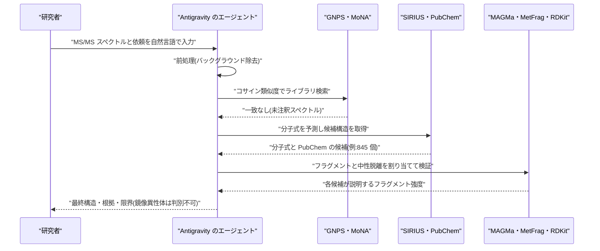
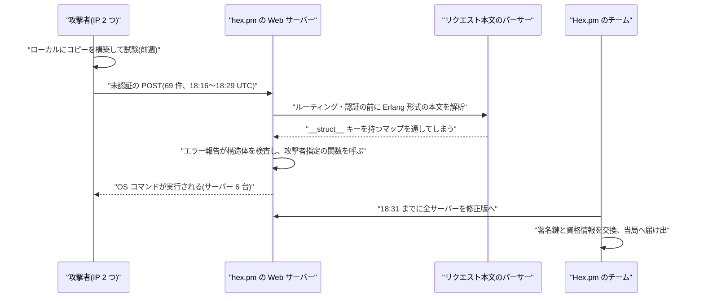

# LLM・AI Agent 最新情報レポート Vol.205
<!-- x-summary: DeepMindがAntigravity向け質量分析スキルを公開、分子の同定精度は約97% -->

**作成日**: 2026年11月26日(JST)
**対象期間**: 11月25日〜11月26日(Vol.204との差分)。拾い漏れの回収は公開日を明記

## 目次

- [1. Google DeepMind の公式発表](#1-google-deepmind-の公式発表)
  - [1.1 DeepMind が Antigravity 向け「Mass Spec Skills」を公開、100 化合物のベンチマークで同定精度は約 97%](#11-deepmind-が-antigravity-向け-mass-spec-skills-を公開100-化合物のベンチマークで同定精度は約-97)
- [2. OpenAI の顧客事例](#2-openai-の顧客事例)
  - [2.1 Clay が GPT-6 の 3 階層をエージェントの用途別に使い分け、Codex と ChatGPT のプラグインを提供(11月24日)](#21-clay-が-gpt-6-の-3-階層をエージェントの用途別に使い分けcodex-と-chatgpt-のプラグインを提供11月24日)
  - [2.2 Hebbia が GPT-6 Astra で金融リサーチの引用精度と資料作成を評価(11月20日、拾い漏れ回収)](#22-hebbia-が-gpt-6-astra-で金融リサーチの引用精度と資料作成を評価11月20日拾い漏れ回収)
- [3. Azure・Microsoft Foundry の更新](#3-azuremicrosoft-foundry-の更新)
  - [3.1 Foundry の hosted agents を自社 VNet に置いたとき「Agents ページがタイムアウト」する場合の 5 つの確認点(11月21日、拾い漏れ回収)](#31-foundry-の-hosted-agents-を自社-vnet-に置いたときagents-ページがタイムアウトする場合の-5-つの確認点11月21日拾い漏れ回収)
- [4. 開発ツール・フレームワークのリリース](#4-開発ツールフレームワークのリリース)
  - [4.1 Claude Code v2.1.332:MCP サーバー由来のスキル(ベータ)とスキルのシェルコマンドを止めるフック](#41-claude-code-v21332mcp-サーバー由来のスキルベータとスキルのシェルコマンドを止めるフック)
  - [4.2 Google ADK v2.15.1、LangChain の各パッケージ、Codex の alpha](#42-google-adk-v2151langchain-の各パッケージcodex-の-alpha)
- [5. 脆弱性情報](#5-脆弱性情報)
  - [5.1 AI関連](#51-ai関連)
  - [5.2 実行環境](#52-実行環境)
  - [5.3 KVM の AMD 向け use-after-free(CVE-2026-99312):ネスト仮想化の有効時にゲストからホストメモリへ](#53-kvm-の-amd-向け-use-after-freecve-2026-99312ネスト仮想化の有効時にゲストからホストメモリへ)
- [6. セキュリティインシデント](#6-セキュリティインシデント)
  - [6.1 Hex.pm(Elixir・Erlang のパッケージレジストリ)で、未認証の POST から Web サーバー 6 台でコマンドが実行された(CVSS 10.0)](#61-hexpmelixirerlang-のパッケージレジストリで未認証の-post-から-web-サーバー-6-台でコマンドが実行されたcvss-100)
- [7. その他の観点の確認結果](#7-その他の観点の確認結果)
- [8. 未確認情報](#8-未確認情報)
- [9. 確認ログ](#9-確認ログ)
- [10. 参考リンク](#10-参考リンク)

---

## 1. Google DeepMind の公式発表

### 1.1 DeepMind が Antigravity 向け「Mass Spec Skills」を公開、100 化合物のベンチマークで同定精度は約 97%

DeepMind は、質量分析(MS/MS)のスペクトルから低分子の構造を同定する「Mass Spec Skills」を、エージェント開発環境 Google Antigravity 向けに公開した。DeepMind の RSS では 11月24日 13:07(UTC)、記事本文の日付は 11月25日で、日付表記が 1 日ずれている。提供形態は Antigravity アプリの Mass Spec プラグインで、企業利用者は「Use Business Account」から Google Cloud の認証情報で使える。DeepMind は最上位の Antigravity 利用枠を 6 か月間無料にして 10,000 人の科学者に提供するとしており、受付はフォーム経由で、資格・容量・選考の条件が付く。[[1]](#ref-1) [[2]](#ref-2)

技術的な中身は、分析化学者の作業手順を 4 段階のスキルにしたものだ。(1) スペクトルの前処理でバックグラウンドを除く、(2) GNPS と MoNA の参照ライブラリをコサイン類似度で検索する、(3) SIRIUS で分子式を予測し PubChem から候補構造を引く、(4) MAGMa や MetFrag でフラグメントと中性脱離を割り当て、RDKit で最終構造を検証する。ユーザーは自然言語で依頼し、エージェントがツールを選んで連鎖させる。事例では、負イオンモードで前駆体 m/z 395.1387 のスペクトルから、分子式 C20H21ClN6O(誤差 −1.5 ppm)を予測し、PubChem の 845 個の異性体を採点した。上位候補の複数がフラグメント強度の 97.7%(19 ピーク中 14 本)を同じように説明したため、HCl と HNCO の脱離が示すウレア結合を持たない候補を除外し、5 つのウレア位置異性体に絞って、二次フラグメントから CID 137835447 を選んだ。

ベンチマークは、Enamine REAL の MS/MS コレクション(MoNA 収載)から 100 化合物を選び、1 化合物あたり 3 回試行し、Gemini 3.8 Flash(軽量)、Gemini 4 Argon、Gemini 4 Carbon(最上位の 2 モデル)で測った。インターネットもスキルも無い条件では全モデルの正解率が 4% 未満、インターネットのみだと上位 2 モデルでも全体の 4 分の 1〜3 分の 1 を外し、Flash は 4 分の 3 超を外した。インターネットと Mass Spec Skills を併用すると、全モデルが約 97% の完全一致となり、Flash が上位モデルに並んだ。スキルによって 1 試行あたりの生成トークンも、Flash で約 4 分の 1、Argon で半分、Carbon で約 5 分の 1 に減った。1 時間の予算を超えた試行は失敗として数える。

留意点として、鏡像異性体や近縁の異性体は LC-MS/MS だけでは区別できず、保持時間、イオンモビリティ、NMR が要る。データベースに無い新規分子は確定できず、予測分子式やピーク割り当てを化学者への出発点として返すにとどまる。97% は、スペクトルが MoNA に収載された既知化合物のテストで、数値は DeepMind の自社評価である。エージェント設計の観点では、軽量モデルに手順化したスキルを持たせると上位モデルとの差が縮むという、前週の Tool Retrieval(Vol.202)と同じ「文脈に何を持たせるか」の話として読める。

---

## 2. OpenAI の顧客事例

### 2.1 Clay が GPT-6 の 3 階層をエージェントの用途別に使い分け、Codex と ChatGPT のプラグインを提供(11月24日)

OpenAI は 11月24日、営業向けデータ基盤を提供する Clay の事例を公開した。Clay は「レコード(企業・人物のリスト)→ エンリッチ(エージェントによる情報付与)→ プレイ(営業施策)」の流れで構成され、モデルは GPT-6 の 3 階層を用途で使い分ける。主力は Sol、難しい課題は Astra、コスト重視の処理は Luna である。Claygent(調査・見込み判定・エンリッチ・シグナル検知を担う)と、他のエージェントを調整するワークフロー構築エージェントを OpenAI のモデルで動かし、Responses API を通じて価格帯の違うモデルを 1 つの窓口で扱っている。[[3]](#ref-3)

新しい提供物は、Codex と ChatGPT のプラグインである。構築担当者は Codex 上で営業施策を作って実行でき、営業担当者は自社システムのデータと公開データを組み合わせて取引先を調べられる。ChatGPT のプラグインは同じ顧客データを ChatGPT に持ち込む。ページに数値の成果(割合、売上、時間削減)は載っておらず、「大成功」「上位の営業担当者ほど力を得た」という定性的な記述にとどまる。Head of AI の Jeff Barg 氏は、GPT-6 Astra がコードの作成、テストの追加と実行、プルリクエスト用の動画記録までこなし、手作業での確認が減ったと述べている。今後の計画として、GPT-Live-1 による音声での製品デモ、エージェントが見込み客に製品を説明するインバウンド営業の機能、Decisions API との統合が挙げられている。

示唆は、同一製品の中で「安い階層に大量処理、高い階層に難所」を振り分ける設計が、顧客事例の標準形になりつつある点である。Vol.204 の iFood の事例(GPT-5.6 Luna で 1 回あたり平均 0.04 ドル)も同じ考え方だった。ただし本件はベンダーが公開した事例で、第三者による検証や数値は無い。

### 2.2 Hebbia が GPT-6 Astra で金融リサーチの引用精度と資料作成を評価(11月20日、拾い漏れ回収)

OpenAI は 11月20日、金融リサーチ向けツール Matrix を提供する Hebbia の事例を公開した。Matrix は回答を根拠の資料に結びつけるツールで、約 2,000 ファイルのデータルームを例に、GPT-6 Astra が回答を支える資料や Matrix のセルを選び、その分析を利用者の構成とテンプレートに沿った PowerPoint のスライドにする。引用から元資料の該当箇所が開き、スライドの脚注も出典にリンクする。[[4]](#ref-4)

Hebbia の自社評価(2026年8〜9月にプレリリース版で実施、同じ金融リサーチの課題と採点基準を全モデルに使用、基準は分野の専門家が作成または元資料と照合)では、必要な出典の種類を引用する項目で最良の他モデルを 13.6 ポイント上回り、引用された抜粋の 99.5% が質問に関連していた。プレゼン要件は 97.9% を満たし、最良の他モデルを 14.4 ポイント上回った。指示追従とプレゼンの質の両方で首位になったモデルは他に無かったとされる。技術的な構成は、上記のコンポーネント以外には書かれていない。評価は Hebbia が実施し、比較対象のモデル名と件数は公開されていない。引用先を開ける作りは、監査が必要な業務(財務・法務)でエージェントを入れる際の要件の例として参考になる。

---

## 3. Azure・Microsoft Foundry の更新

### 3.1 Foundry の hosted agents を自社 VNet に置いたとき「Agents ページがタイムアウト」する場合の 5 つの確認点(11月21日、拾い漏れ回収)

Microsoft の Foundry ブログは 11月21日、hosted agents を自社の仮想ネットワーク(BYO VNet)に閉じて運用する際の定番の不具合を整理した記事を公開した。金融機関の想定構成(パブリックアクセス無効、スポーク VNet にエージェント用サブネット、Cosmos DB・Storage・AI Search はプライベートエンドポイント経由で一部ハブ VNet、TLS 検査をするファイアウォール)で、デプロイは成功するのに Agents ページが「Listing agents timed out」(`400 invalid_configuration`)になる、という事例である。基本の主張は、エージェント用サブネットが必要なすべてのリソースを名前解決でき、到達できなければならないというもので、原因の大半は DNS だとされる。[[5]](#ref-5)

5 つの確認点は次のとおり。(1) サブネットの特定:Foundry アカウントの `networkInjections` プロパティを Azure CLI で調べ、`Microsoft.App/environments` への委任、本番は /24 以上(最小 /27)、ピアリング先と重ならない RFC 1918 の範囲、Foundry リソースごとの専用サブネット、`legionservicelink` のサービス関連付けリンクを確認する。ネットワーク注入はアカウント作成時にしか設定できず、既存アカウントには追加できない。(2) タイムアウトの診断:サブネットのデータプロキシが BYO の Cosmos DB に時間内に届かないのが主因で、`Sql` のプライベートエンドポイントの承認、`privatelink.documents.azure.com` ゾーンのエージェント VNet へのリンク、アカウントと各リージョンの A レコード、カスタム DNS から `168.63.129.16` または Azure DNS Private Resolver への転送を確認し、VNet 内の VM から `nslookup` でプライベート IP が返るかを調べる。(3) Entra のサインインと TLS 検査:プライベート CA の信頼は、プラットフォーム自身の Entra ID とマネージド ID の通信には効かないため、これらのホストを TLS 検査から除外し、ファイアウォールと NSG で許可する。(4) ピアリングしたハブ VNet:経路表はトラフィックをファイアウォールに通す場合のみ必要で、ハブにだけリンクした DNS ゾーンはスポークでは解決されない。(5) `DelegatedSubnetInUse`:論理削除したアカウントがエージェント環境とサブネットを保持し続けるため、パージ(Cognitive Services Contributor またはサブスクリプションの Contributor が必要で元に戻せない)が要る。

その他の注意として、プライベートエンドポイントに `192.168.0.0/24` を使うと内部のサンドボックス網と重なり「No route to host」になりうる。Foundry リソースと VNet は同一リージョンが必要で、Cosmos DB・Storage・Search は別リージョンでもよい。ポータルはサブネットの IP 使用量を表示しないので、`429 subnet_exhausted` やデータプロキシの 5xx を監視する必要がある。Vol.203 で掲載した「egress 制御 GA、同時セッション数の拡大」と合わせ、hosted agents を閉域で本番運用する場合の落とし穴の一覧として使える。ブログ記事であり、公式ドキュメントの更新ではない点には留意したい。

---

## 4. 開発ツール・フレームワークのリリース

### 4.1 Claude Code v2.1.332:MCP サーバー由来のスキル(ベータ)とスキルのシェルコマンドを止めるフック

Claude Code v2.1.332 が 11月25日に公開された。新機能は 3 つで、MCP サーバーが提供するスキルが `/` メニューに `server:skill` の形で並ぶ(ベータ)、スキルの読み込み時に埋め込まれたシェルコマンドを拒否できる `PreSkillShellCommand` フックのイベント、SendUserMessage で送ったテキスト用の OpenTelemetry `assistant_response` イベントである。[[6]](#ref-6)

修正では、`claude auth login` が資格情報を保存できなかったとき成功と表示せず終了コード 1 で終わるようになった。名前付きパイプに対する Read、@ メンション、コンパクションがハングしないよう、読み取りが 20 秒で失敗する。フックが無制限に出力した場合などのフリーズや、SSE の MCP サーバーがイベントストリームの切断から復帰する点も直った。Bedrock Mantle では Sonnet のエイリアスが Haiku 4.5 ではなく Sonnet 5 を指すようになった。直前の v2.1.331 で告知された、11月30日から管理設定の `extraKnownMarketplaces` にあるプラグインのマーケットプレイスが既定で自動更新される変更(止めるには `"autoUpdate": false`)も近づいている。

意味合いは、スキルを MCP 経由で配る経路が増えるので、スキルに埋め込まれたシェルコマンドの審査点(`PreSkillShellCommand`)が運用上の管理点になる点である。チームでスキルを共有している場合は、このフックで拒否ルールを置くか、自動更新を止めるかを 11月30日までに決めておきたい。この節はリリースページの要約に基づき、全変更点の網羅ではない。

### 4.2 Google ADK v2.15.1、LangChain の各パッケージ、Codex の alpha

Google ADK(Python)v2.15.1 が 11月25日に出た。Claude のサンプリング設定が Anthropic SDK の 1.x と 2.x の両方で動くようになり、`RemoteA2aAgent` のストリーミング出力の永続化は不完全な状態を避けるため元に戻された。Apigee ツールが非オブジェクトの引数で呼ばれた場合にエラーが分かりやすくなり、動的インストラクションの制御が一時的な指示を正しく追跡する。LangChain では langchain-core 1.8.5(11月25日)がストリーミングで後続チャンクがプロバイダのメッセージ ID を再利用するよう直し、langchain-anthropic 1.7.13(同日)がカスタムの HTTP・SDK クライアントに対応した。OpenAI Codex は 0.172.0(11月24日、Vol.204 掲載済み)が最新の正式版で、0.174.0 の alpha.4〜alpha.6(11月24〜25日)が出ているが、リリースノートの記載は無い。いずれも小さな保守的リリースで、既報の v2.15.0 や langchain 系の Python 3.10 切り捨てからの続報にあたる。[[7]](#ref-7) [[8]](#ref-8) [[9]](#ref-9)

---

## 5. 脆弱性情報

### 5.1 AI関連

| CVE / ID | 対象製品・影響バージョン → 修正 | CVSS | 種類・影響 | 悪用状況 | 推奨対応 |
|---|---|---|---|---|---|
| — | — | — | 新情報なし | — | — |

GitHub Advisory Database の npm の Critical 一覧では、11月25日の公開は `@waline/client` の保存型 XSS(CVE-2026-64670)のみで AI 関連ではなく、AI 関連の最新は 11月24日の ruflo(Vol.204 で掲載済み)だった。pip の Critical の一覧は 11月20日の jupyter-mcp-server(Vol.201 で掲載済み)が最新で、11月24〜26日の新規は無かった。[[10]](#ref-10)

### 5.2 実行環境

| CVE / ID | 対象 | CVSS | 種類・影響 | 悪用状況 | 推奨対応 |
|---|---|---|---|---|---|
| CVE-2026-99312 | Linux カーネル(KVM、AMD の SVM・ネスト仮想化)。影響バージョン・修正は Red Hat のページに記載なし | 7.8(Red Hat、CVSS 3.1)。cve.org は 8.8、NVD は未評価。いずれも暫定 | KVM の use-after-free。ゲストからホストメモリへの読み書きにつながりうる(5.3 参照) | KEV 掲載・PoC の確認なし(不明) | ネスト仮想化を無効化(5.3 参照)、修正カーネルの到着を確認 |
| Node.js | Node.js 本体 | — | 新情報なし | — | 公式のセキュリティリリースの最新は 11月11日(現行 LTS は v26.13.1) |
| Python | CPython、pip | — | 新情報なし | — | — |

Ubuntu のセキュリティ通知の RSS には 11月24〜25日分として Kerberos(USN-9202-1、CVE 19 件)、Expat(USN-9196-1、CVE 10 件)、elfutils、NVIDIA 向け Linux カーネル(USN-9192-1)などがあったが、フィードに重要度が含まれず、基準(CVSS 7.0 以上、悪用確認、High 以上の公式アドバイザリ)を個別に確認できなかったので表には載せていない。[[11]](#ref-11)

### 5.3 KVM の AMD 向け use-after-free(CVE-2026-99312):ネスト仮想化の有効時にゲストからホストメモリへ

Red Hat の CVE ページによると、Linux カーネルの KVM(AMD x86)で、ネスト仮想化が有効なとき、ページング無効での INIT リセットをエミュレートする際にネストのページテーブル(NPT)のポインタがリセットされない。解放された NPT のページが再割り当てされると、ゲスト VM 内の攻撃者がページテーブルのエントリを偽造し、ホストのメモリを読み書きできる可能性がある。弱点の種別は CWE-825(失効ポインタの参照)である。Red Hat のスコアは 7.8(`CVSS:3.1/AV:L/AC:H/PR:L/UI:N/S:C/C:H/I:H/A:H`)、cve.org は 8.8、NVD は N/A で、いずれも暫定とされている。[[12]](#ref-12)

成立条件は、AMD ハードウェアの KVM ホストでネスト仮想化が有効であることで、ネスト仮想化を使わない構成や Intel の KVM は影響を受けない。Red Hat のページには修正や erratum は載っておらず、緩和策として、`/sys/module/kvm_amd/parameters/nested` で状態を確認し、全 VM を止めて `modprobe -r kvm_amd` のあと `modprobe kvm_amd nested=0` で無効化し、永続化するには `/etc/modprobe.d/` に `options kvm_amd nested=0` を置く手順が示されている。公開日はページに記載が無く、カーネルのメーリングリストのリンクから 11月18日前後と推測されるが、これは推測である。優先度は、マルチテナントの AMD ホストで、ネスト仮想化(たとえば CI や開発用の VM 基盤)を使っている場合は高い。The Hacker News の見出し一覧にも同名の話題があったが、本文は読めていない。悪用の報告は確認できていない。

---

## 6. セキュリティインシデント

### 6.1 Hex.pm(Elixir・Erlang のパッケージレジストリ)で、未認証の POST から Web サーバー 6 台でコマンドが実行された(CVSS 10.0)

Hex.pm は 11月24日付のブログ「Security incident on hex.pm」で、11月23日(月曜)に第三者が脆弱性を使って Web サーバー上でコマンドを実行したと公表した。トラフィックを遮断して 20 分以内に修正をデプロイし、直後に同じ脆弱性の報告を受けた。The Hacker News(11月25日付)が詳細を伝えており、CVE は CVE-2026-129514、CVSS は 10.0 である。以下の技術的な経緯は主に同記事による。[[13]](#ref-13) [[14]](#ref-14)

原因は、Erlang のデータ形式のリクエスト本文を解析するパーサーが、ルーティングと認証の前に動くため、サイトのどのアドレスへの未認証の POST でも到達できたことにある。デコーダーは関数などの危険な項を拒否していたが、`__struct__` キーを持つマップは通したので、リクエスト本文が読み込み済みの任意の Elixir の構造体になりすませた。細工した構造体がエラーを起こし、エラー報告のコードがその構造体を調べる過程で Ecto と DBConnection のライブラリを経由して攻撃者が選んだ関数が呼ばれ、レジストリのサービスアカウントの権限で OS コマンドが動いた。安全確認が外されたのは 2016年2月23日で、そこから修正までこの欠陥があった。修正は、`__struct__` キーを持つマップを含む項をデコーダーが拒否する方式である。時系列(UTC)は、前の週の後半に 2 つの IP が自前のコピーで試験したとみられる活動があり、月曜 18:16〜18:29 にロードバランサーのログで 69 件の攻撃リクエストが 2 つのアドレスから記録され、6 台の Web サーバーにファイルが現れ(うち 1 台はリクエストの 3 ミリ秒後)、再起動で脆弱なビルドの機械が加わった 3 台もあった。18:31 に全サーバーが修正版になり、19:07 に別の報告者から同じ欠陥のメールが届いた。

影響の範囲として、攻撃中に公開された 23 件のリリースは監査ログと一致し、古いリリースの改変も無かったとされる。一方、データベースの読み取り、シェルコマンド、環境変数のアクセスはログに残らず、メールアドレス、パスワードのハッシュ、API キーのハッシュ、2 要素認証の秘密情報、セッション情報を読まれた可能性は排除できない。非公開パッケージの読み取りも痕跡なしに起こりうる。常駐の痕跡や新規アカウントは見つかっていない。ユーザーへの案内は、アカウント保持者はパスワードを変更し 2 要素認証を再設定して再ログインすること(`mix hex.user auth` または `rebar3 hex user auth`)、数日以内に出る Hex クライアントの更新(新しいレジストリ署名方式を導入)を適用すること、それまでは repo.hex.pm からのみ取得しサードパーティのミラーを避けること、Hex 関連のメールのリンクが hex.pm か確かめることである。API キーはランダムな 128 ビット値で HMAC-SHA256 のハッシュとして保存されているため交換不要とされ、レジストリの署名鍵は記事の時点で未交換だった。同じ原因類型(未信頼データから構造体を作る)の別件として、ash(CVE-2026-124283、3.38.0 で修正)、db_connection(CVE-2026-133555、2.10.3)、flop(CVE-2026-130411、0.26.7 ほか)も同時期に公開されている。自社でレジストリを運用している場合はパッチを当てるまで影響を受ける。

---

## 7. その他の観点の確認結果

- **Google Cloud**: リリースノートのフィードの最新は 11月24日。11月24日分に BigQuery の ML.TREND、ML.SEASONALITY、ML.DETECT_CHANGE_POINTS、ML.CORRELATION の GA、embeddinggemma-300m(AI.EMBED・AI.SIMILARITY)の GA、Knowledge Catalog の Data Agent Kit の curate-context スキル(プレビュー)などがあった。エージェント基盤に直結する新規は無く、本文には載せていない。[[15]](#ref-15)
- **Google・DeepMind**: DeepMind のブログの最新は 11月24日(本号 1.1)、blog.google の最新は 11月24日の Golden State の事例記事で、技術的な新情報は無かった。[[2]](#ref-2) [[16]](#ref-16)
- **OpenAI**: RSS の最新は 11月24日。顧客事例として Clay と Hebbia を本号に載せた。Intentful、Richpanel などの顧客事例は読めておらず載せていない。11月19日の「Deploying Daybreak Red」(監督付きのセキュリティ調査の参照アーキテクチャ)は、本文が PDF のみで読めなかったため本号では扱わない(未確認情報を参照)。[[17]](#ref-17)
- **Anthropic**: ニュースページの最新は 11月20日の IPO クロージングで新規なし。Claude Platform のリリースノートの最新は 11月23日で、Claude Opus 4.5 の API からの廃止予定(2027年1月22日、移行先は Opus 5.5)や Enterprise Frontier Safeguards(ベータ)があった。Claude Code は本号 4.1 のとおり。[[18]](#ref-18) [[19]](#ref-19)
- **Azure・Foundry**: Azure Updates の RSS は取得できたが「0 Updates found」で 11月25日以降の項目を確認できなかった。Foundry ブログの最新は 11月21日(本号 3.1)。[[20]](#ref-20)
- **CISA KEV**: 11月25日の追加は、Mitel MiCollab の 5 件(CVE-2026-133323、-133303、-133311、-133275、-133324)、Danfoss AK-SM 800A の 3 件、Vates Xen Orchestra(CVE-2026-133469)、HPE の Juniper Session Smart Conductor・Router(CVE-2026-103406)で、カタログのページで確認した。対象は AI 関連でも本号の実行環境(Python・Node.js・Linux)の範囲でもなく、NVD などでの個別確認を行っていないので詳細は載せない。[[21]](#ref-21)
- **MCP・Google ADK・LangChain・Claude Code**: 本号 4.1・4.2 のとおり。MCP の仕様の更新は確認できなかった(Vol.204 時点で最新は 2026-07-28 版)。
- **セキュリティインシデント(AI 関連)**: 本号 6.1 は AI 関連ではない。The Hacker News の見出しに、Microsoft の agent-framework の PyPI パッケージの侵害(バージョン 1.26.1・1.26.2、11月17日公開)があり、BleepingComputer(11月18日付)の本文を読めた。公開日が対象外(7日超)でこれまでのレポートにも載っていないため、本号では本文化していない。次号以降で、Microsoft の事後報告の有無とあわせて扱うかを検討する。
- **AI Agent 搭載の SaaS 製品**: Clay と Hebbia の事例(本号 2.1・2.2)のほか、新規の一次情報は確認できなかった。

---

## 8. 未確認情報

- **Check Point 管理サーバー 24 台の侵害(GreyNoise の GT13、「AI 駆動の疑い」)**: The Hacker News(11月25日付)の本文は読めたが、GreyNoise の一次報告と Check Point のアドバイザリを開けておらず、他媒体の本文も読めていない。「AI 駆動」は GreyNoise の推測と記事にある。AI 関連の観点でもあるため、次回に一次情報を探す。
- **GeoServer の脆弱性 2 件の悪用(CVE-2026-120705、CVE-2026-129243)**: The Hacker News(11月25日付)の本文のみで、watchTowr の報告と GeoServer のアドバイザリは未取得。AI 関連・実行環境の範囲外でもあるため本文には載せていない。
- **OpenAI「Deploying Daybreak Red」(11月19日)**: ページは開けたが、本文は PDF のみで内容を読めなかった。
- **Ubuntu の USN-9202-1(Kerberos)ほか**: RSS に重要度が無く、基準への該当を確認できなかった。
- **Hex.pm の CVE-2026-129514 の NVD・GHSA での確認**: 未実施。Hex.pm 公式ブログと The Hacker News で確認した。
- **agent-framework(PyPI)の侵害の一次情報(StepSecurity、Socket、GitHub issue)**: 未取得。BleepingComputer の本文のみ。

---

## 9. 確認ログ

| 情報源 | 試したURL・手段 | 結果 | 確認できた最新の更新日 |
|---|---|---|---|
| OpenAI | openai.com/news/rss.xml、顧客事例(clay-plugins-openai、hebbia、deploying-daybreak-red) | 取得成功(Daybreak Red は本文が PDF のみ) | 11月24日 |
| Anthropic | anthropic.com/news、platform.claude.com/docs/en/release-notes/overview、github.com/anthropics/claude-code/releases | 取得成功(docs.claude.com は 301 でリダイレクト先を取得) | 11月20日(ニュース)、11月23日(API)、11月25日(v2.1.332) |
| Google DeepMind | deepmind.google/blog/rss.xml、記事ページ | 取得成功 | 11月24日(RSS)、記事は 11月25日表記 |
| Google | blog.google/technology/ai/rss/ | 取得成功 | 11月24日 |
| Gemini API | ai.google.dev/gemini-api/docs/changelog | 301 でリダイレクト。リダイレクト先の aistudio.google.com/docs/changelog は取得を試みておらず未確認 | 不明 |
| Google Cloud | docs.cloud.google.com/feeds/gcp-release-notes.xml | 取得成功(先頭部分のみ。cloud.google.com 側は 301) | 11月24日 |
| Azure | azure.microsoft.com/en-us/updates/feed/(クエリ付きも) | 取得はできたが「0 Updates found」 | 不明 |
| Foundry | devblogs.microsoft.com/foundry/、各記事(VNet、Toolboxes、Dev Pack) | 取得成功 | 11月21日 |
| OpenAI SDK | github.com/openai/codex、openai-agents-python のリリース | 取得成功 | 11月25日(alpha)、11月24日(正式版) |
| Google ADK / LangChain | github.com/google/adk-python、langchain-ai/langchain のリリース | 取得成功 | 11月25日 |
| GitHub Advisory | github.com/advisories(pip・npm の Critical) | 取得成功 | 11月25日(npm)、11月20日(pip) |
| CISA | cisa.gov/known-exploited-vulnerabilities-catalog | 取得成功(先頭 20 件) | 11月25日追加分 |
| Node.js | nodejs.org/en/blog/vulnerability | 取得成功(一覧のみ) | 11月11日 |
| Ubuntu | ubuntu.com/security/notices/rss.xml | 取得成功(重要度なし) | 11月25日 |
| Red Hat | access.redhat.com/security/cve/CVE-2026-99312 | 取得成功 | 日付の記載なし |
| NVD | nvd.nist.gov/vuln/detail/CVE-2026-133469 | 取得はできたが本文なし | 不明 |
| Hex.pm | hex.pm/blog、thehackernews.com の記事 | 取得成功 | 11月24日(公式)、11月25日 |
| The Hacker News | トップページ、各記事 | 取得成功(feeds.feedburner.com は名前解決失敗、darkreading.com と helpnetsecurity.com も名前解決失敗) | 11月25日 |
| BleepingComputer | agent-framework の記事、Cursor の記事 | 取得成功 | 11月14日、11月18日 |
| Microsoft agent-framework | github.com/microsoft/agent-framework | 本号では再試行せず(Vol.204 時点で 404) | 不明 |

---

## 10. 参考リンク

- **[1]** [Mass Spec Skills for Google Antigravity(From spectrum to structure) | Google DeepMind](https://deepmind.google/blog/interpreting-mass-spectra-with-google-antigravity/)
- **[2]** [DeepMind Blog RSS | Google DeepMind](https://deepmind.google/blog/rss.xml)
- **[3]** [Clay helps sales teams win with Codex and ChatGPT | OpenAI](https://openai.com/business/customer-stories/clay-plugins-openai)
- **[4]** [Hebbia sees improvements in financial research with GPT-6 Astra | OpenAI](https://openai.com/business/customer-stories/hebbia)
- **[5]** [Hosted agents in your own virtual network: five checks when the Agents page times out | Microsoft Foundry Blog](https://devblogs.microsoft.com/foundry/hosted-agents-private-network-setup/)
- **[6]** [Releases(v2.1.332、v2.1.331、v2.1.330) | anthropics/claude-code(GitHub)](https://github.com/anthropics/claude-code/releases)
- **[7]** [Releases(v2.15.1) | google/adk-python(GitHub)](https://github.com/google/adk-python/releases)
- **[8]** [Releases(langchain-core 1.8.5、langchain-anthropic 1.7.13) | langchain-ai/langchain(GitHub)](https://github.com/langchain-ai/langchain/releases)
- **[9]** [Releases(0.174.0-alpha.4〜6、0.172.0) | openai/codex(GitHub)](https://github.com/openai/codex/releases)
- **[10]** [GitHub Advisory Database(npm・pip の Critical) | GitHub](https://github.com/advisories?query=type%3Areviewed+severity%3Acritical+ecosystem%3Anpm)
- **[11]** [Ubuntu Security Notices RSS | Ubuntu](https://www.ubuntu.com/security/notices/rss.xml)
- **[12]** [CVE-2026-99312 | Red Hat Customer Portal](https://access.redhat.com/security/cve/CVE-2026-99312)
- **[13]** [Security incident on hex.pm | Hex.pm Blog](https://hex.pm/blog)
- **[14]** [Hackers Exploited CVSS 10.0 Hex.pm RCE Flaw to Compromise 6 Package Registry Servers | The Hacker News](https://thehackernews.com/2026/11/hackers-exploited-cvss-100-hexpm-rce.html)
- **[15]** [Google Cloud Release Notes フィード | Google Cloud](https://docs.cloud.google.com/feeds/gcp-release-notes.xml)
- **[16]** [Google AI ブログ RSS | blog.google](https://blog.google/technology/ai/rss/)
- **[17]** [OpenAI News RSS | OpenAI](https://openai.com/news/rss.xml)
- **[18]** [Anthropic News | Anthropic](https://www.anthropic.com/news)
- **[19]** [Claude Platform release notes | Anthropic](https://platform.claude.com/docs/en/release-notes/overview)
- **[20]** [Microsoft Foundry Blog | Microsoft](https://devblogs.microsoft.com/foundry/)
- **[21]** [Known Exploited Vulnerabilities Catalog | CISA](https://www.cisa.gov/known-exploited-vulnerabilities-catalog)
