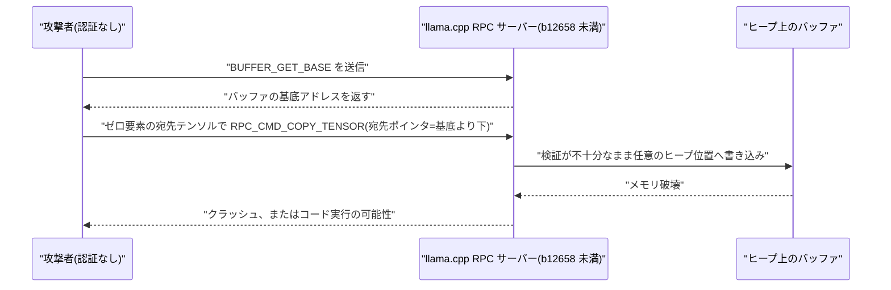

# LLM・AI Agent 最新情報レポート Vol.206
<!-- x-summary: llama.cppのRPCサーバーに認証不要の書き込み欠陥、CVSS 9.3(b12658で修正) -->

**作成日**: 2026年11月27日(JST)
**対象期間**: 11月26日〜11月27日(Vol.205との差分)。新規の公式発表が少ない日のため、件数は絞り、1件ごとの深さを優先した

## 目次

- [1. Google Cloud の更新](#1-google-cloud-の更新)
  - [1.1 Google Cloud リリースノート(11月25〜26日):Airflow に「エージェントによるアップグレード事前確認」、BigQuery のクロスクラウド接続が GA](#11-google-cloud-リリースノート11月2526日airflow-にエージェントによるアップグレード事前確認bigquery-のクロスクラウド接続が-ga)
- [2. 脆弱性情報](#2-脆弱性情報)
  - [2.1 AI関連](#21-ai関連)
  - [2.2 実行環境](#22-実行環境)
  - [2.3 llama.cpp の RPC サーバーに、認証なしで任意のヒープ位置へ書き込める欠陥(CVE-2026-137567、CVSS 9.3)](#23-llamacpp-の-rpc-サーバーに認証なしで任意のヒープ位置へ書き込める欠陥cve-2026-137567cvss-93)
  - [2.4 nanobot の Codex プロバイダが TLS 検証を無効にして再試行する(CVE-2026-137463)](#24-nanobot-の-codex-プロバイダが-tls-検証を無効にして再試行するcve-2026-137463)
- [3. その他の観点の確認結果](#3-その他の観点の確認結果)
- [4. 未確認情報](#4-未確認情報)
- [5. 確認ログ](#5-確認ログ)
- [6. 参考リンク](#6-参考リンク)

---

## 1. Google Cloud の更新

### 1.1 Google Cloud リリースノート(11月25〜26日):Airflow に「エージェントによるアップグレード事前確認」、BigQuery のクロスクラウド接続が GA

Google Cloud のリリースノートのフィードに、11月26日付で Managed Service for Apache Airflow の「agentic upgrade check」が載った。アップグレード前に Google Cloud コンソールで実行すると、選択した Airflow のビルドまたはイメージのバージョンに移る際に、DAG にどんな変更が必要になるかを示す機能である。提供段階(プレビューか GA か)はリリースノートに記載がなく、エージェントがどのモデル・仕組みで DAG を解析するのかも書かれていない。同じ Airflow については 11月24日に、12月から新しいイメージで `ray_dist.jar` が同梱されなくなること、新しい Gen 3 ビルドと Gen 2 バージョンが Python 3.12 に切り替わり 3.11.8 は新バージョンで提供されなくなる(既存環境は更新まで 3.11.8 のまま)ことも告知されており、バージョンアップの影響確認を自動化する動きと対になっている。[[1]](#ref-1)

11月25日には、BigQuery のクロスクラウド接続が全 BigQuery リージョンから AWS、Azure、Salesforce Data 360 に対して使える GA 機能として載った。リリースノートは「標準の BigQuery Omni 接続より多くの機能に対応する」と書いている。同じ日に BigQuery Storage API v1beta1 の廃止も告知され、アクセスは 11月20日に「2026年3〜8月に利用実績のあるプロジェクト」へ制限済みで、完全な停止は 2027年8月31日である。v1 は後方互換とされ、v1beta1 を直接呼ぶコネクタやカスタムコードは移行が必要になる。Compute Engine では、オンデマンド予約の作成時にコンソールから、予約資源に一致するハードウェア基盤のコミットメントを購入・紐付けでき、確約利用割引が適用される(GA)。[[1]](#ref-1)

Linux の観点では、Container-Optimized OS の 4 イメージ(cos-125-19216-801-82、cos-129-19506-625-71、cos-121-18867-652-94、新規の cos-133-19999-44-277)が 11月25日に公開された。cos-133 はカーネル 6.18.60 で、TCP 輻輳制御の整数オーバーフロー修正と、Go、containerd、OpenSSH、libuv、glibc などの多数のセキュリティ修正を含む。GKE ノードなどで COS を使う場合の更新対象になる。ただしリリースノートは個別の CVE 番号を挙げておらず、重大度は本号では確認できていない。以上は本文が読めたフィードの先頭部分(約 10 万字)に基づく。エージェント基盤に直結する発表は Airflow の 1 件のみで、機能の中身は公式の詳細ページを開けておらず、フィードの記述の範囲にとどまる。

---

## 2. 脆弱性情報

### 2.1 AI関連

| CVE / ID | 対象製品・影響バージョン → 修正 | CVSS | 種類・影響 | 悪用状況 | 推奨対応 |
|---|---|---|---|---|---|
| CVE-2026-137567(GHSA-8fqh-8p37-cc5h) | llama.cpp b11450 以上 b12658 未満 → b12658 | 9.3(v4.0) | ggml RPC サーバーの範囲外書き込み(CWE-787)。認証なしで任意のヒープ位置へ書き込め、クラッシュまたはコード実行の可能性(2.3 参照) | KEV・悪用は不明。PoC の公開は未確認 [[2]](#ref-2) | b12658 以降へ更新。RPC サーバーを信頼できないネットワークに公開しない |
| GHSA-mxwj-93g9-cc5r(CVE-2026-137463) | nanobot-ai(pip)0.1.4〜0.4.0 → 0.4.1 | GitHub のリポジトリ側は High、NVD 登録は 9.1(v4.0) | OpenAI Codex プロバイダが TLS 検証失敗後に検証なしで再試行(CWE-295)。中間者にトークンと内容を奪われる(2.4 参照) | 不明 [[5]](#ref-5) [[6]](#ref-6) | 0.4.1 以降へ更新してゲートウェイを再起動 |
| GHSA-w4m3-qhx8-c649(CVE-2026-137547) | Coder(Go)2.39.0 は 2.39.1、2.38.x は 2.38.7、2.37.x は 2.37.11、2.30〜2.34 は 2.34.19、2.29 以前は 2.29.27 | 8.1(v3.1、リポジトリ側)/ 9.2(v4.0、NVD 登録) | `CODER_PG_AUTH=awsiamrds` 利用時、DB に接続できない間、API の応答に一時的な DB パスワード(有効 15 分)が含まれる(CWE-209)。Coder は AI コーディングエージェントの実行環境としても使われる | 不明 [[7]](#ref-7) [[8]](#ref-8) | 該当バージョンへ更新。DB へのネットワーク経路を Coder のみに制限 |

**本文化しない件**: GitHub Advisory Database の Critical 一覧(11月26日公開分)には、ToolJet(SSO の認証バイパス、CVSS 9.3)、Budibase、Twenty(招待トークンの取得による管理者参加、9.1)、Parse Server(9.1)、SiYuan などもあったが、AI 関連の製品ではないため表に入れていない。VMware ESXi・Workstation・Fusion の XHCI USB コントローラの範囲外書き込み(CVE-2026-123912、CVSS 9.3、ローカル)も同日の公開で、Broadcom が修正ビルドを出しているが、本号の範囲外で悪用状況も記載がなかった。[[9]](#ref-9) [[10]](#ref-10)

### 2.2 実行環境

| CVE / ID | 対象 | CVSS | 種類・影響 | 悪用状況 | 推奨対応 |
|---|---|---|---|---|---|
| — | Linux(GKE の COS 含む) | — | COS の新イメージ(cos-133 はカーネル 6.18.60)に glibc・OpenSSH などの修正を含むが、CVE 番号と重大度は不明(1.1 参照) | 不明 | COS を使う環境は 11月25日のイメージへ更新 |
| Node.js | Node.js 本体 | — | 新情報なし | — | 公式のセキュリティリリースの最新は 11月11日 [[12]](#ref-12) |
| Python | CPython、pip | — | 新情報なし | — | 11月中の CPython のセキュリティリリースは確認できなかった(未確認情報を参照) |

Ubuntu の RSS には 11月26日付で binutils(USN-9214-1)、libXi(USN-9213-1)、PyJWT(USN-9212-1)、Linux カーネル HWE(USN-9190-2)などがあったが、フィードに重要度が無く、基準を個別に確認できなかったため表には載せていない。CISA KEV の最新追加は 11月25日(Mitel MiCollab、Danfoss、Xen Orchestra、Juniper など)で、本号の対象範囲外である。[[11]](#ref-11) [[13]](#ref-13)

### 2.3 llama.cpp の RPC サーバーに、認証なしで任意のヒープ位置へ書き込める欠陥(CVE-2026-137567、CVSS 9.3)

llama.cpp の ggml RPC サーバーに、範囲外書き込みの脆弱性が 11月26日に NVD と GitHub Advisory Database で公開された。アドバイザリによれば、影響は b11450 以上 b12658 未満で、CVSS v4.0 は 9.3(攻撃元区分はネットワーク、複雑さ低、認証・ユーザー操作不要、機密性・完全性・可用性の影響はいずれも高)。ゼロ要素の宛先テンソルを使うと、未認証のリモート攻撃者が任意のヒープアドレスに書き込める。攻撃者はまず `BUFFER_GET_BASE` でバッファの基底アドレスを読み取り、次に宛先ポインタを基底より下に設定した `RPC_CMD_COPY_TENSOR` を送る。結果はサーバーのクラッシュ、または コード実行の可能性とされる。GitHub 側の「影響バージョン」欄は「不明」で、範囲は説明文による。[[2]](#ref-2)

修正は ggml-org/llama.cpp の PR #32651(11月23日マージ)で、リリース b12658(11月24日)に含まれる。PR の題は「rpc: typed request helpers and a single validation step on the server」で、公式の位置づけはリファクタリングである。クライアントとサーバーが同じ「コマンド→リクエスト/レスポンス構造体」の表を共有し、受信テンソルの検証(不正な op、ブロックサイズの不整合、要素数のオーバーフロー)を 1 か所に集め、`rpc_check_region` が個々のハンドラ内の範囲チェックに代わってテンソルサイズに対して検証する。グラフ構築も 1 パスで、未知・重複の ID、順序の乱れた入力、バッファ外のビューを拒否する。通信フォーマットは変更されない。PR 本文は「vulnerability」という語を使っておらず、CVE との対応は NVD の登録情報と、下流のフォークのコミットメッセージ(PR のページ経由で確認)に基づく。関連する別 PR #32925(GET_ROWS 経由の認証前 OOB 書き込み)も開かれており、RPC サーバーには検証漏れがほかにも残っている可能性がある。[[3]](#ref-3) [[4]](#ref-4)

影響が出るのは、`rpc-server` を起動して外部から接続できる状態にしている環境である。RPC バックエンドは複数マシンの GPU やメモリに推論を分散させる用途で使われ、認証の仕組みが無いため、プライベートネットワーク内でも他のホストから書き込みを許すことになる。優先度は、RPC サーバーを LAN の外、またはマルチテナントのネットワークに出している場合は高く、ローカル専用なら低い。対応は b12658 以降への更新と、RPC のポートを推論クライアントのホストだけに制限することである。なお b12658 は GitHub 上で pre-release 表示になっており、安定版タグの扱いは今後変わる可能性がある。Vol.201 の GGUF パーサの欠陥とは別件である。

### 2.4 nanobot の Codex プロバイダが TLS 検証を無効にして再試行する(CVE-2026-137463)

HKUDS が公開する軽量エージェント nanobot(pip パッケージ名は nanobot-ai)の 0.1.4〜0.4.0 に、OpenAI Codex プロバイダが認証付きリクエストで TLS 証明書の検証に失敗すると、証明書とホスト名の検証を切って再試行する欠陥があった。通信経路上の攻撃者が証明書エラーを起こさせてエンドポイントになりすませば、ベアラートークンやリクエスト内容を奪い、応答を改ざんできる。修正は 0.4.1 で、TLS 検証を有効のままにし、無効での再試行をやめた。リポジトリ側のアドバイザリ(GHSA-mxwj-93g9-cc5r)は重大度を High(CWE-295)とし、CVE は未割当と書いているが、GitHub Advisory Database には NVD 登録の CVE-2026-137463(CVSS v4.0 で 9.1)があり、評価が食い違う。なお、同じ記載が NVD 由来の GHSA-v2m6-69vh-pvwr にあり、日付は両方 11月26日である。[[5]](#ref-5) [[6]](#ref-6)

エージェント基盤の実装で見落としやすい「失敗時のフォールバックが安全性を落とす」パターンの例である。社内プロキシが独自 CA を使う環境では証明書エラーが起きやすく、この実装ではそのたびにトークンが検証なしの経路に流れる。0.4.1 以降へ更新して再起動し、自社 CA が必要な場合はプロジェクトの troubleshooting の手順で信頼する CA を設定する。悪用の報告は確認できなかった。

---

## 3. その他の観点の確認結果

- **OpenAI**: RSS の最新は 11月24日(Vol.204〜205 で扱った GPT-6 のタンパク質設計、Astra の系外惑星探索、Clay など)。11月22日の「Perplexity and Intelligence」は Vol.202 で掲載済み。Intentful と Richpanel の顧客事例、法務向けの学習記事は未読のため載せていない。[[14]](#ref-14)
- **Google・DeepMind**: DeepMind のブログの最新は 11月24日の Mass Spec Skills(Vol.205 で掲載済み)、blog.google の最新も 11月24日で新規なし。Gemini API の更新履歴は aistudio.google.com が名前解決できず確認できていない。[[15]](#ref-15) [[16]](#ref-16)
- **Anthropic**: ニュースの最新は 11月20日の IPO クロージングで、26日の見出しは空だった。Claude Platform のリリースノートの最新は 11月23日(Vol.205 で言及済み)。Claude Code の最新は v2.1.332(11月25日、Vol.205 で掲載済み)。[[17]](#ref-17) [[18]](#ref-18) [[19]](#ref-19)
- **Azure・Foundry**: Foundry ブログの最新は 11月24日の Ignite 総括(Vol.204 で掲載済み)で、25日以降の新規なし。Azure Updates の RSS は前号に続き内容を確認できなかった。[[20]](#ref-20)
- **エージェントフレームワーク**: Codex は 0.174.0-alpha.6〜8(11月25〜26日、リリースノートは「Release 0.174.0-alpha.N」のみ)で、正式版の最新は 0.172.0。Google ADK の最新は v2.15.1(11月25日)、LangChain は langchain-core 1.8.5 と langchain-anthropic 1.7.13(11月25日)、OpenAI Agents SDK は v0.26.0(11月24日)で、いずれも Vol.204〜205 で掲載済み。MCP 仕様の最新は 2026-07-28 版のままで更新なし。[[21]](#ref-21) [[22]](#ref-22) [[23]](#ref-23) [[24]](#ref-24) [[25]](#ref-25)
- **セキュリティインシデント**: The Hacker News のトップ(11月26日分)に、PolinRider(北朝鮮関連、7,600 超の GitHub リポジトリに汚染、うち 375 件に Python ローダー)、1Password の GitHub アカウント侵害、NuGet の悪意あるパッケージ 13 件などがあるが、いずれも AI・エージェント関連ではなく、本文を読めていないため載せていない。AI 関連の見出しは未確認情報を参照。[[26]](#ref-26)
- **AI Agent 搭載の SaaS 製品**: 新規の一次情報は確認できなかった。

---

## 4. 未確認情報

- **ThreatsDay「10M NGINX Services at Risk, 250+ Malicious Extensions, AI Server Hijacking + 17 More Stories」(11月26日)**: 見出しと概要(AI サーバーの不正利用を含む)を The Hacker News のトップで確認したが、記事の URL を推測で開いたところ 404 で、本文を読めていない。「AI Server Hijacking」の中身は不明。
- **Check Point 管理サーバー 24 台の侵害(AI 駆動の疑い)**: Vol.205 から継続。再度 GreyNoise と Check Point の一次情報を検索したが、該当する報告は見つからなかった(関連しそうな GreyNoise の AI 駆動キャンペーン記事は PaperCut が対象で別件)。
- **CVE-2026-119170(CPython 3.14.10、FIPS モードの OpenSSL 利用時)**: 検索結果の第三者サイト(secnews.gr)のみで、python.org・security-announce を確認できていない。修正版 3.14.11 は 12月1日ごろの予定と同サイトが書いている。
- **nginx-poolslip(NGINX 1.31.0 の RCE、AI エージェントが発見したと主張)**: 検索結果の 1 媒体(aiweekly.co)の抜粋のみ。
- **llama.cpp の別 PR #32925(GET_ROWS 経由の認証前 OOB 書き込み)**: PR #32651 のページ上の言及のみで、PR 本体は未取得。
- **VulnCheck の llama.cpp アドバイザリ**: vulncheck.com が名前解決できず開けなかった。

---

## 5. 確認ログ

| 情報源 | 試したURL・手段 | 結果 | 確認できた最新の更新日 |
|---|---|---|---|
| OpenAI | openai.com/news/rss.xml | 取得成功(先頭 10 万字) | 11月24日 |
| Anthropic | anthropic.com/news、platform.claude.com/docs/en/release-notes/overview、github.com/anthropics/claude-code/releases | 取得成功 | 11月20日(ニュース)、11月23日(API)、11月25日(v2.1.332) |
| Google DeepMind | deepmind.google/blog/rss.xml | 取得成功 | 11月24日 |
| Google | blog.google/technology/ai/rss/ | 取得成功 | 11月24日 |
| Gemini API | aistudio.google.com/docs/changelog | 失敗(名前解決できず。ネットワーク許可の対象外とみられる) | 不明 |
| Google Cloud | docs.cloud.google.com/feeds/gcp-release-notes.xml | 取得成功(先頭 10 万字のみ) | 11月26日 |
| Foundry | devblogs.microsoft.com/foundry/ | 取得成功 | 11月24日 |
| Azure Updates | azure.microsoft.com の更新 RSS | 本号では再取得せず(Vol.205 では 0 件) | 不明 |
| Microsoft agent-framework | github.com/microsoft/agent-framework | 本号では再試行せず | 不明 |
| OpenAI SDK | github.com/openai/codex、openai-agents-python のリリース | 取得成功 | 11月26日(alpha)、11月24日(v0.26.0) |
| Google ADK / LangChain / MCP | github.com/google/adk-python、langchain-ai/langchain、modelcontextprotocol のリリース | 取得成功 | 11月25日、11月25日、7月28日(仕様) |
| GitHub Advisory | github.com/advisories(Critical、pip、npm)、各 GHSA | 取得成功(Critical は 11月26日公開分あり) | 11月26日 |
| llama.cpp | リリース b12658、PR #32651、リポジトリの security/advisories | 取得成功(advisories 一覧は 3月までの項目で、今回の件は未掲載) | 11月24日(b12658) |
| nanobot / Coder | 各リポジトリの security/advisories | 取得成功 | 11月11日(Coder の公開日)、11月26日(nanobot) |
| CISA | cisa.gov/known-exploited-vulnerabilities-catalog | 取得成功(先頭 15 件) | 11月25日追加分 |
| Node.js | nodejs.org/en/blog/vulnerability | 取得成功(一覧のみ) | 11月11日 |
| Ubuntu | ubuntu.com/security/notices/rss.xml | 取得成功(10 件、重要度なし) | 11月26日 |
| The Hacker News | トップページ、ThreatsDay の推測 URL | トップは取得成功、記事は 404 | 11月26日 |
| VulnCheck | vulncheck.com/advisories/… | 失敗(名前解決できず) | 不明 |
| Python | WebSearch のみ(python.org は未取得) | 一次情報は未確認 | 10月25日(3.11.18・3.12.16、検索結果による) |

---

## 6. 参考リンク

- **[1]** [Google Cloud リリースノート(フィード)| Google Cloud](https://docs.cloud.google.com/feeds/gcp-release-notes.xml)
- **[2]** [GHSA-8fqh-8p37-cc5h(CVE-2026-137567)llama.cpp RPC サーバーの範囲外書き込み | GitHub Advisory Database](https://github.com/advisories/GHSA-8fqh-8p37-cc5h)
- **[3]** [llama.cpp リリース b12658 | GitHub](https://github.com/ggml-org/llama.cpp/releases/tag/b12658)
- **[4]** [rpc: typed request helpers and a single validation step on the server(PR #32651)| GitHub](https://github.com/ggml-org/llama.cpp/pull/32651)
- **[5]** [GHSA-v2m6-69vh-pvwr(CVE-2026-137463)HKUDS nanobot の証明書検証 | GitHub Advisory Database](https://github.com/advisories/GHSA-v2m6-69vh-pvwr)
- **[6]** [GHSA-mxwj-93g9-cc5r nanobot-ai の Codex プロバイダ | HKUDS/nanobot](https://github.com/HKUDS/nanobot/security/advisories/GHSA-mxwj-93g9-cc5r)
- **[7]** [GHSA-g8gr-3qjg-qvr3(CVE-2026-137547)Coder | GitHub Advisory Database](https://github.com/advisories/GHSA-g8gr-3qjg-qvr3)
- **[8]** [GHSA-w4m3-qhx8-c649 AWS IAM database authentication exposes a temporary database password | coder/coder](https://github.com/coder/coder/security/advisories/GHSA-w4m3-qhx8-c649)
- **[9]** [Critical 重大度のアドバイザリ一覧 | GitHub Advisory Database](https://github.com/advisories?query=severity%3Acritical)
- **[10]** [GHSA-4xvg-6m67-6x39(CVE-2026-123912)VMware ESXi の XHCI USB コントローラ | GitHub Advisory Database](https://github.com/advisories/GHSA-4xvg-6m67-6x39)
- **[11]** [Known Exploited Vulnerabilities Catalog | CISA](https://www.cisa.gov/known-exploited-vulnerabilities-catalog)
- **[12]** [Node.js セキュリティリリース一覧 | Node.js](https://nodejs.org/en/blog/vulnerability)
- **[13]** [Ubuntu セキュリティ通知(RSS)| Ubuntu](https://ubuntu.com/security/notices/rss.xml)
- **[14]** [OpenAI News(RSS)| OpenAI](https://openai.com/news/rss.xml)
- **[15]** [Google DeepMind Blog(RSS)| Google DeepMind](https://deepmind.google/blog/rss.xml)
- **[16]** [Google AI(RSS)| Google](https://blog.google/technology/ai/rss/)
- **[17]** [Anthropic News | Anthropic](https://www.anthropic.com/news)
- **[18]** [Claude Platform リリースノート | Anthropic](https://platform.claude.com/docs/en/release-notes/overview)
- **[19]** [Claude Code リリース | GitHub](https://github.com/anthropics/claude-code/releases)
- **[20]** [Microsoft Foundry Blog | Microsoft Developer Blogs](https://devblogs.microsoft.com/foundry/)
- **[21]** [Codex リリース | GitHub](https://github.com/openai/codex/releases)
- **[22]** [Google ADK(Python)リリース | GitHub](https://github.com/google/adk-python/releases)
- **[23]** [LangChain リリース | GitHub](https://github.com/langchain-ai/langchain/releases)
- **[24]** [OpenAI Agents SDK(Python)リリース | GitHub](https://github.com/openai/openai-agents-python/releases)
- **[25]** [Model Context Protocol 仕様リリース | GitHub](https://github.com/modelcontextprotocol/modelcontextprotocol/releases)
- **[26]** [The Hacker News トップページ(11月26日分)| The Hacker News](https://thehackernews.com/)
