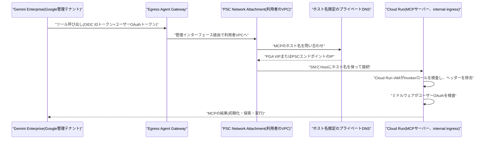

# LLM・AI Agent 最新情報レポート Vol.207
<!-- x-summary: Google Agent Retrieval、PDF・動画の取り込みと引用付き検索をAPI1回で(公開プレビュー) -->

**作成日**: 2026年11月28日(JST)
**対象期間**: 11月27日〜11月28日(Vol.206との差分)。OpenAI・Google・Anthropic・Microsoft の公式フィードに11月27〜28日付の新規記事は無く、静かな日だった。件数は絞り、直近7日の拾い漏れ(11月20〜24日公開分)を一次情報で回収して1件ごとの深さを優先した

## 目次

- [1. Google・Google Cloud の更新](#1-googlegoogle-cloud-の更新)
  - [1.1 Agent Retrieval に Managed ingestion と SearchDocuments(公開プレビュー、11月24日公開の拾い漏れ回収)](#11-agent-retrieval-に-managed-ingestion-と-searchdocuments公開プレビュー11月24日公開の拾い漏れ回収)
  - [1.2 社内向け Cloud Run MCP サーバーを Gemini Enterprise へ閉域でつなぐ構成(11月20日公開の拾い漏れ回収)](#12-社内向け-cloud-run-mcp-サーバーを-gemini-enterprise-へ閉域でつなぐ構成11月20日公開の拾い漏れ回収)
  - [1.3 Gemini Enterprise の独自 UI で必要な 3 層の認証(11月20日公開の拾い漏れ回収)](#13-gemini-enterprise-の独自-ui-で必要な-3-層の認証11月20日公開の拾い漏れ回収)
  - [1.4 Google Cloud リリースノート(11月27日)](#14-google-cloud-リリースノート11月27日)
- [2. Anthropic の更新](#2-anthropic-の更新)
  - [2.1 Claude Platform:Enterprise Frontier Safeguards(ベータ)と Opus 4.5 の廃止日(11月23日、拾い漏れ回収)](#21-claude-platformenterprise-frontier-safeguardsベータと-opus-45-の廃止日11月23日拾い漏れ回収)
- [3. 開発ツール・推論基盤のリリース](#3-開発ツール推論基盤のリリース)
- [4. 脆弱性情報](#4-脆弱性情報)
  - [4.1 AI関連](#41-ai関連)
  - [4.2 実行環境](#42-実行環境)
- [5. その他の観点の確認結果](#5-その他の観点の確認結果)
- [6. 未確認情報](#6-未確認情報)
- [7. 確認ログ](#7-確認ログ)
- [8. 参考リンク](#8-参考リンク)

---

## 1. Google・Google Cloud の更新

### 1.1 Agent Retrieval に Managed ingestion と SearchDocuments(公開プレビュー、11月24日公開の拾い漏れ回収)

Google の Developers Blog は 11月24日、Agent Retrieval(旧 Vector Search 2.0)に「Managed ingestion」と「SearchDocuments」を追加したと公開した(Yingxin Jiang 氏、Kaz Sato 氏)。どちらも公開プレビューで、プレビュー中は us-east4 と europe-west4 のみ。Managed ingestion はプレビュー中は追加料金なしで、課金は GA から始まる。裏で作られる Collection は通常の Agent Retrieval 料金で課金される。API は REST の v1beta(ホストは vectorsearch.googleapis.com)で、Python SDK は予定とされている。[[1]](#ref-1)

仕組みは、Cloud Storage のファイルをデータストアに指定すると、サービスが解析・分割・埋め込み(Gemini Embedding 2)を行い、バックエンドの Collection とスキーマも管理する、というもの。文書は PDF、DOCX、PPTX、XLSX、TXT、動画は MP4、MOV、WebM、MKV などに対応する。文書の分割は既定のチャンク分割(100〜500 トークン、レイアウト解析で表と見出しを検出)とページ分割があり、どちらも `startPage` と `endPage` を記録する。動画はトランスコード後に固定の時間窓(既定 30 秒、`segment_duration` で変更)に切って埋め込み、音声を有効にすると最初の音声トラックをフレームと一緒に埋め込む(文字起こし不要)。検索は `documents:search` の 1 回の呼び出しで、文書ではセマンティック検索と全文検索を融合したハイブリッド検索、任意で Ranking API(`semantic-ranker-fast@latest`)の再ランキングを使う。結果には文書ならファイル URI とページ範囲、動画なら開始・終了の秒数が付く。同じファイルを再インポートすると既存文書を更新し、変更の無いファイルは飛ばされる。[[1]](#ref-1)

数値は著者の検証で、Alphabet の投資家向け PDF 18 件が約 9 分で検索可能になり、動画 19 分(5 本)は検索 1 回あたり 0.3〜0.5 秒だった。動画の取り込みは 2 つのデータストアで 20〜45 分かかった。再ランキングでは、従業員数を問うクエリで上位 5 件が無関係な貸借対照表の 2 ページから、すべて従業員数を含むページに変わった。動画の検索語「cucumbers being sorted by a machine」は 03:20〜03:40 の区間を返し、講演内容の検索は音声を有効にしたデータストアだけが正しい箇所を見つけた。運用上の注意は、再ランキングが VIDEO のデータストアで使えないこと、同一データストアのインポートは同時に 1 つだけにすること、削除時は `force=true` と `backing_collection_deleted=true` を付けないと Collection が残ること(削除に約 20 分)、Agent Retrieval のサービスエージェントに `roles/vectorsearch.serviceAgent` を付与すること。精密な場面特定には 10〜20 秒、テーマ検索には最大 80 秒の窓が向くとされる。検証は著者の自社評価で、第三者の比較は記事に無い。RAG の自前実装(パース、チャンク、埋め込み、インデックス管理)を置き換えられるかを見る材料になるが、リージョンが 2 つに限られ v1beta である点は本番採用の前に確認が要る。[[1]](#ref-1)

---

### 1.2 社内向け Cloud Run MCP サーバーを Gemini Enterprise へ閉域でつなぐ構成(11月20日公開の拾い漏れ回収)

Google Cloud の Forward Deployed Engineer である Neeraj Agrawal 氏が 11月20日に Developers Blog で公開した記事は、内部専用(internal ingress)の Cloud Run にある MCP サーバーを Gemini Enterprise から安全に呼ぶ構成を示す。課題は 3 つ。(1) Gemini Enterprise は Google 管理のテナントプロジェクトで動くため、内部専用にすると公開側からの呼び出しが Google のエッジで HTTP 404 で拒否される。(2) 1 回のツール呼び出しに、ネットワーク層の Cloud Run IAM 検査と、アプリ層のユーザー OAuth 2.0 検査の 2 つが必要になる。(3) 共有 VPC で `*.run.app` のワイルドカード用プライベートゾーンを作ると、同じネットワーク上の他の Cloud Run サービスの名前解決を壊す。記事は GA かプレビューかを明記していない。[[2]](#ref-2)

解決は、ネットワーク 2 段と、ホスト名限定の DNS 1 つ。第 1 の橋は、リージョナルの Egress Agent Gateway(Agent-to-Anywhere モード)から、利用者の VPC のサブネットにある PSC Network Attachment への接続で、パブリック IP も受信ファイアウォールのルールも要らない。第 2 の橋は Cloud Run への経路で、選択肢 A はサブネットの Private Google Access(VIP は 199.36.153.8/30、既定の 0.0.0.0/0 ルートがある標準的な VPC 向け)、選択肢 B は Google API 向けのグローバル PSC エンドポイント(240.0.0.10、all-apis バンドル、インターネットへの既定ルートが無い閉じた VPC 向け)である。DNS は MCP サービスの完全なホスト名だけのプライベートゾーンにし、最長一致で他のサービスに影響しないようにする。ゲートウェイは private な VIP に接続しつつ、TLS の SNI と HTTP の Host ヘッダーにはホスト名を保つ。これを怠ると公開 DNS が公開 IP を返し HTTP 502 になる。[[2]](#ref-2)

認証は 2 つのヘッダーで運ぶ。`X-Serverless-Authorization` には Gemini Enterprise のサービスエージェント向けの Google 署名 OIDC ID トークンが入り、Cloud Run IAM が Invoker ロールで検査してコンテナに渡す前に取り除く。`Authorization: Bearer` にはユーザーの OAuth 2.0 アクセストークンが入り、MCP サーバーのミドルウェアがユーザー単位の権限を検査する。記事のサンプルは `/health` を除外し、OAuth が必須のとき欠落・不正なトークンに 401 を返す。限定事項は記事に明記が無く、選択肢 A は既定のインターネット経路が前提、クォータ・費用・リージョン(例示は us-central1 と europe-west1)の記述も無い。社内 MCP を持つ企業にとっては、公開せずに Gemini Enterprise から使う実装例として使えるが、タグ付きの手順と補助リポジトリ(MagnIeeT/ge-secure-cloud-run-mcp)は著者個人の例である。[[2]](#ref-2)

---

### 1.3 Gemini Enterprise の独自 UI で必要な 3 層の認証(11月20日公開の拾い漏れ回収)

同じく Agrawal 氏の 11月20日の記事は、Gemini Enterprise 標準の Web アプリを使わず、StreamAssist API(`:streamAssist`)を自社の画面から呼ぶ場合に、自前で実装すべき認証を 3 層に分けて整理している。標準アプリは、サインイン、ACL を考慮した検索、コネクタやエージェントのログイン要求を自動で処理するが、独自 UI ではこれがすべて実装側の責任になる。記事は StreamAssist のリファレンスが v1alpha のパスを指しており、GA の記載は無い。[[3]](#ref-3)

第 1 層は StreamAssist への認証で、3 パターンある。1A は Google Identity Services でサインインし Bearer トークンをそのまま送る。1B は Workforce Identity Federation で、Entra ID や Okta のクライアント ID を既存のワークフォースプールの OIDC プロバイダに登録し、Google STS でトークンを交換する。1C は Workload Identity Federation で、バックエンドが IdP から機械用 JWT を取って STS で交換する(鍵をディスクに置かない)が、すべてのリクエストが同一のワークロードに見えるため、個人化しないボットにしか使えない。呼び出し側は Discovery Engine User の IAM ロールが必要で、人間向けの 1A・1B は Gemini Enterprise のユーザーライセンスも要る。第 2 層はフェデレーテッドコネクタで、ユーザーごとのリフレッシュトークンを Gemini Enterprise の管理 Keystore が保持し、バックエンドはサードパーティの資格情報を持たない。同意の画面はポップアップで開き、Google の /oauth-redirect が postMessage で結果を UI に返す(カスタムドメインでは Gemini Enterprise 側でカスタムオリジンのフラグを有効にする必要がある)。[[3]](#ref-3)

第 3 層はカスタム ADK エージェントのツール単位の OAuth で、エージェントの登録時にルートレベルで OAuth を要求する方式は、ログインが済むまで全クエリを止め、標準 UI に依存する。記事はこれを避け、保護するツールを `AuthenticatedFunctionTool` と `GcpAuthProvider` で個別に包む構成を示す。Vertex AI Agent Engine に Agent Identity を有効にしてデプロイし、サードパーティごとに 3LO の Auth Provider を作り、Default Continue URI に `<website-url>/validateUserId` を設定する。流れは、Token Vault にトークンが無ければ認可 URL が UI に返り、同意後に GCP Auth Manager がコードを交換して保留し、バックエンドが Validate User Authorization API を呼んで FinalizeCredentials で Token Vault に確定、クエリを自動で再試行する(以後はポップアップ無し)。留意点は、Agent Identity、GCP Auth Manager、Token Vault が正しく設定されていることが前提である点と、1C のみ個人別の ACL が効かない点である。社内向けに独自のチャット画面を作る案件の設計レビューで、どの層をどこが持つかを決めるチェックリストとして使える。[[3]](#ref-3)

---

### 1.4 Google Cloud リリースノート(11月27日)

Google Cloud のリリースノートでは、11月27日に Managed Service for Apache Spark on GKE v2 のプライベートプレビューが載った。標準の GKE クラスタ上で、フルマネージドの Spark ワークロードをネイティブに動かすもので、利用にはプロジェクトの許可リスト登録が必要(dataproc-previews@google.com に連絡)。記載は 1 件のみで、技術的な詳細はリリースノートに無い。11月28日付の項目は確認時点で無かった。11月26日の Managed Airflow の Agentic upgrade check と Beam Java オペレーターの問題は Vol.206 で扱った。[[4]](#ref-4)

---

## 2. Anthropic の更新

### 2.1 Claude Platform:Enterprise Frontier Safeguards(ベータ)と Opus 4.5 の廃止日(11月23日、拾い漏れ回収)

Claude Platform のリリースノートの 11月23日付に 4 項目があった。(1) Enterprise Frontier Safeguards(ベータ)として、適格な組織が最も高性能なモデルでゼロデータ保持(ZDR)を使えるようにする。安全性のためのデータは暗号化したコピー(Sealed Safety Data)にして、利用者自身のクラウドアカウントのバケットに送る。Anthropic 管理のストレージを使うワークスペースは対象外。11月9日の Claude Fable 5.2 と Mythos 5.2 の発表では、30 日のデータ保持が必須で ZDR では使えない(Anthropic の許可がある場合を除く)とされており、この機能はその制約に対する手当てとして読める(記事間の関係は筆者の推測で、リリースノートに明記は無い)。[[5]](#ref-5)

(2) `claude-opus-4-5-20251101` と `claude-opus-4-5` は 2027年1月22日に Claude API で提供終了となり、Claude Opus 5.5 への移行が案内されている。残りは約 8 週間。(3) Webhooks(ベータ)に、利用者所有のストレージ向けの `external_storage.failed` と `external_storage.recovered` が追加された。(4) Enterprise Analytics API の集計修正で、`List User Activity` の `web_search_count` はすべての検索ツールを含むため増える(11月17日 UTC 以降が対象)。`Get Connector Usage` の個別認証・管理認証のユーザー数は増えるか null でなく数値になる(11月19日 UTC 以降)。プロジェクト別の過少計上の修正は 11月24日に反映される(11月20日 UTC 以降が対象)。いずれも過去分の再集計はない。社内ダッシュボードで利用状況を追っている場合、11月17日前後で数値が不連続になる点に注意が要る。[[5]](#ref-5)

---

## 3. 開発ツール・推論基盤のリリース

Ollama の v0.40.19(11月26日)は、inkling2 モデルの短い履歴の高速化、mlxrunner の履歴圧縮、llama-server の更新が中心で、セキュリティ修正の記載は無かった。v0.40.18(11月24日)は Metal での inkling2 の高速化と llama.cpp の更新(jetpack5 のサポート終了)だった。OpenAI Codex は安定版 0.172.0(11月24日)が最新で、0.174.0-alpha.9 が 11月27日に出たが、ノートの無いプレリリースで内容は不明。Claude Code は v2.1.332(11月25日)が最新のまま、vLLM は v0.34.0(11月16日)が最新、Google ADK は v2.15.1(11月25日)、langchain-core は 1.8.5(11月25日)、OpenAI Agents SDK は v0.26.0(11月24日)で、Vol.206 以降の更新は見つからなかった。[[6]](#ref-6) [[7]](#ref-7) [[8]](#ref-8)

---

## 4. 脆弱性情報

### 4.1 AI関連

| CVE / ID | 対象製品・影響バージョン → 修正 | CVSS | 種類・影響 | 悪用状況 | 推奨対応 |
|---|---|---|---|---|---|
| GHSA-4rj4-rcrq-gr92(CVE 未採番) | npm `safari-mcp` 2.22.15 未満 → 2.22.15 | 6.2(CVSS v4、Moderate) | JavaScript インジェクション(CWE-94・CWE-116)。`safari.js` の 16 か所でツール引数を単一引用符の JS 文字列に入れ、引用符だけをエスケープしてバックスラッシュを先にエスケープしていないため、`\'` で抜け出して引数の残りがページ上の JS として実行される。7 つの引数は、タブ所有権の検査を飛ばす読み取り専用ツールに属し、読み取り専用に制限したクライアントでも、所有していないタブのページ JS を実行できる | 不明(PoC・悪用の記載なし)。2026年10月9日に非公開報告、10月11日に公開 | 2.22.15 以上へ更新。設定での回避策なし(`safari_evaluate` と `safari_run_script` を除外しても注入を防げない) |

safari-mcp は Safari を操作する MCP サーバーで、報告から公開まで 2 日だが、これまでの Vol に載っておらず(GitHub の reviewed 一覧には 11月19日付で出ていた)、拾い漏れとして掲載した。CVSS 7.0 未満だが、AI 関連は基準を設けていないため載せている。ほかに、GitHub Advisory Database の npm・pip の最新一覧(Critical・High)を 11月28日朝に確認し、11月25日以降に公開された新規の AI 関連は見つからなかった(最新は 11月25日の `@waline/client`、11月24日の ruflo、11月24日の soapbar など。いずれも Vol.204〜206 で扱い済み、または AI 関連ではない)。[[9]](#ref-9) [[10]](#ref-10)

### 4.2 実行環境

| CVE / ID | 対象 | CVSS | 種類・影響 | 悪用状況 | 推奨対応 |
|---|---|---|---|---|---|
| — | — | — | 新情報なし | — | — |

CISA の KEV カタログで 11月25〜27日に追加された 13 件(Drupal コア、GeoServer 2 件、Mitel MiCollab 5 件、Danfoss AK-SM 3 件、Xen Orchestra、Juniper Session Smart)は、Vol.204〜206 で扱い済みで、11月28日分の追加は確認時点で無かった。Node.js のセキュリティリリースの最新は 11月11日(v26.13.1、v24.22.3、v22.23.5)で、Python は 10月下旬の臨時リリース(3.15.2、3.14.10 ほか)が最新、次の 3.14.11 は 12月1日の予定と二次情報にある(CVE-2026-119170 は Vol.206 で扱い済み)。Ubuntu のセキュリティ通知の 11月26日分(binutils、libXi、PyJWT、Plexus Utils、alsa-lib、HWE カーネルの USN-9190-2 ほか)は、フィードに重要度が無く、基準を個別に判定できなかった。USN-9190-2(24.04 LTS の HWE カーネル、CVE 141 件)は件数が多いため、Ubuntu 24.04 の HWE カーネルを使う環境は通常の更新を適用するのが無難である。[[11]](#ref-11) [[12]](#ref-12)

---

## 5. その他の観点の確認結果

- **OpenAI**: 公式 RSS の最新は 11月24日(GPT-6 のタンパク質設計、Astra と Codex の系外惑星探索、iFood、Clay など)で、11月25日以降の記事は無かった。Vol.205・206 で扱い済みの内容で、新規は無い。
- **Google / DeepMind**: blog.google の RSS の最新は 11月24日(Golden State のカスタマー事例)、DeepMind の RSS の最新は 11月24日(Mass Spec Skills)で新規モデルの発表は無かった。Developers Blog の新着は 1.1〜1.3 のとおり。
- **Anthropic**: ニュースページの最新は 11月20日の IPO クロージング。11月27日の日付見出しは表示されたが記事は無かった。Claude Platform のリリースノートの最新は 11月23日(2.1)。
- **Azure / Microsoft Foundry**: Foundry ブログの最新は 11月24日の「What's new in Microsoft Foundry | Ignite 2026」(Vol.205 で扱い済み)。Azure Updates のフィードは取得時に項目が表示されず、確認できなかった。
- **AI Agent 搭載の SaaS 製品**: 11月27〜28日に確認できる新規の一次情報は無かった。Salesforce の営業エージェント Hunter が 11月の GA 予定とされるが、GA の確認は取れていない(検索結果の抜粋のみ)。
- **セキュリティインシデント**: LLM・AI Agent に関する新規の実インシデントは確認できなかった(検索で出た最新は 10月の GitLab の修正で、インシデントではない)。
- **フレームワーク**: MCP 仕様の最新リリースは 2026-07-28 で更新なし。LangChain は 11月25日の langchain-core 1.8.5 が最新。

---

## 6. 未確認情報

- 本文に載せなかった話題の記録はない。ただし、Azure Updates のフィード(azure.microsoft.com/updates/feed)は 11月28日の取得で「0 Updates found」と表示され、内容を確認できなかった。次回に再確認する。
- Microsoft Agent Framework のリリースページ(github.com/microsoft/agent-framework/releases)は 404 で、現在の場所を未確認。

---

## 7. 確認ログ

| 情報源 | 試したURL・手段 | 結果 | 確認できた最新の更新日 |
|---|---|---|---|
| OpenAI | openai.com/news/rss.xml | 取得成功 | 11月24日 |
| Google / DeepMind | blog.google/technology/ai/rss/、deepmind.google/blog/rss.xml | 取得成功 | 11月24日(両方) |
| Google Developers Blog | developers.googleblog.com/feeds/posts/default と各記事 | 取得成功 | 11月24日(Agent Retrieval)、フィードのビルドは 11月27日 |
| Google Gemini API の変更履歴 | ai.google.dev/gemini-api/docs/changelog → aistudio.google.com/docs/changelog | リダイレクト先が名前解決できず失敗(許可ドメイン外)。blog.google の RSS と Developers Blog で代替 | 未確認 |
| Google Cloud リリースノート | cloud.google.com/release-notes → docs.cloud.google.com/release-notes | 取得成功(長大で先頭 10 万字のみ) | 11月27日 |
| Vertex AI リリースノートのフィード | cloud.google.com/feeds/vertex-ai-release-notes.xml → docs.cloud.google.com | 取得成功だがフィードは 2026年3月16日で更新停止 | 3月16日 |
| Azure / Foundry | devblogs.microsoft.com/foundry/feed/、azure.microsoft.com/en-us/updates/feed/、MicrosoftDocs/azure-ai-docs の commits | Foundry ブログは取得成功。Azure Updates は項目が 0 件で失敗。GitHub の commits は 404 | 11月24日(Foundry ブログ) |
| Microsoft Learn MCP | 本環境では利用不可 | 試せず | — |
| Anthropic | anthropic.com/news、docs.claude.com → platform.claude.com のリリースノート | 取得成功 | 11月20日(ニュース)、11月23日(リリースノート) |
| Claude Code | github.com/anthropics/claude-code/releases | 取得成功 | v2.1.332(11月25日) |
| Google ADK / LangChain / MCP 仕様 | 各 GitHub のリリースページ | 取得成功 | ADK 11月25日、langchain-core 11月25日、MCP 2026-07-28 |
| OpenAI Codex / Agents SDK | 各 GitHub のリリースページ | 取得成功 | Codex 0.174.0-alpha.9(11月27日)、Agents SDK v0.26.0(11月24日) |
| vLLM / Ollama | 各 GitHub のリリースページ | 取得成功 | vLLM v0.34.0(11月16日)、Ollama v0.40.19(11月26日) |
| Microsoft Agent Framework | github.com/microsoft/agent-framework/releases | 404 | 未確認 |
| CISA KEV | cisa.gov/known-exploited-vulnerabilities-catalog | 取得成功 | 11月27日追加分 |
| GitHub Advisory Database | github.com/advisories(pip・npm の Critical・High、個別 GHSA) | 取得成功(日付フィルタは無効で、新しい順の一覧を利用) | 11月25日 |
| Ubuntu | ubuntu.com/security/notices | 取得成功(先頭 10 件のみ) | 11月26日 |
| oss-security | openwall.com/lists/oss-security | 名前解決できず失敗(許可ドメイン外)。WebSearch の検索結果で代替 | 未確認 |
| Node.js / Python | WebSearch(二次情報) | 公式ページは直接開けていない | Node.js 11月11日、Python 10月下旬 |

---

## 8. 参考リンク

- **[1]** [From Files to Cited Answers in One API Call: Managed Ingestion and SearchDocuments in Agent Retrieval | Google Developers Blog](https://developers.googleblog.com/from-files-to-cited-answers-in-one-api-call-managed-ingestion-and-searchdocuments-in-agent-retrieval/)
- **[2]** [How to securely connect internal Cloud Run MCP servers to Gemini Enterprise | Google Developers Blog](https://developers.googleblog.com/how-to-securely-connect-internal-cloud-run-mcp-servers-to-gemini-enterprise/)
- **[3]** [How to handle user, connector, and agent auth in Gemini Enterprise with a custom UI | Google Developers Blog](https://developers.googleblog.com/how-to-handle-user-connector-and-agent-auth-in-gemini-enterprise-with-a-custom-ui/)
- **[4]** [Google Cloud リリースノート | Google Cloud](https://docs.cloud.google.com/release-notes)
- **[5]** [Claude Platform release notes(2026年11月)| Claude Docs](https://platform.claude.com/docs/en/release-notes/overview)
- **[6]** [Ollama リリース | GitHub](https://github.com/ollama/ollama/releases)
- **[7]** [OpenAI Codex リリース | GitHub](https://github.com/openai/codex/releases)
- **[8]** [vLLM リリース | GitHub](https://github.com/vllm-project/vllm/releases)
- **[9]** [GHSA-4rj4-rcrq-gr92(safari-mcp)| GitHub Advisory Database](https://github.com/advisories/GHSA-4rj4-rcrq-gr92)
- **[10]** [GitHub Advisory Database(npm・Critical)| GitHub](https://github.com/advisories?query=type%3Areviewed+ecosystem%3Anpm+severity%3Acritical)
- **[11]** [CISA Known Exploited Vulnerabilities Catalog | CISA](https://www.cisa.gov/known-exploited-vulnerabilities-catalog)
- **[12]** [Ubuntu Security Notices | Ubuntu](https://ubuntu.com/security/notices)
