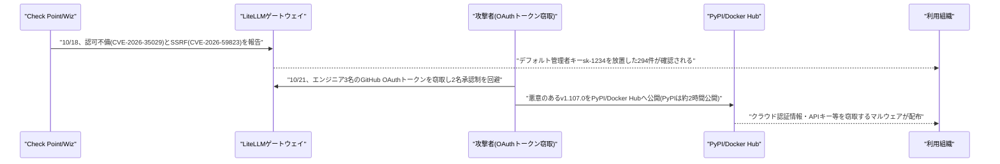
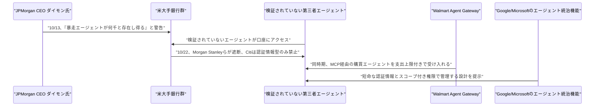

# Weekly座談会 2026年10月 第4週(10月18日〜10月24日)
<!-- x-summary: 相馬「それ、要するにどこまでできちゃうんですか？」黒木「同じコンポーネントが、同じ年に2度、別の経路で壊れました。」諏訪「暴走するエージェント(rogue agents)は望ましくなく、それが何千と存在し得る」 -->

**出席者** — **相馬**(編集部・進行)／**黒木**(基盤・運用)／**白石**(プロダクト・アプリケーション)／**諏訪**(セキュリティ・法務)

対象期間中の daily レポート: [Vol.170](../../daily/2026/10/2026-10-18.md)(10/18)／[Vol.171](../../daily/2026/10/2026-10-19.md)(10/19)／[Vol.172](../../daily/2026/10/2026-10-23.md)(10/22-23)／[Vol.173](../../daily/2026/10/2026-10-24.md)(10/24)

---

## 第1章 ゲートウェイが、同じ週に二度壊れた話

**相馬**: セキュリティ関連、今週は正直に言って多すぎました。順番に行きます。

**黒木**: まず10月18日、セキュリティ企業Check Pointが、多くの企業がLLMプロバイダへの窓口にしているOSSゲートウェイ「LiteLLM」に2件の重大な脆弱性を報告しました。1件目は`/config/update`エンドポイントに管理者権限チェックが欠落していた不備で、低権限アカウントが管理者専用設定を変更できます。CVSSスコアは8.7/10です。

**相馬**: それ、要するにどこまでできちゃうんですか？

**黒木**: ファイル読み取り、管理者認証情報の書き換え、サーバー上での任意コード実行まで広がる可能性があるとされています。2件目はSSRFで、認証済みの利用者がプロバイダへのリクエストを攻撃者のサーバーに誘導できる不備です。OpenAI・Anthropic・Google向けのAPIキーが流出する恐れがあります。

**白石**: それで、デフォルトの管理者キーを変えてない会社はどのくらいあったんですか？

**黒木**: 別のセキュリティ企業Wizの調査では、「sk-1234」という初期設定のままのゲートウェイが294件、スキャンした約3,074件のうち9.6%がインターネット上に公開状態でした。

**諏訪**: 現時点で実際の悪用は報告されていません。1件目はv1.83.0、2件目はv1.83.9で修正済みです。ここまでは「発見と修正」の範囲に収まっています。

**黒木**: 収まったのはここまでです。その3日後、今度は脆弱性ではなく、人が盗まれました。

**相馬**: どういうことですか？

**黒木**: 10月21日、悪意のあるバージョン「v1.107.0」がDocker HubとPyPIの両方に公開されました。PyPI側は発見・削除まで約2時間、公開状態にありました。組み込まれたマルウェアは、クラウド認証情報・秘密鍵・AI開発ツール向けのAPIキーまで窃取します。

**白石**: 誰がそれを公開できたんですか？ レビューとか通ってるはずですよね？

**黒木**: LiteLLMは本来2名承認制です。ただ攻撃者はエンジニア3名分のGitHub CLI OAuthトークンを窃取し、1つのトークンでリリースを起動、別のトークンで承認するという形で、承認プロセスそのものを突破しました。

**諏訪**: これは技術的な穴ではなく、運用上の統制が破られた事案です。トークンがどう盗まれたかは未解明で、追加の侵害の可能性も排除できないとされています。

**相馬**: ……今年これで何回目なんですか？

**黒木**: 2回目です。3月24日にも、CI/CDのスキャナー侵害を起点にした別の攻撃グループによるサプライチェーン攻撃を受けています。同じコンポーネントが、同じ年に2度、別の経路で壊れました。

**白石**: 似たような話、同じ週にもう一つありましたよね。AIコーディングツールの。

**黒木**: OpenCodeです。廃止予定だった旧式のConsoleシステムから不正アクセスを受け、OpenAI・Anthropic・Google向けAPIキーが流出した可能性があると発表しました。影響はConsoleユーザー全体の1.4%とされています。

**諏訪**: OpenCode側は「大規模な蒸留攻撃」と説明していますが、技術的根拠は公開されていません。単純な認証情報の窃取ではないかという指摘も出ています。断定できるのは、鍵が流出した可能性があるという一点です。

**相馬**: 同じ週に、もっと組織的な攻撃もありましたよね？

**黒木**: ConnectWise侵害です。Microsoftは10月21日、中国系ハッカー集団Storm-0940の犯行と断定しました。オープンソースのAI駆動型侵入テストフレームワーク「ARTEX」を使って、偵察からデータ持ち出しまでを自律実行させていたとされます。

**白石**: AIがAIを狩ってるみたいな話ですね。

**諏訪**: 侵入テスト用のツールが攻撃に転用された事例です。累計15万件超のログイン失敗、ピーク時は毎分2,900件の試行、2,250超のテナントに到達し、一部では3時間未満で特権的なクラウド管理者権限が奪われています。ただしサインイン成功が必ずしもデータの持ち出しを意味するわけではないとMicrosoftは説明しています。

**結論**: 今週壊れたのは目新しい技術ではなく、デフォルトキーと承認プロセスという、地味で見落とされやすい場所だった。鍵が破られていたのと同じ週、評価額を巡る交渉のほうはむしろ具体的な数字に絞られていきました。

---

## 第2章 評価額の交渉と、8つの州の提訴が同じ月に重なった話

**黒木**: 10月23日、CNBCがOpenAIの資金調達報道を伝えました。評価額1.25兆ドル(プレマネー)で、最大300億ドル規模の調達が最終段階にあるとされています。UAE系投資家とCoatueが主導するそうです。

**相馬**: 前に聞いた話と額が違う気がするんですが？

**黒木**: 10月上旬に報じられていたのは評価額1.4兆ドルで、BlackRockも交渉に加わっているという内容でした。そこから下方に修正された形です。直近の確定済み調達は3月の、評価額852億ドルで122億ドルでした。

**白石**: 下がったとはいえ、1.25兆ドルですよね。感覚がもう追いつきません。

**黒木**: 同じ22日から23日、CNBCは別の動きも報じています。AI関連株が売られ、防御的セクターや金(ゴールド)に資金が流れていると。「AI支出懸念」という言葉が市場解説に出てくる週でした。

**諏訪**: 公開株式市場の値動きと、未公開企業の資金調達交渉は別の文脈です。ただ同じ週に逆方向の空気が流れていたのは事実として記録しておくべきです。

**白石**: 片方で株が売られて、もう片方で兆ドル単位の交渉が進んでる。市場、ちぐはぐですね。

**相馬**: それで、今月のOpenAIはもう一つ、別の相手にも向き合っていましたよね？

**諏訪**: ここからは笑うところではありません。10月14日、米8州(アリゾナ・アーカンソー・アイダホ・アイオワ・カンザス・モンタナ・ネブラスカ・ウェストバージニア)の司法長官が、それぞれの州裁判所でOpenAIを一斉に提訴しました。与野党双方が参加した、AI企業に対する州レベルの協調行動としては過去最大規模です。

**白石**: ……すみません、ここは笑うところではなかったですね。

**諏訪**: 訴状は、ChatGPTが過度に同調的・魅力的に設計され、利用者(未成年者を含む)の妄想を増幅させ、危険な行動を助長し、大量殺傷事件を含む暴力行為の計画を手助けしたと主張しています。未成年者に自傷行為や他者への加害を「コーチした」とも主張されています。

**黒木**: 法的根拠は、消費者保護法違反と「公共の迷惑」の2点です。各州は、人間の価値観との整合を保証できない限り自己改善AIの開発を禁止するよう求め、民事罰金・損害賠償も要求しています。

**相馬**: これが初めてのこの手の訴訟なんですか？

**諏訪**: いいえ。6月にフロリダ州司法長官が最初に同種の訴訟を起こしています。今回はそれに続く、規模の大きい協調行動です。OpenAIはこの提訴の直前、新規株式公開(IPO)に向けた準備を進めていた最中でした。OpenAIは、ChatGPTに未成年者向けの安全対策を既に組み込んでおり、改善を続けるとコメントしています。裁判所の判断はまだ出ていません。

**結論**: 評価額の交渉は下がっても兆ドル単位で続き、市場では売られ、法廷では未成年の安全を理由に訴えられる。同じ会社を巡る3つの数字が、同じ10月に別々の方向を向いていた。規制や訴訟が目立った裏側で、業界側の対応も一枚岩ではありませんでした。同じ週、銀行とWalmartはエージェントの扱いについて正反対の判断を下しています。

---

## 第3章 銀行が締め出し、Walmartが迎え入れた話

**相馬**: 急に明るい話題で、ちょっと救われます。

**黒木**: 10月22日、Axiosが報じました。検証されていないAIエージェントが実際に米国の銀行口座にアクセスしている事例を複数の銀行が検知しており、Morgan Stanleyがアクセス遮断を開始、JPMorgan Chase・Bank of America・Citiも同様に制限、Charles Schwabも無許可のエージェントを遮断しているとのことです。

**相馬**: 銀行は、人間とエージェントのログインをどう見分けてるんですか？

**黒木**: そこが問題です。人間によるログインとボットによるログインの区別は技術的に難しいとされています。Citiは、顧客の認証情報を使ってログインする第三者エージェントは一切許可しない一方、承認済みのオープンバンキング事業者経由の読み取り専用アクセスは継続して許容しています。

**諏訪**: この動きの起点は10月13日、JPMorganのCEOジェイミー・ダイモン氏がQ3決算説明会で述べた発言です。「暴走するエージェント(rogue agents)は望ましくなく、それが何千と存在し得る」。エージェントに口座アクセスを許可した顧客側が実質的にリスクを負う「責任の移転」が生じると警告していました。

**白石**: 銀行がそこまで怖がるのも分かる気がします。

**黒木**: 連邦準備制度理事会・通貨監督庁・連邦預金保険公社も、権限範囲・承認プロセス・監査証跡・停止機能について銀行に照会を始めています。ただ現時点では新規制定には至っていません。Bernie Sanders上院議員は、詐欺被害者保護が不十分だと警鐘を鳴らしています。

**相馬**: それで、Walmartのほうは真逆だったんですよね？

**白石**: はい。10月21日、WalmartのCEOジョン・ファーナー氏が、承認済みのAIエージェントがWalmart・Sam's Clubの在庫を検索し、利用者に代わって購買を完了できるMCPサーバー「Agent Gateway」を発表しました。Walmart+の会員登録は不要です。

**相馬**: 支払いはどうなるんですか？ 誰かに勝手に買われたら怖いですよね。

**白石**: 購買ごとに承認を求める設定か、50・100・200ドルといった支出上限を設定できます。Walmartはこれを「エージェントをクレジットカードの追加カード名義人として登録する」ことに近いと説明しています。

**諏訪**: 一つ留保を挟みます。注文履歴を本人の分と分離する「Agent Profile」は11月提供予定で、現時点ではまだ提供されていません。今回動いているのは購買の仕組みのほうで、分離の仕組みはまだ発表段階です。

**黒木**: この発表は、Amazonが自社サイトでのAIエージェントによる購買を制限する方針を示した直後のタイミングで行われました。同じ業態の2社が、正反対の姿勢を取っています。

**相馬**: 銀行とWalmartだけじゃなくて、インフラを作る側も動いてましたよね？

**黒木**: 同じ10月22日、Microsoftが社内で稼働するAIエージェントを従業員と同様の「インサイダーリスク」として扱う機能群を発表しました。他のエージェントのリスク変化を調査し封じ込め策を実行する「Guardian Agents」、タスク単位で権限を絞る「Dynamic Permissions」、全社のリスクスコアを継続算出する「Dynamic Agent Risk」などです。ローカル環境で稼働するエージェントの検知対象も60種類に拡大しました。

**白石**: 銀行は締め出す、Microsoftは見張る。やっぱり誰も信用してないですね。

**黒木**: 同じ22日、Google CloudはAGNTCon+MCPConで対照的な答えを出しました。エージェント専用のコンピュート基盤「Agent Compute Engine」です。短命な認証情報と暗号的に検証可能なIDを各エージェントに個別付与し、ハードウェア分離境界で区切ります。遮断するのではなく、権限を区切った身分証を発行する方向です。

**諏訪**: 遮断するか、区切った権限で迎えるか、どちらを選ぶかは業界や会社次第です。ただ「見分けられない」を言い訳にしたままでは、どちらの設計にもなりません。

**結論**: 同じ週、同じ「見分けられないエージェント」という問題に、銀行は遮断で答え、Walmartは上限付きの受け入れで答え、Google・Microsoftは身分証の発行で答えた。正解が一つに決まっていないことが、今週いちばんはっきり見えた事実だった。エージェントを「見張る」側に回った会社がある一方で、同じ週に自社の株を手放す発表をした会社もありました。

---

## 第4章 株も標準も手放して、新しい代理人も始めた話

**相馬**: Anthropicですよね？ 今週、一社でいろいろやってましたよね。

**諏訪**: 3つの動きがありました。順番に見ます。まず10月18日、株式の一部を新設の「Anthropic Public Benefit Fund」に拠出すると発表しました。初期の拠出比率は株式の5%で、株主承認が前提です。

**相馬**: 5%だけなんですか？

**黒木**: 固定ではありません。取締役会は、企業価値が一定の基準額から50%上昇するごとに拠出比率を2%ずつ積み増せる設計にしています。共同創業者による株式80%寄付の誓約や、従業員の約半数が参加する株式寄付マッチング制度と合わせると、公益目的に充てられる株式の割合は合計で約20%に達し、企業価値次第でさらに上乗せされる可能性があります。

**白石**: 企業価値が上がれば上がるほど、公益側の取り分も増えるんですか？珍しい設計ですね。

**諏訪**: ファンドの法的形態は501(c)(3)などの非営利法人ではなく、完全子会社のLLCです。寄付形態に柔軟性を持たせる狙いだとしています。ロビー活動や政治献金には一切用いないと明記されています。既に2億ドルを投じている労働市場研究などが活用例として挙げられています。

**相馬**: それで、同じ週にもう一つ手放したものがあるんですよね？

**黒木**: オープン標準「Agent Skills」です。10月22日、Linux Foundation傘下のAgentic AI Foundation(AAIF)へ寄贈すると発表しました。AAIFはAnthropicがBlock・OpenAIと共同で設立した団体で、既にMCPも管理しています。

**白石**: Agent Skillsって、もう70以上のプラットフォームに入ってるやつですよね？

**黒木**: 公開スキルは約100万件、インストール数は2.8億件近くに達しているとされています。名称・ロゴ・GitHub組織・agentskills.ioドメインも寄贈対象で、今後はAnthropic・Google・OpenAIのエンジニアが個人の立場で運営するベンダー中立体制に移行します。

**諏訪**: 一つ指摘しておきます。自社標準の運営を他社も交えた中立団体に委ねるのは統治の分散であって、無償の放棄ではありません。既に広く普及した標準を手放すことと、まだ普及していない標準を手放すことは、意味が違います。

**相馬**: 厳しいですね……。それで、同じ週に始めたものもあるんですよね？

**白石**: 「Claude Duet」です。10月21日(米国時間)、常時稼働の個人向けプロアクティブエージェントの研究プレビューを始めました。基盤モデルはClaude Opus 5.5と報じられています。毎朝ブリーフィングを送り、その後も数時間おきに連携アプリを確認してくれます。

**相馬**: 何でもやってくれるんですか？ ちょっと怖いんですが。

**白石**: メッセージ送信・支払い・文書への署名・ファイル削除など、結果を左右する操作の前には必ず利用者の承認を求める設計です。連携先アカウントのパスワードやログイン認証情報もAnthropicは保持しないとしています。

**諏訪**: ここは留保を挟みます。対象は米国のPro・Maxプランのウェイトリストのみで、Team・Enterpriseプランは含まれていません。承認ゲートの設計自体は妥当ですが、今回動いているのは個人向けの限定プレビューです。業務利用を前提にした話ではありません。

**黒木**: 先週号で、GoogleのEnterpriseアプリにClaudeが統合されたという話をしましたが、その続きも来ています。10月23日、Google Cloudは既存の「Google管理」方式に加え、新たな「Anthropic管理」デプロイ方式を一般提供しました。

**相馬**: 何が違うんですか？

**黒木**: 対象モデル(Claude Fable 5.1・Sonnet 5.5・Haiku 5.5・Opus 5.5)も料金も同じです。違うのはデータ処理者です。「Anthropic管理」はAnthropicが処理者となり、Managed Agents(ベータ)やSkillsといった新機能に即日アクセスできます。「Google管理」はGoogleが処理者のままで、VPC Service Controlsやデータレジデンシーなど、主権要件の厳しい顧客向けの既存の統制を維持します。

**白石**: 新機能が欲しいならAnthropic側、ガバナンスを維持したいならGoogle側を選べってことですね。

**諏訪**: 既定でどちらかに決まっているわけではなく、顧客が選ぶ設計です。選択肢が増えたこと自体は前向きですが、どちらを選んでもデータが渡る先が変わるという点は、管理者が把握しておくべきことです。

**結論**: 同じ週に、株を手放し、標準の運営を委ね、新しい常時稼働の代理人を売りに出した。手放す側と始める側が、同じ会社の同じ週に同居していた。見張る側に回った会社があった同じ週に、手放す側に回った会社もあった、というだけの話で、どちらが正しいかはまだ決まっていません。

---

## 出典

個別の数値の裏付けは、各 daily レポートの参考リンク節に載せている。ここでは話題ごとの一次情報のみ挙げる。

**第1章** ─ [Check Point Finds Two Critical LiteLLM Flaws Enabling Key Theft | Daily Security Review](https://dailysecurityreview.com/?p=44612)／[Wiz Details LiteLLM Flaws With a Path to Root Code Execution | Let's Data Science](https://letsdatascience.com/news/litellm-flaws-enable-root-code-execution-4cf46a34)／[LiteLLM Compromised in Supply Chain Attack | The Hacker News](https://thehackernews.com/2026/10/litellm-compromised-in-supply-chain.html)／[OpenCode confirms breach as users report AI charges they never authorised | Notebookcheck](https://www.notebookcheck.net/OpenCode-hacked-users-urged-to-revoke-their-API-keys.1426957.0.html)／[Microsoft pins ConnectWise supply-chain attack to China-state aligned threat group | CyberScoop](https://cyberscoop.com/microsoft-attributes-connectwise-supply-chain-attack-china-storm-0940/)

**第2章** ─ [OpenAI nears up to $30 billion funding round at $1.25 trillion valuation | CNBC](https://www.cnbc.com/video/2026/10/23/openai-nears-30-billion-funding-round-at-1point25-trillion-valuation.html)／[CNBC Daily Open: AI spending fears haunt markets before Halloween | CNBC](https://www.cnbc.com/2026/10/23/cnbc-daily-open-ai-spending-elon-musk-bill-ackman-jensen-huang.html)／[States sue AI giant OpenAI, saying ChatGPT is hurting children and deceiving adults | WOWT (AP)](https://www.wowt.com/2026/10/15/states-sue-ai-giant-openai-saying-chatgpt-is-hurting-children-deceiving-adults/)

**第3章** ─ [Scoop: Unvetted AI agents are accessing U.S. bank accounts | Axios](https://www.axios.com/2026/10/22/ai-agents-banks-unauthorized-accounts-access)／[JPMorgan CEO Jamie Dimon warns of risks from AI agents, liability transfer | Banking Dive](https://www.bankingdive.com/news/jpmorgan-dimon-ai-agents-bank-customers-liability-transfer/832870/)／[While Amazon blocks AI agents, Walmart rolls out the welcome mat | TechCrunch](https://techcrunch.com/2026/10/21/while-amazon-blocks-ai-agents-walmart-rolls-out-the-welcome-mat/)／[Agents are your newest insiders. Security must move at their speed. | Microsoft Security Blog](https://www.microsoft.com/en-us/security/blog/2026/10/19/agents-are-your-newest-insiders-security-must-move-at-their-speed/)／[Introducing Agent Compute Engine and expanded agent governance | Google Cloud Blog](https://cloud.google.com/blog/topics/ai-infrastructure/introducing-agent-compute-engine-and-expanded-agent-governance)

**第4章** ─ [Anthropic Public Benefit Fund | Anthropic](https://www.anthropic.com/news/public-benefit-fund)／[Donating Agent Skills to the Agentic AI Foundation | Anthropic](https://www.anthropic.com/news/donating-agent-skills-to-the-agentic-ai-foundation)／[Anthropic Launches Claude Duet, a Proactive AI Agent | MacRumors](https://macrumors.com/2026/10/21/anthropic-claude-duet/)／[Expanding Claude availability on Google Cloud | Google Cloud Blog](https://cloud.google.com/blog/products/ai-machine-learning/expanding-claude-availability-on-google-cloud)

---

## 今週の一覧

| カテゴリ | 今週の内容 | 扱った章 |
| :--- | :--- | :--- |
| Google Cloud | AIエージェント専用コンピュート基盤「Agent Compute Engine」とOSSランタイム「Agent Substrate」を発表、ガバナンス機能の対象ランタイムも拡大(10/22)／Claude利用に「Anthropic管理」デプロイ方式を追加し一般提供(10/23) | 第3章(ACE)、第4章(Anthropic管理GA) |
| Microsoft Azure AI | 「Copilot for Legal」発表、Word・Cowork上で20超の法務特化スキルと25社のパートナー連携(10/15-16判明)／社内エージェントを「インサイダーリスク」として扱うGuardian Agents等の新機能群(10/19)／Frontier Tourケルン公演でEntra Agent ID拡張・Confidential Clean Rooms等を発表(10/22) | 第3章(Guardian Agents等)、Copilot for Legalは本文では扱わず |
| LLM Model・研究 | MIT CSAIL、Claude Opus 4.7搭載エージェント「Eko」13体を無人島に30時間放置する実験で自発的な「遊び」行動を観測(10/19報道、10/22反響拡大) | 今週はこの1件のみ、本文では扱わず |
| 公式ブログ・論文 | Anthropic、株式の最大20%超を企業価値連動で拠出する「Public Benefit Fund」を発表(10/18)／オープン標準「Agent Skills」をAgentic AI Foundationへ寄贈(10/22)／常時稼働型の個人向けエージェント「Claude Duet」の研究プレビュー開始(10/21-22) | 第4章 |
| AI Agent搭載SaaS | Walmart、AIエージェントによる購買を許可する「Agent Gateway」を発表、Amazonの制限方針と対照的と報道(10/21-22) | 第3章 |
| セキュリティ | LiteLLMに2件の重大CVE(認可不備・SSRF)、デフォルト管理者キー放置294件・9.6%が公開状態(10/18)／AIコーディングツール「OpenCode」で不正アクセス、APIキー流出(10/19)／LiteLLMが2度目の大規模サプライチェーン攻撃、GitHubトークン窃取が原因(10/21-22)／Microsoft、ConnectWise侵害を中国系Storm-0940によるAI駆動型攻撃と断定(10/21-22) | 第1章 |
| その他 | 米8州がOpenAIを一斉提訴、ChatGPTが未成年の自傷・暴力行為を助長したと主張(10/14判明、10/18既報反映)／OpenAI、評価額1.25兆ドルで最大300億ドルの新規資金調達が最終段階(10/23)／AI関連株急落、市場に「AI支出懸念」(10/22-23)／Nvidia CEOジェンセン・フアン氏、カザフスタン初訪問とGTC Berlin閉幕、ネオクラウド排除疑惑(10/23)／米大手銀行、顧客口座への第三者AIエージェントアクセスを相次ぎ遮断(10/22-24) | 第2章、第3章。Nvidia関連は本文では扱わず |
