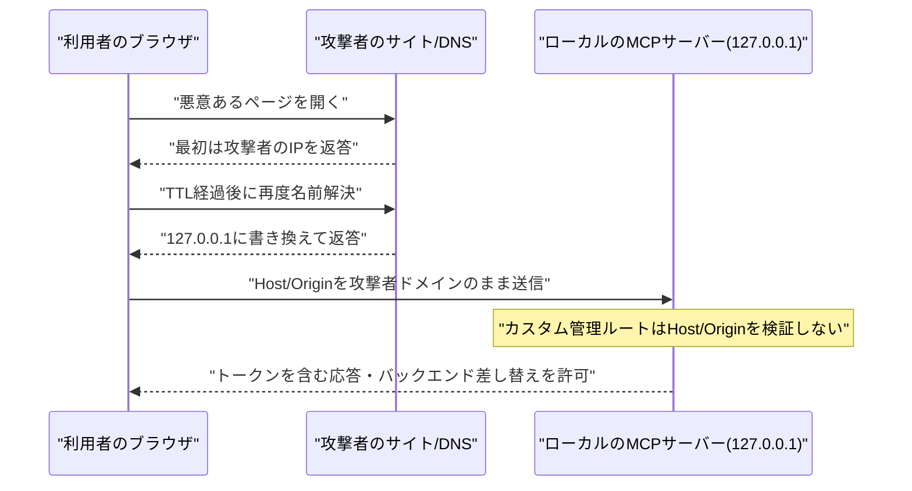

# Weekly座談会 2026年11月 第3週(11月15日〜11月21日)
<!-- x-summary: 相馬「それ、良いことなんですか？」黒木「普通に使っている状態こそが前提条件です」諏訪「仕組みを入れただけでは、まだ門は閉まりません。」 -->

**出席者** — **相馬**(編集部・進行)／**黒木**(基盤・運用)／**白石**(プロダクト・アプリケーション)／**諏訪**(セキュリティ・法務)

対象期間中の daily レポート: [Vol.194](../../daily/2026/11/2026-11-15.md)(11/15)／[Vol.195](../../daily/2026/11/2026-11-16.md)(11/16)／[Vol.196](../../daily/2026/11/2026-11-17.md)(11/17)／[Vol.197](../../daily/2026/11/2026-11-18.md)(11/18)／[Vol.198](../../daily/2026/11/2026-11-19.md)(11/19)／[Vol.199](../../daily/2026/11/2026-11-20.md)(11/20)／[Vol.200](../../daily/2026/11/2026-11-21.md)(11/21)

---

## 第1章 確定しなかった数字が、全部確定した話

**相馬**: 先週の座談会、最後に「評価額も性能も、まだ確定じゃない」で締めましたよね？今週、確定したんですか？

**黒木**: 前回話したあれ、続きが来ました。11月18日、Anthropicは新規株式公開の公募価格を1株83ドルに決定しました。先週時点の想定レンジは70〜78ドルだったので、上限より上です。

**白石**: レンジの上に出たんですか。強気ですね。

**黒木**: 公募価格決定時の発表では、募集・売出しの総数は9億8,000万株、Anthropic自身が売る分が9億5,635万1,354株、既存株主の売り出しが2,364万8,646株でした。上場先はNasdaq Global Select Market、ティッカーは「ANT」、取引開始は11月19日です。

**相馬**: ……で、結局いくらになったんですか？

**黒木**: 11月20日にクロージングの発表が出ています。引受人の追加購入オプション1億4,700万株がすべて行使され、最終的な売出株数は11億2,700万株。Anthropic分が11億335万1,354株、売出株主分が2,364万8,646株です。IPOだけで総額約935億ドル、Anthropicの手取りは引受手数料前で約916億ドルです。

**白石**: 935億ドルって、もう額として掴めないんですけど。

**黒木**: 四捨五入の単位が、たいていの会社の生涯売上より大きいです。しかもこれはIPO単体の額で、同時にプライベートプレースメントも実施しています。

**相馬**: プライベートプレースメントって、IPOと別物なんですか？

**諏訪**: 別物です。IPOは取引所での公開売却、プライベートプレースメントは特定の相手に直接株を売る非公開の取引で、1933年証券法の登録対象外になります。

**黒木**: 今回はクラスN株3億1,325万3,007株を、同じ1株83ドルでAMD、Broadcom、Google、Micron、Microsoft、NVIDIA、TSMC Partnersの7社に売却しました。総額は約260億ドルです。

**白石**: その7社の名前、そのままAnthropicの調達先じゃないですか……。

**諏訪**: その通りです。GPU、ネットワーク機器、メモリ、ファウンドリ、クラウドの主要サプライヤーが、同じタイミングで株主になりました。

**黒木**: 依存先が調達契約から資本関係に移っただけ、という見方もできます。供給を切られるリスクと、株主を失望させるリスクが、同じ相手との関係の中で重なったということです。

**相馬**: それ、良いことなんですか？

**諏訪**: 一概には言えません。資金的な結びつきが強まれば、価格交渉で「他をあたります」と言いづらくなる面はあります。発表自体は資金の使途を書いていないので、評価は今回の情報だけでは完結しません。

**白石**: IPOとプレースメント、合わせるとどれくらいなんですか？

**黒木**: 控除前で合計約1,195億ドルです。主幹事はGoldman SachsとMorgan Stanley、SECの登録届出書が効力発生したのは11月18日です。

**相馬**: 先週「まだ確定じゃない」で終わった話が、今週は全部確定したわけですね。

**黒木**: 数字は確定しました。ただエンジニアの実務に直結する話かと言うと、今回確認できた範囲にはありません。価格・提供条件・データの扱いが変わったという情報はないです。

**諏訪**: 上場企業になったことで変わるのはむしろガバナンスです。四半期決算、重要契約の開示、リスク要因の公表が定期的に出るようになります。ベンダー評価の材料は増えます。

**相馬**: じゃあ今回は、お金の話はこれで一区切りですね。

**黒木**: 一区切りです。ただ同じ週、Anthropicは別の発表も出しています。「AIが強くなった」という話を自分から公式に出したのは、これだけじゃないんです。

**結論**: 公募価格の決定から最終クロージングまで、先週「まだ確定ではない」としていた数字がすべて確定した。確定したのは株価と株主構成であって、Claudeの使い勝手や価格ではない。GPU・メモリ・ファウンドリの主要サプライヤーが同時に株主になった事実は、調達リスクの分散とも、依存の形を変えただけとも読める。どちらに転ぶかは、今回の発表だけでは判断できない。

---

## 第2章 見つける力は上がったが、直す力は追いついていない話

**相馬**: 黒木さん、さっき「AIが強くなったという発表はこれだけじゃない」って言ってましたけど、どういうことですか？

**諏訪**: 11月16日、Anthropicは研究ページで協調的脆弱性開示(CVD)ポリシーの期限短縮を発表しました。深刻度がHigh / Criticalの案件の開示期限が、90日から30日に短縮されます。

**白石**: 90日が30日って、3分の1じゃないですか。急すぎません？

**諏訪**: 理由も明記されています。AIモデルが脆弱性を見つける力を急速に高めていて、「修正は人間の速度で進む」「同じバグを別の人が独立に見つける可能性は低い」という従来の前提が、両方とも成り立たなくなったというものです。

**黒木**: 見つける速度が上がった分、直す側の猶予を削った、ということです。見つける方が忙しくなったのはAIで、直す方が忙しくなったのは人間のメンテナです。

**相馬**: それ、ちょっと不公平な感じもしますが……。

**黒木**: 不公平というより、しわ寄せです。重要インフラなど30〜45日で配備できないソフトウェアは個別に期限を合意するとありますが、相談に乗る程度の配慮にとどまります。

**諏訪**: 一方で配慮もあります。悪用が確認済みの脆弱性は従来どおり7日で変わりません。報告にパッチ案を添える、OSS Scannerの提供、Claude for Open Source Programでメンテナに半年分のClaude Ultraを無償提供する、といった施策も併記されています。

**白石**: パッチまで用意してくれるなら、まだ良心的な気もしますけど。

**黒木**: 良心的かどうかは、実際のパッチの質と量次第です。適用は2027年1月1日以降に報告する案件からで、進行中の案件は旧ルールのままです。

**相馬**: ちなみにこの週、もう一つ「AIの強さ」の話があったんですよね？

**黒木**: はい。11月17日、Anthropicは、Claudeのエージェント群が量子重力とブラックホール物理の未解決問題2件を解いたという記事と、プレプリント2本を公開しています。

**白石**: ブラックホール？Claudeが物理の未解決問題を解いたんですか？

**黒木**: 研究者が8月に副業で始めたプロジェクトです。Claudeに未解決問題の一覧を出させたら22件の候補が返ってきて、候補ごとに別のエージェントを約6週間、バックグラウンドで走らせました。

**相馬**: 6週間もバックグラウンドで動かしっぱなしって、結構な規模ですね……。

**黒木**: 一つは、ホーキング=ページ転移が弱結合でも急激に起きるかという、1983年から未解決だった問題です。N=4超対称ヤン=ミルズ理論で急激であると結論しました。もう一つは3次元重力の最軽量ブラックホール質量の上限で、Hellermanの2009年の評価c/6を、Λ≈9.1266という厳密な値まで絞り込んでいます。

**白石**: すごい話じゃないですか。賢くなってるってことですよね。

**諏訪**: ここは留保を付けておきます。結果はAnthropicの自己発表で、物理コミュニティによる査読はこれからです。ブートストラップ側の手法はブラックホールのスピンを無視していて、正しい3次元量子重力理論を特定するものでもない、と記事自身が書いています。

**黒木**: 以前のClaudeは同じ問題に61回並列で試行して失敗していたとも書かれています。今回は別の2エージェントが独立に同じ答えに到達した、という再現性の作り方は参考になりますが、査読前の結果だという一点は押さえておくべきです。

**相馬**: 見つける力も証明する力も上がった、という発表が同じ週に並んだわけですね。

**黒木**: ただ、見つける力が上がったことを理由に開示期限を削った同じ週に、MCPサーバーの新規脆弱性がいくつも出てきています。見つけているのはAIというより、普通のセキュリティ研究者です。

**結論**: 見つける速度が上がったという説明で開示期限を30日に縮めた同じ週に、Anthropicは別のエージェント群が物理の未解決問題を解いたと発表した。どちらも「AIの能力が上がった」という同じ主張の裏表だが、実際に今週MCPサーバーの脆弱性を見つけたのは、AIではなく従来型の脆弱性診断だった。

---

## 第3章 ブラウザがログインできてしまった一週間

**相馬**: セキュリティ関連、今週も正直多すぎました。順番にいきます。

**黒木**: 共通点を先に言っておきます。今週立て続けに出てきたのは、ローカルで動くMCPサーバーが、ブラウザからのリクエストを検証していなかったという話です。同じ型の不備が3つの別製品から出ています。

**白石**: 3つも同じ型のバグがあったんですか？

**黒木**: Todoist公式のMCPサーバー、Obsidianの同期用MCPサーバー、Jupyterノートブックを操作するMCPサーバーです。いずれもHTTPモードで動かした場合に、カスタムの管理ルートがHost / Originヘッダーを検証していませんでした。

**相馬**: Host / Originの検証って、何をチェックするものなんですか？

**諏訪**: ブラウザは通常、別サイトのローカルサーバーに任意のリクエストを送れないよう制限されています。ところがDNSリバインディングという手口を使うと、攻撃者のサイトを開いただけで、裏でDNSの応答を書き換え、ブラウザに127.0.0.1宛のリクエストを送らせることができます。Host / Originを見ていないサーバーは、それを正規の呼び出しと区別できません。

**白石**: でも、それって悪意あるページを開かないと成立しないですよね？普通に使ってたら大丈夫なんじゃ……。

**黒木**: 普通に使っている状態こそが前提条件です。開発者がHTTPモードのMCPサーバーをローカルで立てたまま、別のタブで何かのページを開く。それだけで条件は揃います。タブを開く行為は、日常的すぎて「普通に使っている」の範囲に入ります。

**諏訪**: Todoistの件(CVSS 9.3)では、サーバー自身が持つTodoistトークンでタスクの作成・削除・改変ができました。JupyterのMCPサーバーの件(CVSS v4 9.3)では、バックエンドURLを攻撃者側に差し替えられ、Jupyterのトークンがそのまま漏れます。

**白石**: 図で見ると分かりやすいですね……。改めて見るとこれ結構やばいやつですね。

**黒木**: 対応はいずれも、更新に加えて「HTTPモードを使わない」「127.0.0.1に束縛してトークンを必須にする」の2択です。stdioモードは対象外です。

**相馬**: 他にも脆弱性、ありましたよね？

**黒木**: Kubernetesのトラフィック可視化ツール、Kubesharkです。MCPツールの引数を区切り文字なしで渡していたため、`--set=`で始まる値を仕込むとHelmのフラグとして解釈され、worker・hub・frontのイメージを攻撃者のレジストリに差し替えられます。特権付きのDaemonSetなので、cluster-adminのkubeconfigまで奪われます。

**白石**: 引数とフラグの区別がついていなかったってことですか？

**黒木**: そうです。CVSSは7.2に抑えられていますが、これは`--allow-destructive`付きで起動していることが前提になっているためです。そのオプションを付けて、信頼できない入力を読むエージェントに繋いだ構成では、プロンプトインジェクションからクラスタ全体の侵害につながります。

**諏訪**: もう一つ、コンテナビルドツールのkanikoです。Azure Container Registry用の認証情報ヘルパーが、ホスト名の末尾を固定しない正規表現を使っていました。`x.azurecr.io.attacker.com`のようなDockerfileの`FROM`行だけで、ビルド環境のAzureトークンが攻撃者のサーバーに送られます。

**白石**: `RUN`も`push`も要らないんですか？ビルドするだけで？

**諏訪**: ビルドするだけです。CVSSは9.3。AKSなどで信頼できないDockerfileをビルドしている組織では優先度が高いとされています。

**黒木**: LLMの可観測性ツール、Arize Phoenixでは、GraphQLのテンプレート処理がユーザー指定の文字列をそのままf-string形式のフォーマッタに渡していて、サーバーの環境変数まで読めました。CVSSは10.0です。

**相馬**: 10.0って、上限ですよね？

**黒木**: 上限です。漏れる値の中に`PHOENIX_SECRET`が含まれていて、これが漏れると管理者権限のJWTを偽造でき、保存済みのLLM APIキーやOAuthトークンを守る鍵まで導出できます。読み取り専用に見える脆弱性が、実際は認証突破と資格情報の復号に直結します。

**白石**: 今週だけでCVSS9点台、何件も出てましたよね……。Claude Code自身の方は大丈夫だったんですか？

**黒木**: Claude Codeは逆方向に動いています。11月16日のv2.1.326から11月20日のv2.1.330まで、ほぼ1日おきに権限とサンドボックスの厳格化が入りました。`rm`コマンドの承認要件が増え、承認者がいない環境では拒否、一部のホームディレクトリへの書き込みも既定で止まるようになりました。

**諏訪**: 同じ週、一方では自社の権限チェックを厳しくし、もう一方では外部のMCPサーバーが基本的な検証を飛ばしている。同じ技術領域で、方向がまったく逆の一週間でした。

**相馬**: 結局、全部「確認を飛ばしていた」という話に戻ってくるんですね。

**黒木**: その確認の中身を、今週は誰も自動でレビューしていません。たまたま同じ週に、AIにコードをレビューさせる仕組みの話も出ていたんですが。

**結論**: 今週見つかった脆弱性の多くは、ローカルで動くMCPサーバーがブラウザからのリクエストを検証していなかったという、同じ型の不備だった。悪意あるページを一つ開くだけで成立する条件は、「普通に使っている」の範囲からそう遠くない。Claude Code自身が同じ週に権限チェックを厳しくしていた事実と比べると、業界全体でこの基本動作が揃っていないことが見える。

---

## 第4章 レビューする側に回った数字と、その横ですり抜けた話

**相馬**: 最後に、AIにコードをレビューさせる話、今週2つ出てましたよね？

**黒木**: 1つはGoogle Cloudが11月11日に公開した記事で、自律的なコードセキュリティエージェントCodeMenderをGitHubのPull Requestに組み込む参照実装です。

**白石**: PR上で動くんですか？便利そうですね。

**黒木**: PRのタイムライン上で完結します。`cm find`が検出結果を投稿し、確信度100%未満の指摘は`/verify`でサンドボックス内でエクスプロイトを実際に構築・実行して検証、`/fix`でパッチのドラフトPRを作り、`/approve`でコミットステータスをgreenにします。

**諏訪**: ここで一点、見落とされがちな注記があります。このステータスは、ブランチ保護で必須にしない限り、助言にとどまるとGoogle Cloud自身が書いています。

**白石**: ……ゲートって言っても、閾値を決めてないと素通りするってことですか？

**諏訪**: そうです。仕組みを入れただけでは、まだ門は閉まりません。

**黒木**: もう1つは、Googleが11月19〜20日に公開した「Sashiko」の運用実績です。Geminiを使ったLinuxカーネル向けのエージェント型コードレビューで、2026年前半にLinux Foundationへ寄贈されています。

**相馬**: カーネルのレビューを、AIがやってるんですか？

**黒木**: パッチ周辺のコードとサブシステムのガイドから計画を立て、最大7本のセッションを並列で走らせます。各セッションがコミットの意図、制御フロー、ロック、セキュリティなど観点ごとに専念し、根拠のない除外は主検証役の審査に回されます。

**白石**: 数字、気になります。

**黒木**: 7か月の運用で1日約1,200件、2026年3月以降の累計は24万1,000件です。70超のメーリングリストが参加し、1,500人超のカーネル開発者が返信しています。

**相馬**: 1,200件って、1日にそんなに出るものなんですか？

**黒木**: Linuxカーネルは年間8万5,000件超の変更があるので、1日あたりでは230件程度の計算になります。少数のメンテナーが手作業で見ている状況が、そもそもの課題だったという前提です。

**白石**: 効果はどのくらい出たんですか？

**黒木**: 60日以内の事後修正率が、過去の基準(Linux 6.2〜6.19)の3.4%からLinux 7.2では2.2%に下がっています。相対で35%の低下です。

**諏訪**: ただし著者ら自身が、他の要因の寄与もあり得ると断っています。数字は運営元の集計で、第三者の検証はまだありません。

**白石**: それでも、重大な警告を無視して統合したパッチの事後修正率が7.6%で、問題なしだったパッチは0.9%って、8倍くらい違うじゃないですか。

**黒木**: 約8倍、パッチの大きさを補正すると6.3倍です。人間が見逃したバグだけを集めたベンチマークでも、Gemini 4 Carbonを使ったSashikoが75.8%を検出したとされています。

**諏訪**: 数字自体は説得力がありますが、繰り返しになりますが自己申告である点は変わりません。

**相馬**: じゃあ、今週出てきたMCPサーバーの脆弱性、こういうレビューエージェントに見てもらえば防げたんですか？

**黒木**: そこが今週のねじれです。Todoist、Obsidian、Jupyter、Kubeshark、kanikoのいずれも、こうしたレビュー体制を通っていたという記載はありません。レビューする側の能力を誇示する発表と、レビューされないまま出荷された脆弱性が、同じ週の同じレポートに並んでいます。

**白石**: レビューする仕組みの話と、レビューされなかった実例が、同じ週に出るとは思いませんでした……。

**諏訪**: Sashikoの対象もCodeMenderの対象も、それぞれカーネルとGitHub PRという限られた範囲です。今週見つかったMCPサーバーのような、小規模な外部プロジェクトまでは届いていません。

**結論**: AIがコードをレビューする仕組みは、Linuxカーネルという巨大プロジェクトでは数字を出し始めている。ただしその範囲は今のところ限られていて、今週見つかったMCPサーバーの基本的な検証漏れは、こうした仕組みの外で起きている。レビューする側の能力が上がっても、レビューされる範囲が追いつくまでには時間差がある。

---

## 出典

個別の数値の裏付けは、各 daily レポートの参考リンク節に載せている。ここでは話題ごとの一次情報のみ挙げる。

**第1章** ─ [Anthropic prices initial public offering | Anthropic](https://www.anthropic.com/news/anthropic-prices-initial-public-offering)／[Anthropic announces closing of initial public offering … and closing of concurrent private placement | Anthropic](https://www.anthropic.com/news/ipo-close)

**第2章** ─ [Updating our coordinated vulnerability disclosure policy timelines | Anthropic](https://www.anthropic.com/research/coordinated-vulnerability-disclosure-timelines)／[Claude solves two open problems in the physics of black holes | Anthropic](https://www.anthropic.com/research/claude-black-hole-physics)

**第3章** ─ [GHSA-833v-v58w-294h: Todoist MCP DNS rebinding (CVE-2026-76807) | GitHub Advisory Database](https://github.com/advisories/GHSA-833v-v58w-294h)／[GHSA-9x8x-crjq-g64h: jupyter-mcp-server DNS rebinding (CVE-2026-77359) | GitHub Advisory Database](https://github.com/advisories/GHSA-9x8x-crjq-g64h)／[GHSA-8vf2-hxg5-crqh: Kubeshark MCP argument injection (CVE-2026-129236) | GitHub Advisory Database](https://github.com/advisories/GHSA-8vf2-hxg5-crqh)／[GHSA-5q7h-w9jf-cx97: kaniko Azure token exposure (CVE-2026-105769) | GitHub Advisory Database](https://github.com/advisories/GHSA-5q7h-w9jf-cx97)／[GHSA-gfv3-m769-5xm3: Phoenix format string injection (CVE-2026-53998) | GitHub Advisory Database](https://github.com/advisories/GHSA-gfv3-m769-5xm3)

**第4章** ─ [Don't just flag it, fix it: How to run CodeMender in your pull requests | Google Cloud Blog](https://cloud.google.com/blog/products/identity-security/how-to-run-codemender-in-your-pull-requests)／[Sashiko: Lessons from building an agentic code review system for Linux | Google Cloud Blog](https://cloud.google.com/blog/products/application-development/lessons-from-building-sashiko-an-agentic-code-review-system)

---

## 今週の一覧

| カテゴリ | 今週の内容 | 扱った章 |
| :--- | :--- | :--- |
| Google Cloud | CodeMenderのPull Request組み込み参照実装(11/11公開、拾い漏れ回収)／Sashikoの7か月運用実績(11/19〜20)／Cloud Storage「object enrichments」プレビュー(11/20)／BigQuery・LookerのAIエージェント観測・評価機能(11/14公開、拾い漏れ回収) | 第4章(CodeMender・Sashiko) |
| Microsoft Azure AI | learn.microsoft.com・azure.microsoft.comが接続不可で未確認。Microsoft Ignite(11/17〜20開催)でのFoundry関連発表は報道の見出しのみで一次情報未確認 | 本文では扱わず |
| LLM Model・研究 | GPT-6.2 Astra / Solへの対応がLangChainのリリースノートに記載(11/18〜19)されたが、OpenAI公式の発表は未確認 | 本文では扱わず |
| 公式ブログ・論文 | Anthropic、脆弱性の協調開示(CVD)ポリシーの期限短縮を発表(11/16)／Anthropic、Claudeのエージェント群によるブラックホール物理の未解決問題2件の解決を発表(11/17) | 第2章 |
| AI Agent搭載SaaS | 今週は確認できた新規発表なし | 本文では扱わず |
| セキュリティ | Todoist MCP・obsidian-sync-mcp・jupyter-mcp-serverのDNSリバインディング(CVSS 9.3/8.8/9.3)／KubesharkのMCP引数インジェクション(CVSS 7.2)／kanikoのAzureトークン流出(CVSS 9.3)／Arize Phoenixの書式文字列インジェクション(CVSS 10.0)／Microsoft Aspire Dashboardの認可欠如(CVSS 9.1)とCLIの一時ディレクトリ不備(CVSS 7.3)／Rails Active Storageの任意ファイル読み書き(CVSS 9.8)／LXDの制限プロジェクト回避(CVSS 9.9)／aiohttpのDoS系9件(修正版3.14.4)／Git LFSの3件(CVSS 8.6/8.6/7.6)／Ubuntu needrestartの権限昇格(USN-9151-1)ほか多数 | 第3章(一部) |
| その他 | Claude Code v2.1.326〜v2.1.330の連続リリース(権限・サンドボックス厳格化、Auto mode対象拡大、easel追加)／OpenAI Agents SDKがv0.24.0-alpha.8→v0.25.0→v1.0.0-alpha.1と短期間で複数回の破壊的変更／LangChain・LlamaIndexがPython 3.10サポートを相次いで終了／Google ADK v2.14.1→v2.15.0(Visual Agent Builder削除)／vLLM v0.34.0(Model Runner V2への一本化) | 第3章で一部言及 |
